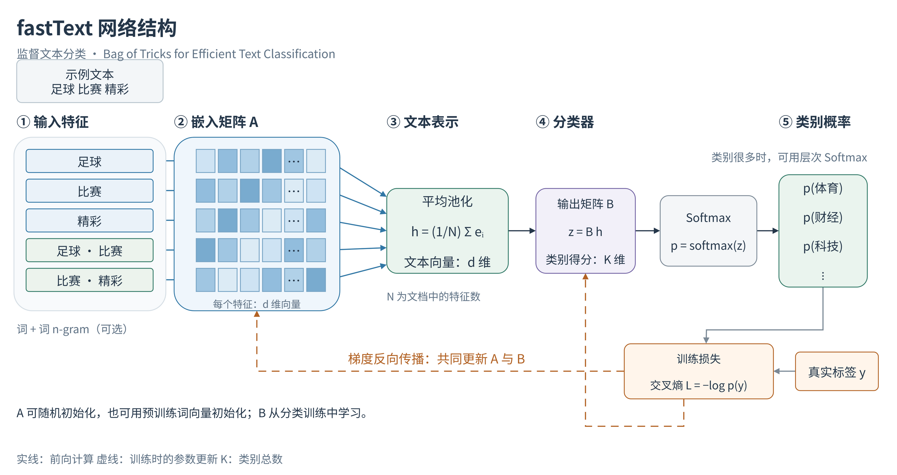

# fastText 网络结构图

这张图表示《Bag of Tricks for Efficient Text Classification》中的监督文本分类模型。输入包含词特征，也可加入词 n-gram；特征查找嵌入矩阵 A 得到向量，平均池化形成文本表示 h，再经输出矩阵 B 和 Softmax 得到类别概率。类别空间很大时，可采用层次 Softmax。

实线表示前向计算，橙色虚线表示训练损失对 A、B 的参数更新。图中的交叉熵公式对应单标签分类。彩色小格仅示意向量维度，不代表实测数值。

A 可以随机初始化，也可以使用预训练词向量初始化；原生 fastText 默认会在监督训练时继续更新加载到新分类模型中的词向量。图中的预训练初始化说明是可选用法，不表示论文实验采用了预训练向量。

- [高清 PNG](fasttext_network.png)
- [矢量 SVG](fasttext_network.svg)
- [可编辑 draw.io 源文件](fasttext_network.drawio)
- [原论文模型说明](https://arxiv.org/html/1607.01759v3#S2)
- [原生 fastText 预训练向量入口](https://fasttext.cc/docs/en/python-module.html)

生成源码位于 `../../tools/draw_fasttext_network.py`。绘图只生成文件，不运行训练。
