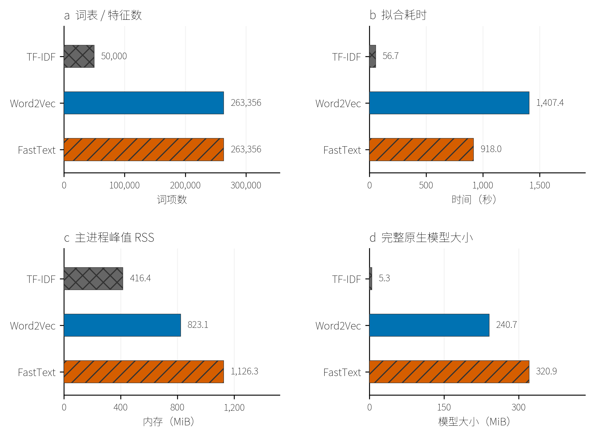
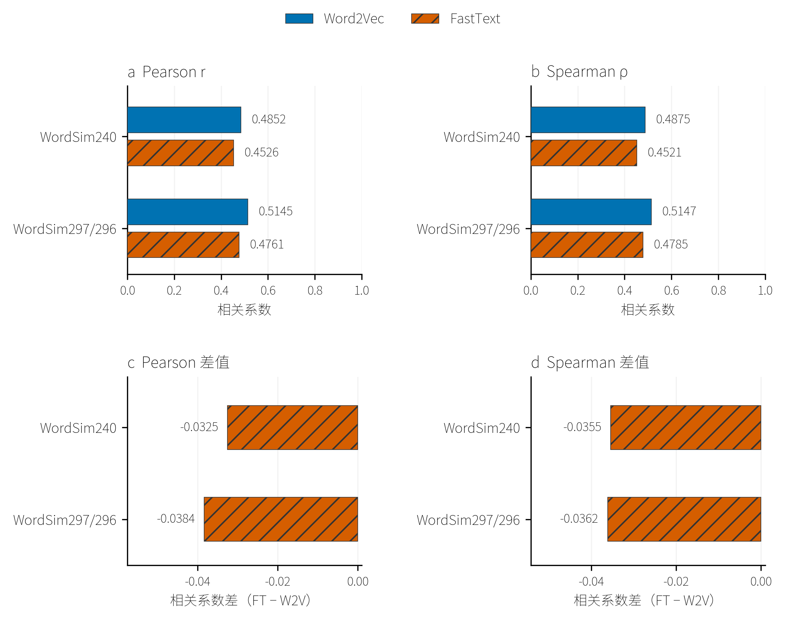
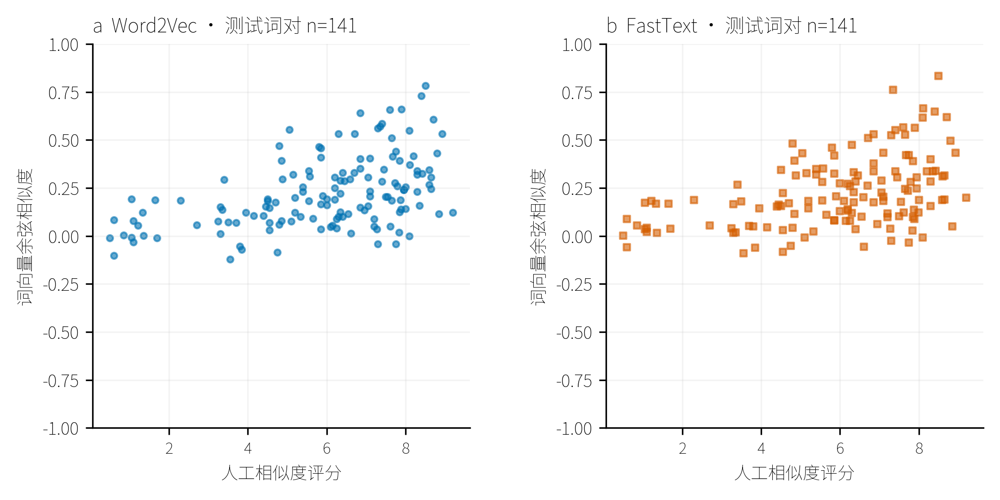
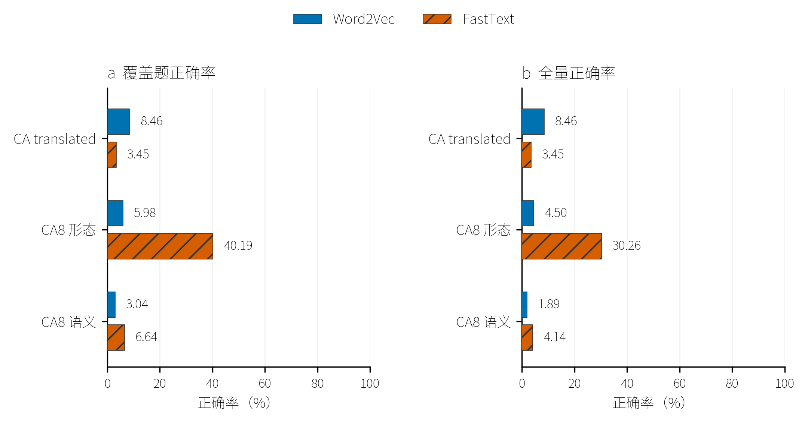
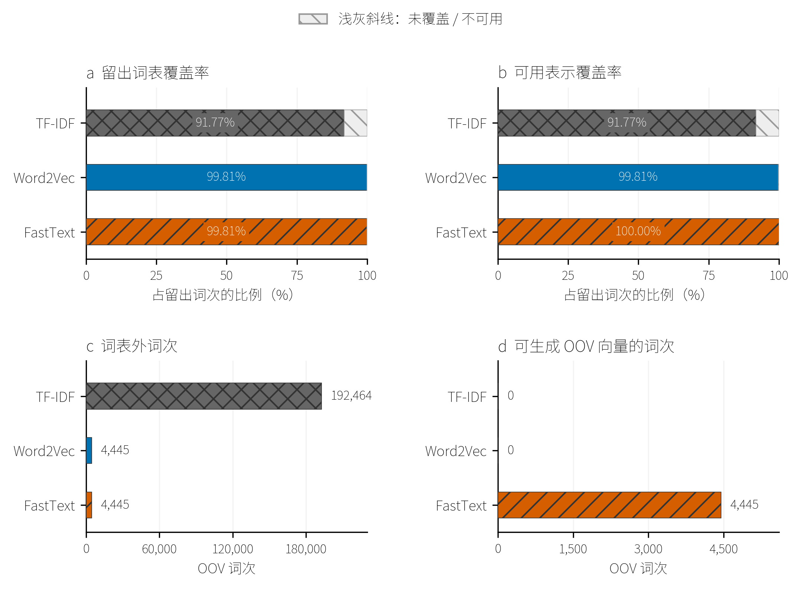
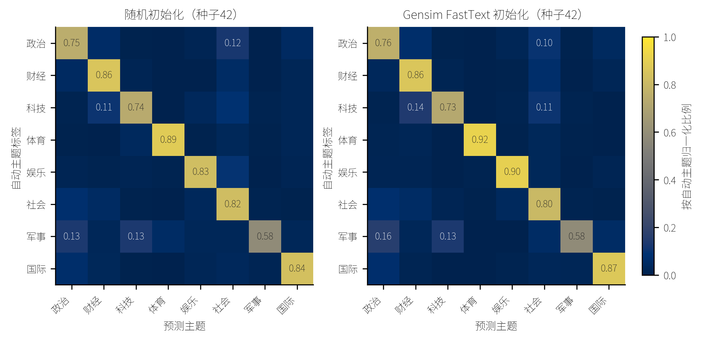

# 提交报告

## part1 Gensim文本实验

### 1.1 Gensim 文本向量化表示

本节使用 Gensim 4.4.0，在同一份中文新闻语料上比较 TF-IDF、Word2Vec 和 FastText 三种文本表示。模型只根据文本统计或上下文学习，不使用新闻类别标签；本节评价表示质量与资源开销，类别预测单独放在 1.2 节。

#### 1.1.1 数据集（THUCNews）

使用清华 THUCNews 完整压缩包，实测包含 836,075 篇文章，分为体育、娱乐、家居、彩票、房产、教育、时尚、时政、星座、游戏、社会、科技、股票、财经 14 类。数据规模按本次实际文件清单统计。处理流程为：读取原文 → 字符清洗 → 分句与分词 → 短文本过滤 → 全局去重 → 固定划分与语料导出。

##### 1.1.1.1 原始文件读取与文本清洗

从 ZIP 中逐篇读取新闻 `.txt` 文件，保留文件内标题、正文及段落的原有顺序。排除目录、`__MACOSX` 元数据和以 `._` 开头的辅助文件；修复压缩包中未正确标记 UTF-8 的中文文件名，依据父目录识别类别。文件按 `utf-8-sig` 解码，以兼容带 BOM 的 UTF-8 文本；解码失败的文件记录为 `invalid_utf8`，不以替换乱码的方式继续处理。原始压缩包保存 SHA-256，读取文章时由 `zipfile` 检查成员 CRC，以核验文件完整性。

每篇文章使用相同的 `clean()` 函数，按以下顺序清洗：

1. **还原 HTML 实体并统一字符形式。** 先用 `html.unescape()` 将 `&nbsp;`、`&amp;` 等实体还原，再做 Unicode NFKC 规范化。例如 `ＡＩ` 变为 `AI`，全角数字 `１２` 变为 `12`，全角空格变为普通空格，减少同一内容因字符形式不同而产生的重复词项。
2. **去除 HTML 标签。** 用正则表达式匹配不跨行、标签内部长度为 1–200 的 `<...>` 片段，将其替换为空格，保留标签包围的文字。例如 `<b>中国经济</b>` 保留“中国经济”。这是针对简短标签的清理，不是完整 HTML 解析。
3. **去除网址。** 匹配以 `http://` 或 `https://` 开头、延续至下一个空白符的字符串，并替换为空格。该规则只处理上述两类前缀，不宣称删除了所有形式的网址。
4. **清除控制及格式字符。** 去掉 Unicode 类别以 `C` 开头的字符，例如空字符；暂时保留换行和制表符，供后续空白整理与分句使用。
5. **整理空白。** 删除空行，将每行连续空白压缩为一个普通空格，去掉行首、行尾空白，再用换行连接各非空行。这样保留段落边界，并避免多余空格形成词元。

这一步不做英文小写化、数字删除、繁简转换或词性筛选；标点暂时保留，供下一步定位句子边界。

##### 1.1.1.2 分句、中文分词与词元过滤

先按中文句号、问号、叹号、分号，以及英文 `! ? ;` 和换行切分文本，再分别对每个片段调用 `jieba.Tokenizer().cut(fragment, HMM=False)`。使用 jieba 0.42.1 的默认精确模式与默认词典；关闭 HMM，避免额外通过隐马尔可夫模型合并未登录词。词典文件保存 SHA-256，确保全量实验与历史抽样实验采用同一词典。数据预处理使用 8 个进程，每个进程独立初始化相同的分词器，结果按输入顺序归并。

分词后，只保留至少包含一个汉字（Unicode `U+3400–U+9FFF`）、ASCII 英文字母或数字，且内部不含空白的词元。纯标点、纯符号和空白词元被过滤；含中文、英文或数字的词元进入语料。此处不删除停用词，保留“的”“和”等常见词，也不做词干化或同义词合并。因此，三个模型接收相同的基础分词结果，词频筛选由各模型在训练阶段分别执行。

分词后的每个片段最多包含 256 个词，超过时按原顺序切成多个连续分块；短句不会与下一句拼接，文章之间也不会拼接。这是用于限制上下文长度的分块，不是摘要生成。英文句点 `.` 不在分句规则内，不能将该规则视为完整的中英文句子识别器。

下面用构造文本说明实际处理效果，分词结果已用同一处理函数核对；`\x00` 表示末尾空字符：

```text
原文：标题：ＡＩ新闻\n<b>中国经济</b>增长１２.５％。详情见 https://example.com/a\x00
清洗：标题:AI新闻\n中国经济 增长12.5%。详情见
词序列 1：标题 / AI / 新闻
词序列 2：中国 / 经济 / 增长 / 12 / 5
词序列 3：详情 / 见
```

该例也说明，本处理保留数字词元，但不保证保留小数和百分数的完整格式：在当前分词与符号过滤规则下，`12.5%` 变为 `12` 和 `5`。因此，本节评价的是经过这一处理流程得到的新闻文本表示。

##### 1.1.1.3 短文本过滤与全局去重

按过滤后词元总数统计文章长度，少于 30 词的文章排除为 `short_document`。该阈值作用于整篇文章，不是要求每句至少 30 词；文章内部较短的句子仍可保留。

对合格文章的清洗后完整文本计算 SHA-256，以相同哈希识别完全重复。去重跨类别、跨训练与留出分区执行，不只在单个目录内去重；若副本与固定留出文章相同，优先保留指定的留出原文，其余副本排除。其他重复文本保留按压缩包成员顺序首先接受的一篇，排除项记录为 `duplicate_clean_text`。去重依据是分词前的清洗文本，不是标题相同或词袋相同。

| 处理结果 | 文章数 | 判定依据 |
| --- | --- | --- |
| 原始新闻 | 836,075 | 通过文件筛选的新闻 `.txt` 成员 |
| 排除短文本 | 8,232 | 过滤后整篇文章少于 30 个词元 |
| 排除完全重复 | 1,234 | 清洗后完整文本 SHA-256 重复 |
| 最终保留 | 826,609 | 通过上述处理的唯一文章 |

本次没有使用 SimHash、语义相似度或近重复分组。因此，内容相近但文字不完全一致的新闻可能同时保留，不能把当前留出集理解为已经严格隔离近重复的泛化测试集。

##### 1.1.1.4 固定划分与模型输入

留出集沿用此前 5 万篇实验的 5,000 篇文章。当时先依据各类别的文章数分配抽样名额，再以种子 42 在各类别内打乱候选，跳过不合格文章并补足名额；类别信息只用于分层抽样。扩展到全量时保留同一批留出文章，将其余全部合格文章用于训练。本次不是把全量语料再按 9∶1 划分，也没有根据评价结果更换留出文章。

| 分区 | 文章数 | 句子／分块数 | 分词后的词数 |
| --- | --- | --- | --- |
| 训练集 | 821,609 | 18,576,718 | 378,641,761 |
| 留出集 | 5,000 | 114,052 | 2,337,756 |

文章依据原始成员路径的 SHA-256 生成固定 ID，按 ID 排序后导出语料。Word2Vec 和 FastText 读取相同的训练文件，每行是一个句子或分块，词与词之间用空格分隔；文档 ID、类别和文件路径均不写入训练词序列。TF-IDF 则把同一文章的各个分块还原为完整词序列，按文章计算词频和文档频次，避免把多个句子误当成多篇文档。

三个模型的词典、IDF 和词向量只拟合训练集。短文本阈值与字符清洗规则均提前固定；留出文本经过相同的处理，用于覆盖率和上下文评分检查，不加入模型训练，也不用于本轮选参。

`documents.jsonl` 保存文章 ID、类别、来源成员名、分区、原文字节哈希与清洗文本哈希、CRC、词数和句子词序列；`train.txt`、`holdout.txt` 保存逐句语料；逐句索引 CSV 保存文章 ID、句子序号与词数；`exclusions.csv` 保存被排除文章及原因。处理完成后核验文章总数、分区词数、唯一哈希，以及固定留出文件与历史版本的校验值。实现见[清洗与分词代码](../gensim_lab/thucnews_data.py)、[全量处理与划分代码](../gensim_lab/thucnews_full_data.py)，统计及文件校验值见[数据清单](../data/thucnews/prepared/9cb3ecd006ae1a9a1f7f/manifest.json)。

##### 1.1.1.5 内在评价数据的验证／测试划分

词相似度与类比题用于评价表示质量，不是新闻文章分区。先对题目去重，再按固定种子 42 划分验证／测试：相同无序词对、关系交换或同时反向的等价类比题在不同基准中共享同一分区，题组交集为 0。单个基准的重复题保留首题，评分冲突另记。WordSim240 的 240 个原始词对去重为 237 对，分为 95 验证、142 测试；其他基准按同题组规则分配，目标验证比例 40%。

每轮评价三个词对集的全部验证题；每套类比从验证池按关系固定抽取最多 128 题，用作辅助曲线。选轮完成后才评价全部测试题。WordSim297 与 WordSim296 大量重叠，不能当作独立重复。历史实验已观察过原完整基准，本次测试子集不能声称是从未被观察过的新盲测；当前训练程序不读取测试分数选轮。[基准分区及去重清单](../artifacts/thucnews_validation/benchmarks/c1943509f229e0645ba2/manifest.json)、[题组分配](../artifacts/thucnews_validation/benchmarks/c1943509f229e0645ba2/assignments.csv)。

#### 1.1.2 实验模型、参数与对比设置

**TF-IDF** 使用文章词频乘以 $\log_2(N/df_t)$，再做 L2 归一化，得到稀疏文章表示。相同训练集的统计模型不受轮数选择影响，本轮直接复用。

**Word2Vec** 使用 CBOW，以附近词预测中心词，学习每个整词的 100 维向量，词表外词没有直接表示。**FastText** 保持相同目标，在整词表示中加入字符子词参数共享，词表外词可组合子词得到向量。这里使用 Gensim 无监督词向量模型；字符 n-gram 与监督分类的词 n-gram 是两类特征。

| 设置 | TF-IDF | Word2Vec | FastText |
| --- | --- | --- | --- |
| 表示维度 | 最多 50,000 特征 | 100 | 100 |
| 词表过滤 | DF≥3、DF/N≤0.9 | 训练词频≥5 | 训练词频≥5 |
| 训练算法 | 文章 DF／IDF 统计 | CBOW | CBOW |
| 上下文窗口 | 不适用 | 5 | 5 |
| 训练轮数 | 一次统计遍历 | 实际 8／选择 5 | 实际 5／选择 1 |
| 训练目标 | 不适用 | HS=1、negative=0 | HS=1、negative=0 |
| 学习率 | 不适用 | 0.025→0.0001，按最多 15 轮调度 | 同 Word2Vec |
| 高频下采样 | 不适用 | 0.001 | 0.001 |
| 字符子词 | 不适用 | 无 | 长度 1–3、200,000 桶 |
| 并行 | 8 统计进程 | 20 训练线程 | 20 训练线程 |

两个词向量模型分别从头训练，至少 5 轮、最多 15 轮，以 **WordSim240 验证 Spearman** 独立选择检查点。连续 3 轮未比有效提升参照增加超过 0.001 时停止；任何更高分都会更新最佳模型，不足 0.001 的改善不重置耐心计数。Pearson、其他词对集和类比只作辅助诊断。每轮保存完整原生检查点，结束后重载得分最高的模型，再评价测试集。学习率按 15 轮上限预先线性调度，提前停止时尚未走完；与历史固定 5 轮日程不同，差异不能只归因于轮数。

使用 Python 3.12、Gensim 4.4.0、NumPy 1.26.4，种子 42，输入顺序和 Python hash seed=0 固定，数值库 4 线程。原生 LineSentence 和有界任务队列每批最多 9,000 原始词，各轮核对完整词数。训练使用 CPU；多线程不保证独立重训逐位一致，每个模型本轮只有一次正式运行，不作显著性判断。当前未做 THUCNews 的维度、窗口或子词范围消融，所选轮次仅针对当前配置和验证任务。[词向量配置](../configs/thucnews_validation.yaml)、[TF-IDF 配置](../configs/thucnews.yaml)。

<!-- thucnews-ablation:start -->

#### 1.1.3 超参数搜索

前述全量实验采用 CBOW 与层次 softmax 的组合。本节在固定训练子集上依次比较训练方式、初始学习率和向量维数，考察这些参数如何影响词向量质量。参数选择以词相似度为主要依据，同时检查类比表现与计算成本。

搜索语料从既有训练分区中固定抽取 50,000 篇完整文章。抽样保留 THUCNews 14 个类别的原有比例：采用最大余数法分配各类别样本数，再按文章标识与固定种子 42 生成的 SHA256 排序取样。类别信息仅用于控制抽样构成，词向量学习不使用类别标签。子集共含 1,129,776 个句段、23,080,089 个词，与留出文章的交集为零。文本沿用前节的清洗与 jieba 分词结果，保留文章内部句段顺序；单个上下文最长为 256 词，且不跨越文章边界。

训练方式与学习率阶段的两类模型均设为 100 维，窗口大小为 5，最低词频为 5，高频词下采样阈值为 0.001，使用 20 个训练线程与 4 个数值库线程。Gensim FastText 的字符子词长度固定为 1–3，哈希桶数为 200,000。训练语料及输入顺序在各配置间保持一致，所得词表均含 94,426 个词。与前节最低训练 5 轮的全量基线不同，搜索阶段设定至少 3 轮、最多 15 轮，以控制重复实验的计算量。

主指标为 WordSim240 验证集的 Spearman 相关系数，衡量模型余弦相似度排序与人工评分排序的一致程度。评价题目去重后按固定种子 42 划分验证集与测试集，训练种子另取 42、2026、7。95 个验证词对中，有 92 个的两个词均在训练词表内；全部搜索配置使用相同的这 92 个词对，以保持比较口径一致。FastText 为未登录词生成子词向量的能力另作诊断，不改变主指标的评价范围。辅助评价包括 Pearson 相关系数、WordSim297 与 WordSim296 的验证相关系数，以及三个类比集各 128 道固定验证题的正确率；类比题中出现词表外词时计为错误。

每轮训练后计算验证指标并保存原生模型检查点，最终选取主指标最高的轮次。停止规则以 0.001 为有效增幅阈值。第 3 轮若相较前一轮和前两轮均无超过该阈值的上升，则停止；继续训练的运行在连续 3 轮无有效提升、且近期一轮或两轮也无上述上升时停止，最多训练 15 轮。任何更高的验证得分都会更新最佳检查点，0.001 仅用于控制训练预算。学习率按 15 轮上限预先线性衰减至 0.0001，提前停止后保持原定日程。训练结束时重新加载最佳检查点并复核评价结果，曲线中的最佳轮次与实际停止轮次分别记录。

##### 1.1.3.1 训练方式比较

训练方式实验采用 CBOW／Skip-gram 与层次 softmax（HS）／负采样（NS）的组合。HS 配置设为 `hs=1、negative=0`；负采样配置关闭 HS，分别使用 5 个和 10 个负例，记为 NS5、NS10。每个模型包含六种组合，初始学习率统一为 0.025。首先用种子 42 完成 12 组初筛，再分别对两个模型的 CBOW＋HS 基线和初筛得分最高的新配置补充种子 2026、7，共完成 20 次训练。


固定种子 42 时，两个模型的 Skip-gram 得分均高于采用相同训练目标的 CBOW。Word2Vec 使用 HS 时，得分由 CBOW 的 0.3559 升至 Skip-gram 的 0.4536；使用 NS5 时，由 0.3889 升至 0.5056。FastText 的对应 HS 结果由 0.4175 升至 0.5278，NS10 结果由 0.3677 升至 0.5641。在当前子集上，Skip-gram 因而更适合作为后续词相似度搜索的训练方式。

HS 与负采样的排名随 CBOW／Skip-gram 设置变化。FastText 采用 CBOW 时，HS 的得分为 0.4175，高于 NS5 的 0.3370 和 NS10 的 0.3677；改用 Skip-gram 后，NS5 与 NS10 分别达到 0.5612 和 0.5641，均高于 HS 的 0.5278。负例数之间的差距较小：Word2Vec 的 Skip-gram＋NS5 与 NS10 分别为 0.5056、0.5038，FastText 则分别为 0.5612、0.5641。后续复验采用各模型初筛得分最高的组合；5 个与 10 个负例的比较仍只有单种子结果。

逐轮验证进一步区分了最佳模型状态与训练停止状态。Word2Vec 的 Skip-gram＋NS5 在第 12 轮取得最高验证分，实际训练至第 15 轮；FastText 的 Skip-gram＋NS10 在第 8 轮取得最高分，实际训练至第 14 轮。不同配置的最佳轮次与实际训练长度均有差异，故训练方式排名统一依据各自的最佳验证检查点。


三种子复验中，Word2Vec 的 CBOW＋HS 基线为 0.3402±0.0136，Skip-gram＋NS5 为 0.5095±0.0065，均值提高 0.1692；FastText 的基线为 0.4163±0.0161，Skip-gram＋NS10 为 0.5380±0.0256，均值提高 0.1217。按相同种子配对，两个新配置的三次得分均高于各自基线，后续学习率搜索据此采用这两个组合。复验同时改变了上下文预测方式与训练目标，因此上述增量对应整个组合的变化。


计算成本也随配置变化。以种子 42 的候选配置为例，Word2Vec 的 Skip-gram＋NS5 平均每轮训练约 8.9 秒，进程峰值内存为 287.8 MiB，模型文件为 75.2 MiB；FastText 的 Skip-gram＋NS10 分别约为 14.9 秒、516.1 MiB 和 151.5 MiB。这两组配置同时存在子词结构与负例数差异，资源比较反映候选方案的整体成本。累计训练时间还受提前停止轮次影响，因此图中分别列出累计耗时与平均每轮耗时；训练耗时统计仅包含参数更新阶段，建词表、评价和保存另行计时。


##### 1.1.3.2 学习率敏感性分析

学习率实验分别固定 Word2Vec 的 Skip-gram＋NS5 和 FastText 的 Skip-gram＋NS10，比较初始学习率 0.005、0.01、0.025、0.05、0.1。每档均完成种子 42、2026、7 的训练，共形成 30 组结果；其中初始学习率 0.025 的六组与训练方式复验共用。语料、评价题目、其他模型参数及选轮规则保持一致，各模型按照三次训练的 WordSim240 验证 Spearman 均值选择学习率。

下文的“均值±标准差”均由三个训练结果计算，标准差采用样本标准差（分母为 n−1）。它描述固定评价题目下的训练波动，题目抽样的不确定性尚未量化。学习率效果图在同一模型内同时呈现五档参数和全部种子结果，逐轮曲线按种子分面，以便观察平均表现与训练轨迹之间的关系。

###### 1.1.3.2.1 Word2Vec：Skip-gram＋NS5

Word2Vec 的验证均值随初始学习率从 0.005 增至 0.025 而上升，继续增大学习率后回落。0.025 的均值最高，为 0.5095；0.05 为 0.5067，两者相差 0.0028。两档的种子间标准差分别为 0.0065 和 0.0276，说明均值虽然接近，0.05 的训练结果却更分散。按预定的均值选参规则，选择 0.025；其较小的实测波动也支持这一选择。两档差异未作显著性检验。

| 初始学习率 α | ρ（种子 42） | ρ（种子 2026） | ρ（种子 7） | 均值±样本标准差（n=3） | 选择结果 |
| --- | --- | --- | --- | --- | --- |
| 0.005 | 0.3909 | 0.3865 | 0.3825 | 0.3867±0.0042 |  |
| 0.01 | 0.4619 | 0.4618 | 0.4688 | 0.4642±0.0041 |  |
| 0.025 | 0.5056 | 0.5059 | 0.5169 | 0.5095±0.0065 | 选中 |
| 0.05 | 0.5157 | 0.5287 | 0.4758 | 0.5067±0.0276 |  |
| 0.1 | 0.4889 | 0.4471 | 0.5046 | 0.4802±0.0297 |  |


逐轮曲线显示，学习率对最佳轮次的影响具有种子差异。初始学习率为 0.025 时，三个种子的最佳轮次依次为 12、9、9；改为 0.05 后，依次为 2、10、2。较大的初始学习率在部分运行中较早取得高分，但三个种子的最佳轮次与最终得分更不一致。这也说明，单个种子在较早轮次取得高分，并不足以代表该学习率的平均表现。


不同评价任务偏好的学习率有所不同。WordSim297 与 WordSim296 均在 0.01 时取得最高验证 Spearman，分别为 0.5155 和 0.5116；WordSim240 的 Pearson 则在 0.025 时最高，为 0.5159。CA_translated 类比探针同样偏好 0.025，三种子平均正确率为 0.3177，0.05 时则为 0.1380。因此，选择 0.025 主要依据 WordSim240，同时得到该类比探针的支持；另外两个词相似度题组更偏好较低学习率。


###### 1.1.3.2.2 Gensim FastText：Skip-gram＋NS10

FastText 的主指标均值从初始学习率 0.005 下的 0.4157 上升至 0.05 下的 0.5949，增至 0.1 后回落到 0.5207。0.05 的均值最高，较参考学习率 0.025 的 0.5380 提高 0.0569。按相同种子配对，42、2026、7 的得分分别增加 0.0659、0.0684、0.0364，三次训练均有提升，因而选择 0.05。

| 初始学习率 α | ρ（种子 42） | ρ（种子 2026） | ρ（种子 7） | 均值±样本标准差（n=3） | 选择结果 |
| --- | --- | --- | --- | --- | --- |
| 0.005 | 0.4141 | 0.4149 | 0.4180 | 0.4157±0.0020 |  |
| 0.01 | 0.4836 | 0.5116 | 0.4917 | 0.4956±0.0144 |  |
| 0.025 | 0.5641 | 0.5131 | 0.5369 | 0.5380±0.0256 |  |
| 0.05 | 0.6300 | 0.5814 | 0.5732 | 0.5949±0.0307 | 选中 |
| 0.1 | 0.5263 | 0.4677 | 0.5682 | 0.5207±0.0505 |  |


初始学习率 0.05 下的最佳轮次依次为 6、4、8，实际训练分别停止于第 9、7、11 轮，最高验证分均出现在停止之前。学习率提高至 0.1 时，验证均值下降，标准差由 0.0307 增至 0.0505；在这组三次训练中，继续增大学习率降低了平均得分，也增大了训练波动。


FastText 在 WordSim240 上选出的学习率，对其他任务未必合适。WordSim240 的 Pearson 在 0.05 时最高，为 0.5861；WordSim297 与 WordSim296 的 Spearman 均值则在 0.01 时最高，分别为 0.5155 和 0.5140。CA_translated 类比正确率在 0.025 时为 0.2214，改为 0.05 后降至 0.0990；CA8 形态类比在 0.005 时最高，为 0.2370，而 0.05 时为 0.0755。CA8 语义类比也在 0.005 时取得最高均值 0.0495，0.05 时为 0.0417。0.05 的优势因此限于预先指定的 WordSim240 目标，部分类比任务更偏好较低学习率。


<!-- thucnews-dimension:start -->

##### 1.1.3.3 向量维数搜索

前两个阶段均采用 100 维词向量。本阶段在选定的训练方式与学习率下，比较 50、100、150、200、300 维，观察增加维数能否改善词相似度，以及相应的计算成本。Word2Vec 固定为 Skip-gram＋NS5、初始学习率 0.025；Gensim FastText 固定为 Skip-gram＋NS10、初始学习率 0.05。两类模型继续使用同一份 50,000 篇、23,080,089 词训练子集，其他参数保持不变，各档词表均为 94,426 词。

每个维数均使用种子 42、2026、7，合计 30 组结果。其中 100 维的六组结果经封存核验后复用，其余 24 组从头训练。各次运行沿用前述 3–15 轮的训练预算、早停规则和学习率日程，依据逐轮 WordSim240 验证 Spearman 保存最佳检查点。主指标仍使用相同的 92 个词表内验证词对，按三个种子的均值选择维数，精确同分时优先较低维数。表中“均值±样本标准差”（n=3）描述固定题目下的训练波动，本阶段未作显著性检验。

###### 1.1.3.3.1 Word2Vec

Word2Vec 的验证均值在 50–150 维之间变化较小，分别为 0.4993、0.5095 和 0.5099；增至 200 维后升至 0.5302，300 维最高，为 0.5724±0.0103。相较 100 维，300 维的均值提高 0.0629，三个种子的得分也均有提高；相较次高的 200 维，均值提高 0.0422。因此，本阶段选择 300 维。该值已处于搜索范围上界，更大维数能否继续改善结果，仍需另外验证。

| 向量维数 | ρ（种子 42） | ρ（种子 2026） | ρ（种子 7） | 均值±样本标准差（n=3） | 选择结果 |
| --- | --- | --- | --- | --- | --- |
| 50 | 0.5017 | 0.5076 | 0.4887 | 0.4993±0.0097 |  |
| 100 | 0.5056 | 0.5059 | 0.5169 | 0.5095±0.0065 |  |
| 150 | 0.5003 | 0.5376 | 0.4917 | 0.5099±0.0244 |  |
| 200 | 0.5119 | 0.5405 | 0.5381 | 0.5302±0.0159 |  |
| 300 | 0.5665 | 0.5842 | 0.5664 | 0.5724±0.0103 | 选中 |


300 维时，三个种子的最佳轮次依次为 11、10、9，实际训练分别进行至第 15、13、14 轮。其得分优势来自各次运行的最佳检查点，比较时允许不同维数在不同轮次达到最高分。100 维和 300 维的种子 42 运行均训练至第 15 轮，因此这里比较的是共同轮数预算内可获得的结果。


300 维的优势随评价任务而变化。WordSim297 与 WordSim296 均在 150 维取得最高验证 Spearman 均值，分别为 0.5064 和 0.5035。CA_translated 与 CA8 形态类比的平均正确率则在 300 维最高，分别为 0.3750 和 0.0182；CA8 语义类比在 200 维最高，为 0.0677。这些指标均在 WordSim240 选定的检查点上计算。300 维因而是按主指标选出的候选，在其他任务上仍有不同的维数偏好；其中 CA8 形态类比即使取最高值，正确率也较低。


提高维数也增加了资源开销。由 100 维增至 300 维，平均每轮训练耗时从 9.6 秒增至 12.9 秒，平均进程峰值内存从 287.7 MiB 增至 575.2 MiB，平均模型文件大小从 75.2 MiB 增至 219.3 MiB。在本次测量中，300 维取得更高验证得分，同时需要约两倍的峰值内存和接近三倍的模型存储空间。累计耗时还受实际训练轮数影响，下图同时列出累计时间与平均每轮时间。


###### 1.1.3.3.2 Gensim FastText

Gensim FastText 的验证均值随维数变化没有持续上升。100 维最高，为 0.5949±0.0307；200 维次之，为 0.5571，低于 100 维 0.0378；300 维为 0.5534。因此，按三种子均值保留 100 维。不过，这一排名并非在每个种子下都一致：种子 7 在 200 维取得 0.5928，高于 100 维的 0.5732。100 维的选择依据是三次训练的平均表现。

| 向量维数 | ρ（种子 42） | ρ（种子 2026） | ρ（种子 7） | 均值±样本标准差（n=3） | 选择结果 |
| --- | --- | --- | --- | --- | --- |
| 50 | 0.5206 | 0.5295 | 0.5226 | 0.5242±0.0046 |  |
| 100 | 0.6300 | 0.5814 | 0.5732 | 0.5949±0.0307 | 选中 |
| 150 | 0.5241 | 0.4807 | 0.5798 | 0.5282±0.0497 |  |
| 200 | 0.5182 | 0.5601 | 0.5928 | 0.5571±0.0374 |  |
| 300 | 0.5964 | 0.5542 | 0.5096 | 0.5534±0.0434 |  |


部分较高维数的运行较早停止，是解释这组比较时需要考虑的限制。150 维的种子 42、2026，200 维的种子 42，以及 300 维的种子 7，均在第 3 轮触发早停；300 维的种子 42 则训练至第 15 轮。相比之下，100 维的三个种子分别在第 6、4、8 轮取得最高分，在第 9、7、11 轮停止。因此，100 维是在当前学习率和早停规则下均值最高的配置；较高维数在延长训练或重新选择学习率后是否会改善，尚需实验确认。


其他词相似度题组也偏好 100 维。WordSim297 与 WordSim296 在该维数下的验证 Spearman 均值最高，分别为 0.4734 和 0.4694。类比任务则偏好更高维数：CA_translated 在 200 维取得最高平均正确率 0.1120，CA8 形态和语义类比均在 300 维最高，分别为 0.2240 和 0.0573。这些结果在主指标选定的检查点上计算，说明增加维数对词相似度和类比任务的影响有所不同。本节按词相似度选参，因而仍保留 100 维。


从资源开销看，保留 100 维也更经济。100 维的平均每轮训练耗时为 14.4 秒，平均进程峰值内存为 517.0 MiB，平均模型文件大小为 151.5 MiB；300 维分别增至 24.1 秒、1181.2 MiB 和 448.2 MiB。在本次实验条件下，增至 300 维需要更多训练时间、内存和存储空间，WordSim240 的验证均值却低于 100 维。


维数变化没有改变训练词表，因此各档在主验证题组上的词对覆盖率一致，比较主要反映得分与资源开销的差异。100 维的资源统计来自前一阶段复用的运行；各档虽在同一机器上测量，耗时仍会受运行时段和系统负载影响。完整逐次结果、辅助指标及资源记录见下方链接。

[完整逐次结果](../artifacts/thucnews_small_search/experiments/c0654ea5f83982f1f307e526/results.csv) · [辅助指标](../artifacts/thucnews_small_search/experiments/c0654ea5f83982f1f307e526/dimension_validation_metrics.csv) · [资源指标](../artifacts/thucnews_small_search/experiments/c0654ea5f83982f1f307e526/dimension_cost_metrics.csv) · [运行核验](../artifacts/thucnews_small_search/experiments/c0654ea5f83982f1f307e526/verification.json)

<!-- thucnews-dimension:end -->

##### 1.1.3.4 候选参数与结论范围

按三个阶段的验证结果，Word2Vec 的候选配置为 Skip-gram＋NS5、初始学习率 0.025、300 维；Gensim FastText 为 Skip-gram＋NS10、初始学习率 0.05、100 维。最终选择以三种子的 WordSim240 验证 Spearman 均值为主，训练时间、峰值内存和模型大小用于评估计算代价，未纳入加权评分。Word2Vec 采用 300 维，是在更高资源开销下保留词相似度收益；FastText 则在 100 维取得最高验证均值，同时保持较低资源开销。这些选择针对词相似度任务；辅助类比结果已有不同的参数偏好。WordSim297 与 WordSim296 存在题目重叠，其相近趋势也应作为相关证据解读。

本节采用逐阶段搜索：学习率只在选定的训练方式下比较，维数又沿用各模型在 100 维时选出的学习率。因此，所得候选适用于当前参数组合，训练方式、学习率与维数之间的交互仍待检验。训练预算也会影响排名，例如学习率 0.005 时，两类模型的三个种子均训练至 15 轮上限；维数阶段则有部分 FastText 运行在第 3 轮停止。三种子结果提供了训练波动的初步估计，但主指标仅含 92 个词对，结论仍需在更充分的训练与评价中确认。

候选配置来自同一份固定抽样的 50,000 篇语料，三种子复验反映训练波动，尚未检验不同语料抽样及规模对参数排序的影响。本轮搜索未使用测试分区，也未按候选配置启动全量重训。相关基准在此前实验中已有评价记录，因此本节仍作为探索性选参，候选参数在全量语料及独立评价数据上的表现有待确认。1.1.4 保留的全量 CBOW＋HS 结果对应此前基线，其语料规模、词对覆盖和最低训练轮数与本节不同，应分别解读。

数据与运行记录：[抽样清单](../data/thucnews/search_subsets/6b1f898386a4874fb53a5478/manifest.json)、[训练方式原始结果](../artifacts/thucnews_small_search/experiments/e5cc57786fa3cd4195698419/index.json)、[学习率逐次结果](../artifacts/thucnews_small_search/experiments/361d2139d70c8d840fc61da0/results.csv)、[辅助指标汇总](../artifacts/thucnews_small_search/experiments/361d2139d70c8d840fc61da0/rate_validation_metrics.csv)、[完整实验记录](THUCNews小规模超参数搜索.md)。

<!-- thucnews-ablation:end -->

#### 1.1.4 训练结果与评估

##### 1.1.4.1 Word2Vec 逐轮验证与模型选择

Word2Vec 实际训练 **8 轮**，连续 3 轮没有有效提升而提前停止。验证主指标最高的是 **第 5 轮，Spearman ρ=0.3655**，该轮检查点作为最终模型。训练最后一轮没有自动替代最佳轮。


[SVG 矢量图](figures/section11/word2vec_validation.svg)

[逐轮完整指标](../artifacts/thucnews_validation/runs/ea6051ebda1db1bf95921d3d/validation_metrics.csv)、[轮次／时间／检查点索引](../artifacts/thucnews_validation/runs/ea6051ebda1db1bf95921d3d/epochs.csv)、[保存加载复核](../artifacts/thucnews_validation/runs/ea6051ebda1db1bf95921d3d/save_load_check.json)。

##### 1.1.4.2 FastText 逐轮验证与模型选择

FastText 实际训练 **5 轮**，连续 3 轮没有有效提升而提前停止。验证主指标最高的是 **第 1 轮，Spearman ρ=0.3499**，该轮检查点作为最终模型。训练最后一轮没有自动替代最佳轮。


[SVG 矢量图](figures/section11/fasttext_validation.svg)

[逐轮完整指标](../artifacts/thucnews_validation/runs/b560d36061b15b8ab5904931/validation_metrics.csv)、[轮次／时间／检查点索引](../artifacts/thucnews_validation/runs/b560d36061b15b8ab5904931/epochs.csv)、[保存加载复核](../artifacts/thucnews_validation/runs/b560d36061b15b8ab5904931/save_load_check.json)。

两个模型使用同一评价分区，但分别计算指标、分别决定停止和最佳轮数。验证曲线用于选择当前配置的训练轮数；单次曲线与有限词对不能证明所有语义任务已经收敛，也不能据此作模型差异显著性判断。

##### 1.1.4.3 TF-IDF 稀疏表示与留出文章诊断

TF-IDF 在 821,609 篇训练文章上拟合词表与 IDF，最终保留 50,000 个特征。它按文档统计词频和文档频次，不经过梯度更新，因此无需逐轮选取检查点。本次复用已经保存的词典和模型，将同一批 5,000 篇留出文章映射到固定特征空间；留出文章不参与词表筛选或 IDF 计算。

留出文章共包含 2,337,756 词次，其中 2,145,292 词次进入词表，整体覆盖率为 91.77%。每篇文章的非零特征数中位数为 195，四分位区间为 117–295，均值为 228.48。相对于 50,000 维特征空间，中位数对应的非零比例仅为 0.39%，说明单篇文章只激活词表中的少量特征。图 1.3 展示逐篇分布，避免用一个总体覆盖率掩盖文章之间的差异。


[SVG 矢量图](figures/section11/tfidf_document_diagnostics.svg)

全部留出文章均得到非零表示，零向量比例为 0%。L2 归一化后的向量范数均为 1，最大绝对偏差为 1.22e-15；重新加载模型后，全部文章的稀疏向量逐项一致。统计模型拟合耗时 56.7 秒，历史主进程峰值 RSS 为 416.4 MiB，词典与模型合计 5.3 MiB。这些资源与覆盖指标可和词向量方法并列比较；词相似度、词类比及上下文评分针对词向量，不适用于当前文档级 TF-IDF。覆盖率和稀疏度描述表示是否可用及其存储特征，不能直接证明语义质量或分类性能。

[逐篇原始指标](../artifacts/tfidf_submission_diagnostics/928ed691978c06e8cc9d3d1e/holdout_documents.csv)、[诊断汇总与来源核验](../artifacts/tfidf_submission_diagnostics/928ed691978c06e8cc9d3d1e/summary.json)、[图表核验](../artifacts/tfidf_submission_diagnostics/928ed691978c06e8cc9d3d1e/figure_audit.json)、[拟合记录](../artifacts/thucnews/runs/928ed691978c06e8cc9d3d1e/summary.json)、[词表及 IDF](../artifacts/thucnews/runs/928ed691978c06e8cc9d3d1e/training_vocabulary.csv)。

##### 1.1.4.4 训练耗时、峰值内存与模型大小



[SVG 矢量图](figures/section11/resources.svg)

Word2Vec 与 FastText 均保留 263,356 词，TF-IDF 为 50,000 文章特征。词向量时间累计所有实际训练轮的训练调用：Word2Vec 1407.4 秒、FastText 918.0 秒；不包含词表构建、验证、检查点保存、最终测试。TF-IDF 包含 DF／CF 统计和 IDF 计算，计时范围不同，不能直接当作同算法加速比；两个词向量模型实际轮数不同，累计时间也不代表单位轮次速度比较。TF-IDF 的资源记录沿用历史相同统计模型，峰值包含当时的文档诊断。峰值 RSS 为模型主进程，未累计子进程；TF-IDF 体积含词典，词向量为所选完整原生模型，不含全部检查点总占用。

##### 1.1.4.5 词相似度：Pearson 与 Spearman

使用模型余弦相似度与人工评分比较；Pearson 衡量线性相关，Spearman 衡量排序相关。它们不是类别预测准确率。下面仅评价所选模型的独立测试词表内词对，两个模型的词表和覆盖题相同。



[SVG 矢量图](figures/section11/similarity_metrics.svg)



[SVG 矢量图](figures/section11/wordsim_pairs.svg)

WordSim240 测试 Spearman 分别为 Word2Vec 0.4875、FastText 0.4521，差值 -0.0355。各基准差值按本次实测解释，不能推广为稳定优势。WordSim296 去掉 OPEC–石油词对，且与 WordSim297 共享大多数题目。本次两个版本的测试题完全相同，图中合并显示，原始指标分别保存。FastText 可生成 OOV 的探索分数另存完整记录，不混入正式词表内相关。

##### 1.1.4.6 词类比：覆盖题与全部题正确率



[SVG 矢量图](figures/section11/analogy_accuracy.svg)

类比通过“B−A+C”寻找最相近词，正式评价只搜索训练词表，字符子词能生成 OOV 向量不等于能完成所有 OOV 类比。形态与语义关系分别报告；与逐轮小探针的分母不同，不能用图中测试分数回选轮数。TF-IDF 是文档表示，词相似度和类比不适用。

##### 1.1.4.7 词表与可用表示覆盖率



[SVG 矢量图](figures/section11/coverage.svg)

FastText 为 4,445/4,445 次 OOV 出现生成可用向量；Word2Vec 跳过这些词。TF-IDF 覆盖受 50,000 特征限制，不能把覆盖率当作语义质量排序。

##### 1.1.4.8 近邻词与句子上下文评分

word2vec 查询“经济”的前三近邻为“总体经济、宏观经济、经济运行”；查询“新能源汽车产业”得到“无向量”。近邻仅作定性检查，不能代替基准指标。

[所选模型的 114,052 条留出句子评分](../artifacts/thucnews_validation/posthoc/ea6051ebda1db1bf95921d3d/heldout_sentence_scores.csv)。

[定性 API 探针](../artifacts/thucnews_validation/posthoc/ea6051ebda1db1bf95921d3d/qualitative_probes.json)另存词／词组相似度、乘法类比和异类词结果，不作为模型排名或选轮指标。

fasttext 查询“经济”的前三近邻为“能源经济、自然经济、私营经济”；查询“新能源汽车产业”得到“汽车产业、新能源、新型产业”。近邻仅作定性检查，不能代替基准指标。

[所选模型的 114,052 条留出句子评分](../artifacts/thucnews_validation/posthoc/b560d36061b15b8ab5904931/heldout_sentence_scores.csv)。

[定性 API 探针](../artifacts/thucnews_validation/posthoc/b560d36061b15b8ab5904931/qualitative_probes.json)另存词／词组相似度、乘法类比和异类词结果，不作为模型排名或选轮指标。

HS 上下文 score 累计窗口内词预测事件，忽略 OOV；FastText 继承 Word2Vec HS 评分路径，仅作兼容性诊断。它不是整句生成对数概率，不计算语言模型困惑度，也不参与本轮早停。TF-IDF 不提供这种评分。

##### 1.1.4.9 核验与结果范围

本节提供三种表示的资源和覆盖率比较，以及分别按验证指标选择的 Word2Vec／FastText 测试结果。没有训练类别预测器，也没有据此确定哪种表示用于文本分类最好。选轮、每轮检查点重载、训练词表频次、原始词数、逐题测试指标及保存向量通过[独立核查](../artifacts/thucnews_validation/verification.json)。[完整实验记录](THUCNews词向量实验.md)保存 p 值、原始指标、日志、时间和协议边界；[绘图记录](../artifacts/submission_section11_figures/数据剖析与图型选择.md)保存完整精度数据、来源、图型选择及视觉核查。

项目测试 73 项通过，见[测试日志](../artifacts/thucnews_validation/tests.log)。

#### 1.1.5 小结

本节在相同的 THUCNews 训练语料上比较了 TF-IDF、Word2Vec 和 FastText 三种表示。TF-IDF 通过留出文章诊断评价，词向量通过词相似度与类比任务评价。以下词向量结论采用候选参数全量重训后的最佳检查点；1.1.4 中既有词向量曲线和分数仍保留此前 CBOW＋HS 基线，两个阶段应分别解读。[最新全量重训结果](THUCNews候选参数全量重训练.md)。

TF-IDF 以较小的模型体积保存了新闻中的词项权重。其词典和模型合计约 5.3 MiB，拟合耗时 56.7 秒；在 5,000 篇留出文章上，词次覆盖率为 91.77%，全部文章均得到非零表示。每篇文章的非零特征数中位数为 195，仅占 50,000 维特征空间的 0.39%。这些结果说明当前 TF-IDF 表示稀疏、存储紧凑，并保留了大部分词次；其语义区分能力和分类效果仍需通过文档任务评价。

Word2Vec 的候选配置为 Skip-gram＋NS5、学习率 0.025、300 维。全量重训后，WordSim240 和 WordSim297／296 的测试 Spearman 分别为 0.5061 和 0.5379，翻译类比的全部题正确率为 41.38%。在当前两套候选配置中，Word2Vec 在 WordSim240 和翻译类比上得分较高；留出语料词表覆盖率为 99.81%。300 维配置的完整模型约为 611.8 MiB，其表示能力伴随较大的存储开销，词表外词仍无法直接获得向量。

FastText 的候选配置为 Skip-gram＋NS10、学习率 0.05、100 维。WordSim240 测试 Spearman 为 0.4963，略低于 Word2Vec；WordSim297／296 为 0.5692，高于 Word2Vec。CA8 形态类比的全部题正确率为 17.83%，高于 Word2Vec 的 7.84%；此外，全部 4,445 次未登录词出现均可生成向量，使留出语料的可用表示覆盖率达到 100%。这些结果支持当前 FastText 在形态关系和表示覆盖方面的优势，但生成向量不保证语义正确。其形态类比仍低于旧 CBOW＋HS 基线的 30.26%，说明以词相似度选参得到的新配置存在任务间取舍。

三种方法的效果取决于评价目标。TF-IDF 提供紧凑的稀疏文档表示；Word2Vec 在当前部分词语关系任务上得分较高；FastText 补充了未登录词表示，并在部分词相似度和形态类比任务上表现较好。两套词向量配置的维数不同，全量实验也各只有一个种子，因此这些差异限定于本次配置与评价数据，尚不能归结为模型架构本身的稳定优劣。三种表示在同一分类器下的比较留待 1.2 节，当前结果不构成文本分类性能排名。

### 1.2 八类主题分类：原生 FastText 与三种表示比较

#### 1.2.1 数据处理、主题标注与评价划分

本节使用人民日报1998年一月至三月语料（9801—9803），任务是根据文章内容确定主主题。原始8,679篇，文本清洗后8,431篇。八类为政治、财经、科技、体育、娱乐、社会、军事、国际；版面编号不作为分类标签。THUCNews只提供此前学到的FastText词向量，不提供本轮分类训练文章或主题标签。

原文已经分词并标注词性。按文章编号聚合段落并保留文件顺序，去除编号、词性后缀和实体括号，使用NFKC统一全半角、清除控制字符。分类输入保留原分词和功能词，标题与正文一并使用；带标点和段落的版本另供主题标注。少于30个有效词的文章排除，完全重复文本保留最早一篇，字符三元组SimHash汉明距离不超过3的文章归为近重复组。重复文章处理和划分均不依赖版号。

本轮实际排除248篇短文章，合格文章中完全重复文本0篇、近重复文章对0对；清洗损失及段落编号异常均单独保存，编号重复且内容不同的段落仍按文件顺序保留。

| 月份 | 原始文章 | 清洗保留 |
| --- | --- | --- |
| 199801 | 3148 | 3050 |
| 199802 | 2626 | 2559 |
| 199803 | 2905 | 2822 |

| 主题 | 判定范围 |
| --- | --- |
| 政治 | 国内政治、党政活动、公共政策与政府治理 |
| 财经 | 金融、贸易、企业经营、产业及农业经济 |
| 科技 | 科学研究、技术研发及技术应用 |
| 体育 | 比赛、运动员、训练与群众体育 |
| 娱乐 | 影视、音乐、演出及文艺活动 |
| 社会 | 社会生活、教育、医疗服务、法治、民生与环境问题 |
| 军事 | 国防、军队、军事装备、演习及军事行动 |
| 国际 | 外国政局、外交关系及国际组织事务 |

主题由DeepSeek `deepseek-flash`单次自动标注。请求关闭思考模式，以匿名编号提交完整文章，不提供日期、版号等源文件元数据或分类器预测；文章正文中的日期仍保留。按中心事件判定主题：国外财经、体育和科技报道仍归相应主题，不因外国地名而归国际；政治人物参加某领域活动也不自动归政治。每篇保存分类依据和高／中／低自评等级，进入分类实验的文章还必须有连续原文证据。这些等级没有经过正确率校准。接口采用20请求并发、每批至多4篇，仅对格式、遗漏或网络失败重试，成功文章不再做第二次语义标注。

全部8,431篇均获得有效结构化标注，其中正常标注8,063篇、带歧义标记0篇、无法归入单一新闻主题368篇。后者包括纯文学创作、天气预报和无关主题汇编等，保留排除原因，不强行归入八类。自评高／中／低等级分别为7,583／846／2篇。另有12篇无法归类文章未返回证据原句，已显式记录并退出分类；4篇引用通过截取已有响应中真实连续的原文片段或缩短过长引用完成格式修复，保留原始引用与修复标记，未改变主题或新增接口调用。共2,150次请求，接口记录输入4,723,228、输出614,863 tokens，累计计入费用6.6481元（包括100篇试标及失败重试），低于35元预算。费用依据响应usage与调用时段核算，缺少usage的请求共0次；若发生未知用量的网络失败，则按预留上界单列。价格查阅于2026-10-10，见[官方计价](https://api-docs.deepseek.com/zh-cn/quick_start/pricing/)。

一月和二月全部可归类文章用于训练（n=5,333）；三月按主题分层、按重复组以种子42划为验证集（n=820）和测试集（n=1,910），目标比例30%／70%。验证集选择轮数，配置冻结后才计算测试结果。三月参与选参，因此本节称为三月留出测试，不将整个三月视为未用于模型选择的数据。

具体划分先按种子42生成组顺序，再采用不内部打乱的分组分层十折分配，取三折验证、七折测试。实际各主题验证篇数与30%目标相差不超过2篇；文章ID、相同文本和近重复组均未跨分区。


图1.2-1 八类主题在训练、验证和测试集中的文章数。数值为自动标注后实际进入实验的文章数量，三个面板各自从零起，横轴范围不同。

#### 1.2.2 原生监督模型与预训练向量初始化

原生监督部分比较原生FastText的随机初始化与Gensim FastText向量初始化两条路线。原生模型将分词后的词和词bigram映射到输入向量，汇总成文章表示，再通过线性输出层和softmax预测主题。监督训练同时更新输入向量和输出分类权重。相比仅训练外部分类器，这里考察的是词向量在主题标签监督下继续调整后的效果。

预测保存原生接口分数及去除数值偏移、归一化后的八类softmax概率。该数值处理保持类别排序，并不构成概率校准，不能把高分直接解释为相同水平的正确率。

两条路线统一采用100维、学习率0.1、minCount=1、词bigram、关闭字符子词、softmax、200000哈希桶及20个CPU训练线程。预训练路线使用此前在THUCNews上训练的Gensim FastText模型：Skip-gram、负采样10、100维、字符子词1—3，验证选中第11轮。只导出本轮训练集中出现的词；源词表外词允许用Gensim子词生成初值。原生模型导入的是完整词向量，没有导入Gensim的字符子词桶；词bigram参数仍由监督训练学习。

训练词表有74,462个词，导出74,462个初值，其中源词表向量50,393个、子词生成向量24,069个。以学习率为零的导入探针核验，32个检查词的初值逐位一致；监督训练后的向量变化另外保存。更新的是原生模型自己的向量副本，封存的Gensim源模型保持不变。选定的种子42模型中，32/32个检查词向量发生变化，平均L2变化为0.1077，最大为0.5914。这是监督训练实际调整输入向量的运行证据，不是仅对初值另接一个冻结分类器。

#### 1.2.3 验证轮数选择与三种子测试结果

种子42分别比较5、15、25、50、100、200轮，以验证Macro-F1最高值选轮，若相同则优先较少轮数。选定预算后用2026、7复验，各自保持同样轮数。轮数对照来自六次独立训练的终点，并非同一模型连续训练中的逐轮曲线；各预算模型和验证预测均保存为检查点。

随机初始化选中200轮，即本轮搜索上界；这只能说明它在已测预算中取得最高验证Macro-F1，尚不能证明继续训练无收益、模型已经收敛或该轮数为全局最优。


图1.2-2 两条原生FastText路线的训练预算对照。种子42，每个点对应一次独立训练终点；空心圈标出验证Macro-F1选中的轮数。连线只展示有序预算变化，不代表逐轮连续监测。

| 路线 | 5轮验证F1 | 15轮 | 25轮 | 50轮 | 100轮 | 200轮 | 选中轮数 |
| --- | --- | --- | --- | --- | --- | --- | --- |
| 随机初始化 | 4.50 | 38.79 | 58.15 | 68.33 | 69.96 | 71.37 | 200 |
| Gensim FastText 初始化 | 64.39 | 71.66 | 76.05 | 76.31 | 77.58 | 77.36 | 100 |

预训练初始化在25轮的验证Macro-F1为76.05%，已经高于随机初始化200轮的71.37%。在这组固定监督参数下，预训练向量改善了较低训练预算时的验证表现；这里仍包含此前THUCNews预训练提供的额外信息，不能解释为相同数据成本下的效率优势。

下表以三种子均值±样本标准差报告最终测试表现。Macro-F1等权计入八类，Micro-F1在单标签任务中与Accuracy相同；Weighted-F1按测试类频加权。种子波动只包含监督训练阶段，源Gensim词向量仍只有此前选定的一套。

| 路线 | 轮数 | 验证Macro-F1 (%) | 测试Macro-F1 (%) | Accuracy / Micro-F1 (%) | Weighted-F1 (%) |
| --- | --- | --- | --- | --- | --- |
| 随机初始化 | 200 | 71.37 ± 0.10 | 78.67 ± 0.11 | 80.94 ± 0.09 | 80.96 ± 0.09 |
| Gensim FastText 初始化 | 100 | 77.30 ± 0.43 | 80.13 ± 0.08 | 81.95 ± 0.06 | 81.92 ± 0.06 |


图1.2-3 三种子测试表现。圆形、方形、三角形依次表示种子7、42、2026；黑色标记为均值±样本SD，每条路线n=3。此处误差线描述训练波动，不是文章抽样置信区间。

在种子42的同一测试文章上进行按主题分层的配对bootstrap（2,000次），预训练初始化相对随机初始化的Macro-F1差值为1.31个百分点，95%百分位区间为[-0.45, 2.99]个百分点。该区间跨零，当前测试抽样证据不能区分两条路线。这个区间与三种子SD回答不同的不确定性问题。两条路线各自选择预算，差值不是同轮数下初始化因素的单独因果效应。

#### 1.2.4 逐主题表现、词表覆盖与不一致案例


图1.2-4 两条路线、三个种子的逐主题F1。所有单元格共用0—1色阶，括号标明测试文章数。各格为对应种子的实际结果，不是平均后生成的重复点。



图1.2-5 种子42测试混淆矩阵，按自动主题标签归一化。两幅图共用0—1色阶；数值标出比例至少0.10的单元格。纵轴标签来自大模型，不能视为已核验的人工真值。

| 主题 | 路线 | 测试篇数 | Precision (%) | Recall (%) | F1 (%) |
| --- | --- | --- | --- | --- | --- |
| 政治 | 随机初始化 | 444 | 81.79 ± 0.03 | 74.85 ± 0.13 | 78.17 ± 0.08 |
| 政治 | Gensim FastText 初始化 | 444 | 82.06 ± 0.12 | 75.90 ± 0.00 | 78.86 ± 0.05 |
| 财经 | 随机初始化 | 430 | 84.99 ± 0.20 | 85.58 ± 0.00 | 85.28 ± 0.10 |
| 财经 | Gensim FastText 初始化 | 430 | 83.60 ± 0.13 | 86.12 ± 0.13 | 84.84 ± 0.13 |
| 科技 | 随机初始化 | 95 | 73.08 ± 0.54 | 73.33 ± 0.61 | 73.20 ± 0.53 |
| 科技 | Gensim FastText 初始化 | 95 | 76.67 ± 0.00 | 72.63 ± 0.00 | 74.59 ± 0.00 |
| 体育 | 随机初始化 | 131 | 95.87 ± 0.00 | 88.55 ± 0.00 | 92.06 ± 0.00 |
| 体育 | Gensim FastText 初始化 | 131 | 96.77 ± 0.00 | 91.60 ± 0.00 | 94.12 ± 0.00 |
| 娱乐 | 随机初始化 | 103 | 72.03 ± 0.00 | 82.52 ± 0.00 | 76.92 ± 0.00 |
| 娱乐 | Gensim FastText 初始化 | 103 | 75.61 ± 0.00 | 90.29 ± 0.00 | 82.30 ± 0.00 |
| 社会 | 随机初始化 | 419 | 75.94 ± 0.05 | 82.10 ± 0.24 | 78.90 ± 0.14 |
| 社会 | Gensim FastText 初始化 | 419 | 77.47 ± 0.05 | 80.43 ± 0.24 | 78.92 ± 0.14 |
| 军事 | 随机初始化 | 38 | 64.71 ± 0.00 | 57.89 ± 0.00 | 61.11 ± 0.00 |
| 军事 | Gensim FastText 初始化 | 38 | 63.47 ± 1.07 | 57.89 ± 0.00 | 60.55 ± 0.48 |
| 国际 | 随机初始化 | 250 | 83.82 ± 0.19 | 83.60 ± 0.00 | 83.71 ± 0.10 |
| 国际 | Gensim FastText 初始化 | 250 | 86.92 ± 0.20 | 86.80 ± 0.00 | 86.86 ± 0.10 |

初始化收益并非均匀分布于八类。平均F1增加最多的是娱乐，提高5.38个百分点；预训练路线表现最低的是军事，平均F1为60.55%，该类测试样本只有38篇。逐类数值既受模型识别能力影响，也受类别样本数量和自动标签边界影响，不能将总体均值的提升理解为每一类均有改善。

两条原生模型使用相同的监督训练词表，minCount=1。下表统计词token在该词表内的覆盖率；原生字符子词已关闭，预训练路线在训练时生成初值，并不意味着推断时可为任意新词生成字符子词向量。

| 分区 | 词token数 | 词表外token数 | 词token覆盖率 (%) | 全部词均在词表外的文章 |
| --- | --- | --- | --- | --- |
| train | 1829472 | 0 | 100.00 | 0 |
| validation | 306200 | 8776 | 97.13 | 0 |
| test | 724171 | 21566 | 97.02 | 0 |

以下为预训练路线种子42与自动标签不一致的高分案例。它们可用于检查类别边界或模型失误，但单次自动标签不足以判定哪一方正确。

| 文章标题 | 自动标签 | 预测主题 | 预测分数 | 标注原文证据 |
| --- | --- | --- | --- | --- |
| 教师的心声 | 政治 | 社会 | 1.000 | 一位利用会议间隙准备提案的女委员,引起了记者关注。 |
| 一流也有假 | 社会 | 娱乐 | 0.999 | 呼吁演出主办者和宣传媒介在评介、宣传外国演出时要实事求是 |
| 思想工作做细去向落实到位柳铁机关干部转岗分流静悄悄 | 财经 | 政治 | 0.999 | 柳州铁路局近1000名在撤销重复机构中裁减下来的机关干部,欣然到基层一线工作 |
| 做好军转安置工作 | 军事 | 政治 | 0.999 | 妥善安置转业退伍军人 |

#### 1.2.5 资源成本与实验小结

| 路线 | 训练耗时 (s) | 加载及测试预测耗时 (s) | 进程峰值RSS (MiB) | 模型大小 (MiB) |
| --- | --- | --- | --- | --- |
| 随机初始化 | 9.48 ± 0.06 | 0.38 ± 0.01 | 885.66 ± 1.09 | 105.94 ± 0.00 |
| Gensim FastText 初始化 | 7.82 ± 0.19 | 0.38 ± 0.00 | 906.95 ± 17.35 | 105.94 ± 0.00 |

训练耗时计原生train_supervised调用，包含读取训练输入及预训练向量；不含此前THUCNews预训练、主题标注、向量导出和导入探针。峰值RSS为进程采样峰值，不能当作模型本体大小。所有候选及三种子模型均保留，保存加载后的验证和测试标签及分数一致。

在本轮三月留出测试中，Gensim FastText 初始化取得较高的平均Macro-F1（80.13%）。该结论限定于本轮原生FastText配置、验证选轮和自动主题标签；是否存在稳定优势同时结合三种子波动与配对区间判断。原生监督部分比较两种初始化方式；三种冻结表示接同一LinearSVC的结果另见1.2.6。

主题标签均来自大模型一次判断，原文证据校验只能检查引用是否真实，不能证明主题一定正确。标签误差、类别边界和无法归类文章的排除会影响评价范围，测试分数衡量模型与这套弱标签体系的一致性。后续若需要确认真实主题识别准确率，应另行建立独立人工标注评价集。

复现入口见[主题分类指南](../docs/人民日报主题分类复现指南.md)，原始结果见[三种子指标](../artifacts/pfr_topics/experiments/aa186821a473ccf786c78e9f/results.csv)、[轮数对照](../artifacts/pfr_topics/experiments/aa186821a473ccf786c78e9f/validation_grid.csv)和[核验记录](../artifacts/pfr_topics/experiments/aa186821a473ccf786c78e9f/verification.json)。

#### 1.2.6 三种冻结表示与同一 LinearSVC 的比较

##### 1.2.6.1 比较条件与验证选参

复用此前THUCNews学到的TF-IDF、Word2Vec和Gensim FastText，冻结词典、IDF、词向量及字符子词参数；本轮只训练LinearSVC分类器，未新增主题标注或重新训练表示模型。使用与原生FastText部分完全相同的八类主题、5,333篇一至二月训练文章、820篇三月验证文章和1,910篇三月测试文章。文本、重复组和划分均不变，版号不进入特征。

TF-IDF沿用50,000词词典及训练IDF，输出稀疏文章向量；Word2Vec和FastText按文章中词的出现次数加权求均值。Word2Vec跳过未登录词，FastText允许由字符子词生成词向量。三种文章向量均做L2归一化。现有Word2Vec为300维、Skip-gram＋NS5、alpha=0.025；FastText为100维、Skip-gram＋NS10、alpha=0.05，子词1—3、200,000桶。这里比较现有表示的实际使用效果，维数和预训练参数未匹配，不能单独归因于算法结构。

分类器统一采用LinearSVC，L2惩罚、squared-hinge损失、one-vs-rest多类策略和balanced类别权重。使用原始问题求解（dual=False），容差为10⁻⁴，最大20,000次迭代；九组拟合均收敛。各方法只在训练文章上拟合，在验证集从C={0.1,1,10}选择Macro-F1最高者，平局选较小C。参数全部冻结后评估测试集，不用验证或测试文章更新表示，不合并验证集重新拟合分类器。

LinearSVC使用CPU的liblinear求解器，数值库限制4线程，特征转换使用8个线程。每组求解一个凸优化分类器，不增加无意义的分类器种子重复；本轮也未重复预训练表示，因此没有词向量训练种子的误差估计。

| 表示 | C=0.1验证Macro-F1 (%) | C=1验证Macro-F1 (%) | C=10验证Macro-F1 (%) | 选定C |
| --- | --- | --- | --- | --- |
| TF-IDF | 78.68 | 79.27 | 77.52 | 1.0 |
| Word2Vec | 74.06 | 78.30 | 80.31 | 10.0 |
| Gensim FastText | 71.42 | 75.96 | 75.31 | 1.0 |


图1.2-6　同一LinearSVC的验证选参。n=820；每个点对应一次独立拟合，空圈为选中C。只显示三个实际候选，不插值。


Word2Vec选中C=10，位于本轮候选上界；该结果只说明它在三个已测C中验证Macro-F1最高，不声称C=10是全局最佳参数。后续迭代诊断固定此处选定的C，不重新按曲线峰值选参。


图1.2-7　三种表示接LinearSVC的验证准确率与求解迭代预算。n=820；每种表示实际拟合max_iter=1—20共20个预算，使用同一训练集和各自已选C。三条线置于同图；连接线仅引导阅读独立预算结果，不是按epoch采集的训练曲线。


LinearSVC使用liblinear求解，没有逐epoch回调，也不将一次求解迭代等同于遍历一次语料。因此该图横轴为求解预算；每个预算均从头拟合，保存模型、完整验证决策分数、实际n_iter和收敛状态。预算不足的ConvergenceWarning作为预期诊断记录，不当作正式已收敛结果。TF-IDF和FastText在预算12时首次不再报告未收敛，实际各迭代11次；Word2Vec在预算18时首次收敛，实际迭代17次。预算20的三个模型均与正式选定分类器的验证预测和决策分数完全一致。较小预算的验证准确率可能高于收敛值；优化目标收敛并不保证验证准确率单调提高。本次诊断没有重新读取测试结果或据此改变正式模型。

##### 1.2.6.2 整体效果与配对差值

| 表示 | C | Accuracy (%) | Macro-F1 (%) | Macro-F1 95%区间 (%) | Micro-F1 (%) | Weighted-F1 (%) |
| --- | --- | --- | --- | --- | --- | --- |
| TF-IDF | 1.0 | 81.15 | 80.15 | [77.81, 82.29] | 81.15 | 81.17 |
| Word2Vec | 10.0 | 79.95 | 78.60 | [76.46, 80.74] | 79.95 | 79.92 |
| Gensim FastText | 1.0 | 79.58 | 78.01 | [75.79, 80.12] | 79.58 | 79.63 |

TF-IDF的测试Macro-F1点估计最高，为80.15%；排名依次为TF-IDF、Word2Vec、Gensim FastText。Word2Vec在验证集最高，但测试排序改变，说明单个验证留出集上的小幅差异不能保证在另一批文章中保持。单标签任务中Micro-F1等于Accuracy，二者均保存用于核验。


图1.2-8　三种冻结表示接同一LinearSVC的三月留出测试。n=1,910；Macro-F1误差线为按自动主题分层、文章配对重采样2,000次的百分位95%区间；Accuracy仅显示点估计。每种表示使用一个分类器，误差线不是训练种子标准差。


| 配对差值（前者－后者） | Macro-F1差值（百分点） | 95%区间（百分点） |
| --- | --- | --- |
| Word2Vec－TF-IDF | -1.56 | [-3.64, 0.78] |
| Gensim FastText－TF-IDF | -2.14 | [-4.43, 0.03] |
| Gensim FastText－Word2Vec | -0.59 | [-2.30, 1.04] |

三组配对差值区间都包含零。当前数据支持TF-IDF点估计较高，但不足以确认它稳定优于另外两种表示；不能把包含零解释为三种方法等效。重采样对三种方法使用同一批文章，保持各主题测试数量，本轮所有近重复组均只有一篇，文章可作为重采样单位。区间以既有弱标签和已训练模型为条件，不涵盖自动标注误差或词向量预训练波动，也未做多重比较校正，作为探索性比较报告。

##### 1.2.6.3 逐类表现与覆盖率


图1.2-9　三种表示的逐主题F1。n为该主题测试文章数；统一0—1色阶，格内数字为单个已选模型的F1。


| 主题 | 表示 | 测试篇数 | Precision (%) | Recall (%) | F1 (%) |
| --- | --- | --- | --- | --- | --- |
| 政治 | TF-IDF | 444 | 82.43 | 75.00 | 78.54 |
| 政治 | Word2Vec | 444 | 80.99 | 70.05 | 75.12 |
| 政治 | Gensim FastText | 444 | 83.25 | 71.62 | 77.00 |
| 财经 | TF-IDF | 430 | 80.98 | 84.19 | 82.55 |
| 财经 | Word2Vec | 430 | 81.96 | 87.67 | 84.72 |
| 财经 | Gensim FastText | 430 | 81.31 | 83.95 | 82.61 |
| 科技 | TF-IDF | 95 | 73.91 | 71.58 | 72.73 |
| 科技 | Word2Vec | 95 | 69.37 | 81.05 | 74.76 |
| 科技 | Gensim FastText | 95 | 66.95 | 83.16 | 74.18 |
| 体育 | TF-IDF | 131 | 100.00 | 91.60 | 95.62 |
| 体育 | Word2Vec | 131 | 97.64 | 94.66 | 96.12 |
| 体育 | Gensim FastText | 131 | 96.12 | 94.66 | 95.38 |
| 娱乐 | TF-IDF | 103 | 76.38 | 94.17 | 84.35 |
| 娱乐 | Word2Vec | 103 | 67.61 | 93.20 | 78.37 |
| 娱乐 | Gensim FastText | 103 | 61.94 | 93.20 | 74.42 |
| 社会 | TF-IDF | 419 | 76.87 | 78.52 | 77.69 |
| 社会 | Word2Vec | 419 | 79.42 | 71.84 | 75.44 |
| 社会 | Gensim FastText | 419 | 78.72 | 70.64 | 74.47 |
| 军事 | TF-IDF | 38 | 59.09 | 68.42 | 63.41 |
| 军事 | Word2Vec | 38 | 50.94 | 71.05 | 59.34 |
| 军事 | Gensim FastText | 38 | 52.00 | 68.42 | 59.09 |
| 国际 | TF-IDF | 250 | 86.69 | 86.00 | 86.35 |
| 国际 | Word2Vec | 250 | 84.25 | 85.60 | 84.92 |
| 国际 | Gensim FastText | 250 | 85.94 | 88.00 | 86.96 |


图1.2-10　三种表示的测试混淆矩阵。行是真实保存的自动主题标签，列是预测主题，按行归一化，三图共享0—1色阶；标出占比至少10%的格，原始计数完整保存。


| 表示 | 测试词token数 | 词典内覆盖率 (%) | 可用向量覆盖率 (%) | 零向量文章 |
| --- | --- | --- | --- | --- |
| TF-IDF | 724171 | 86.33 | 86.33 | 0 |
| Word2Vec | 724171 | 95.74 | 95.74 | 0 |
| Gensim FastText | 724171 | 95.74 | 100.00 | 0 |

覆盖率按词token计数。TF-IDF词典内覆盖指保留词典中的token；Word2Vec可用向量覆盖与词典内覆盖一致；FastText可用覆盖还包含子词生成的未登录词向量。高覆盖只说明模型能够构造特征，不保证特征对主题识别有用，因此不能用FastText的覆盖率直接推断分类优势。词均值压缩也会丢失词袋中的部分区分信息，这是TF-IDF表现较好的一个可能原因，本轮没有进行因果验证。

##### 1.2.6.4 计算成本、差异案例与结论

| 表示 | 特征维数 | 8063篇特征转换 (s) | 选定分类器拟合 (s) | 加载及1910篇预测 (s) | 拟合进程峰值RSS (MiB) | 分类器文件 (MiB) |
| --- | --- | --- | --- | --- | --- | --- |
| TF-IDF | 50000 | 2.67 | 0.414 | 0.0057 | 679.80 | 3.0526 |
| Word2Vec | 300 | 11.26 | 0.593 | 0.0039 | 684.97 | 0.0191 |
| Gensim FastText | 100 | 15.57 | 0.144 | 0.0017 | 650.99 | 0.0069 |

特征转换包含表示文件加载和8063篇文章转换；分类器拟合计fit调用，预测列仅计分类器加载和已缓存测试特征上的推断。RSS为共享编排进程采样峰值，受已加载库、表示和缓存影响；分类器文件大小不包含外部词典或词向量，不能当作完整部署体积。这些秒级单次测量用于描述本机成本，不用于推断稳定的速度倍数。FastText分类器较小，但子词向量生成使本轮特征转换耗时最高；TF-IDF虽然有50,000维，其稀疏计算仍使分类拟合保持在秒以内。

| 文章标题 | 自动标签 | TF-IDF | Word2Vec | Gensim FastText |
| --- | --- | --- | --- | --- |
| 印国大党主席凯斯里辞职 | 国际 | 国际 | 政治 | 国际 |
| 肖黎主编的我的史学观一书由广东人民出版社出版所谓史学观简而言之就是历史学家对历史学本身的总体认识如历史学的功能性质研究历史的方法等本书约请海内外30多位史学家从个人的角度对上述问题进行了反思由于他们在各自所从事的专业领域都取得过很大成就故均能道出许多独到的见解此书的出版对广大的史学工作者尤其是青年学子的治学会有颇多启迪与帮助丛文 | 社会 | 社会 | 社会 | 娱乐 |
| 消费者欢迎三·一五 | 社会 | 社会 | 政治 | 社会 |
| 最高人民法院院长任建新在九届人大一次会议上的报告摘要 | 政治 | 政治 | 社会 | 政治 |

上表从预测不一致文章中，先按与自动标签一致的方法数量降序、再按匿名ID升序取四篇，只用于展示具体分歧，不代表错误分布。自动标签也可能有误，未经人工核验不能将某个模型的不同判断直接定为语义错误。

本轮结论是：在同一LinearSVC、固定语料划分与既有预训练表示下，TF-IDF取得最高整体点估计，Word2Vec次之，Gensim FastText略低，配对不确定性尚不能确认稳定排序。三套表示的排名与1.2.3的原生FastText初始化实验属于不同问题：这里表示完全冻结，原生监督训练则会更新输入词向量，并学习词bigram和分类输出权重。前一部分的初始化收益不能直接转化为本部分冻结表示的优势。

三月验证文章参与选参，且此测试集已有原生实验历史观察，结果按探索性的三月留出测试解释。主题来自单次大模型标注，因此分数衡量与这套弱标签的一致性，不等同于人工真值上的主题识别准确率。

完整资源见[验证网格](../artifacts/pfr_topic_svm/experiments/8b19ba4ff6f59b678887f3cb/validation_grid.csv)、[测试指标](../artifacts/pfr_topic_svm/experiments/8b19ba4ff6f59b678887f3cb/results.csv)、[逐类指标](../artifacts/pfr_topic_svm/experiments/8b19ba4ff6f59b678887f3cb/per_class_test.csv)、[分区覆盖率](../artifacts/pfr_topic_svm/experiments/8b19ba4ff6f59b678887f3cb/coverage_summary.csv)、[配对区间](../artifacts/pfr_topic_svm/experiments/8b19ba4ff6f59b678887f3cb/bootstrap.json)、[求解迭代曲线数值](../artifacts/pfr_topic_svm/experiments/8b19ba4ff6f59b678887f3cb/iteration_diagnostic/86a1c2cf7d3858c27d4bf1bf/accuracy_curve.csv)、[全部分歧案例](../artifacts/pfr_topic_svm/experiments/8b19ba4ff6f59b678887f3cb/disagreement_examples.csv)和[核验](../artifacts/pfr_topic_svm/experiments/8b19ba4ff6f59b678887f3cb/verification.json)。复现方法见[主题分类指南](../docs/人民日报主题分类复现指南.md)。

## part2 相关论文要点

#### 2.1 FastText 文本分类模型

Joulin 等在 [*Bag of Tricks for Efficient Text Classification*](../paper/Bag%20of%20Tricks%20for%20Efficient%20Text%20Classification.pdf) 中研究了文本分类的准确率与计算成本之间的权衡。作者将低秩线性分类、词组合特征和树形标签预测整合为 FastText，使简单模型在较低计算成本下取得有竞争力的分类效果。其贡献主要在于系统设计与规模验证，为大规模文本分类提供了高效的实现方案。

##### 2.1.1 模型原理

###### 模型结构

FastText 将文档中的词及词组合映射为低维向量，取平均得到文档表示，再通过输出矩阵计算类别分数。设特征空间大小为 $F$，类别数为 $K$，向量维度为 $d$，文档的归一化特征计数为 $\mathbf x\in\mathbb R^F$，输入、输出矩阵分别为 $A\in\mathbb R^{d\times F}$ 和 $B\in\mathbb R^{K\times d}$，则

$$
\mathbf h=A\mathbf x
=\frac{1}{m}\sum_{j=1}^{m}\mathbf a_{f_j},
\qquad
\mathbf s=B\mathbf h=BA\mathbf x.
\tag{2.3-1}
$$

其中，$m$ 为特征实例数，$\mathbf a_{f_j}$ 为相应输入向量，重复特征按出现次数参与平均。启用词 n-gram 后，$m$ 同时包含单词和词组合实例，归一化时需要计入二者。模型没有非线性隐藏层，分类权重等价于 $W=BA$，满足 $\operatorname{rank}(W)\le d$。参数量由 $KF$ 变为 $dF+Kd$，在特征和类别较多、表示维度较低时可节省存储与计算。低秩约束也限制了模型容量，各类别通过共享输入表示学习相关特征。提高维度可以放宽秩约束，同时增加存储与运算需求，因而维度选择本身也是表达能力与资源成本之间的权衡。

###### 训练目标

分类概率由 softmax 给出，输入向量和输出权重通过标签联合训练。对于 $N$ 篇单标签文档，目标为

$$
\mathbf p_n=\operatorname{softmax}(BA\mathbf x_n),
\qquad
\mathcal L=-\frac{1}{N}\sum_{n=1}^{N}\log p_{n,y_n},
\tag{2.3-2}
$$

其中，$y_n$ 为真实类别。分类损失同时更新 $A$ 与 $B$，使输入表示直接适应标签预测。它与连续词袋模型（CBOW）均采用平均操作，但监督目标不同。先训练无监督词向量、固定表示后再学习独立分类器，则无法通过分类损失调整词向量；这一差异决定了两种流程学到的表示并不等价。

##### 2.1.2 计算优化

###### 词 n-gram

单词向量平均不保留词序，论文加入相邻单词构成的词 n-gram，使局部组合关系进入特征空间。例如，“狗 咬 人”与“人 咬 狗”的单词计数相同，bigram 却不同。词组合与单词共同参与平均，无需改变分类结构。这种方式能够补充局部顺序信息，表达范围仍受组合长度限制；增加长度也会扩大特征规模。

###### 特征哈希

为控制词组合的存储开销，模型将 n-gram 映射到固定数量的哈希桶，避免维护全部组合的独立词典。参数表规模因此不再随不同词组合的数量持续增长，代价是不同特征可能因碰撞而共享向量。桶数越大，存储需求越高，碰撞通常越少；工程设置需要兼顾资源预算与特征区分能力。

###### 层次 softmax

平坦 softmax 需要计算全部类别分数，输出开销为 $O(Kd)$。论文使用 Huffman 二叉树组织标签，将类别放在叶节点，预测转化为根到叶路径上的二元决策。设标签 $y$ 的路径长度为 $L_y$，内部节点向量为 $\mathbf b_i$，方向为 $t_i\in\{-1,+1\}$，则

$$
P(y\mid\mathbf h)
=\prod_{i=1}^{L_y}\sigma(t_i\mathbf b_i^\top\mathbf h),
\qquad \sigma(a)=\frac{1}{1+e^{-a}}.
\tag{2.3-3}
$$

路径上的条件概率相乘形成归一化的标签分布，其参数化方式与平坦 softmax 不同。Huffman 编码为高频标签分配较短路径，训练时只更新目标路径上的节点。预测时，子树根概率构成其叶节点概率的上界，可据此剪枝。原文将实践中的成本概括为接近 $O(d\log K)$，实际搜索量仍取决于树结构和分支概率，不能直接作为最坏情况保证。

###### 并行训练

模型采用学习率线性衰减的随机梯度下降，并通过多个 CPU 线程异步更新共享参数。每次训练只访问文档包含的输入特征及标签路径上的输出节点，稀疏访问减少了更新量，异步执行降低了同步开销。低维查表、局部特征和树形输出共同构成其效率基础，多线程的更新顺序则可能带来训练波动。

##### 2.1.3 结论

实验表明，词组合特征能够改善分类效果，FastText 在多类文本任务中以较低成本接近较复杂模型的准确率，并能扩展到大规模语料和标签空间。其优势集中于效果、速度与资源需求的平衡，准确率并非在所有任务上领先。模型间的硬件与实现条件也未完全统一，耗时差异包含算法和实现因素的共同影响。

##### 2.1.4 讨论

这项研究说明，分类信息主要集中在单词及局部组合时，简单加性表示能够成为有效基线。其主要限制是难以建模长距离依赖、否定范围和复杂上下文关系。论文对低秩约束、哈希桶数及并行机制的独立贡献缺少完整消融，部分较小性能差异也缺少多次运行验证。

后续研究可通过分层错误分析判断局部特征的表达边界，并在统一预算下比较特征长度、向量维度和标签树设计。对于大标签任务，还需关注低频类别、检索覆盖及延迟分布。本项目使用 Gensim 词向量聚合后接独立分类器时，应与标签联合训练的监督 FastText 分别评价。

#### 2.2 FastText 子词嵌入模型

Bojanowski 等在 [*Enriching Word Vectors with Subword Information*](../paper/Enriching%20Word%20Vectors%20with%20Subword%20Information.pdf) 中提出子词 Skip-gram 模型，以缓解低频词和未登录词的表示问题。普通词向量为每个词分配独立参数，词形变化会进一步分散训练样本。作者利用字符片段共享输入参数，使不同词形能够复用彼此的上下文信息，并将这种共享纳入高效的词向量训练。

##### 2.2.1 子词表示

###### 字符 n-gram

模型在词首和词尾添加 `<`、`>`，提取长度为 3–6 的连续字符片段，并保留独立整词项。以 `where` 为例，长度为 3 的片段包括 `<wh`、`whe`、`her`、`ere`、`re>`。边界符号区分词首、词尾和内部位置，整词项则用于保留该词特有的信息。片段 `her` 与词 `her` 的整词项使用不同参数，避免将内部片段直接等同于独立单词。字符片段可能覆盖词根或词缀，也可能跨越词素边界，因此模型无需形态分析器或人工词素标注。

这里的字符 n-gram 在单词内部提取，用于不同词形之间的参数共享；分类模型的词 n-gram 跨越相邻单词，用于保留文档的局部词序。二者虽然都增加了组合特征，所补充的信息与共享范围有所不同。

###### 模型结构

设词 $w$ 的表示项集合为 $\mathcal G_w$，包含字符片段和整词项，各项的输入向量为 $\mathbf z_g$，上下文词 $c$ 的输出向量为 $\mathbf v_c$，则

$$
\mathbf u_w=\sum_{g\in\mathcal G_w}\mathbf z_g,
\qquad
s(w,c)=\mathbf u_w^\top\mathbf v_c.
\tag{2.4-1}
$$

模型改变了中心词输入向量的参数化方式，上下文输出仍按词独立存储。具有相同片段的词共享相应参数，一个词的训练会同时影响其他词形的组合表示。低频词由此获得额外的统计信息，而整词项保留共享片段无法表达的差异。

###### 未登录词

未登录词（OOV）没有已训练的整词项，但可以提取字符片段并组合已有参数。其表示质量取决于片段的训练程度，以及共享拼写是否反映相关语义。模型扩大了词表外的表示覆盖，却不能保证任意新词均获得准确向量。复现还需明确求和或平均规则：二者对非零向量的余弦相似度相同，但未经归一化的点积与训练梯度可能不同。

##### 2.2.2 模型训练

模型沿用 Skip-gram 的词与上下文共现学习，采用负采样降低全词表归一化的成本。对正例 $(w,c)$ 抽取 $q$ 个负上下文 $n_i$，优化

$$
\mathcal L_{w,c}
=-\log\sigma(\mathbf u_w^\top\mathbf v_c)
-\sum_{i=1}^{q}\log\sigma(-\mathbf u_w^\top\mathbf v_{n_i}).
\tag{2.4-2}
$$

该损失提高真实上下文的匹配分数，降低负例分数。它采用独立二元判别，sigmoid 输出不构成全词表归一化概率，应与分类论文的层次 softmax 区分。

由于中心词表示由各项相加得到，损失梯度会传播到整词项和全部字符片段。例如，`where` 与 `there` 共享部分片段，更新前者也会改变后者的表示。若多个片段访问同一哈希桶，该桶的更新按访问次数累加。共享参数能够改善稀疏估计，但低频词的独立整词项仍依赖自身样本，拼写相似也未必意味着语义相同。

##### 2.2.3 计算优化

###### 特征哈希

论文使用 FNV-1a 将字符片段映射到 200 万个桶，使子词参数表保持固定规模。相同片段跨词复用是预期的共享，不同片段落入同一桶则形成额外耦合。哈希控制了存储增长，但内存开销仍随桶数和向量维度增加，碰撞影响也需要结合语料评价。

###### 训练设置

原文每个正例抽取 5 个负例，抽样概率正比于词频的平方根，并使用动态上下文窗口和高频词下采样。负采样减少输出访问，子词组合增加输入访问；若中心词含 $m_w$ 个表示项，单个词对的计算量约为 $O((m_w+q+1)d)$。因此，子词共享带来表示收益，也付出额外查表与向量运算成本。

实现采用 C++ 和 Hogwild 异步更新，学习率随训练进度线性衰减。原文报告的子词训练速度低于普通 Skip-gram，但仍保持较高吞吐。工程上保留了稀疏更新与多线程优势，其代价主要来自一个中心词需要访问多个输入向量。

##### 2.2.4 结论

多语言实验显示，子词表示对稀有词、未登录词和形态相关的句法关系较为有效，小规模语料下也能利用共享参数缓解数据不足。预训练子词向量还改善了所报告语言模型的初始化效果。收益具有任务差异：常见词相似度和语义类比未必改善，部分设置出现下降，字符长度的选择也会影响结果。

##### 2.2.5 讨论

该方法将词形信息纳入上下文学习，在无需形态标注的条件下实现跨词共享。共享字符片段可能捕获形态规律，也可能使拼写相近、语义不同的词相互干扰。模型仍为同一表面词构造静态表示，对一词多义和复杂上下文的处理有限；陌生构词、无规律名称及哈希碰撞也可能影响 OOV 向量质量。

论文的部分比较存在学习率差异，字符范围未通过正式验证程序选取，组件消融与多随机种子结果也不充分。后续研究可在统一训练条件下考察整词与子词的组合权重，并按词频、构词类型及 OOV 状态评价共享的收益与代价。原文未验证中文，字符范围和分词方式仍需通过独立验证集确定。

两篇论文的共同基础是低维向量查表与聚合，学习目标则不同：分类模型由文档标签监督训练，子词模型由词与上下文的关系训练。Gensim FastText 主要对应后者，聚合词向量后用于分类属于其下游应用。因此，比较两种方法时，需要同时考察表示来源、监督信号和参数更新过程。

## part3 核心代码&Gensim对FastText的实现

Gensim 4.4.0 的 `FastText` 将整词向量与字符 n-gram 向量组合起来，再用文本中的上下文关系训练词表示，对应第 2.4 节的子词词向量模型。用于文本分类时，训练好的词向量还要交给下游分类器。第 2.3 节中的相邻词 n-gram 和标签联合训练不在这个类的实现范围内。两种模型都使用 FastText 这一名称，但输入特征和训练目标各有不同。

下文用 $V$、$B$、$d$ 分别表示词表大小、字符桶数和向量维度，$n_w$ 表示词 $w$ 的字符 n-gram 实例数，不含独立整词项；重复片段和哈希碰撞按访问实例计数。沿用第 2.4 节的符号，$\mathbf u_w$ 是整词项与字符项的向量之和，$\mathbf h_w$ 是训练输入，$\mathbf e_w$ 是查询返回的词向量。

#### 3.1 字符 n-gram 的边界与长度

Gensim 先给词加上 `<`、`>`，编码为 UTF-8，再遍历字节提取字符片段。遇到 UTF-8 后续字节时，循环会跳过该位置；扩展片段时，也会越过同一字符剩余的字节。这样，变量 `n` 每次增加 1，表示多包含一个字符。

关键代码（来源：[fasttext_inner.pyx](<C:/Projects/LLM/Gensim/references/sources/gensim-4.4.0/models/fasttext_inner.pyx:707>)，第 707–719 行）：

```cython
for i in range(num_bytes):
    if bytez[i] & _MB_MASK == _MB_START:
        continue

    j, n = i, 1
    while j < num_bytes and n <= max_n:
        j += 1
        while j < num_bytes and (bytez[j] & _MB_MASK) == _MB_START:
            j += 1
        if n >= min_n and not (n == 1 and (i == 0 or j == num_bytes)):
            ngram = bytes(bytez[i:j])
            ngrams.append(ngram)
        n += 1
```

一个常用汉字通常占三个 UTF-8 字节，在这里仍计为一个字符。条件 `n == 1` 会排除单独的 `<`、`>`，避免把所有词共有的边界符当成普通单字符片段。提取后的片段由 `ft_ngram_hashes` 映射到固定桶，整词项另用词表索引存储。

这与子词论文 §3.2 的字符边界和共享方式一致。论文给出字符序列上的定义，代码处理的是 UTF-8 存储细节。该函数由原生实现移植；本项目此前用中英文、重音字符和 emoji 核对过分桶结果。按字符边界遍历既保留了片段的完整性，也使特征提取与原生模型兼容。

片段长度由 `min_n`、`max_n` 控制。扩大长度范围通常会增加每词的字符项数，训练时也就要读取和更新更多向量。当前 THUCNews 使用 1–3 字符，论文默认使用 3–6 字符。较短片段让短中文词有更多共享机会，同时也可能引入字符歧义；适合哪种范围，仍要由中文任务的验证结果决定。

#### 3.2 输入参数的存储与初始化

整词和字符项分别存放在 `vectors_vocab`、`vectors_ngrams` 中，两张矩阵的形状为 $V\times d$ 和 $B\times d$。`prep_vectors` 在创建或扩展矩阵时保留已有参数，随机初始化新增部分。

关键代码（来源：[fasttext.py](<C:/Projects/LLM/Gensim/references/sources/gensim-4.4.0/models/fasttext.py:1152>)，第 1152–1156 行）：

```python
vocab_shape = (len(self.index_to_key), self.vector_size)
# Unlike in superclass, 'vectors_vocab' array is primary with 'vectors' derived from it & ngrams
self.vectors_vocab = prep_vectors(vocab_shape, prior_vectors=self.vectors_vocab, seed=seed)
ngrams_shape = (self.bucket, self.vector_size)
self.vectors_ngrams = prep_vectors(ngrams_shape, prior_vectors=self.vectors_ngrams, seed=seed + 1)
```

论文定义了整词与字符项如何组合，没有限定它们必须放在几张矩阵中。原生 fastText 0.9.2 使用一张输入矩阵，Gensim 拆成两张，由训练内核通过各自的指针访问。拆分后，两类参数和查询用的合成向量更容易分别管理，也可以分别控制更新倍率；字符项的共享关系仍然相同。

这些矩阵是稠密数组。训练时用整数索引定位一行，再执行向量运算，可以减少更新过程中对 Python 字典的查找。固定桶数则把字符参数规模限制在 $B\times d$，延续了论文通过哈希控制存储的做法。

代价是全部 $B$ 个桶都会分配空间，包括没有得到训练的桶。仅 `float32` 字符矩阵就需要约 $4Bd$ 字节：100 维、200,000 桶约为 80 MB，2,000,000 桶约为 800 MB，其它参数和缓存另计。增加桶数可以减少碰撞，也会增加初始化成本和内存压力。矩阵拆分便于管理，至于两张表是否比一张表更快，目前没有同条件计时支持。

#### 3.3 词表过滤、降采样与子词缓存

参数准备好后，训练还要把 token 转换为内核能够使用的索引。`populate_ft_config` 查询词表，过滤未知词和被高频降采样丢弃的词，再为保留的词绑定字符桶索引缓存。

关键代码（来源：[fasttext_inner.pyx](<C:/Projects/LLM/Gensim/references/sources/gensim-4.4.0/models/fasttext_inner.pyx:479>)，第 479–489 行）：

```cython
for token in sent:
    word_index = wv.key_to_index.get(token, None)
    if word_index is None:
        continue  # leaving `effective_words` unchanged = shortening the sentence = expanding the window
    if c.sample and vocab_sample_ints[word_index] < random_int32(&c.next_random):
        continue
    c.indexes[effective_words] = word_index

    if wv.bucket:
        c.subwords_idx_len[effective_words] = <int>(len(buckets_word[word_index]))
        c.subwords_idx[effective_words] = <np.uint32_t *>np.PyArray_DATA(buckets_word[word_index])
```

未知词在这里直接跳过。OOV（out-of-vocabulary，未登录词）查询虽然可以组合字符向量，训练却只接纳词表内的 token。删除 token 还会压缩有效序列，改变窗口在原始文本中的覆盖范围。源码注释明确指出了这一点：在 `a x b` 中删除 `x` 后，窗口可能直接连接 `a` 与 `b`。

最小词频过滤和高频降采样也用于子词论文的实验。Gensim 把过滤后的样本整理成 C 层索引，并复用每个词已经计算好的字符桶列表。一个词会在不同窗口中反复参与训练，缓存可省去重复提取片段和计算哈希的工作。高频降采样则减少后续更新次数，同时改变训练信号的分布。

当前主要配置的 `sample=0.001`，论文 §4.3 使用 $10^{-4}$。阈值不同，有效 token 数和上下文组合也会不同。因此，相同的原始 token 总数还不足以说明两次训练使用了相同样本。缓存的独立加速量尚未通过关闭缓存的对照测定。

#### 3.4 训练架构与输出目标的调度

Gensim 在有效序列上确定窗口，并将边界裁剪在句内。启用 `shrink_windows=True` 时，实际窗口半径随机取 1 到设定窗口大小之间的值，与论文的随机窗口做法对应。随后，`sg` 决定使用连续词袋模型（continuous bag-of-words，CBOW）还是 Skip-gram（SG），`hs` 和 `negative` 决定输出目标。

关键代码（来源：[fasttext_inner.pyx](<C:/Projects/LLM/Gensim/references/sources/gensim-4.4.0/models/fasttext_inner.pyx:554>)，第 554–567 行）：

```cython
if c.sg == 0:
    if c.hs:
        fasttext_fast_sentence_cbow_hs(c, i, window_start, window_end)
    if c.negative:
        fasttext_fast_sentence_cbow_neg(c, i, window_start, window_end)
else:
    for j in range(window_start, window_end):
        if j == i:
            # no reason to train a center word as predicting itself
            continue
        if c.hs:
            fasttext_fast_sentence_sg_hs(c, i, j)
        if c.negative:
            fasttext_fast_sentence_sg_neg(c, i, j)
```

CBOW 先聚合一个中心位置的上下文，再执行输出更新；SG 为窗口中的每个上下文词分别更新。因此，相同窗口下，SG 通常有更多次输出计算。CBOW 仍需读取全部上下文的整词和字符项，其总耗时还取决于这部分聚合成本。

Gensim 沿用 Word2Vec 的接口，使 SG、CBOW 可以分别搭配层次 softmax（hierarchical softmax，HS）或负采样（negative sampling，NS）。四种组合复用词表、字符缓存和窗口准备逻辑，方便在同一语料和子词结构下切换算法。子词论文提出的模型采用 SG／NS；当前 THUCNews 默认采用 CBOW／HS，论文复现路线中的 Gensim 表示采用 CBOW／NS。

`if c.hs` 和 `if c.negative` 是两个独立条件。同时设置 `hs=1`、`negative>0`，会训练两个输出头，并增加更新工作量。本项目的 HS-only 配置将 `negative` 设为 0，使输出目标保持单一。

#### 3.5 负采样分布与累计概率表

NS 的结果受负例数量和抽样分布共同影响。Gensim 继承 `Word2Vec.make_cum_table`，先对词频取幂并归一化，再把累计概率映射到整数区间。训练内核通过搜索这张表取得负例词索引。

关键代码（来源：[word2vec.py](<C:/Projects/LLM/Gensim/references/sources/gensim-4.4.0/models/word2vec.py:837>)，第 837–847 行）：

```python
train_words_pow = 0.0
for word_index in range(vocab_size):
    count = self.wv.get_vecattr(word_index, 'count')
    train_words_pow += count**float(self.ns_exponent)
cumulative = 0.0
for word_index in range(vocab_size):
    count = self.wv.get_vecattr(word_index, 'count')
    cumulative += count**float(self.ns_exponent)
    self.cum_table[word_index] = round(cumulative / train_words_pow * domain)
if len(self.cum_table) > 0:
    assert self.cum_table[-1] == domain
```

对应分布为

$$
q(w)=\frac{f(w)^\beta}{\sum_{v=1}^{V}f(v)^\beta},
\qquad \beta=\texttt{ns\_exponent}.
$$

Gensim 默认 $\beta=0.75$，论文 §4.3 和原生 0.9.2 使用 $0.5$。若两个词的频次比为 16:1，指数 0.75 给出约 8:1 的抽样权重，指数 0.5 给出约 4:1。Gensim 的默认值相对更偏向高频负例，此前的累计表探针已核对这一差异。

0.75 来自沿用的 Word2Vec 默认参数，现有证据没有说明它对 FastText 更优。累计表的作用则很明确：准备阶段计算一次，后续抽样复用长度为 $V$ 的整数表，省去每次更新时重新计算词频幂和归一化项。原生采用按概率重复存放词 ID 的负例表，两种实现各有存储和查找成本。

`ns_exponent` 可调，便于比较不同噪声分布。当前 NS 路线没有显式覆盖该参数，因而使用 0.75；HS-only 路线不使用累计表。分布改变后的任务效果仍须实测。

#### 3.6 SG／NS 的输入合成与参数更新

SG／NS 内核先读取中心词的整词行，再累加字符桶行。合成输入存放在 `neu1` 中，输入端待写回的误差累积在 `work` 中。下面这段代码决定了合成输入的尺度。

关键代码（来源：[fasttext_inner.pyx](<C:/Projects/LLM/Gensim/references/sources/gensim-4.4.0/models/fasttext_inner.pyx:116>)，第 116–120 行）：

```cython
if subwords_len:
    for d in range(subwords_len):
        our_saxpy(&c.size, &ONEF, &c.syn0_ngrams[subwords_index[d] * c.size], &ONE, c.neu1, &ONE)
    norm_factor = ONEF / subwords_len
    sscal(&c.size, &norm_factor, c.neu1, &ONE)
```

`subwords_len` 只计字符项。当 $n_w>0$ 时，Gensim 4.4.0 实际使用 $\mathbf h_w=\mathbf u_w/n_w$；论文 §3.2 的打分公式使用求和后的 $\mathbf u_w$，原生 0.9.2 训练使用 $\mathbf u_w/(n_w+1)$。没有字符项时，Gensim 保留整词输入，避免除零。

按特征数量缩放，可以减弱合成向量的尺度随项数增长的趋势。但这里已经累加了整词项，分母却没有把它计入，源码没有解释这一选择。Gensim 查询向量又使用 $n_w+1$，所以训练和导出的尺度也不一致。此前的固定权重探针给出了直接例子：整词与字符项之和为 6，只有一个字符项时，SG 训练输入为 6，导出输入为 3。这处分母差异的设计原因和收益尚未得到证实。

合成输入随后与正例、负例输出向量计算点积。`our_dot` 负责点积，`our_saxpy` 负责向量加法；普通更新倍率为 1 时，输入参数接收累计的 `work`。

关键代码（来源：[fasttext_inner.pyx](<C:/Projects/LLM/Gensim/references/sources/gensim-4.4.0/models/fasttext_inner.pyx:134>)，第 134–145 行）：

```cython
    row2 = target_index * c.size
    f_dot = our_dot(&c.size, c.neu1, &ONE, &c.syn1neg[row2], &ONE)
    if f_dot <= -MAX_EXP or f_dot >= MAX_EXP:
        continue
    f = EXP_TABLE[<int>((f_dot + MAX_EXP) * (EXP_TABLE_SIZE / MAX_EXP / 2))]
    g = (label - f) * c.alpha
    our_saxpy(&c.size, &g, &c.syn1neg[row2], &ONE, c.work, &ONE)
    our_saxpy(&c.size, &g, c.neu1, &ONE, &c.syn1neg[row2], &ONE)
our_saxpy(&c.size, &c.vocab_lockf[word2_index % c.vocab_lockf_len], c.work, &ONE, &c.syn0_vocab[row1], &ONE)
for d in range(subwords_len):
    our_saxpy(&c.size, &c.ngrams_lockf[subwords_index[d] % c.ngrams_lockf_len],
              c.work, &ONE, &c.syn0_ngrams[subwords_index[d]*c.size], &ONE)
```

Cython 类型化指针、`float32` 参数和 BLAS 运算让这一循环减少了对 Python 对象及解释器的依赖。每次更新只访问当前输入项和抽中的输出行，保留了论文负采样控制输出计算量的做法。

两处更新规则仍与原生不同。抽中的负例若等于正例，Gensim 跳过这次抽样，原生会重抽。因此，`negative=k` 对应的有效负更新次数可能少于 $k$。点积达到或越过查表边界 $\pm8$ 时，SG 也直接跳过样本；原生 logistic 则截断 sigmoid 后继续计算更新。

跳过会省去相应计算，也可能漏掉仍然很大的更新。例如正例得到很低的分数时，理论更新幅度仍然很大；本项目的微型探针却观察到 SG 更新为零。正式语料中有多少样本触发这一规则，目前尚未统计。

#### 3.7 CBOW／NS 的聚合与梯度缩放

CBOW／NS 聚合上下文来预测中心词。这里的 `count` 同时统计上下文整词项和字符项。默认 `cbow_mean=1` 时，隐藏层除以全部输入特征项数。

关键代码（来源：[fasttext_inner.pyx](<C:/Projects/LLM/Gensim/references/sources/gensim-4.4.0/models/fasttext_inner.pyx:253>)，第 253–266 行）：

```cython
count = <REAL_t>0.0
for m in range(j, k):
    if m == i:
        continue
    count += ONEF
    our_saxpy(&c.size, &ONEF, &c.syn0_vocab[c.indexes[m] * c.size], &ONE, c.neu1, &ONE)
    for d in range(c.subwords_idx_len[m]):
        count += ONEF
        our_saxpy(&c.size, &ONEF, &c.syn0_ngrams[c.subwords_idx[m][d] * c.size], &ONE, c.neu1, &ONE)

if count > (<REAL_t>0.5):
    inv_count = ONEF / count
if c.cbow_mean:
    sscal(&c.size, &inv_count, c.neu1, &ONE)
```

对含有效上下文的窗口，隐藏层为

$$
\mathbf h=
\frac{\sum_{w\in\mathcal C}\mathbf u_w}
{\sum_{w\in\mathcal C}(n_w+1)},
$$

其中 $\mathcal C$ 表示窗口内的上下文 token 实例。每个特征项在这个平均中占相同份额，字符项较多的词因此占有更多份额。若先对每个词的子词求均值、再对词等权平均，会得到另一种聚合结果。原生 CBOW 同样将上下文各词的输入项拼接后平均。这条分支扩展了子词论文采用的 SG 模型，改变了预测方向和聚合对象。

统一聚合后，一个中心位置只需进行一次 NS 输出更新，通常可以减少 SG 中逐个词对打分的次数。平均也控制了隐藏层随输入项数累加的尺度。节省的输出计算和最终词向量质量，需要分别评价。

前向平均与输入梯度的缩放并不对称。下面的条件只在 `cbow_mean=0` 时缩放 `work`；默认 `cbow_mean=1` 时，写回输入的更新保留 `work` 的原尺度。

关键代码（来源：[fasttext_inner.pyx](<C:/Projects/LLM/Gensim/references/sources/gensim-4.4.0/models/fasttext_inner.pyx:294>)，第 294–295 行）：

```cython
if not c.cbow_mean:  # divide error over summed window vectors
    sscal(&c.size, &inv_count, c.work, &ONE)
```

这种 word2vec 风格的更新约定与平均函数的严格链式导数有差别。此前探针已确认输入更新没有再次除以特征项数，原生无监督模型也关闭相应的梯度归一化。这是两者共同采用的约定，尚无证据表明它带来了收敛改进。

饱和点积的处理也与 SG／NS 有别。CBOW／NS 会先把 sigmoid 截为 0 或 1，再计算更新，保留了该样本的更新机会。

#### 3.8 CBOW／HS 的词表树更新

CBOW／HS 沿用上一节的输入聚合，输出端改为沿中心词在 Huffman 树中的路径更新。`word_point` 存节点索引，`word_code` 存路径上的二元目标，`codelens[i]` 给出路径长度。

关键代码（来源：[fasttext_inner.pyx](<C:/Projects/LLM/Gensim/references/sources/gensim-4.4.0/models/fasttext_inner.pyx:350>)，第 350–359 行）：

```cython
for b in range(c.codelens[i]):
    row2 = word_point[b] * c.size
    f_dot = our_dot(&c.size, c.neu1, &ONE, &c.syn1[row2], &ONE)
    if f_dot <= -MAX_EXP or f_dot >= MAX_EXP:
        continue
    f = EXP_TABLE[<int>((f_dot + MAX_EXP) * (EXP_TABLE_SIZE / MAX_EXP / 2))]
    g = (1 - word_code[b] - f) * c.alpha

    our_saxpy(&c.size, &g, &c.syn1[row2], &ONE, c.work, &ONE)
    our_saxpy(&c.size, &g, c.neu1, &ONE, &c.syn1[row2], &ONE)
```

目标词的路径长度为 $L_w$ 时，输出阶段访问 $L_w$ 个节点，主要向量计算量随 $L_wd$ 增长。Huffman 编码让高频词通常获得较短路径，省去逐个计算整个词表 softmax 的工作。HS 与 NS 的速度比较则取决于词频分布、平均路径长度和负例数。

子词论文提出的模型采用 NS，Gensim 增加 HS 选项，扩展了可用的输出目标。文本分类论文也使用 Huffman 树，但叶子代表标签；这里的叶子代表词，监督信号仍来自上下文。当前 THUCNews 的 `sg=0, hs=1, negative=0` 实际执行的就是这条更新分支。

这个内核也会对达到或越过查表边界的点积执行 `continue`，与 CBOW／NS 截断后继续更新的行为不同。沿树更新节省了输出计算，跳过饱和节点则另行改变更新过程；其实际影响仍需记录触发频率后判断。

#### 3.9 文件流训练与学习率调度

大语料训练还要处理读取和调度开销。`corpus_file` 路线在 Cython 文件模块中读取批次、准备 C 层结构，并在释放 Python 全局解释器锁（GIL）后执行更新。下面是 SG 文件分支，CBOW 由对应函数处理。

关键代码（来源：[fasttext_corpusfile.pyx](<C:/Projects/LLM/Gensim/artifacts/reviews/fasttext_paper_engineering/sources/fasttext_corpusfile.pyx:152>)，第 152–158 行）：

```cython
with nogil:
    input_stream.reset()
    while not (input_stream.is_eof() or total_words > expected_words / c.workers):
        effective_sentences = 0
        effective_words = 0

        sentences = input_stream.next_batch()
```

工作线程从各自的文件流位置读取数据，共享模型参数，使用独立工作缓冲区。iterable 路线需要 Python 持续向任务队列提供 token 列表；文件路线把部分输入准备和批次交接移入 Cython 循环。从执行位置看，它可以减少 Python 参与，适合大规模已分词语料。实际吞吐收益仍要在相同语料、线程和批次设置下计时。

每个批次结束后，内核累计计数，并调用学习率调度函数。

关键代码（来源：[fasttext_corpusfile.pyx](<C:/Projects/LLM/Gensim/artifacts/reviews/fasttext_paper_engineering/sources/fasttext_corpusfile.pyx:183>)，第 183–187 行）：

```cython
total_sentences += sentences.size()
total_effective_words += effective_words

c.alpha = get_next_alpha(start_alpha, end_alpha, total_sentences, total_words,
                         expected_examples, expected_words, cur_epoch, num_epochs)
```

子词论文 §4.2 按 token 进度线性衰减步长，各线程异步更新共享参数。Gensim 保留这两种做法，但步长还取决于接口提供的计数：提供 `expected_examples` 时，`get_next_alpha` 按样本数计算进度；否则按词数计算，并以 `end_alpha` 为下限。原生 0.9.2 使用共享 token 计数，更新粒度也不同，两者可能给同一位置的样本分配不同步长。

起始、结束步长和进度计数由接口控制，便于适配句子列表、文件流及续训。使用时则要核对计数单位。本项目文件训练传入 `total_words`，正式训练使用 20 个 CPU 线程。释放 GIL 后，各线程可以异步访问共享参数；更新顺序会影响数值轨迹，固定随机种子仍不能保证逐位相同。

文件路线最终调用的仍是前述 SG／CBOW 内核。更换输入入口后，分母、负例跳过和饱和更新等规则依然存在。

#### 3.10 查询向量的合成与缓存

训练结束后，Gensim 将整词和字符输入参数合成为 `wv.vectors`，供已登录词查询和下游池化使用。原始参数仍存放在 `vectors_vocab`、`vectors_ngrams` 中。

关键代码（来源：[fasttext.py](<C:/Projects/LLM/Gensim/references/sources/gensim-4.4.0/models/fasttext.py:1203>)，第 1203–1208 行）：

```python
self.vectors = self.vectors_vocab[:].copy()
for i, _ in enumerate(self.index_to_key):
    ngram_buckets = self.buckets_word[i]
    for nh in ngram_buckets:
        self.vectors[i] += self.vectors_ngrams[nh]
    self.vectors[i] /= len(ngram_buckets) + 1
```

已登录词的返回向量为

$$
\mathbf e_w=\frac{\mathbf u_w}{n_w+1}.
$$

论文 §3.2 的打分公式使用求和，这里返回均值，原生 0.9.2 的普通词查询也使用均值。对非零词向量乘以正标量，余弦方向保持相同；未归一化的点积会改变，与其它词聚合时的相对尺度也会改变。

`adjust_vectors` 的注释说明，这样合成是为了匹配原生实现。预先计算后，已登录词查询只需取出一行，省去逐次累加子词的工作。代价是额外保存一张 $V\times d$ 的矩阵，并在训练结束或加载时重建。OOV 没有整词行，查询时另走字符项合成路径。

有字符项时，SG 训练除以 $n_w$，查询除以 $n_w+1$。因此，`wv.vectors` 的点积与第 3.2.6 节 SG 内核的前向分数存在尺度差异。字符桶重建对句末符（EOS）`</s>` 的处理也与原生不同：普通已登录词和 OOV 的导入此前通过了数值核对，EOS 仍须单独检查。

本项目的 CBOW／HS、SG／NS 和 CBOW／NS 使用了不同更新分支，训练耗时和词向量效果都应按实际配置解释。源码与此前微型探针已经支持上述差异；每项差异对耗时、词相似度和下游分类指标的独立影响，尚待全量消融测定。

本节保留了 10 个代码点，编号与[核心源码摘录](<C:/Projects/LLM/Gensim/reports/Gensim_FastText核心代码.md>)一致。代码来自当前版本的 `fasttext.py`、`fasttext_inner.pyx`、继承的 `word2vec.py` 及文件训练模块，只摘录关键连续片段，省略了函数外围代码。


