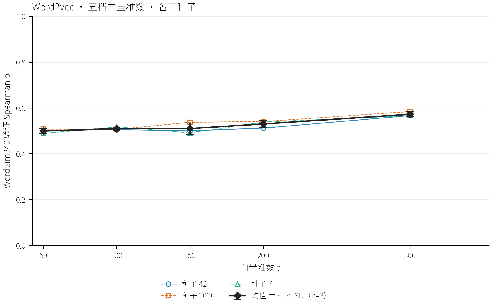
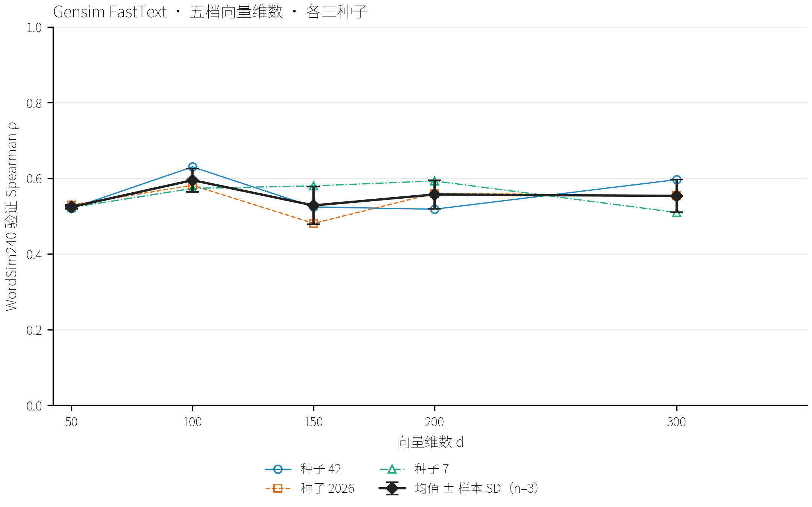
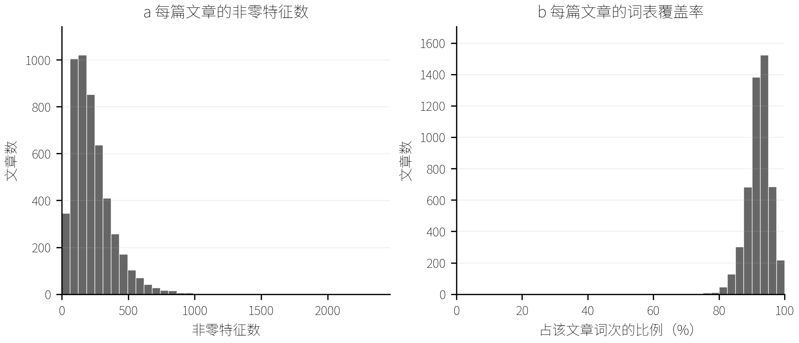
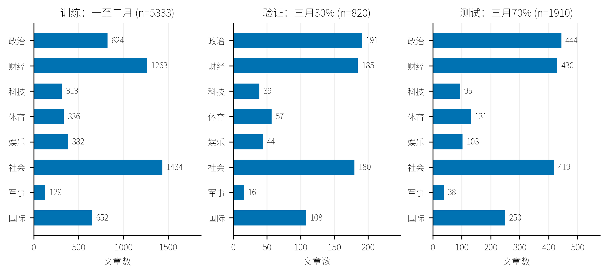
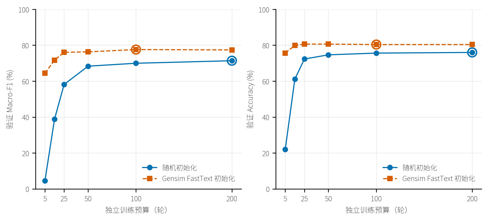
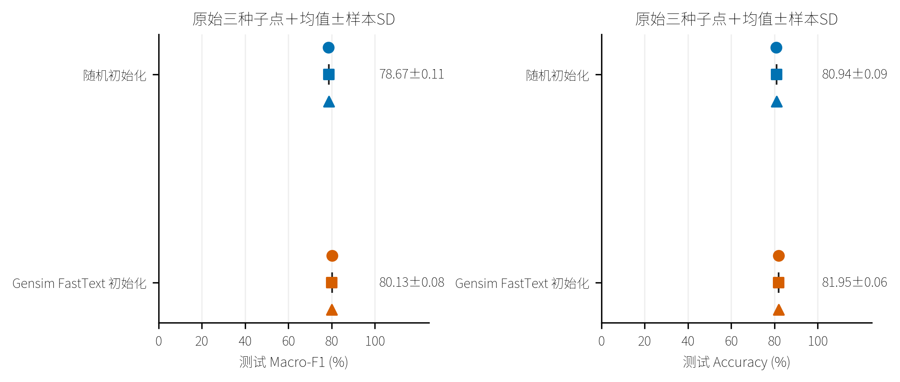
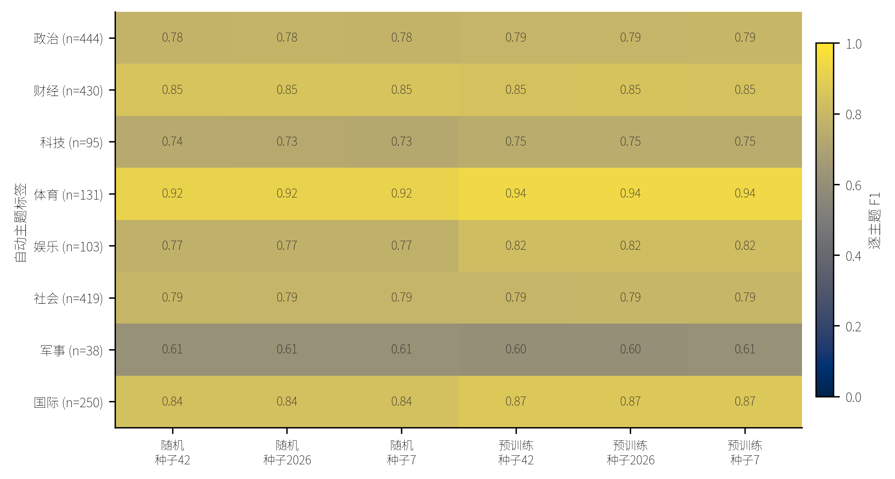

# 中文新闻文本表示的比较与 FastText 实现分析

## 摘要

本文围绕中文新闻的文本表示与主题分类，比较 TF-IDF、Word2Vec 和 Gensim FastText，并结合原生 FastText 实验与源码阅读，考察词向量评价、下游分类和计算成本之间的关系。在 THUCNews 上，完成文本清洗、去重和固定划分，以 821,609 篇新闻训练全量基线；在固定 50,000 篇子集上，用三个随机种子依次搜索训练方式、学习率和向量维数，再将选定的 Word2Vec 与 FastText 配置用于全量重训。评价涵盖词相似度、类比、词表覆盖、未登录词表示、训练耗时和存储成本，并核验模型保存与加载的一致性。

主题分类使用人民日报 1998 年一月至三月语料，比较原生 FastText 的随机初始化与预训练初始化，以及三种冻结表示接入同一 LinearSVC 的效果。冻结表示实验中，TF-IDF、Word2Vec 和 FastText 的测试 Macro-F1 分别为 80.15%、78.60% 和 78.01%；原生 FastText 的预训练路线在较低训练预算下获得更高的验证分数。两类实验的配对差值区间均包含零，且主题标签由模型自动生成、未经独立人工核验，结果尚不足以确认稳定的性能排序。

实现分析依据两篇 FastText 论文和 Gensim 4.4.0、原生 fastText 0.9.2 的固定版本源码，围绕字符子词、哈希桶、训练目标、负例采样、更新尺度及并行训练等十项机制展开。实验与实现共同说明：子词机制扩大了词表外表示的覆盖，但词向量基准的表现、向量可生成性与主题分类效果需要分别验证；方法选择还应结合监督更新方式与资源成本。

## 数据、工具与项目代码

项目代码与复现说明见 [GitHub 公开仓库](https://github.com/LynxPeng/Gensim-FastText)。逐种子数值、辅助曲线及完整分类指标见 [独立附录](Gensim&FastText-附录.md)。正文保留主要比较和实现代码，附录按 A–D 编排。

### 数据来源

- THUCNews 新闻语料：[清华大学 THUCTC 项目说明](https://github.com/thunlp/THUCTC#中文文本分类数据集thucnews)，[语料压缩包](https://thunlp.oss-cn-qingdao.aliyuncs.com/THUCNews.zip)。本文的文章数量以实际读取和清洗结果为准。
- 人民日报标注语料：[北京大学开放研究数据平台的官方资源入口](https://opendata.pku.edu.cn/dataset.xhtml?persistentId=doi%3A10.18170%2FDVN%2FSEYRX5)。本文使用 1998 年一月至三月的分词与词性标注文本；该入口提供资源说明及申请条件，复现时应核对语料版本。本文八类主题标签来自另行执行的自动标注。
- 中文词相似度与类比基准：[CWE 数据与说明](https://github.com/Leonard-Xu/CWE/tree/bc55e88a4be9480d585f009e36ce169ec041ae15/data)，[Chinese-Word-Vectors 测试集](https://github.com/Embedding/Chinese-Word-Vectors/tree/3096a475f79f218dde7b413dcc6b507d302b7f46/testsets)。评价使用固定版本的 WordSim240、WordSim297 和中文类比题组。

### 工具与版本

- 无监督表示与实现阅读：[Gensim 4.4.0 源码](https://github.com/piskvorky/gensim/tree/4.4.0)。
- 原生文本分类：[fastText 0.9.2 源码](https://github.com/facebookresearch/fastText/tree/v0.9.2)；Windows Python 接口采用 [fasttext-wheel 0.9.2 分发包](https://pypi.org/project/fasttext-wheel/0.9.2/)。
- 中文分词：[jieba](https://github.com/fxsjy/jieba)，本项目使用 0.42.1；冻结表示分类采用 [scikit-learn LinearSVC](https://scikit-learn.org/stable/modules/generated/sklearn.svm.LinearSVC.html)，具体依赖版本见仓库中的锁定文件。

## 引言

文本表示的评价需要区分词语关系、文档分类和计算成本。词相似度较高的模型未必更适合主题分类，能够生成未登录词向量也不意味着这些向量具有准确的语义。本文以中文新闻为对象，比较 TF-IDF、Word2Vec 和 Gensim FastText 的表示特征，并在八类主题分类中考察原生 FastText 的预训练初始化与冻结表示的实际效果。

实验分为 THUCNews 无监督表示学习和人民日报主题分类两个部分。前者包括全量基线、固定子集上的参数搜索及候选配置全量重训；后者分别评价监督训练中可更新的输入向量和接入同一分类器的冻结表示。在此基础上，结合两篇 FastText 论文与 Gensim 4.4.0 源码，分析子词共享、输出目标和参数更新规则对模型使用与结果解释的影响。

## 1 中文新闻文本表示与分类实验

### 1.1 无监督文本表示

TF-IDF 根据文档词频与文档频次构建稀疏表示，Word2Vec 和 Gensim FastText 根据上下文学习词向量。三个模型均在同一 THUCNews 训练分区上拟合，不使用新闻类别标签。文档级 TF-IDF 通过稀疏度、覆盖率与资源开销评价，词向量另通过词相似度和类比任务评价；三种表示的分类效果在第 1.2 节比较。

#### 1.1.1 数据集与预处理

THUCNews 压缩包包含 836,075 篇新闻，涵盖体育、娱乐、家居、彩票、房产、教育、时尚、时政、星座、游戏、社会、科技、股票和财经 14 类。数据依次经过字符清洗、分句分词、短文本过滤、全局去重和固定划分。

##### 1. 文件读取与字符清洗

逐篇读取新闻文本，保留标题、正文及段落顺序，排除压缩包目录和系统辅助文件。文本采用 UTF-8 解码并兼容字节顺序标记，解码失败的文件予以排除。读取时检查成员 CRC，并记录压缩包的 SHA-256 校验值。

清洗先还原 HTML 实体，再以 Unicode NFKC 统一全半角字符；随后删除简短 HTML 标签、以 HTTP 或 HTTPS 开头的网址，以及换行和制表符之外的控制及格式字符。连续空白压缩为单个空格，空行删除，其余段落边界保留。英文大小写、数字和繁简字形不再转换，标点保留至分句阶段。HTML 标签清理仅匹配长度为 1–200 且不跨行的标签片段，网址清理也仅覆盖上述两类前缀。

##### 2. 分句、分词与词元过滤

按中文句号、问号、叹号、分号、英文问号、叹号、分号及换行切分文本，再使用 jieba 0.42.1 默认词典和精确模式分词，关闭隐马尔可夫模型（HMM）。英文句点不作为分句边界。预处理采用 8 个进程，各进程使用相同词典，输出按输入顺序归并。

仅保留至少含一个汉字（Unicode U+3400–U+9FFF）、ASCII 英文字母或数字且内部无空白的词元。纯标点、纯符号和空白词元被删除，停用词保留，不做词干化或同义词合并。各模型接收相同的基础分词结果，再分别执行训练词频或文档频次筛选。

每个句段最多保留 256 个词，超长句段按原顺序分为连续分块，短句段和不同文章之间均不拼接。数字词元保留，但小数和百分数可能被拆分；例如，当前规则将 `12.5%` 转为 `12` 和 `5`。构造文本的完整处理示例见附录 A。

##### 3. 短文本过滤与去重

整篇文章少于 30 个有效词元时予以排除，文章内部的短句仍可保留。对清洗后的完整文本计算 SHA-256，并在全部类别和分区间删除完全重复文本。与固定留出文章重复时保留指定留出原文；其余重复项保留按压缩包成员顺序最先接受的文章。

表 1. THUCNews 文本过滤与去重结果

| 处理结果 | 文章数 | 判定依据 |
| --- | --- | --- |
| 原始新闻 | 836,075 | 通过文件筛选的新闻 `.txt` 成员 |
| 排除短文本 | 8,232 | 过滤后整篇文章少于 30 个词元 |
| 排除完全重复 | 1,234 | 清洗后完整文本 SHA-256 重复 |
| 最终保留 | 826,609 | 通过上述处理的唯一文章 |

去重依据为完整清洗文本。当前流程未进行语义近重复隔离，文字不完全相同的相似报道仍可能同时进入语料，这限制了留出结果对跨报道泛化能力的解释。

##### 4. 固定划分与模型输入

留出集固定为此前 50,000 篇实验中按类别比例、种子 42 抽取的 5,000 篇合格文章。扩展至全量时保留这批文章，其余合格文章进入训练集。类别仅用于分层抽样，留出文章未因评价结果而更换。

表 2. THUCNews 训练与留出分区

| 分区 | 文章数 | 句子／分块数 | 分词后的词数 |
| --- | --- | --- | --- |
| 训练集 | 821,609 | 18,576,718 | 378,641,761 |
| 留出集 | 5,000 | 114,052 | 2,337,756 |

文章按固定标识排序后导出。Word2Vec 和 Gensim FastText 读取相同的逐句语料，文档标识、类别和来源路径不进入词序列。TF-IDF 将同一文章的句段还原为完整词序列，按文章计算词频与文档频次。

词典、IDF 和词向量仅在训练集上拟合。清洗规则及短文本阈值提前固定，留出文本采用相同预处理，仅用于表示覆盖与上下文评分检查。

##### 5. 内在评价的验证与测试划分

词相似度和类比基准独立于新闻文章划分。基准题目先去重，再按种子 42 分配验证与测试题组。同一无序词对及关系交换、同时反向的等价类比题在不同基准中共享分区，跨分区题组交集为零。WordSim240 的 240 个词对去重后为 237 对，其中 95 对用于验证、142 对用于测试；其他基准按相同题组规则分配，目标验证比例为 40%。

每轮评价三个词相似度基准的全部验证题，并从每套类比验证池中按关系固定抽取最多 128 题。选定模型后评价全部测试题。WordSim297 与 WordSim296 高度重叠，其结果应作为相关证据解读。完整基准曾在历史实验中被观察，因此当前测试子集仍属探索性评价；本轮程序未使用测试分数选择参数或轮次。

#### 1.1.2 模型与全量基线设置

TF-IDF（term frequency–inverse document frequency，词频–逆文档频率）将文章词频乘以 log2(N / df_t)，其中 N 为训练文章数，df_t 为包含词项 t 的文章数，随后进行 L2 归一化。Word2Vec 基线采用连续词袋模型（continuous bag-of-words，CBOW），根据上下文预测中心词；Gensim FastText 使用相同预测目标，并通过字符子词共享输入参数。前者为每个整词学习独立向量，后者还可由字符片段组合未登录词（out-of-vocabulary，OOV）向量。

表 3. 三种表示及全量基线参数

| 设置 | TF-IDF | Word2Vec | Gensim FastText |
| --- | --- | --- | --- |
| 表示维度 | 最多 50,000 特征 | 100 | 100 |
| 词表过滤 | DF≥3、DF/N≤0.9 | 训练词频≥5 | 训练词频≥5 |
| 训练算法 | 文章 DF／IDF 统计 | CBOW | CBOW |
| 上下文窗口 | 不适用 | 5 | 5 |
| 训练轮数 | 一次统计遍历 | 实际 8／最佳 5 | 实际 5／最佳 1 |
| 训练目标 | 不适用 | HS=1、negative=0 | HS=1、negative=0 |
| 学习率 | 不适用 | 0.025→0.0001，按最多 15 轮调度 | 同 Word2Vec |
| 高频下采样 | 不适用 | 0.001 | 0.001 |
| 字符子词 | 不适用 | 无 | 长度 1–3、200,000 桶 |
| 并行 | 8 统计进程 | 20 训练线程 | 20 训练线程 |

词向量基线采用层次 softmax（hierarchical softmax，HS），关闭负采样（negative sampling，NS）。两个模型分别从头训练，至少 5 轮、最多 15 轮，依据 WordSim240 验证集的 Spearman 相关系数独立选择最佳检查点。连续 3 轮相对有效提升参照无超过 0.001 的改善时停止；任何更高得分均更新最佳模型，但不超过 0.001 的改善不重置耐心计数。学习率按 15 轮上限线性衰减至 0.0001，提前停止时保留原定日程。

运行环境为 Python 3.12、Gensim 4.4.0 和 NumPy 1.26.4。随机种子为 42，输入顺序固定，Python 哈希种子为 0；词向量训练使用 20 个 CPU 线程，数值库使用 4 个线程。每轮核对训练词数，并在训练结束后重载最佳模型进行测试。多线程更新不保证独立重训逐位一致，全量实验每个模型仅运行一个种子。以下基线结果用于提供参照，后续参数搜索与候选配置重训分别报告。

#### 1.1.3 固定子集上的超参数搜索

从训练分区固定抽取 50,000 篇完整文章，保留 14 类的原有比例。各类配额通过最大余数法分配，类内按文章标识和种子 42 生成的 SHA-256 排序抽取。子集含 1,129,776 个句段和 23,080,089 个词，与留出文章无交集，沿用全量语料的预处理结果和句段顺序。

搜索依次比较训练方式、初始学习率和向量维数。前两阶段采用 100 维向量，窗口为 5，最低词频为 5，高频词下采样阈值为 0.001；Gensim FastText 的字符子词长度为 1–3，哈希桶数为 200,000。各配置使用相同输入顺序、20 个训练线程和 4 个数值库线程，词表均为 94,426 词。

主指标为 WordSim240 验证 Spearman，统一在 95 个验证词对中双方均在训练词表内的 92 对上计算。FastText 的 OOV 表示另作诊断。辅助指标包括 Pearson、其他词相似度基准的验证 Spearman，以及三套类比各 128 道固定验证题的正确率，类比中的 OOV 题按错误计。

每次训练至少 3 轮、最多 15 轮，学习率按上限轮数线性衰减至 0.0001。早停以 0.001 为有效增幅阈值，同时检查连续无提升轮数与近期一轮、两轮的增幅；具体规则见附录 A。模型选择始终采用主指标最高的检查点，最佳轮次与停止轮次分别记录。复验使用种子 42、2026、7，汇总为均值±样本标准差（n=3）；标准差描述固定语料和题目下的训练波动。

##### 1. 训练方式

比较 CBOW、Skip-gram 与 HS、NS5、NS10 的六种组合，NS5 和 NS10 分别表示每个正例使用 5 个和 10 个负例。初始学习率统一为 0.025。两个模型先以种子 42 完成 12 组初筛，再对各自的 CBOW＋HS 基线及初筛最高分组合补充两个种子，共完成 20 次训练。


图 1. 训练方式初筛：Word2Vec 与 Gensim FastText 各六种组合。每个单元格为种子 42 下最佳检查点的 WordSim240 验证 Spearman，附对应轮次；每种配置一次运行。

固定种子 42 时，Skip-gram 在相同输出目标下均高于 CBOW。Word2Vec 的 HS 结果由 0.3559 提高至 0.4536，NS5 由 0.3889 提高至 0.5056；Gensim FastText 的 HS 由 0.4175 提高至 0.5278，NS10 由 0.3677 提高至 0.5641。

输出目标的排序依赖预测方式。FastText 采用 CBOW 时，HS 得分为 0.4175，高于 NS5 的 0.3370 和 NS10 的 0.3677；改用 Skip-gram 后，NS5 和 NS10 分别为 0.5612、0.5641，高于 HS 的 0.5278。负例数之间的差距较小，Word2Vec 的 Skip-gram＋NS5、NS10 分别为 0.5056、0.5038，FastText 则为 0.5612、0.5641。5 个与 10 个负例的直接比较仅有单种子结果。

三种子复验中，Word2Vec 的 CBOW＋HS 和 Skip-gram＋NS5 分别为 0.3402±0.0136、0.5095±0.0065；FastText 的 CBOW＋HS 和 Skip-gram＋NS10 分别为 0.4163±0.0161、0.5380±0.0256。按种子配对，两个候选组合的三次得分均高于各自基线，因此后续搜索分别采用 Skip-gram＋NS5 和 Skip-gram＋NS10。该增量对应预测方式与输出目标共同变化后的配置效果。


图 2. 基线与候选训练方式的三种子复验。点表示种子 42、2026、7 的独立训练结果，汇总为均值±样本标准差（n=3）；各次运行均使用自己的最佳验证检查点。

##### 2. 初始学习率

在选定训练方式下比较 0.005、0.01、0.025、0.05、0.1 五档初始学习率，每档使用三个种子，合计 30 组结果，其中 0.025 的六组复用训练方式复验。其他参数及选轮规则固定，按 WordSim240 验证 Spearman 均值选择学习率。

###### a) Word2Vec：Skip-gram＋NS5

Word2Vec 的最高均值出现在 0.025，为 0.5095±0.0065；0.05 为 0.5067±0.0276，两档均值相差 0.0028。按预定规则选择 0.025，其实测种子波动也较小。


图 3. Word2Vec 初始学习率与验证效果。横轴为学习率的对数坐标，彩色点线呈现全部三个种子结果，黑线与误差棒表示均值±样本标准差（n=3）。各点使用对应运行的最佳检查点。

###### b) Gensim FastText：Skip-gram＋NS10

Gensim FastText 的最高均值出现在 0.05，为 0.5949±0.0307，比 0.025 的 0.5380±0.0256 高 0.0569，三个种子的配对增量均为正；增至 0.1 后均值回落至 0.5207，标准差增至 0.0505。


图 4. Gensim FastText 初始学习率与验证效果。横轴为学习率的对数坐标，彩色点线呈现全部三个种子结果，黑线与误差棒表示均值±样本标准差（n=3）。各点使用对应运行的最佳检查点。

学习率选择存在任务间取舍。两个模型的 WordSim297 和 WordSim296 均在 0.01 时取得最高验证 Spearman 均值。FastText 的 CA_translated 类比正确率由 0.025 时的 0.2214 降至 0.05 时的 0.0990，CA8 形态类比则更偏好 0.005。因而，0.05 是针对 WordSim240 目标选出的 FastText 学习率，其优势未覆盖全部词语关系任务。逐种子数值、训练轨迹和辅助指标见附录 A。

##### 3. 向量维数

Word2Vec 固定为 Skip-gram＋NS5、学习率 0.025，Gensim FastText 固定为 Skip-gram＋NS10、学习率 0.05，比较 50、100、150、200、300 维。每档使用三个种子，共 30 组结果；其中 100 维的六组经核验后复用，其余 24 组从头训练。按主指标均值选择维数，精确同分时优先较低维数。

###### a) Word2Vec

Word2Vec 在 50–150 维的验证均值分别为 0.4993、0.5095、0.5099，200 维升至 0.5302，300 维最高，为 0.5724±0.0103。300 维相对 100 维提高 0.0629，三个种子的得分均有提高，因此选取 300 维。该维数位于搜索上界，当前结果尚未确定更大维数是否仍有收益。



图 5. Word2Vec 向量维数与 WordSim240 验证 Spearman。各档展示三个种子的最佳检查点得分，黑线与误差棒为均值±样本标准差（n=3）；连线仅辅助比较已测维数。

###### b) Gensim FastText

FastText 在 100 维取得最高均值 0.5949±0.0307，200 维和 300 维分别为 0.5571、0.5534。各种子的排序并不完全一致，种子 7 在 200 维取得 0.5928，高于 100 维的 0.5732。部分较高维数运行在第 3 轮触发早停，因此 100 维的优势应限定于当前学习率和训练预算。



图 6. Gensim FastText 向量维数与 WordSim240 验证 Spearman。各档展示三个种子的最佳检查点得分，黑线与误差棒为均值±样本标准差（n=3）；连线仅辅助比较已测维数。

维数变化还伴随资源成本变化。Word2Vec 由 100 维增至 300 维时，平均每轮耗时由 9.6 秒增至 12.9 秒，平均峰值内存由 287.7 MiB 增至 575.2 MiB，模型大小由 75.2 MiB 增至 219.3 MiB。FastText 的对应数值由 14.4 秒、517.0 MiB、151.5 MiB 增至 24.1 秒、1181.2 MiB、448.2 MiB，WordSim240 验证均值则未提高。

辅助任务仍显示不同偏好：Word2Vec 的 WordSim297／296 在 150 维最高，FastText 的两个题组在 100 维最高；FastText 的 CA8 形态和语义类比均在 300 维最高。完整数值及资源图见附录 A。

##### 4. 候选配置与适用范围

三个阶段得到的 Word2Vec 候选为 Skip-gram＋NS5、初始学习率 0.025、300 维，FastText 候选为 Skip-gram＋NS10、初始学习率 0.05、100 维。选择依据为主指标均值，资源指标用于描述代价，未参与加权评分。

逐阶段搜索尚未检验训练方式、学习率和维数之间的完整交互，语料也只有一份固定子集。主验证集仅含 92 个词对，三种子结果反映训练波动，未覆盖题目与语料抽样的不确定性。搜索阶段未读取测试分数；冻结后的两套候选配置随后用于全量重训，其结果在下文单独报告。

#### 1.1.4 全量基线与 TF-IDF 表示特征

##### 1. 词向量基线

CBOW＋HS 基线中，Word2Vec 实际训练 8 轮，在第 5 轮取得最高 WordSim240 验证 Spearman 0.3655；FastText 实际训练 5 轮，在第 1 轮取得最高值 0.3499。两个模型均重载各自最佳检查点进行测试，WordSim240 测试 Spearman 分别为 0.4875 和 0.4521。逐轮曲线及其他基准结果见附录 B。

两个模型均保留 263,356 词，对留出语料的训练词表覆盖率为 99.81%。FastText 为全部 4,445 次 OOV 出现生成向量，Word2Vec 跳过这些词。词相似度正式评价仅使用双方共同覆盖的词对，OOV 生成向量的分数另作诊断；类比搜索范围为训练词表，并分别报告覆盖题与全部题正确率。

累计参数更新耗时分别为 Word2Vec 1407.4 秒、FastText 918.0 秒，实际训练轮数不同，累计时间主要用于描述本轮总成本。两次全量基线均为单种子运行，分数差异不足以建立稳定的模型排序。

##### 2. TF-IDF 稀疏表示

TF-IDF 在 821,609 篇训练文章上拟合，保留 50,000 个特征。5,000 篇留出文章共含 2,337,756 词次，其中 2,145,292 词次进入词表，整体覆盖率为 91.77%。逐篇非零特征数中位数为 195，四分位区间为 117–295，均值为 228.48；中位数仅占特征空间的 0.39%。



图 7. TF-IDF 留出文章的非零特征数与词次覆盖率分布。a：非零特征数；b：进入词表的词次占比。两面板纵轴均为文章数，n=5,000。

全部留出文章均获得非零表示。词典与模型合计 5.3 MiB，拟合耗时 56.7 秒，历史主进程峰值内存为 416.4 MiB。TF-IDF 的计时包含词频、文档频次与 IDF 统计，词向量计时仅包含参数更新，二者用于描述各自的资源需求。当前结果表明 TF-IDF 表示稀疏且存储紧凑，其主题区分能力还需通过分类任务检验。

#### 1.1.5 候选配置全量重训与表示比较

冻结子集搜索得到的候选参数后，在相同的 821,609 篇训练文章上从头重训两个词向量模型，并沿用既定验证和测试分区。全量重训各使用种子 42，Word2Vec 选中第 2 轮，FastText 选中第 11 轮；后续分类实验使用这两套模型。以下结果与前述 CBOW＋HS 基线分别对应不同训练配置。

表 4. 候选配置全量重训的测试表现与覆盖

| 评价指标 | Word2Vec 候选全量模型 | Gensim FastText 候选全量模型 |
| --- | --- | --- |
| 训练方式 | Skip-gram＋NS5 | Skip-gram＋NS10 |
| 初始学习率／维数 | 0.025／300 | 0.05／100 |
| WordSim240 测试 Spearman | 0.5061 | 0.4963 |
| WordSim297／296 测试 Spearman | 0.5379 | 0.5692 |
| CA8 形态类比全部题正确率 (%) | 7.84 | 17.83 |
| 留出词表覆盖率 (%) | 99.81 | 99.81 |
| 留出可用向量覆盖率 (%) | 99.81 | 100.00 |

Word2Vec 在当前 WordSim240 和翻译类比任务上的得分较高，翻译类比全部题正确率为 41.38%，300 维完整模型约为 611.8 MiB。FastText 在 WordSim297／296 和 CA8 形态类比上较高，并补充了 OOV 表示。不过，FastText 候选模型的形态类比正确率仍低于 CBOW＋HS 基线的 30.26%，表明以词相似度为主目标的选参伴随任务间取舍。

两套候选的维数、学习率和负例数不同，全量阶段也各只有一个种子。当前比较反映既定配置在这些基准上的表现，架构本身的独立贡献仍需匹配条件的对照。TF-IDF 的优势体现为紧凑的稀疏文档表示，词向量的优势与代价则随关系任务和表示覆盖而变化，三种方法的分类性能在下一节评价。

### 1.2 八类主题分类

分类实验使用同一数据划分比较两类问题：原生 FastText 在监督训练中是否受益于 Gensim 预训练初始化，以及三种冻结表示接入同一 LinearSVC 后的表现。前者允许输入向量随标签更新，后者只训练分类器。

#### 1.2.1 数据处理、自动主题标签与划分

使用人民日报 1998 年一月至三月语料，原始 8,679 篇，清洗后保留 8,431 篇。原文已分词并标注词性；按文章编号聚合段落，保留文件顺序，删除编号、词性后缀和实体括号，并以 NFKC 统一字符形式、清除控制字符。分类输入保留标题、正文和功能词，少于 30 个有效词的文章予以排除。

完全重复文本保留最早一篇，以字符三元组 SimHash 汉明距离不超过 3 定义近重复组。本轮排除 248 篇短文章，合格文章中完全重复文本和近重复文章对均为零；清洗保留数及主题定义见附录 C。版面编号不参与标签判定、特征构建或数据划分。

DeepSeek `deepseek-flash` 对完整文章进行一次自动主题标注，类别为政治、财经、科技、体育、娱乐、社会、军事和国际。标注关闭思考模式，不提供日期、版号等源文件元数据或分类器预测，正文中的日期仍保留。按文章中心事件判定主题，外国财经、体育和科技报道分别归入相应主题。进入实验的标注需提供连续原文证据，但证据真实性检查仅验证引用文本，主题正确性仍未经过独立人工核验。

8,431 篇文章均获得有效结构化响应，其中 8,063 篇可归入八类，368 篇因文学创作、天气预报或多主题汇编等原因排除。一至二月的 5,333 篇文章用于训练；三月文章按主题分层、按重复组以种子 42 分为验证集 820 篇和测试集 1,910 篇。分配采用分组分层十折划分，三折验证、七折测试，各主题验证数量与 30% 目标相差不超过 2 篇，文章标识及重复组均不跨分区。



图 8. 八类主题在训练、验证和测试集中的文章数。标签来自单次自动标注；三个面板横轴范围不同，均从零起。

验证集用于选择轮数或分类器参数，冻结配置后评价测试集。三月数据参与了模型选择，本文将其测试分区称为三月留出测试。THUCNews 仅提供预训练表示，未提供本轮分类训练文章或主题标签。所有分类分数均衡量模型与这套自动主题标签的一致性。

#### 1.2.2 原生 FastText 与预训练初始化

原生监督 FastText 比较随机初始化与 Gensim FastText 初始化两条路线。分词后的词和词 bigram 映射为输入向量，平均聚合为文章表示，再通过线性输出层与 softmax 预测主题。标签损失同时更新输入向量与输出权重。

两条路线统一采用 100 维、学习率 0.1、最低词频 1、词 bigram、200,000 个哈希桶、softmax 和 20 个 CPU 线程，关闭原生字符子词。预训练源模型为前节全量重训的 Gensim FastText，即 Skip-gram＋NS10、100 维、字符子词长度 1–3、最佳检查点第 11 轮。

仅为本轮训练词表的 74,462 个词导出完整初值，其中 50,393 个来自源词表，24,069 个由源模型的字符子词组合生成。导入范围为词向量，Gensim 的字符桶未迁移，词 bigram 参数仍由监督训练学习。监督训练更新原生模型中的向量副本，源模型保持冻结。32 个检查词通过零学习率导入核验，选定种子 42 模型中的 32 个向量均在训练后发生变化，支持输入向量实际参与了监督更新。

预测分数经去除数值偏移和归一化得到八类 softmax 概率，类别排序保持一致。该处理未校准概率，高分仍需结合标签误差和类别边界解释。

#### 1.2.3 训练预算与整体测试表现

种子 42 分别训练 5、15、25、50、100、200 轮，以验证集宏平均 F1（Macro-F1）最高值选择预算，同分时优先较少轮数。六个预算对应六次独立训练的终点。选定后以种子 2026、7 复验，轮数保持不变。

表 5. 两种初始化的验证训练预算

| 路线 | 5 轮验证 Macro-F1 (%) | 15 轮 | 25 轮 | 50 轮 | 100 轮 | 200 轮 | 选定轮数 |
| --- | --- | --- | --- | --- | --- | --- | --- |
| 随机初始化 | 4.50 | 38.79 | 58.15 | 68.33 | 69.96 | 71.37 | 200 |
| Gensim FastText 初始化 | 64.39 | 71.66 | 76.05 | 76.31 | 77.58 | 77.36 | 100 |



图 9. 原生 FastText 两种初始化的训练预算比较。每个点为种子 42 的一次独立训练终点，空心圈标记验证 Macro-F1 选定的轮数；连接线表示有序预算变化。

随机初始化选中 200 轮，位于搜索上界；预训练初始化选中 100 轮。预训练路线在 25 轮时验证 Macro-F1 为 76.05%，已高于随机路线在 200 轮时的 71.37%。这表明在当前监督参数下，预训练初始化改善了较低预算的验证表现，但其成本还包括额外的 THUCNews 预训练。

最终测试结果以三种子均值±样本标准差报告。Macro-F1 等权计入八类，微平均 F1（Micro-F1）在该单标签任务中等于准确率（Accuracy），加权 F1（Weighted-F1）按测试类别频次加权。种子波动仅涵盖监督训练阶段，预训练源表示只有一套。

表 6. 原生 FastText 三种子整体表现

| 路线 | 轮数 | 验证 Macro-F1 (%) | 测试Macro-F1 (%) | Accuracy / Micro-F1 (%) | Weighted-F1 (%) |
| --- | --- | --- | --- | --- | --- |
| 随机初始化 | 200 | 71.37 ± 0.10 | 78.67 ± 0.11 | 80.94 ± 0.09 | 80.96 ± 0.09 |
| Gensim FastText 初始化 | 100 | 77.30 ± 0.43 | 80.13 ± 0.08 | 81.95 ± 0.06 | 81.92 ± 0.06 |



图 10. 原生 FastText 三种子测试表现。圆形、方形、三角形分别表示种子 7、42、2026，黑色标记和误差线为均值±样本标准差，每条路线 n=3。

预训练初始化的平均测试 Macro-F1 为 80.13%，随机初始化为 78.67%。针对种子 42 的同一批测试文章，按主题分层进行 2,000 次配对 bootstrap，Macro-F1 差值为 1.31 个百分点，95% 百分位区间为 [−0.45, 2.99] 个百分点。区间跨零，当前文章抽样证据尚不足以确认稳定优势。该区间与三种子标准差分别描述文章抽样和训练波动；两条路线各自选择预算，差值也同时包含初始化与训练轮数的影响。

#### 1.2.4 逐主题表现与表示覆盖



图 11. 两种初始化、三个种子的逐主题 F1。括号标注测试文章数，所有单元格采用共同的 0–1 色阶。

初始化收益在各主题间分布不均。娱乐类平均 F1 提高 5.38 个百分点，军事类的预训练结果则为 60.55%，低于随机初始化的 61.11%，该类仅含 38 篇测试文章。逐主题结果同时受到样本数量和自动标签边界的影响，总体均值提高并未对应每一类的同步改善。完整 Precision、Recall、F1 和混淆矩阵见附录 C。

两条路线的监督训练词表相同，验证和测试词次覆盖率分别为 97.13% 和 97.02%，均无全部词落在词表外的文章。原生字符子词已关闭，预训练时由 Gensim 为训练词生成初值，并未赋予原生模型在推断时生成任意 OOV 字符向量的能力。

高分预测与自动标签仍有分歧，例如《教师的心声》被标为政治，预训练模型预测为社会；《做好军转安置工作》被标为军事，模型预测为政治。这些案例提示类别边界存在交叉，具体证据见附录 C。缺少人工核验时，模型与自动标签的分歧只能作为复核线索。

#### 1.2.5 资源成本与初始化实验小结

表 7. 原生 FastText 的资源成本

| 路线 | 训练耗时 (s) | 加载及测试预测耗时 (s) | 进程峰值 RSS (MiB) | 模型大小 (MiB) |
| --- | --- | --- | --- | --- |
| 随机初始化 | 9.48 ± 0.06 | 0.38 ± 0.01 | 885.66 ± 1.09 | 105.94 ± 0.00 |
| Gensim FastText 初始化 | 7.82 ± 0.19 | 0.38 ± 0.00 | 906.95 ± 17.35 | 105.94 ± 0.00 |

训练耗时统计原生监督训练调用，包含读取训练输入与初始向量；此前的 THUCNews 预训练、主题标注和向量导出不计入。峰值常驻内存（resident set size，RSS）为进程采样峰值，模型大小为保存文件体积。保存加载后的验证与测试预测一致。

在当前监督配置中，预训练初始化以较少轮数获得较高的验证表现，测试平均 Macro-F1 也较高。配对区间仍跨零，结论限于本轮配置和自动标签评价。若要评价真实主题识别准确率，需要独立人工标注测试集，并进一步区分初始化收益、预算差异和预训练数据带来的影响。

#### 1.2.6 三种冻结表示与同一 LinearSVC

##### 1. 比较条件与验证选参

复用 THUCNews 学到的 TF-IDF、Word2Vec 和 Gensim FastText，冻结词典、IDF、词向量及子词参数，仅训练 LinearSVC。训练、验证和测试仍为前述 5,333、820、1,910 篇文章，文本与重复组划分保持一致。

TF-IDF 沿用 50,000 词词典及 IDF，生成稀疏文章向量。Word2Vec 和 FastText 按词的出现次数加权求均值，前者跳过 OOV，后者允许组合字符子词向量。三种文章表示均进行 L2 归一化。Word2Vec 为 300 维、Skip-gram＋NS5、学习率 0.025，FastText 为 100 维、Skip-gram＋NS10、学习率 0.05；该比较评价现有表示的使用效果，维数和预训练参数差异仍包含在方法间差值中。

LinearSVC 统一采用 L2 惩罚、平方 hinge 损失、one-vs-rest 策略及 balanced 类别权重。使用原始问题求解，容差为 0.0001，最多 20,000 次迭代。各表示仅在训练文章上拟合，从 C 的三个候选值（0.1、1、10）中按验证 Macro-F1 选参，同分时选择较小值；配置冻结后评价测试集，未合并验证集重新拟合。

表 8. 冻结表示的 LinearSVC 验证选参

| 表示 | C=0.1验证 Macro-F1 (%) | C=1验证 Macro-F1 (%) | C=10验证 Macro-F1 (%) | 选定C |
| --- | --- | --- | --- | --- |
| TF-IDF | 78.68 | 79.27 | 77.52 | 1.0 |
| Word2Vec | 74.06 | 78.30 | 80.31 | 10.0 |
| Gensim FastText | 71.42 | 75.96 | 75.31 | 1.0 |


图 12. 三种冻结表示接入 LinearSVC 的验证选参。n=820，每个点对应一次独立拟合，空心圈标记选定 C。

九组正式拟合均收敛。Word2Vec 的选定值 C=10 位于候选上界，其最优性限定于这三个已测值。求解迭代预算诊断见附录 D，诊断曲线未用于重新选参。分类器由 CPU 的 liblinear 求解，数值库限制 4 线程，特征转换使用 8 线程；本轮未重复预训练表示，测试区间不包含词向量训练种子波动。

##### 2. 整体测试表现与配对差值

表 9. 冻结表示的整体测试表现

| 表示 | C | Accuracy (%) | Macro-F1 (%) | Macro-F1 95% 区间 (%) | Micro-F1 (%) | Weighted-F1 (%) |
| --- | --- | --- | --- | --- | --- | --- |
| TF-IDF | 1.0 | 81.15 | 80.15 | [77.81, 82.29] | 81.15 | 81.17 |
| Word2Vec | 10.0 | 79.95 | 78.60 | [76.46, 80.74] | 79.95 | 79.92 |
| Gensim FastText | 1.0 | 79.58 | 78.01 | [75.79, 80.12] | 79.58 | 79.63 |

TF-IDF 的测试 Macro-F1 点估计最高，为 80.15%，Word2Vec 和 FastText 分别为 78.60%、78.01%。Word2Vec 的验证得分最高，但测试排序改变，显示当前验证分区的小幅差异未在另一批文章中保持。


图 13. 三种冻结表示的三月留出测试表现。n=1,910，Macro-F1 误差线为按自动主题分层、文章配对重采样 2,000 次的 95% 百分位区间，Accuracy 显示点估计；每种表示使用一个选定分类器。

表 10. 冻结表示的配对 Macro-F1 差值

| 配对差值（前者－后者） | Macro-F1 差值（百分点） | 95% 区间（百分点） |
| --- | --- | --- |
| Word2Vec－TF-IDF | -1.56 | [-3.64, 0.78] |
| Gensim FastText－TF-IDF | -2.14 | [-4.43, 0.03] |
| Gensim FastText－Word2Vec | -0.59 | [-2.30, 1.04] |

三组配对差值区间均包含零。当前结果支持 TF-IDF 点估计较高，但稳定排序与方法等效性均未得到确认。重采样对三种方法使用相同文章，并保持各主题测试数量；当前近重复组均为单篇，文章作为重采样单位。区间以既有自动标签和已训练模型为条件，未涵盖标签误差、预训练波动或多重比较校正，因而作为探索性比较报告。

##### 3. 逐主题表现与覆盖率


图 14. 三种冻结表示的逐主题 F1。括号标注测试文章数，单元格采用共同的 0–1 色阶；各数值来自对应的选定分类器。

表 11. 冻结表示的测试词次覆盖

| 表示 | 测试词次 | 词典内覆盖率 (%) | 可用向量覆盖率 (%) | 零向量文章 |
| --- | --- | --- | --- | --- |
| TF-IDF | 724,171 | 86.33 | 86.33 | 0 |
| Word2Vec | 724,171 | 95.74 | 95.74 | 0 |
| Gensim FastText | 724,171 | 95.74 | 100.00 | 0 |

TF-IDF 的词典内覆盖率为 86.33%，Word2Vec 为 95.74%，FastText 的词典内覆盖率同为 95.74%，计入子词生成向量后可用表示覆盖率为 100%。三种方法均无零向量文章。覆盖率描述特征是否能够构造，FastText 的覆盖优势在本轮未转化为更高的总体分类分数。词均值聚合可能压缩词袋中的区分信息，但这一解释尚未经消融验证。完整逐类指标和混淆矩阵见附录 D。

##### 4. 计算成本与分类比较小结

表 12. 冻结表示分类的计算成本

| 表示 | 特征维数 | 8,063 篇特征转换 (s) | 选定分类器拟合 (s) | 加载及 1,910 篇预测 (s) | 拟合进程峰值 RSS (MiB) | 分类器文件 (MiB) |
| --- | --- | --- | --- | --- | --- | --- |
| TF-IDF | 50,000 | 2.67 | 0.414 | 0.0057 | 679.80 | 3.0526 |
| Word2Vec | 300 | 11.26 | 0.593 | 0.0039 | 684.97 | 0.0191 |
| Gensim FastText | 100 | 15.57 | 0.144 | 0.0017 | 650.99 | 0.0069 |

特征转换时间包含表示加载与 8,063 篇文章转换，分类器拟合仅计拟合调用，预测时间包含分类器加载及缓存测试特征上的推断。RSS 来自共享编排进程，受已加载库、表示和缓存影响；分类器文件体积不含外部词典或词向量。单次秒级测量用于描述本机成本，稳定吞吐还需重复测量。

FastText 分类器较小，但子词向量生成使其本轮特征转换耗时最高。TF-IDF 虽有 50,000 维，稀疏计算仍使拟合耗时低于 1 秒。模型分歧案例见附录 D，其作用是展示具体分类差异，未经人工核验的自动标签仍可能有误。

冻结表示比较中，TF-IDF 取得最高整体点估计，三组配对区间均跨零。原生 FastText 初始化实验则允许输入向量继续更新，并同时学习词 bigram 和分类权重。两类实验共同表明，预训练表示、监督更新和聚合方式需要分别考察：监督训练中的初始化收益，并未直接对应冻结表示接入 LinearSVC 后的优势。三月测试分区已有实验观察历史，且标签来自单次自动判断，结论限于当前探索性评价。

## 2 FastText 的模型原理与研究依据

### 2.1 FastText 文本分类模型

Joulin 等在 *Bag of Tricks for Efficient Text Classification* [1] 中研究了文本分类的准确率与计算成本之间的权衡。作者将低秩线性分类、词组合特征和树形标签预测整合为 FastText，使简单模型在较低计算成本下取得有竞争力的分类效果。其贡献主要在于系统设计与规模验证，为大规模文本分类提供了高效的实现方案。

#### 2.1.1 模型原理

##### 1. 模型结构

FastText 将文档中的词及词组合映射为低维向量，取平均得到文档表示，再通过输出矩阵计算类别分数。设特征空间大小为 F，类别数为 K，向量维数为 d，文档的归一化特征计数为 x（F 维实向量），输入、输出矩阵分别为 A（d × F 实矩阵）和 B（K × d 实矩阵），则

$$
\mathbf h=A\mathbf x
=\frac{1}{m}\sum_{j=1}^{m}\mathbf a_{f_j},
\qquad
\mathbf s=B\mathbf h=BA\mathbf x.
\tag{1}
$$

其中，m 为特征实例数，a_(f_j) 为相应输入向量，重复特征按出现次数参与平均。启用词 n-gram 后，m 同时包含单词和词组合实例，归一化时需要计入二者。模型没有非线性隐藏层，分类权重等价于 W = B × A，满足 rank(W) ≤ d。参数量由 K × F 变为 d × F + K × d，在特征和类别较多、表示维度较低时可节省存储与计算。低秩约束也限制了模型容量，各类别通过共享输入表示学习相关特征。提高维度可以放宽秩约束，同时增加存储与运算需求，因而维度选择本身也是表达能力与资源成本之间的权衡。

##### 2. 训练目标

分类概率由 softmax 给出，输入向量和输出权重通过标签联合训练。对于 N 篇单标签文档，目标为

$$
\mathbf p_n=\operatorname{softmax}(BA\mathbf x_n),
\qquad
\mathcal L=-\frac{1}{N}\sum_{n=1}^{N}\log p_{n,y_n},
\tag{2}
$$

其中，y_n 为文档的训练类别标签。分类损失同时更新 A 与 B，使输入表示直接适应标签预测。它与连续词袋模型（CBOW）均采用平均操作，但监督目标不同。先训练无监督词向量、固定表示后再学习独立分类器，则无法通过分类损失调整词向量；这一差异决定了两种流程学到的表示并不等价。

#### 2.1.2 计算优化

##### 1. 词 n-gram

单词向量平均不保留词序，论文加入相邻单词构成的词 n-gram，使局部组合关系进入特征空间。例如，“狗 咬 人”与“人 咬 狗”的单词计数相同，bigram 却不同。词组合与单词共同参与平均，无需改变分类结构。这种方式能够补充局部顺序信息，表达范围仍受组合长度限制；增加长度也会扩大特征规模。

##### 2. 特征哈希

为控制词组合的存储开销，模型将 n-gram 映射到固定数量的哈希桶，避免维护全部组合的独立词典。参数表规模因此不再随不同词组合的数量持续增长，代价是不同特征可能因碰撞而共享向量。桶数越大，存储需求越高，碰撞通常越少；工程设置需要兼顾资源预算与特征区分能力。

##### 3. 层次 softmax

平坦 softmax 需要计算全部类别分数，输出开销为 O(K × d)。论文使用 Huffman 二叉树组织标签，将类别放在叶节点，预测转化为根到叶路径上的二元决策。设标签 y 的路径长度为 L_y，内部节点向量为 b_i，方向为 t_i（取 −1 或 +1），则

$$
P(y\mid\mathbf h)
=\prod_{i=1}^{L_y}\sigma(t_i\mathbf b_i^\top\mathbf h),
\qquad \sigma(a)=\frac{1}{1+e^{-a}}.
\tag{3}
$$

路径上的条件概率相乘形成归一化的标签分布，其参数化方式与平坦 softmax 不同。Huffman 编码为高频标签分配较短路径，训练时只更新目标路径上的节点。预测时，子树根概率构成其叶节点概率的上界，可据此剪枝。原文将实践中的成本概括为接近 O(d × log K)，实际搜索量仍取决于树结构和分支概率，不能直接作为最坏情况保证。

##### 4. 并行训练

模型采用学习率线性衰减的随机梯度下降，并通过多个 CPU 线程异步更新共享参数。每次训练只访问文档包含的输入特征及标签路径上的输出节点，稀疏访问减少了更新量，异步执行降低了同步开销。低维查表、局部特征和树形输出共同构成其效率基础，多线程的更新顺序则可能带来训练波动。

#### 2.1.3 结论

原论文实验中，词组合特征改善了分类效果，FastText 在多类文本任务中以较低成本接近较复杂模型的准确率，并扩展至大规模语料和标签空间。其优势集中于效果、速度与资源需求的平衡，准确率并非在所有任务上领先。模型间的硬件与实现条件也未完全统一，耗时差异包含算法和实现因素的共同影响。

#### 2.1.4 讨论

当分类信息主要集中在单词及局部组合时，简单加性表示可作为有效基线。其主要限制是难以建模长距离依赖、否定范围和复杂上下文关系。论文对低秩约束、哈希桶数及并行机制的独立贡献缺少完整消融，部分较小性能差异也缺少多次运行验证。

后续研究可通过分层错误分析判断局部特征的表达边界，并在统一预算下比较特征长度、向量维数和标签树设计。对于大标签任务，还需关注低频类别、检索覆盖及延迟分布。本文的冻结词向量分类与原生监督 FastText 因而分别评价，以区分表示本身和标签联合训练的作用。

### 2.2 FastText 子词嵌入模型

Bojanowski 等在 *Enriching Word Vectors with Subword Information* [2] 中提出子词 Skip-gram 模型，以缓解低频词和未登录词的表示问题。普通词向量为每个词分配独立参数，词形变化会进一步分散训练样本。作者以字符片段共享输入参数，使不同词形能够复用上下文信息。

#### 2.2.1 子词表示

##### 1. 字符 n-gram

模型在词首和词尾添加 `<`、`>`，提取长度为 3–6 的连续字符片段，并保留独立整词项。以 `where` 为例，长度为 3 的片段包括 `<wh`、`whe`、`her`、`ere`、`re>`。边界符号区分词首、词尾和内部位置，整词项则用于保留该词特有的信息。片段 `her` 与词 `her` 的整词项使用不同参数，避免将内部片段直接等同于独立单词。字符片段可能覆盖词根或词缀，也可能跨越词素边界，因此模型无需形态分析器或人工词素标注。

字符 n-gram 在单词内部提取，用于词形之间的参数共享；监督分类模型的词 n-gram 跨越相邻单词，用于保留文档的局部词序。两者的特征单位与共享范围不同。

##### 2. 模型结构

设词 w 的表示项集合为 G_w，包含字符片段和整词项，各项的输入向量为 z_g，上下文词 c 的输出向量为 v_c，则

$$
\mathbf u_w=\sum_{g\in\mathcal G_w}\mathbf z_g,
\qquad
s(w,c)=\mathbf u_w^\top\mathbf v_c.
\tag{4}
$$

模型改变了中心词输入向量的参数化方式，上下文输出仍按词独立存储。具有相同片段的词共享相应参数，一个词的训练会同时影响其他词形的组合表示。低频词由此获得额外的统计信息，而整词项保留共享片段无法表达的差异。

##### 3. 未登录词

OOV 没有已训练的整词项，可以提取字符片段并组合已有参数。表示质量取决于片段的训练程度，以及共享拼写是否反映相关语义。复现还需明确求和或平均规则：二者对非零向量的余弦相似度相同，但未经归一化的点积与训练梯度可能不同。

#### 2.2.2 模型训练

模型沿用 Skip-gram 的词与上下文共现学习，采用负采样降低全词表归一化的成本。对正例 (w, c) 抽取 q 个负上下文 n_i，优化

$$
\mathcal L_{w,c}
=-\log\sigma(\mathbf u_w^\top\mathbf v_c)
-\sum_{i=1}^{q}\log\sigma(-\mathbf u_w^\top\mathbf v_{n_i}).
\tag{5}
$$

该损失提高真实上下文的匹配分数，降低负例分数。它采用独立二元判别，sigmoid 输出不构成全词表归一化概率，应与分类论文的层次 softmax 区分。

由于中心词表示由各项相加得到，损失梯度会传播到整词项和全部字符片段。例如，`where` 与 `there` 共享部分片段，更新前者也会改变后者的表示。若多个片段访问同一哈希桶，该桶的更新按访问次数累加。共享参数能够改善稀疏估计，但低频词的独立整词项仍依赖自身样本，拼写相似也未必意味着语义相同。

#### 2.2.3 计算优化

##### 1. 特征哈希

论文使用 FNV-1a 将字符片段映射到 200 万个桶，使子词参数表保持固定规模。相同片段跨词复用是预期的共享，不同片段落入同一桶则形成额外耦合。哈希控制了存储增长，但内存开销仍随桶数和向量维数增加，碰撞影响也需要结合语料评价。

##### 2. 训练设置

原文每个正例抽取 5 个负例，抽样概率正比于词频的平方根，并使用动态上下文窗口和高频词下采样。负采样减少输出访问，子词组合增加输入访问；若中心词含 m_w 个表示项，单个词对的计算量约为 O((m_w + q + 1) × d)。因此，子词共享带来表示收益，也付出额外查表与向量运算成本。

实现采用 C++ 和 Hogwild 异步更新，学习率随训练进度线性衰减。原论文报告的子词模型训练速度低于普通 Skip-gram。实现仍采用稀疏异步更新，额外开销主要来自每个中心词需访问多个输入向量。

#### 2.2.4 结论

多语言实验显示，子词表示对稀有词、未登录词和形态相关的句法关系较为有效，小规模语料下也能利用共享参数缓解数据不足。预训练子词向量还改善了所报告语言模型的初始化效果。收益具有任务差异：常见词相似度和语义类比未必改善，部分设置出现下降，字符长度的选择也会影响结果。

#### 2.2.5 讨论

该方法将词形信息纳入上下文学习，在无需形态标注的条件下实现跨词共享。共享字符片段可能捕获形态规律，也可能使拼写相近、语义不同的词相互干扰。模型仍为同一表面词构造静态表示，对一词多义和复杂上下文的处理有限；陌生构词、无规律名称及哈希碰撞也可能影响 OOV 向量质量。

论文的部分比较存在学习率差异，字符范围未通过正式验证程序选取，组件消融与多随机种子结果也不充分。后续研究可在统一训练条件下考察整词与子词的组合权重，并按词频、构词类型及 OOV 状态评价共享的收益与代价。原文未验证中文，字符范围和分词方式仍需通过独立验证集确定。

两篇论文均以低维向量查表与聚合为基础，分类模型由文档标签监督训练，子词模型则学习词与上下文的关系。Gensim FastText 对应后者，词向量聚合分类属于其下游应用。第 1 节的两个分类实验据此区分了监督更新与冻结表示，模型名称相同并不意味着训练目标和输入特征相同。

## 3 Gensim FastText 的实现机制

Gensim 4.4.0 的 FastText 将整词与字符 n-gram 参数组合为输入表示，根据上下文训练词向量，对应第 2.2 节的子词模型。第 2.1 节监督分类模型中的词 n-gram 与标签联合训练由原生监督接口实现，Gensim 的无监督 FastText 类本身不包含该分类流程。

以下以 V、B、d 表示词表大小、字符桶数和向量维数，n_w 表示词 w 的字符 n-gram 实例数，不含独立整词项；重复片段和哈希碰撞均按访问实例计数。u_w 为整词项与字符项之和，h_w 为训练输入，e_w 为查询向量。分析依据为固定版本源码与已有微型数值探针，关键连续代码片段随对应机制列出，省略函数外围代码。所示行号对应 Gensim 4.4.0。

### 3.1 字符边界与特征提取

Gensim 为词添加 `<`、`>` 后编码为 UTF-8，再沿字符边界提取片段。循环跳过 UTF-8 后续字节，扩展时跨过同一字符剩余的字节，因此 n-gram 长度按字符计数。一个常用汉字虽通常占三个字节，仍计为一个字符。单独的边界符被排除，整词项另存于词表索引。

关键代码：`fasttext_inner.pyx`，第 707–719 行。

```cython
for i in range(num_bytes):
    if bytez[i] & _MB_MASK == _MB_START:
        continue

    j, n = i, 1
    while j < num_bytes and n <= max_n:
        j += 1
        while j < num_bytes and (bytez[j] & _MB_MASK) == _MB_START:
            j += 1
        if n >= min_n and not (n == 1 and (i == 0 or j == num_bytes)):
            ngram = bytes(bytez[i:j])
            ngrams.append(ngram)
        n += 1
```

该机制对应子词论文的字符序列定义，并处理多字节字符的存储细节。片段经哈希映射到固定桶，中英文、重音字符和 emoji 的已有探针支持其与原生分桶的兼容性。当前中文实验采用 1–3 字符，原论文采用 3–6 字符。较短片段为短中文词提供更多共享机会，也可能引入字符歧义，其任务收益仍需验证。

### 3.2 输入参数的存储与初始化

整词与字符输入参数分别存储于 `vectors_vocab` 和 `vectors_ngrams`，矩阵大小为 V × d 与 B × d。矩阵创建或扩展时保留已有参数，仅随机初始化新增部分。原生 fastText 0.9.2 使用一张输入矩阵，Gensim 则以两张表管理整词和字符参数，两者保留相同的子词共享关系。

关键代码：`fasttext.py`，第 1152–1156 行。

```python
vocab_shape = (len(self.index_to_key), self.vector_size)
# Unlike in superclass, 'vectors_vocab' array is primary with 'vectors' derived from it & ngrams
self.vectors_vocab = prep_vectors(vocab_shape, prior_vectors=self.vectors_vocab, seed=seed)
ngrams_shape = (self.bucket, self.vector_size)
self.vectors_ngrams = prep_vectors(ngrams_shape, prior_vectors=self.vectors_ngrams, seed=seed + 1)
```

稠密数组使训练内核可以通过整数索引定位向量行，减少对 Python 对象的访问；固定桶数限制字符参数表的规模。全部桶均分配空间，包括未训练的桶，仅 float32 字符矩阵即需约 4 × B × d 字节。100 维、200,000 桶约需 80 MB，2,000,000 桶约需 800 MB，其他参数和缓存另计。矩阵拆分便于分别管理参数，其独立速度收益尚无匹配条件的计时证据。

### 3.3 词表过滤、下采样与缓存

训练准备阶段将词元转换为词表索引，跳过未知词及被高频下采样丢弃的词，再绑定预先缓存的字符桶列表。OOV 可以在查询时组合字符向量，训练时仍仅接纳词表内词元。

关键代码：`fasttext_inner.pyx`，第 479–489 行。

```cython
for token in sent:
    word_index = wv.key_to_index.get(token, None)
    if word_index is None:
        continue  # leaving `effective_words` unchanged = shortening the sentence = expanding the window
    if c.sample and vocab_sample_ints[word_index] < random_int32(&c.next_random):
        continue
    c.indexes[effective_words] = word_index

    if wv.bucket:
        c.subwords_idx_len[effective_words] = <int>(len(buckets_word[word_index]))
        c.subwords_idx[effective_words] = <np.uint32_t *>np.PyArray_DATA(buckets_word[word_index])
```

过滤会压缩有效序列并改变原始文本中的窗口覆盖，例如删除 `a x b` 中的 `x` 后，`a` 与 `b` 可直接相邻。字符桶缓存则省去同一词在重复上下文中重新提取片段和计算哈希的工作。

当前配置的下采样阈值为 0.001，子词论文为 0.0001。阈值改变有效词元与上下文组合，相同原始词数并不足以保证训练样本相同。缓存的加速量与下采样造成的任务差异需要分别测量。

### 3.4 预测方式与输出目标

Gensim 在句内确定上下文窗口，启用 `shrink_windows=True` 时随机选择 1 至设定窗口大小的半径。`sg` 控制 CBOW 或 Skip-gram，`hs` 与 `negative` 控制输出目标。CBOW 聚合上下文后预测中心词，Skip-gram 对窗口中各词对分别执行更新，因此二者的输出计算次数与输入聚合成本不同。

关键代码：`fasttext_inner.pyx`，第 554–567 行。

```cython
if c.sg == 0:
    if c.hs:
        fasttext_fast_sentence_cbow_hs(c, i, window_start, window_end)
    if c.negative:
        fasttext_fast_sentence_cbow_neg(c, i, window_start, window_end)
else:
    for j in range(window_start, window_end):
        if j == i:
            # no reason to train a center word as predicting itself
            continue
        if c.hs:
            fasttext_fast_sentence_sg_hs(c, i, j)
        if c.negative:
            fasttext_fast_sentence_sg_neg(c, i, j)
```

Skip-gram（SG）、CBOW 可分别搭配 HS 或 NS，并复用词表、字符缓存和窗口准备逻辑。子词论文采用 SG／NS，本文全量基线采用 CBOW／HS，候选全量模型采用 SG／NS；另一条论文复现路线使用 CBOW／NS。配置说明需与实际更新分支对应。

HS 与 NS 是两个独立条件。同时设置 `hs=1`、`negative>0` 会训练两个输出头，增加更新工作量。本文 HS 基线将负例数设为零，保持单一输出目标。

### 3.5 负采样分布

Gensim 继承 Word2Vec 的累计概率表，对词频取幂并归一化，将累计概率映射至整数区间，再由内核搜索负例索引：

$$
q(w)=\frac{f(w)^\beta}{\sum_{v=1}^{V}f(v)^\beta},
\qquad \beta=\texttt{ns\_exponent}.
$$

关键代码：`word2vec.py`，第 837–847 行。

```python
train_words_pow = 0.0
for word_index in range(vocab_size):
    count = self.wv.get_vecattr(word_index, 'count')
    train_words_pow += count**float(self.ns_exponent)
cumulative = 0.0
for word_index in range(vocab_size):
    count = self.wv.get_vecattr(word_index, 'count')
    cumulative += count**float(self.ns_exponent)
    self.cum_table[word_index] = round(cumulative / train_words_pow * domain)
if len(self.cum_table) > 0:
    assert self.cum_table[-1] == domain
```

Gensim 默认 beta = 0.75，子词论文及原生 fastText 0.9.2 使用 0.5。词频比为 16∶1 时，两者的抽样权重比分别约为 8∶1 和 4∶1，Gensim 默认分布更偏向高频负例。当前 NS 配置未覆盖该参数，因而沿用 0.75；HS 配置不使用负采样表。

累计表只在准备阶段计算，后续反复复用长度为 V 的整数数组。原生实现采用按概率重复存放词标识的负例表，二者的存储与查找成本不同。分布差异的存在可由源码和探针确认，其对任务效果的贡献仍需单独对照。

### 3.6 SG／NS 的输入尺度与更新

SG／NS 先累加整词行与字符桶行，Gensim 4.4.0 在 n_w > 0 时使用

$$
\mathbf h_w=\frac{\mathbf u_w}{n_w}.
$$

关键代码：`fasttext_inner.pyx`，第 116–120 行。

```cython
if subwords_len:
    for d in range(subwords_len):
        our_saxpy(&c.size, &ONEF, &c.syn0_ngrams[subwords_index[d] * c.size], &ONE, c.neu1, &ONE)
    norm_factor = ONEF / subwords_len
    sscal(&c.size, &norm_factor, c.neu1, &ONE)
```

子词论文打分公式使用求和，原生 fastText 0.9.2 的训练输入则为 u_w / (n_w + 1)。Gensim 分母仅计字符项，未计已加入的整词项；无字符项时保留整词输入。其查询向量又采用 n_w + 1，训练与查询的尺度由此不同。固定权重探针中，输入各项之和为 6、字符项数为 1 时，SG 训练输入为 6，查询向量为 3。源码未解释分母选择的设计依据。

合成输入与正、负输出向量计算点积，再累计输入误差并更新当前参数行。Cython 类型化指针、float32 数组及 BLAS 向量运算减少了 Python 解释器参与，稀疏访问则限制每次更新所需读取的参数。

关键代码：`fasttext_inner.pyx`，第 134–145 行。

```cython
    row2 = target_index * c.size
    f_dot = our_dot(&c.size, c.neu1, &ONE, &c.syn1neg[row2], &ONE)
    if f_dot <= -MAX_EXP or f_dot >= MAX_EXP:
        continue
    f = EXP_TABLE[<int>((f_dot + MAX_EXP) * (EXP_TABLE_SIZE / MAX_EXP / 2))]
    g = (label - f) * c.alpha
    our_saxpy(&c.size, &g, &c.syn1neg[row2], &ONE, c.work, &ONE)
    our_saxpy(&c.size, &g, c.neu1, &ONE, &c.syn1neg[row2], &ONE)
our_saxpy(&c.size, &c.vocab_lockf[word2_index % c.vocab_lockf_len], c.work, &ONE, &c.syn0_vocab[row1], &ONE)
for d in range(subwords_len):
    our_saxpy(&c.size, &c.ngrams_lockf[subwords_index[d] % c.ngrams_lockf_len],
              c.work, &ONE, &c.syn0_ngrams[subwords_index[d]*c.size], &ONE)
```

Gensim 对抽中正例的负例直接跳过，原生实现会重抽，所以设定负例数不总等于有效负更新次数。SG／NS 对达到或越过查表边界 ±8 的点积也跳过更新，原生 logistic 则截断 sigmoid 后继续更新。微型探针中，极低分正例仍应产生较大理论更新，却因这条规则得到零更新。其在正式语料中的触发频率尚未统计。

### 3.7 CBOW／NS 的聚合与梯度

CBOW／NS 将上下文词的整词项和字符项合并，默认 `cbow_mean=1` 时按全部输入特征项数平均：

$$
\mathbf h=\frac{\sum_{w\in\mathcal C}\mathbf u_w}
{\sum_{w\in\mathcal C}(n_w+1)}.
$$

关键代码：`fasttext_inner.pyx`，第 253–266 行。

```cython
count = <REAL_t>0.0
for m in range(j, k):
    if m == i:
        continue
    count += ONEF
    our_saxpy(&c.size, &ONEF, &c.syn0_vocab[c.indexes[m] * c.size], &ONE, c.neu1, &ONE)
    for d in range(c.subwords_idx_len[m]):
        count += ONEF
        our_saxpy(&c.size, &ONEF, &c.syn0_ngrams[c.subwords_idx[m][d] * c.size], &ONE, c.neu1, &ONE)

if count > (<REAL_t>0.5):
    inv_count = ONEF / count
if c.cbow_mean:
    sscal(&c.size, &inv_count, c.neu1, &ONE)
```

其中 C 为上下文词元实例。每个特征项占相同份额，字符项更多的词贡献也更大。这与先对各词子词求均值、再对词等权平均的表示不同，原生 CBOW 同样采用特征项合并平均。每个中心位置只执行一次 NS 输出更新，输出计算次数通常少于 SG。

前向平均与输入梯度缩放并不对称。Gensim 仅在 `cbow_mean=0` 时缩放待写回误差，默认情况下输入更新保持其原尺度，与平均函数的严格链式导数存在差异。已有探针支持这一行为，原生无监督模型也关闭相应梯度归一化。其收敛收益尚未得到独立验证。

关键代码：`fasttext_inner.pyx`，第 294–295 行。

```cython
if not c.cbow_mean:  # divide error over summed window vectors
    sscal(&c.size, &inv_count, c.work, &ONE)
```

CBOW／NS 对饱和点积先将 sigmoid 截为 0 或 1，再继续计算更新，与 SG／NS 的跳过规则不同。

### 3.8 CBOW／HS 的词表树更新

CBOW／HS 保留上述输入聚合，输出改为沿中心词在 Huffman 树中的路径更新。路径长为 L_w 时，主要向量计算量随 L_w × d 增长。高频词通常具有较短路径，避免了逐项计算全词表 softmax；HS 与 NS 的相对成本仍取决于路径分布与负例数。

关键代码：`fasttext_inner.pyx`，第 350–359 行。

```cython
for b in range(c.codelens[i]):
    row2 = word_point[b] * c.size
    f_dot = our_dot(&c.size, c.neu1, &ONE, &c.syn1[row2], &ONE)
    if f_dot <= -MAX_EXP or f_dot >= MAX_EXP:
        continue
    f = EXP_TABLE[<int>((f_dot + MAX_EXP) * (EXP_TABLE_SIZE / MAX_EXP / 2))]
    g = (1 - word_code[b] - f) * c.alpha

    our_saxpy(&c.size, &g, &c.syn1[row2], &ONE, c.work, &ONE)
    our_saxpy(&c.size, &g, c.neu1, &ONE, &c.syn1[row2], &ONE)
```

Gensim 的 HS 选项扩展了子词论文的 NS 模型。监督分类论文同样使用 Huffman 树，但其叶节点是标签，此处叶节点是词，训练信号来自上下文。本文 CBOW＋HS 基线执行这一词表树分支。

该内核对达到或越过查表边界的点积同样跳过更新。沿树计算减少输出访问，饱和跳过则改变更新过程，两者的实际影响需分别评估。

### 3.9 文件输入与学习率调度

`corpus_file` 路线在 Cython 文件模块中读取批次、准备 C 层结构，并释放 Python 全局解释器锁（global interpreter lock，GIL）执行更新。工作线程从各自文件流位置读取输入，共享参数并使用独立工作缓冲区。相较 Python 持续向任务队列提供词元列表的 iterable 路线，文件输入减少了部分 Python 调度与批次交接工作，其吞吐收益仍依赖具体语料、线程与批次条件。

关键代码：`fasttext_corpusfile.pyx`，第 152–158 行。

```cython
with nogil:
    input_stream.reset()
    while not (input_stream.is_eof() or total_words > expected_words / c.workers):
        effective_sentences = 0
        effective_words = 0

        sentences = input_stream.next_batch()
```

Gensim 保留按训练进度线性衰减学习率和多线程异步更新。文件调度在提供 `expected_examples` 时按样本数计算进度，否则按词数计算，并以 `end_alpha` 为下限。原生 fastText 0.9.2 使用共享词元计数，计数单位与更新粒度差异可能使同一位置的样本获得不同步长。

关键代码：`fasttext_corpusfile.pyx`，第 183–187 行。

```cython
total_sentences += sentences.size()
total_effective_words += effective_words

c.alpha = get_next_alpha(start_alpha, end_alpha, total_sentences, total_words,
                         expected_examples, expected_words, cur_epoch, num_epochs)
```

本文文件输入路线传入 `total_words`，正式词向量训练使用 20 个 CPU 线程。异步更新顺序会改变数值轨迹，固定种子仍不保证逐位一致。输入接口最终调用相同的 SG／CBOW 内核，输入尺度与饱和处理规则仍需结合实际分支解释。

### 3.10 查询向量与结果解释

训练结束后，Gensim 将整词和字符参数预先合成为 `wv.vectors`，已登录词返回

$$
\mathbf e_w=\frac{\mathbf u_w}{n_w+1}.
$$

关键代码：`fasttext.py`，第 1203–1208 行。

```python
self.vectors = self.vectors_vocab[:].copy()
for i, _ in enumerate(self.index_to_key):
    ngram_buckets = self.buckets_word[i]
    for nh in ngram_buckets:
        self.vectors[i] += self.vectors_ngrams[nh]
    self.vectors[i] /= len(ngram_buckets) + 1
```

原始参数仍保存在两张输入表中。预计算使词表内查询只需读取一行，代价是额外存储 V × d 的合成矩阵，并在训练结束或加载时重建。OOV 无整词行，查询时由字符项合成。

子词论文使用求和打分，Gensim 与原生普通词查询使用均值。正标量缩放保持非零向量的余弦方向，但会改变未经归一化的点积及文章聚合时各词的相对贡献。SG 的训练分母为 n_w，查询分母为 n_w + 1，因此查询点积与训练前向分数存在尺度差异。普通词和 OOV 的已有导入探针通过数值核对，句末符 `</s>` 的字符桶重建则仍需单独检查。

源码分析表明，Gensim 在字符共享和高效向量访问之外，还提供了多种预测方式、输出目标和输入接口。各分支的尺度与更新规则并不完全一致，实验差异应按实际配置解释。已有源码和微型探针支持这些实现差异，其对全量耗时、词语关系和分类指标的独立贡献尚需消融。结合第 1 节结果，模型的表示覆盖、内在评价与下游分类应分别报告，单一指标不足以概括整个表示方案的适用性。

## 4 当前研究的缺陷与不足

### 4.1 小规模参数搜索的全量适用性尚未验证

训练方式、初始学习率和向量维数的搜索均在固定的 50,000 篇 THUCNews 子集上完成，全量阶段沿用子集选定的配置，未重新比较各候选维数。扩大语料后，词表规模、低频词覆盖和上下文共现的统计条件都会变化，模型对表示容量的需求也可能随之改变。因此，Word2Vec 的 300 维与 FastText 的 100 维是当前子集搜索得到的候选，尚不能视为全量语料上的最优维数。已有全量重训说明了这些配置的实际表现，但未解决维数选择能否随数据规模迁移的问题。后续可在多档训练规模上重复同一维数比较，保持验证题组与选参规则一致，检验性能与资源成本的变化。

### 4.2 参数覆盖与交互作用的验证仍不充分

现有搜索主要覆盖训练方式、初始学习率和向量维数。上下文窗口、最低词频、高频词下采样阈值、字符子词长度和哈希桶容量等，在当前选参协议中采用固定设置，尚未系统比较其对结果的影响。三个搜索阶段依次固定前一阶段的选择，也未检验训练方式、学习率与维数的完整交互；单独改变某个参数得到的较优值，在其他参数组合下可能不再适用。源码分析解释了若干参数和更新规则的作用，但其对全量性能的独立贡献仍需实验验证。后续可优先比较窗口与子词设置，并围绕已选配置检验学习率和维数的交互，进一步界定当前结果对参数设置的依赖。

### 4.3 不同文本类别数量下的表现尚未比较

当前主题分类固定采用八类主题，未将文本类别数量作为实验变量，也未在统一条件下比较类别较少和类别较多时的模型表现。类别数量及划分粒度变化，可能同时改变类别间的可区分性、每类样本量和训练难度。因此，本文关于三种表示与预训练初始化的比较，适用范围仍限于当前八类划分，不能直接推广到其他类别数量的任务。后续可设置不同类别数量的分类任务，同时报告并控制每类样本量、类别分布和划分粒度，以区分类别数量与数据条件变化的影响。

## 附录

补充结果见 [Gensim 与 FastText 附录](Gensim&FastText-附录.md)，包含附录 A–D。

## 参考文献

[1] Joulin 等. *Bag of Tricks for Efficient Text Classification*.

[2] Bojanowski 等. *Enriching Word Vectors with Subword Information*.

实现分析依据 Gensim 4.4.0 与原生 fastText 0.9.2 的固定版本源码。
