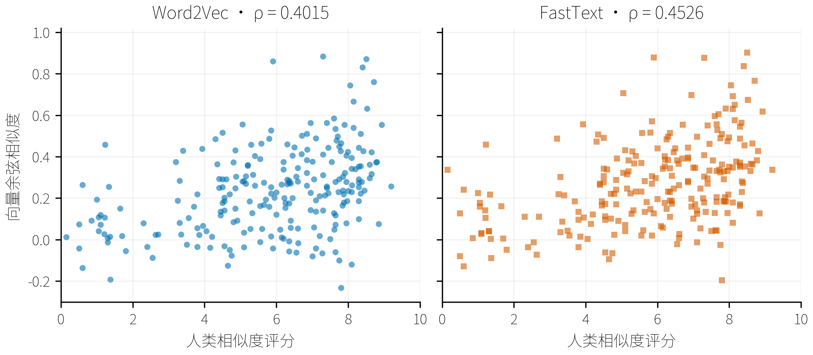

# THUCNews 词向量学习实验

<a id="thucnews-word-learning"></a>

## 数据与范围

本轮使用清华 THUCNews 新闻语料，固定抽样 50,000 篇，比较 Gensim Word2Vec 与 FastText。其中 45,000 篇用于训练，5,000 篇用于覆盖率和上下文评分诊断。新闻类别仅用于分层抽样，不作为模型输入。此前原论文 90 个全量实验保持停止；本轮不训练监督分类器。

原压缩包实测包含 836,075 篇文章、14 个新闻类别，压缩大小 1,560,309,796 字节。官方简介称约 74 万篇，本次按 ZIP 实际文章文件计数。macOS 元数据排除；中文文件名的 UTF-8 标志缺失已经修复。压缩包记录 SHA-256，所有抽中成员在读取时检查 CRC。

| 新闻类别 | 原始文章数 | 训练样本 | 留出样本 |
| --- | --- | --- | --- |
| 体育 | 131604 | 7083 | 787 |
| 娱乐 | 92632 | 4986 | 554 |
| 家居 | 32586 | 1754 | 195 |
| 彩票 | 7588 | 408 | 46 |
| 房产 | 20050 | 1079 | 120 |
| 教育 | 41936 | 2257 | 251 |
| 时尚 | 13368 | 719 | 80 |
| 时政 | 63086 | 3396 | 377 |
| 星座 | 3578 | 193 | 21 |
| 游戏 | 24373 | 1312 | 146 |
| 社会 | 50849 | 2737 | 304 |
| 科技 | 162929 | 8770 | 974 |
| 股票 | 154398 | 8310 | 923 |
| 财经 | 37098 | 1996 | 222 |

分词采用固定 jieba 字典，关闭 HMM；统一 Unicode、清除控制字符和链接，不删除停用词。相同清洗文本去重，少于 30 词的文章退出抽样并用后续候选补足；候选排除计数为 {'short_document': 545, 'duplicate_clean_text': 5}。上下文以句子组织，最长 256 词，不跨文章。训练文章按文件名 SHA-256 排序，跨类别交错。未进行近重复分组，留出诊断不视为分类泛化结果。

| 分区 | 文章 | 句子/分块 | 词数 |
| --- | --- | --- | --- |
| train | 45000 | 1016532 | 20708502 |
| holdout | 5000 | 114052 | 2337756 |

数据清单与逐句索引：[e3f3e06c77a495a85f74/manifest.json](../data/thucnews/prepared/e3f3e06c77a495a85f74/manifest.json)。

## 模型与训练

两种模型统一使用 CBOW、100 维、窗口 5、最低词频 5、5 轮、种子 42、单线程，初始学习率 0.025，线性降到 0.0001，下采样 0.001。为保存上下文评分，本轮使用层次 softmax：hs=1、negative=0。FastText 增加字符子词 1–3 和 200,000 个桶。训练文本、词典拟合范围与输入顺序一致。Gensim 4.4.0 在 CPU 上训练，未使用 CUDA。

当前已完成 2/2 个正式模型；每种只有一个种子，不做统计显著性或置信区间声明。

| 模型 | 词表大小 | 训练轮次耗时 (秒) | 模型进程峰值 RSS (MiB) | 完整原生模型 (MiB) |
| --- | --- | --- | --- | --- |
| fasttext | 90819 | 207.8 | 675.9 | 159.4 |
| word2vec | 90819 | 108.6 | 432.0 | 81.8 |

训练轮次耗时包含逐轮固定探针评分，不包含建词典、导出、完整评价；检查点保存另计。峰值 RSS 包含训练、导出、重载和评价，不包括此前的数据准备。进程总耗时另存 summary.json。

## 词向量评价

评价使用已归档中文 WordSim240、WordSim297/296、CA translated 和 CA8 数据。词相似度的 Pearson、Spearman 只在词表内词对上计算；p 值和逐题数值保存在 JSON/CSV。WordSim296 是从 297 词对中移除 OPEC–石油后的口径，两个版本分别保留。类比同时报告已覆盖题目的条件正确率与 OOV 按错计入的全量正确率。FastText 的 OOV 子词向量结果另列，不能与词表内评价混为一谈。

| 模型 | 词对集 | Spearman ρ | Pearson r | 覆盖词对 | 含生成 OOV 的 ρ（探索） |
| --- | --- | --- | --- | --- | --- |
| fasttext | wordsim240 | 0.4526 | 0.4475 | 233/240 | 0.4367 |
| fasttext | wordsim297 | 0.5697 | 0.5897 | 280/297 | 0.5546 |
| fasttext | wordsim296 | 0.5702 | 0.5898 | 279/296 | 0.5551 |
| word2vec | wordsim240 | 0.4015 | 0.4036 | 233/240 | — |
| word2vec | wordsim297 | 0.5239 | 0.5580 | 280/297 | — |
| word2vec | wordsim296 | 0.5238 | 0.5578 | 279/296 | — |

| 模型 | 类比集 | 条件正确率 | 全量正确率 | 覆盖题数 |
| --- | --- | --- | --- | --- |
| fasttext | CA_translated | 0.0957 | 0.0913 | 909/953 |
| fasttext | CA8_morphological | 0.6251 | 0.2411 | 3926/10177 |
| fasttext | CA8_semantic | 0.0790 | 0.0342 | 3305/7636 |
| word2vec | CA_translated | 0.1287 | 0.1228 | 909/953 |
| word2vec | CA8_morphological | 0.0369 | 0.0142 | 3926/10177 |
| word2vec | CA8_semantic | 0.0481 | 0.0208 | 3305/7636 |

WordSim240 的词表内 Spearman ρ：Word2Vec 0.4015，FastText 0.4526；WordSim296 分别为 0.5238 和 0.5702。这是本次样本、分词和配置下的单次结果；不将一种词评价排序推广为所有下游任务的排序。

| 模型 | 留出词表覆盖率 | 可用向量覆盖率 | OOV 词次 | 可生成 OOV 词次 |
| --- | --- | --- | --- | --- |
| fasttext | 0.9861 | 1.0000 | 32435 | 32435 |
| word2vec | 0.9861 | 0.9861 | 32435 | 0 |

覆盖率衡量能否得到向量，不能证明语义正确。每个运行保存近邻、词/词组相似度、乘法类比和异类词探针；这些例子用于定性检查，不独立作为质量指标。

| 模型 | 查询词 | 向量来源 | 前三个近邻（余弦） |
| --- | --- | --- | --- |
| fasttext | 经济 | in_vocabulary | 能源经济 (0.814)、宏观经济 (0.810)、私营经济 (0.782) |
| fasttext | 股票 | in_vocabulary | 做股票 (0.694)、类股票 (0.687)、股票投资 (0.682) |
| fasttext | 新能源汽车产业 | generated_subword_vector | 汽车产业 (0.901)、新能源 (0.867)、农业产业 (0.849) |
| word2vec | 经济 | in_vocabulary | 宏观经济 (0.754)、银行业 (0.630)、经济运行 (0.622) |
| word2vec | 股票 | in_vocabulary | 债券 (0.701)、货币基金 (0.653)、基金 (0.622) |
| word2vec | 新能源汽车产业 | no_vector | 无向量 |

## 句子上下文评分

历史 HS 上下文评分保留在原始 CSV。评分忽略 OOV，不是整句生成概率，不计算困惑度；当前逐轮验证和模型选择见[新实验](THUCNews词向量实验.md)。

## 词相似度散点图



## 保存与复现

保存加载后检查全部词表内向量逐位相同，固定 256 个留出句子的评分完全一致。文本导出的前 100 个词重新读回，记录最大误差。所有完整资源保存 SHA-256。模型原生格式和 .kv 保留 FastText 子词能力；.vec 只导出词表内词向量，可供原生 fastText 初始化，不传递完整字符子词参数。

fasttext：[原生模型](../artifacts/thucnews/runs/0b6788a19c680bf05fb235a9/model.gensim) · [词向量 KV](../artifacts/thucnews/runs/0b6788a19c680bf05fb235a9/vectors.kv) · [预训练 VEC](../artifacts/thucnews/runs/0b6788a19c680bf05fb235a9/vectors.vec) · [训练日志](../artifacts/thucnews/runs/0b6788a19c680bf05fb235a9/run.log) · [逐轮记录](../artifacts/thucnews/runs/0b6788a19c680bf05fb235a9/epochs.csv) · [句子评分](../artifacts/thucnews/runs/0b6788a19c680bf05fb235a9/heldout_sentence_scores.csv) · [近邻与 API 探针](../artifacts/thucnews/runs/0b6788a19c680bf05fb235a9/queries.json) · [评价明细](../artifacts/thucnews/runs/0b6788a19c680bf05fb235a9/metrics.json) · [重载核查](../artifacts/thucnews/runs/0b6788a19c680bf05fb235a9/save_load_check.json)

word2vec：[原生模型](../artifacts/thucnews/runs/0443b9df979a2decee44dd63/model.gensim) · [词向量 KV](../artifacts/thucnews/runs/0443b9df979a2decee44dd63/vectors.kv) · [预训练 VEC](../artifacts/thucnews/runs/0443b9df979a2decee44dd63/vectors.vec) · [训练日志](../artifacts/thucnews/runs/0443b9df979a2decee44dd63/run.log) · [逐轮记录](../artifacts/thucnews/runs/0443b9df979a2decee44dd63/epochs.csv) · [句子评分](../artifacts/thucnews/runs/0443b9df979a2decee44dd63/heldout_sentence_scores.csv) · [近邻与 API 探针](../artifacts/thucnews/runs/0443b9df979a2decee44dd63/queries.json) · [评价明细](../artifacts/thucnews/runs/0443b9df979a2decee44dd63/metrics.json) · [重载核查](../artifacts/thucnews/runs/0443b9df979a2decee44dd63/save_load_check.json)

独立核查通过：50,000 个文章 ID 与清洗文本均唯一，两模型的词表及词频精确等于训练分区；FastText 的整词与子词矩阵、三个 OOV 词的生成向量重载一致；每模型 114,052 条句子评分均有限且词数匹配。单文件检查点可加载，与最终权重完全一致。[核查记录](../artifacts/thucnews/verification.json)。

两种模型还各自完整复跑了一次：同样本、同种子的输入、输出及子词权重逐位一致，全部基准指标相同，完整句子评分 CSV 的 SHA-256 相同。复跑用于确定性核查，不作为新的独立种子，也不增加统计样本数。模型采用单文件保存，大小包含子词矩阵。

```powershell
conda run -n Gensim python -m gensim_lab.thucnews --stage all
conda run -n Gensim python -m gensim_lab.thucnews --stage report
conda run -n Gensim python -m gensim_lab.thucnews_audit
conda run -n Gensim python -m gensim_lab.thucnews --stage query --model fasttext --word 经济
```

## 来源

[清华 THUNLP 数据说明](https://github.com/thunlp/THUCTC)、[原始压缩包](https://thunlp.oss-cn-qingdao.aliyuncs.com/THUCNews.zip)、[CWE 中文词对数据](https://github.com/Leonard-Xu/CWE)、[Chinese Word Vectors 类比数据](https://github.com/Embedding/Chinese-Word-Vectors)。基准版本及校验值沿用 references/word_benchmarks/manifest.json；配置为 configs/thucnews.yaml。
