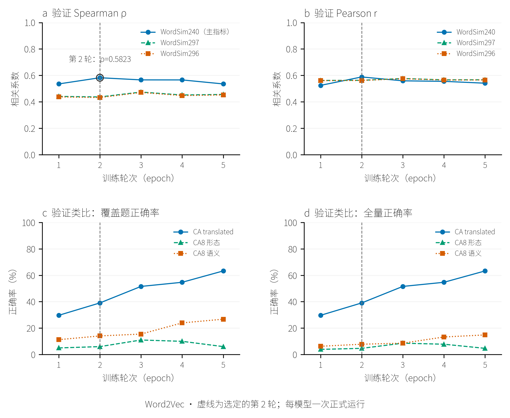
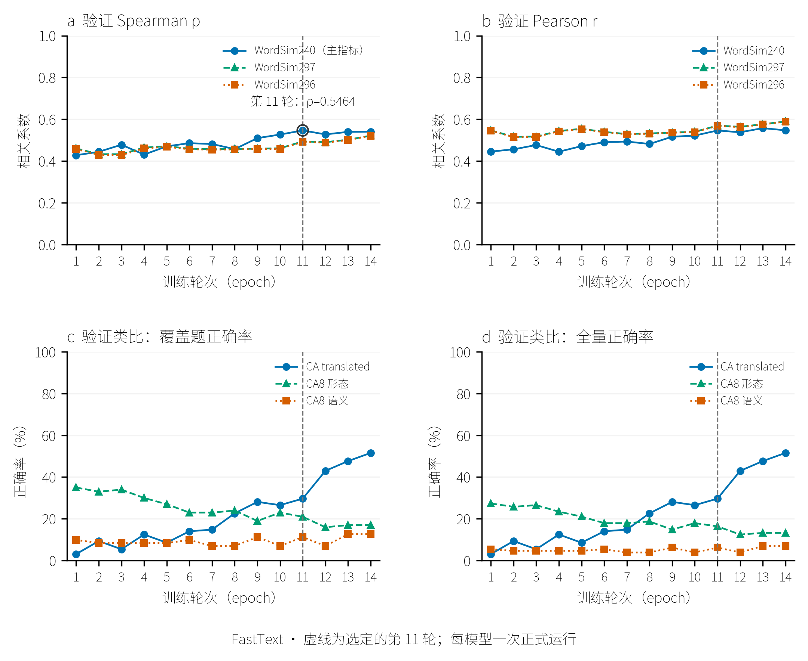
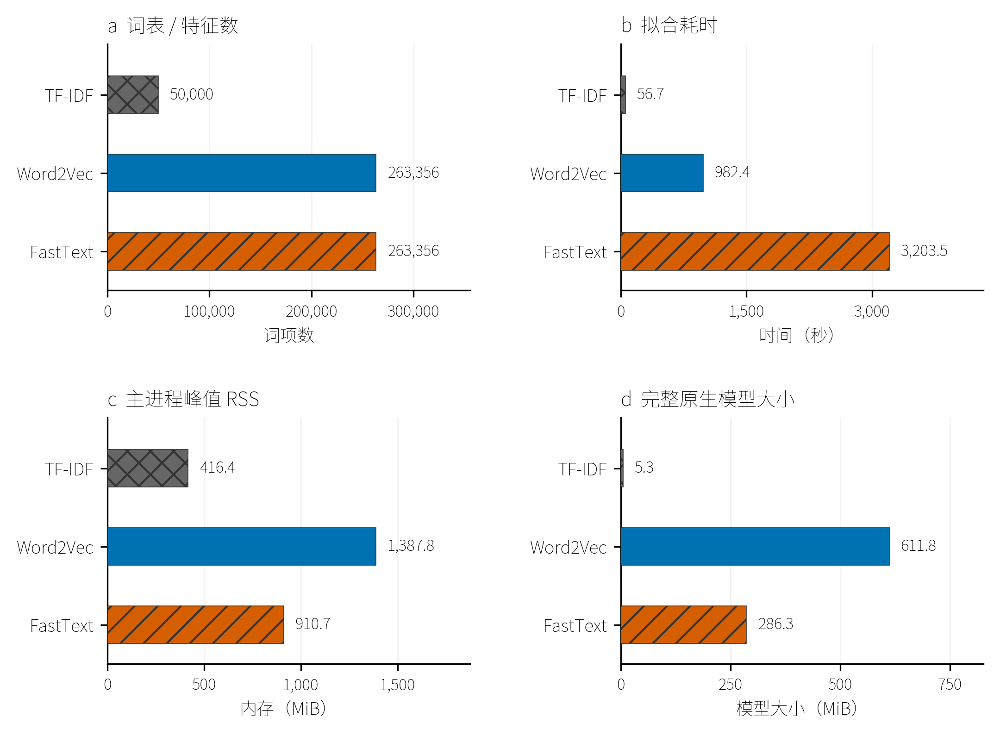
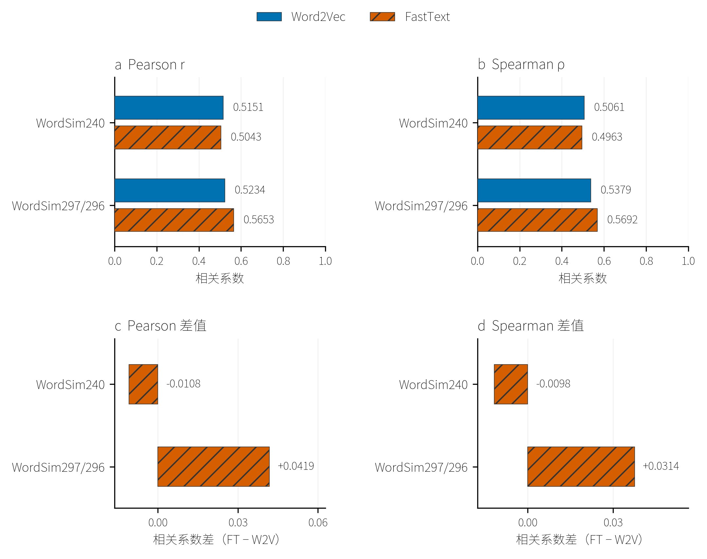
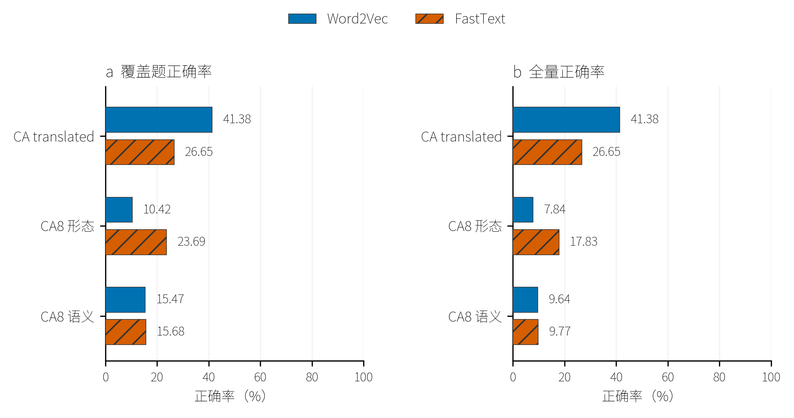
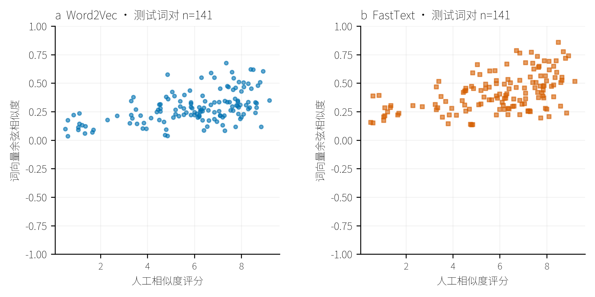

# THUCNews 候选参数全量重训练

更新：2026-10-10T17:58:02+08:00。实验状态：`complete`，完成模型 2/2。

## 数据与固定参数

复用既有全量训练分区：821,609 篇文章、18,576,718 个句段、378,641,761 个词。5,000 篇留出文章不进入训练。清洗、分词、输入顺序和评价分区均沿用原实验；不重新抽样，不使用类别标签。

| 参数 | Word2Vec | Gensim FastText |
| --- | --- | --- |
| 训练方式 | Skip-gram＋NS5 | Skip-gram＋NS10 |
| HS / negative | 0 / 5 | 0 / 10 |
| 初始 / 最低学习率 | 0.025 / 0.0001 | 0.05 / 0.0001 |
| 向量维数 | 300 | 100 |
| 窗口 / 最低词频 / 下采样 | 5 / 5 / 0.001 | 5 / 5 / 0.001 |
| 训练线程 / 种子 | 20 / 42 | 20 / 42 |
| 字符子词 / 哈希桶 | 不适用 | 1–3 / 200,000 |

候选参数来自固定 5 万篇语料的三阶段搜索，冻结后在全量语料上从头训练。本轮每个模型训练一个种子，不能将搜索阶段的三种子标准差作为全量结果的误差。

[候选参数来源](../artifacts/thucnews_small_search/experiments/c0654ea5f83982f1f307e526/index.json) · [完整配置](../configs/thucnews_selected_full.yaml) · [数据清单](../data/thucnews/prepared/9cb3ecd006ae1a9a1f7f/manifest.json)

## 逐轮验证与独立选轮

Word2Vec 和 FastText 分别使用 WordSim240 验证 Spearman 选取最佳检查点。至少训练 5 轮，最多 15 轮，连续 3 轮无超过 0.001 的有效提升时停止。学习率按 15 轮线性日程衰减；训练的最后一轮不会自动替代最佳轮。每轮完整遍历训练集，保存原生检查点及验证明细，完成选轮后才评价测试分区。本轮不记录训练 loss；负采样模型不调用 HS-only 的上下文对数评分。

### Word2Vec

实际训练 5 轮，按验证耐心规则结束。独立选中第 2 轮，WordSim240 验证 Spearman 为 0.5823。其余验证题组用于诊断，不参与候选参数重选。



[SVG 矢量图](figures/thucnews_selected_full/9be433a53e96774c10ee6260/word2vec_validation.svg)

[配置](../artifacts/thucnews_validation/runs/1109be5a651700f6a95e3c96/spec.json) · [日志](../artifacts/thucnews_validation/runs/1109be5a651700f6a95e3c96/run.log) · [逐轮记录](../artifacts/thucnews_validation/runs/1109be5a651700f6a95e3c96/epochs.csv) · [逐轮指标](../artifacts/thucnews_validation/runs/1109be5a651700f6a95e3c96/validation_metrics.csv) · [最终测试](../artifacts/thucnews_validation/runs/1109be5a651700f6a95e3c96/metrics.json) · [选定模型](../artifacts/thucnews_validation/runs/1109be5a651700f6a95e3c96/model.gensim) · [KV](../artifacts/thucnews_validation/runs/1109be5a651700f6a95e3c96/vectors.kv) · [重载核查](../artifacts/thucnews_validation/runs/1109be5a651700f6a95e3c96/save_load_check.json)

[近邻、词组相似度、类比和离群词接口诊断](../artifacts/thucnews_validation/posthoc/1109be5a651700f6a95e3c96/qualitative_probes.json)

### Gensim FastText

实际训练 14 轮，按验证耐心规则结束。独立选中第 11 轮，WordSim240 验证 Spearman 为 0.5464。其余验证题组用于诊断，不参与候选参数重选。



[SVG 矢量图](figures/thucnews_selected_full/9be433a53e96774c10ee6260/fasttext_validation.svg)

[配置](../artifacts/thucnews_validation/runs/31fd3e9423f08bd77a62e68d/spec.json) · [日志](../artifacts/thucnews_validation/runs/31fd3e9423f08bd77a62e68d/run.log) · [逐轮记录](../artifacts/thucnews_validation/runs/31fd3e9423f08bd77a62e68d/epochs.csv) · [逐轮指标](../artifacts/thucnews_validation/runs/31fd3e9423f08bd77a62e68d/validation_metrics.csv) · [最终测试](../artifacts/thucnews_validation/runs/31fd3e9423f08bd77a62e68d/metrics.json) · [选定模型](../artifacts/thucnews_validation/runs/31fd3e9423f08bd77a62e68d/model.gensim) · [KV](../artifacts/thucnews_validation/runs/31fd3e9423f08bd77a62e68d/vectors.kv) · [重载核查](../artifacts/thucnews_validation/runs/31fd3e9423f08bd77a62e68d/save_load_check.json)

[近邻、词组相似度、类比和离群词接口诊断](../artifacts/thucnews_validation/posthoc/31fd3e9423f08bd77a62e68d/qualitative_probes.json)

| 模型 | 实际轮数 | 选中轮 | 验证 Spearman | 结束原因 | 词表大小 |
| --- | --- | --- | --- | --- | --- |
| Word2Vec | 5 | 2 | 0.5823 | 验证耐心规则 | 263356 |
| Gensim FastText | 14 | 11 | 0.5464 | 验证耐心规则 | 263356 |

## 与原全量基线比较

旧基线为 CBOW＋HS、100 维、alpha=0.025，种子、全量训练语料及评价分区相同。新方案同时改变训练方式、目标和部分模型的维数或学习率，差异反映整套候选配置，不能归因于某一个参数。旧基线与本轮各为一次全量运行，不作显著性结论。

| 模型 | 旧验证 ρ | 新验证 ρ | 旧测试 ρ | 新测试 ρ | 测试差值 |
| --- | --- | --- | --- | --- | --- |
| Word2Vec | 0.3655 | 0.5823 | 0.4875 | 0.5061 | 0.0186 |
| Gensim FastText | 0.3499 | 0.5464 | 0.4521 | 0.4963 | 0.0442 |

## 完整测试指标

词相似度相关系数仅在词表内词对上计算；FastText 子词生成 OOV 的相关系数另存原始指标，不混入主指标。类比分别给出覆盖题正确率和将 OOV 按错误计算的全部题正确率。WordSim297 与 WordSim296 存在题目重叠，其结果不能视为两份独立验证。

| 模型 | 题组 | 覆盖 / 总题数 | Pearson r | Spearman ρ | 覆盖题正确率 | 全部题正确率 |
| --- | --- | --- | --- | --- | --- | --- |
| Word2Vec | wordsim240 | 141/142 | 0.5151 | 0.5061 | 不适用 | 不适用 |
| Word2Vec | wordsim297 | 182/186 | 0.5234 | 0.5379 | 不适用 | 不适用 |
| Word2Vec | wordsim296 | 182/186 | 0.5234 | 0.5379 | 不适用 | 不适用 |
| Word2Vec | CA_translated | 319/319 | 不适用 | 不适用 | 0.4138 | 0.4138 |
| Word2Vec | CA8_morphological | 4568/6068 | 不适用 | 不适用 | 0.1042 | 0.0784 |
| Word2Vec | CA8_semantic | 2831/4543 | 不适用 | 不适用 | 0.1547 | 0.0964 |
| Gensim FastText | wordsim240 | 141/142 | 0.5043 | 0.4963 | 不适用 | 不适用 |
| Gensim FastText | wordsim297 | 182/186 | 0.5653 | 0.5692 | 不适用 | 不适用 |
| Gensim FastText | wordsim296 | 182/186 | 0.5653 | 0.5692 | 不适用 | 不适用 |
| Gensim FastText | CA_translated | 319/319 | 不适用 | 不适用 | 0.2665 | 0.2665 |
| Gensim FastText | CA8_morphological | 4568/6068 | 不适用 | 不适用 | 0.2369 | 0.1783 |
| Gensim FastText | CA8_semantic | 2831/4543 | 不适用 | 不适用 | 0.1568 | 0.0977 |

## 计算成本与留出语料覆盖

| 模型 | 累计训练秒 | 每轮训练秒 | 峰值 RSS / MiB | 模型 / MiB | 词表覆盖 | 可用向量覆盖 |
| --- | --- | --- | --- | --- | --- | --- |
| Word2Vec | 982.4 | 196.5 | 1387.8 | 611.8 | 0.9981 | 0.9981 |
| Gensim FastText | 3203.5 | 228.8 | 910.7 | 286.3 | 0.9981 | 1.0000 |

训练耗时仅计参数更新；建词表、验证、检查点保存和测试另有计时。累计训练时间受提前停止轮次影响，不能直接解释为单位轮次速度。RSS 为模型主进程峰值；模型大小为最佳轮的完整原生文件。



[SVG 矢量图](figures/thucnews_selected_full/9be433a53e96774c10ee6260/resources.svg)



[SVG 矢量图](figures/thucnews_selected_full/9be433a53e96774c10ee6260/similarity_metrics.svg)



[SVG 矢量图](figures/thucnews_selected_full/9be433a53e96774c10ee6260/analogy_accuracy.svg)


[SVG 矢量图](figures/thucnews_selected_full/9be433a53e96774c10ee6260/coverage.svg)



[SVG 矢量图](figures/thucnews_selected_full/9be433a53e96774c10ee6260/wordsim_pairs.svg)

## 核验与复现

参数已冻结，本轮不依据测试结果回调参数。基准此前已有观察，结论仍属探索性；单种子全量结果不能排除多线程训练波动。本轮只重训两个固定候选，未在全量语料上比较其余训练方式、学习率或维数，因而不能确认小规模搜索的参数排序在全量语料上仍然成立。

[实验索引](../artifacts/thucnews_selected_full/experiments/9be433a53e96774c10ee6260/index.json) · [旧基线索引快照](../artifacts/thucnews_selected_full/experiments/9be433a53e96774c10ee6260/historical_baseline.json) · [实时进度](../artifacts/thucnews_selected_full/progress.json)

独立核验已通过：完整训练语料计数及词频、每轮模型参数和主指标重算、最佳轮次、逐题测试指标、原生模型与保存词向量一致。两个模型核验通过后统一更新正式索引。

[独立核验](../artifacts/thucnews_selected_full/experiments/9be433a53e96774c10ee6260/verification.json) · [测试原始数值](../artifacts/thucnews_selected_full/experiments/9be433a53e96774c10ee6260/test_metrics.csv) · [资源与覆盖原始数值](../artifacts/thucnews_selected_full/experiments/9be433a53e96774c10ee6260/resource_and_coverage.csv)

[图表来源与导出核验](../artifacts/thucnews_selected_full/experiments/9be433a53e96774c10ee6260/figure_review/approved.json) · [彩色与灰度视觉核验](../artifacts/thucnews_selected_full/experiments/9be433a53e96774c10ee6260/figure_review/visual_review.json)

```powershell
conda run -n Gensim python -m gensim_lab.thucnews_selected_full
conda run -n Gensim python -m gensim_lab.thucnews_selected_full --stage audit
conda run -n Gensim python tools/report_thucnews_selected_full.py --stage preview
# 核验彩色与灰度预览并记录 visual_review.json 后导出
conda run -n Gensim python tools/report_thucnews_selected_full.py --stage export
```
