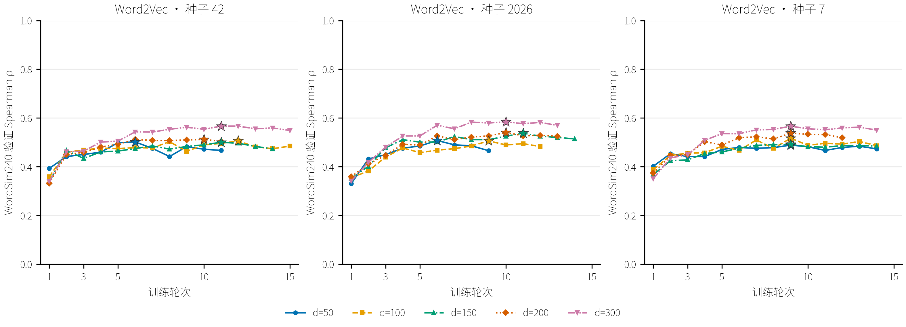
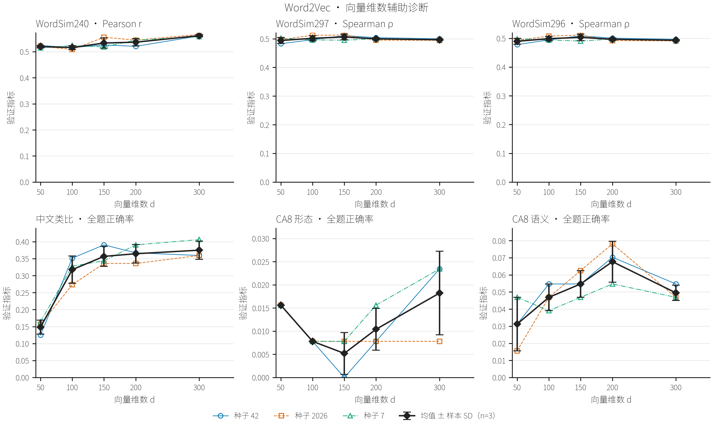
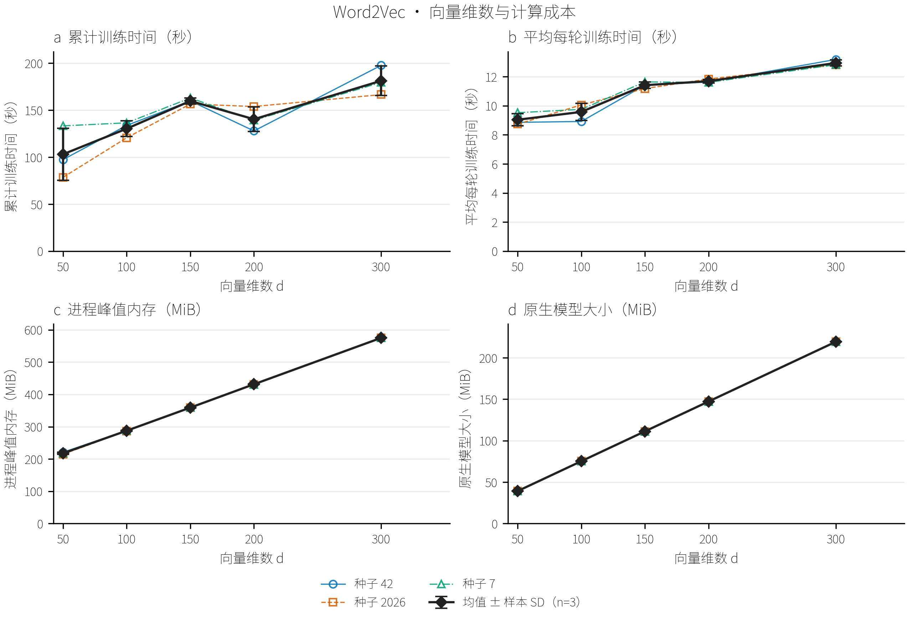
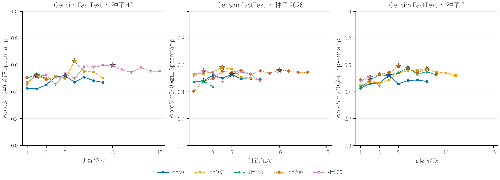
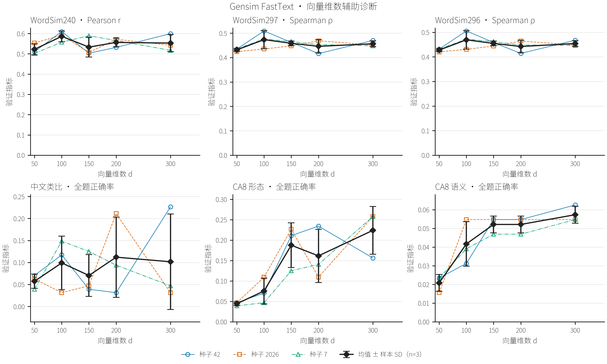
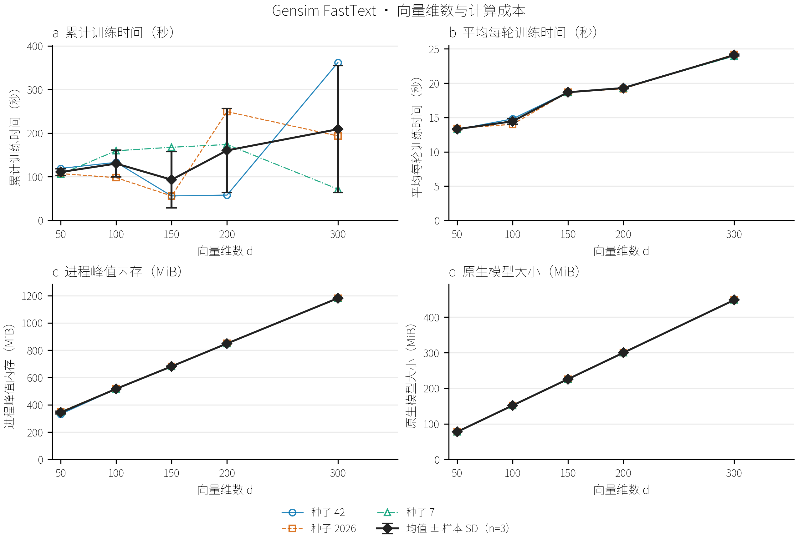

# THUCNews 向量维数搜索

<a id="thucnews-dimensions"></a>

## 实验设计

在固定 50,000 篇、23,080,089 词训练子集上，比较 50、100、150、200、300 维。Word2Vec 固定 Skip-gram＋NS5、初始学习率 0.025；Gensim FastText 固定 Skip-gram＋NS10、初始学习率 0.05。每档均完成种子 42、2026、7，共 30 组结果；100 维六组经封存核验后复用，其余 24 组从头训练。窗口、最低词频、下采样、子词和线程设置沿用前述搜索，词表及主验证词对保持一致。

各次运行通过逐轮 WordSim240 验证 Spearman 独立选择最佳检查点，至少 3 轮、最多 15 轮，停止规则及线性学习率日程沿用学习率阶段。第 3 轮若当前得分相对前一轮与前两轮均未提高超过 0.001，即停止；此后若连续 3 轮未形成有效提升，且最近一至两轮也无超过 0.001 的增幅，则停止。任何严格更高的得分均更新最佳检查点，0.001 仅作为停止规则的增幅阈值；学习率按 15 轮上限线性降至 0.0001，提前停止不重新缩放日程。主指标使用相同的 92 个词表内词对，验证集共 95 题。维数选择依据三次运行的验证均值，精确同分时优先较低维数。下述误差均为样本标准差（n=3），反映固定题目下的训练波动，未进行显著性检验。

## Word2Vec

Word2Vec 的最高验证均值出现在 300 维，为 0.5724±0.0103。100 维参考结果为 0.5095±0.0065，两者均值差为 0.0629。第二高均值为 200 维的 0.5302，与最高均值相差 0.0422；各档的全部种子结果列于下表。最高均值位于本次网格的上界 300 维，更大维数下的趋势尚未确定。

| 向量维数 | 种子42 | 种子2026 | 种子7 | 验证均值±样本SD | 选择结果 |
| --- | --- | --- | --- | --- | --- |
| 50 | 0.5017 | 0.5076 | 0.4887 | 0.4993±0.0097 |  |
| 100 | 0.5056 | 0.5059 | 0.5169 | 0.5095±0.0065 |  |
| 150 | 0.5003 | 0.5376 | 0.4917 | 0.5099±0.0244 |  |
| 200 | 0.5119 | 0.5405 | 0.5381 | 0.5302±0.0159 |  |
| 300 | 0.5665 | 0.5842 | 0.5664 | 0.5724±0.0103 | 选中 |


候选维数下，三个种子的最佳轮次依次为 11、10、9，实际训练轮数为 15、13、14。逐轮曲线保留各维数的实测轨迹，以区分表示维数变化与选定轮次差异。本模型全部 15 次运行中，100 维／种子 42、300 维／种子 42 达到 15 轮训练上限，这些配置的评分仍受共同预算约束。



WordSim297 与 WordSim296 均在 150 维达到最高验证 Spearman 均值，分别为 0.5064 和 0.5035。类比探针的最高全题正确率均值分别为：CA_translated 类比 0.3750（300 维）、CA8 形态类比 0.0182（300 维）、CA8 语义类比 0.0677（200 维）。这些辅助指标在主指标选定的检查点上评价；不同任务的维数偏好共同限定了候选配置的适用目标，选参仍使用预设主指标。



候选维数的平均每轮训练耗时为 12.9 秒，平均进程峰值内存为 575.2 MiB，平均模型文件大小为 219.3 MiB。100 维配置的对应值为 9.6 秒、287.7 MiB、75.2 MiB。累计耗时还受实际训练轮数影响，资源图同时报告累计时间与平均每轮时间；参数更新时间不含建词表、评价及保存。



## Gensim FastText

Gensim FastText 的最高验证均值出现在 100 维，为 0.5949±0.0307。第二高均值为 200 维的 0.5571，低于 100 维 0.0378。当前网格中增减维数均未获得更高的验证均值，因此保留 100 维作为候选。

| 向量维数 | 种子42 | 种子2026 | 种子7 | 验证均值±样本SD | 选择结果 |
| --- | --- | --- | --- | --- | --- |
| 50 | 0.5206 | 0.5295 | 0.5226 | 0.5242±0.0046 |  |
| 100 | 0.6300 | 0.5814 | 0.5732 | 0.5949±0.0307 | 选中 |
| 150 | 0.5241 | 0.4807 | 0.5798 | 0.5282±0.0497 |  |
| 200 | 0.5182 | 0.5601 | 0.5928 | 0.5571±0.0374 |  |
| 300 | 0.5964 | 0.5542 | 0.5096 | 0.5534±0.0434 |  |


候选维数下，三个种子的最佳轮次依次为 6、4、8，实际训练轮数为 9、7、11。逐轮曲线保留各维数的实测轨迹，以区分表示维数变化与选定轮次差异。150 维／种子 42、150 维／种子 2026、200 维／种子 42、300 维／种子 7 在第 3 轮按初始趋势规则停止，其低分只能说明当前学习率与训练预算下的结果，不能据此判定该维数的充分训练性能。本模型全部 15 次运行中，300 维／种子 42 达到 15 轮训练上限，这些配置的评分仍受共同预算约束。



WordSim297 与 WordSim296 均在 100 维达到最高验证 Spearman 均值，分别为 0.4734 和 0.4694。类比探针的最高全题正确率均值分别为：CA_translated 类比 0.1120（200 维）、CA8 形态类比 0.2240（300 维）、CA8 语义类比 0.0573（300 维）。这些辅助指标在主指标选定的检查点上评价；不同任务的维数偏好共同限定了候选配置的适用目标，选参仍使用预设主指标。



候选维数的平均每轮训练耗时为 14.4 秒，平均进程峰值内存为 517.0 MiB，平均模型文件大小为 151.5 MiB。300 维配置的对应值为 24.1 秒、1181.2 MiB、448.2 MiB。累计耗时还受实际训练轮数影响，资源图同时报告累计时间与平均每轮时间；参数更新时间不含建词表、评价及保存。



## 选择范围与复现

维数搜索在各模型已经选定的训练方式与学习率下进行，所得候选属于分阶段条件搜索，尚未系统比较维数与学习率的交互。相同语料和词表使各档的覆盖率一致，维数差异主要通过验证效果及计算成本评价。三种子和较小验证集提供探索性选参依据；较低学习率或较高维数在共同轮数预算之外的表现仍需另行确认。100 维的资源统计继承前一阶段封存运行，耗时比较属于同机实测记录，仍受运行时段与系统负载影响。本阶段没有使用测试分区或启动全量重训。

[完整逐次结果](../artifacts/thucnews_small_search/experiments/c0654ea5f83982f1f307e526/results.csv) · [辅助指标](../artifacts/thucnews_small_search/experiments/c0654ea5f83982f1f307e526/dimension_validation_metrics.csv) · [资源指标](../artifacts/thucnews_small_search/experiments/c0654ea5f83982f1f307e526/dimension_cost_metrics.csv) · [运行核验](../artifacts/thucnews_small_search/experiments/c0654ea5f83982f1f307e526/verification.json)

[配置](../configs/thucnews_dimension_grid.yaml) · [方案](../docs/THUCNews向量维数搜索方案.md)

```powershell
conda run -n Gensim python -m gensim_lab.thucnews_dimension_grid
conda run -n Gensim python -m gensim_lab.thucnews_dimension_grid --stage audit
conda run -n Gensim python -m gensim_lab.thucnews_dimension_grid --stage report
```
