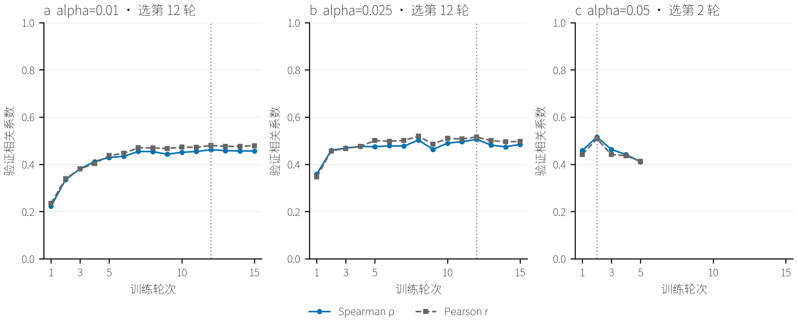
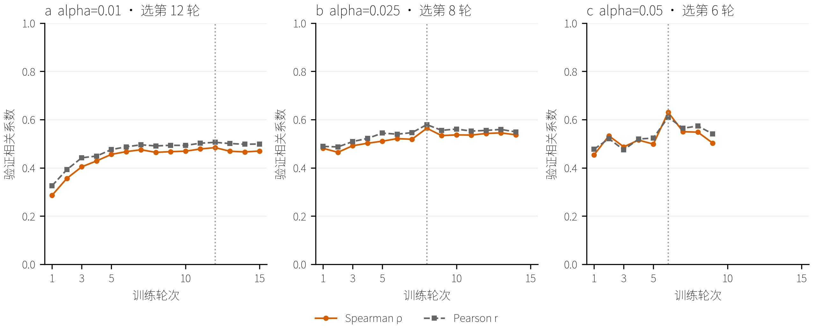
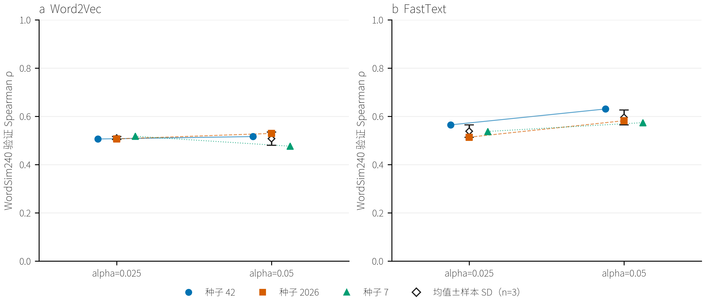

# THUCNews 小规模训练方式与超参数搜索

<a id="thucnews-small-search"></a>

## 搜索范围与当前状态

更新时间：2026-10-10T10:06:37+08:00。**完成，搜索完成；已完成 28/28 次训练**。

本轮在固定 5 万篇上重新搜索 Word2Vec、FastText 的训练方式与学习率。所有模型从头训练，不继承旧全量模型；当前只做表示学习与验证选参，没有新闻类别预测。此前全量搜索保持暂停，4 组完整结果和第 5 组的 8 轮检查点保留在[历史记录](THUCNews训练方式消融实验.md)。

## 抽样、清洗与评价覆盖

从清洗去重后的 821,609 篇训练文章中，按 14 个新闻类别的原比例抽取 50,000 篇；包含 1,129,776 个句子/分块、23,080,089 词。各类别配额按最大余数法确定；类别内按文章 ID 与种子 42 的 SHA-256 排名选择。只抽已有训练文章，和 5,000 篇留出文章的 ID 交集为 0。保留完整文章的句子及原分块顺序，沿用已有 NFKC、HTML/URL/控制字符清洗和 jieba 分词，不重复清洗、不删除停用词，不跨文章连接上下文。

在 min_count=5 下有 94,426 个词。WordSim240 验证覆盖 **92/95** 对，覆盖率 96.84%；同一词表和同一组严格词表内词对用于所有搜索配置。FastText 的 OOV 子词生成分数另列为诊断，不会替换 Word2Vec 无法覆盖的题来参与选参。抽样不依据评价词、人工分数或测试题。覆盖题与全量不同，当前小规模分数不直接和旧全量分数相减。

[抽样清单](../data/thucnews/search_subsets/6b1f898386a4874fb53a5478/selected_articles.csv) · [子集清单](../data/thucnews/search_subsets/6b1f898386a4874fb53a5478/manifest.json) · [配置](../configs/thucnews_small_search.yaml)。

| 类别 | 全量训练篇数 | 本轮抽样篇数 |
| --- | --- | --- |
| 体育 | 130615 | 7949 |
| 娱乐 | 91943 | 5595 |
| 家居 | 29644 | 1804 |
| 彩票 | 7263 | 442 |
| 房产 | 19739 | 1201 |
| 教育 | 40950 | 2492 |
| 时尚 | 13013 | 792 |
| 时政 | 62192 | 3785 |
| 星座 | 3536 | 215 |
| 游戏 | 24137 | 1469 |
| 社会 | 50503 | 3074 |
| 科技 | 160739 | 9782 |
| 股票 | 150952 | 9186 |
| 财经 | 36383 | 2214 |

## 逐轮验证、上升判断与检查点

先训练 3 轮。“仍明显上升”具体定义为：当前主指标相比上一轮或两轮前增幅 **>0.001**。第 3 轮若两种增幅均未达阈值，停止该配置；仍上升则继续。随后当最佳有效提升参照连续 3 轮未提高超过 0.001，且最近一轮和两轮均无上升时停止，最多 15 轮。0.001 是计算预算规则，不代表统计显著性；仍有上升趋势的恢复曲线不会仅因落后于历史峰值被停止。所有轮次中实际最高验证分都能成为最佳检查点，即使增幅小于阈值。

学习率按最多 15 轮从指定 alpha 线性降至 0.0001；早停不重排已用学习率。Word2Vec、FastText 分别判断上升并分别选轮数，不强制使用相同 epoch。每轮保存原生检查点、逐题评价、Pearson、Spearman、类比正确率、覆盖率、耗时和上升/停止理由。不记录训练 loss；最终选中模型重载后重新验证，核对预测指标一致。

## 训练方式搜索与三种子复验

第一阶段：固定 100 维、window=5、min_count=5、sample=0.001、alpha=0.025，两个模型各运行 CBOW／Skip-gram × HS／NS5／NS10 六组，共 12 次。每个模型的 CBOW＋HS 基线和最佳新方案再补 2026、7 两种子，共 20 次，按三种子验证均值选训练方式。

第二阶段：在每个模型选中的训练方式下比较 alpha=0.01、0.025、0.05。0.025 的三种子结果复用本轮已完成模型；其余两个学习率先各做种子 42，共新增 4 次。每个模型选最佳新学习率，再补 2026、7 共新增 4 次，与 0.025 的三种子均值比较。总计 **28 次独立训练**，最终学习率完全同分时保留 0.025。仅两个学习率有三种子，未复验学习率的单次分数不能解释为稳定排名。

FastText 字符子词 1–3、桶 200,000 固定；本轮不混入子词、桶数、窗口和维度搜索。20 个训练线程、4 个数值库线程；固定数据、评价种子 42 和模型种子 42/2026/7，多线程不保证逐位确定性。TF-IDF 保留统计对照。

## 训练方式初筛

| 模型 | 训练方式 | 验证 Spearman | 最佳/实际轮数 | 停止原因 | 训练秒 |
| --- | --- | --- | --- | --- | --- |
| word2vec | CBOW＋HS | 0.3559 | 11/15 | 达到15轮上限 | 132.7 |
| word2vec | CBOW＋NS5 | 0.3889 | 15/15 | 达到15轮上限 | 96.8 |
| word2vec | CBOW＋NS10 | 0.3854 | 15/15 | 达到15轮上限 | 104.1 |
| word2vec | Skip-gram＋HS | 0.4536 | 7/11 | 无有效提升且不再上升 | 213.4 |
| word2vec | Skip-gram＋NS5 | 0.5056 | 12/15 | 达到15轮上限 | 133.8 |
| word2vec | Skip-gram＋NS10 | 0.5038 | 5/8 | 无有效提升且不再上升 | 83.9 |
| fasttext | CBOW＋HS | 0.4175 | 11/15 | 无有效提升且不再上升 | 171.3 |
| fasttext | CBOW＋NS5 | 0.3370 | 5/10 | 无有效提升且不再上升 | 104.0 |
| fasttext | CBOW＋NS10 | 0.3677 | 11/15 | 达到15轮上限 | 172.0 |
| fasttext | Skip-gram＋HS | 0.5278 | 7/12 | 无有效提升且不再上升 | 251.1 |
| fasttext | Skip-gram＋NS5 | 0.5612 | 6/10 | 无有效提升且不再上升 | 122.3 |
| fasttext | Skip-gram＋NS10 | 0.5641 | 8/14 | 无有效提升且不再上升 | 207.9 |

### 训练速度、内存与模型大小

| 模型 | 训练方式 | 每轮秒 | 峰值 RSS MiB | 最佳原生模型 MiB |
| --- | --- | --- | --- | --- |
| word2vec | CBOW＋HS | 8.8 | 371.4 | 85.4 |
| word2vec | CBOW＋NS5 | 6.5 | 289.6 | 75.2 |
| word2vec | CBOW＋NS10 | 6.9 | 287.2 | 75.2 |
| word2vec | Skip-gram＋HS | 19.4 | 371.5 | 85.4 |
| word2vec | Skip-gram＋NS5 | 8.9 | 287.8 | 75.2 |
| word2vec | Skip-gram＋NS10 | 10.5 | 310.0 | 75.2 |
| fasttext | CBOW＋HS | 11.4 | 578.2 | 163.1 |
| fasttext | CBOW＋NS5 | 10.4 | 492.6 | 151.5 |
| fasttext | CBOW＋NS10 | 11.5 | 493.4 | 151.5 |
| fasttext | Skip-gram＋HS | 20.9 | 577.4 | 163.1 |
| fasttext | Skip-gram＋NS5 | 12.2 | 493.5 | 151.5 |
| fasttext | Skip-gram＋NS10 | 14.9 | 516.1 | 151.5 |

训练时间不含建词表、评价、检查点保存和封存；峰值 RSS 统计训练子进程，模型大小仅统计最佳原生模型，不包含所有轮次检查点总占用。速度为本机本次运行实测，不是独立硬件性能基准。

## 训练方式三种子比较

| 模型 | 训练方式 | 验证均值 | 样本 SD | n | 选中 |
| --- | --- | --- | --- | --- | --- |
| word2vec | Skip-gram＋NS5 | 0.5095 | 0.0065 | 3 | 是 |
| word2vec | CBOW＋HS | 0.3402 | 0.0136 | 3 | 否 |
| fasttext | Skip-gram＋NS10 | 0.5380 | 0.0256 | 3 | 是 |
| fasttext | CBOW＋HS | 0.4163 | 0.0161 | 3 | 否 |

## 学习率搜索状态

下表为种子 42、各自最佳轮次的初筛分数，每配置 n=1；三种子均值另列。

| 模型 | 训练方式 | alpha | 验证 Spearman | 最佳/实际轮数 | 训练秒 |
| --- | --- | --- | --- | --- | --- |
| word2vec | Skip-gram＋NS5 | 0.025 | 0.5056 | 12/15 | 133.8 |
| fasttext | Skip-gram＋NS10 | 0.025 | 0.5641 | 8/14 | 207.9 |
| word2vec | Skip-gram＋NS5 | 0.01 | 0.4619 | 12/15 | 138.5 |
| word2vec | Skip-gram＋NS5 | 0.05 | 0.5157 | 2/5 | 47.2 |
| fasttext | Skip-gram＋NS10 | 0.01 | 0.4836 | 12/15 | 224.8 |
| fasttext | Skip-gram＋NS10 | 0.05 | 0.6300 | 6/9 | 133.2 |

| 模型 | alpha | 验证均值 | 样本 SD | n | 选中 |
| --- | --- | --- | --- | --- | --- |
| word2vec | 0.025 | 0.5095 | 0.0065 | 3 | 是 |
| word2vec | 0.05 | 0.5067 | 0.0276 | 3 | 否 |
| fasttext | 0.05 | 0.5949 | 0.0307 | 3 | 是 |
| fasttext | 0.025 | 0.5380 | 0.0256 | 3 | 否 |

## 当前选择与结论边界

**word2vec：Skip-gram＋NS5，alpha=0.025**；验证均值 0.5095，样本 SD=0.0065，n=3。

**fasttext：Skip-gram＋NS10，alpha=0.05**；验证均值 0.5949，样本 SD=0.0307，n=3。

### 选中配置的其他验证指标

| 模型 | 词对基准 | Pearson均值±SD | Spearman均值±SD | 覆盖/题数 |
| --- | --- | --- | --- | --- |
| word2vec | wordsim240 | 0.5159±0.0076 | 0.5095±0.0065 | 92/95 |
| word2vec | wordsim297 | 0.5880±0.0081 | 0.5016±0.0090 | 106/109 |
| word2vec | wordsim296 | 0.5867±0.0081 | 0.4988±0.0077 | 105/108 |
| fasttext | wordsim240 | 0.5861±0.0266 | 0.5949±0.0307 | 92/95 |
| fasttext | wordsim297 | 0.5642±0.0211 | 0.4734±0.0371 | 106/109 |
| fasttext | wordsim296 | 0.5628±0.0211 | 0.4694±0.0376 | 105/108 |

| 模型 | 类比验证探针 | 全部题正确率均值±SD | 覆盖题正确率均值±SD | 覆盖/题数 |
| --- | --- | --- | --- | --- |
| word2vec | CA_translated | 0.3177±0.0401 | 0.3177±0.0401 | 128/128 |
| word2vec | CA8_morphological | 0.0078±0.0000 | 0.0182±0.0000 | 55/128 |
| word2vec | CA8_semantic | 0.0469±0.0078 | 0.1277±0.0213 | 47/128 |
| fasttext | CA_translated | 0.0990±0.0607 | 0.0990±0.0607 | 128/128 |
| fasttext | CA8_morphological | 0.0755±0.0316 | 0.1758±0.0735 | 55/128 |
| fasttext | CA8_semantic | 0.0417±0.0119 | 0.1135±0.0325 | 47/128 |

以上为各自所选轮数下三种子验证均值±样本 SD，n=3；类比每套固定 128 题探针，并非全量类比测试。WordSim297 与 WordSim296 的验证题不同，分别报告。[完整诊断 CSV](../artifacts/thucnews_small_search/experiments/e5cc57786fa3cd4195698419/selected_validation_metrics.csv)保留 OOV、子词可生成词对等指标；逐题和每次训练的原始 p 值保留于逐轮记录，不把多个种子的 p 值作简单平均。

本轮 **不计算测试指标，也不自动启动全量训练**。固定验证基准曾被历史实验观察，本轮为探索性选参；三种子只描述训练波动。小规模胜出配置未必在全量胜出，下一步应在更大语料复核少量候选，最终全量从头训练并重新选择轮数。只对基线与初筛最佳新训练方式做三种子复验，未复验的方案不构成稳定排名。学习率仅在各自选中的训练方式下搜索，未穷举训练方式与学习率的全部交互。

## 验证曲线与对比图








## 运行证据与复现

[搜索 CSV](../artifacts/thucnews_small_search/experiments/e5cc57786fa3cd4195698419/search_results.csv) · [运行索引](../artifacts/thucnews_small_search/experiments/e5cc57786fa3cd4195698419/index.json) · [进度](../artifacts/thucnews_small_search/progress.json)。

FastText/CBOW＋NS5 的第 1 轮完成后，Windows 替换进度文件发生一次 WinError 5，该轮模型与状态已完整保存。核对检查点 SHA-256 后按相同数据、参数和训练代码从第 2 轮恢复，未把文件错误作为模型失败或重新选参。实时监控改用允许删除共享的读取方式。该配置的 RSS 为恢复进程观测峰值；此前进程峰值未独立保存，不能声称已合并两个进程的峰值。[恢复记录](../artifacts/thucnews_small_search/recovery.json)。

矩阵阶段最后一组 FastText／Skip-gram＋NS10／种子 7 曾中断于第 3 轮中途。核对已保存第 2 轮检查点后，丢弃未保存的第 3 轮中间状态，从第 3 轮完整重跑；数据、参数、选轮规则与训练代码未改变。峰值 RSS 为恢复进程观测值，不能声称覆盖此前中断进程的峰值。[续训记录](../artifacts/thucnews_small_search/experiments/e5cc57786fa3cd4195698419/last_replication_resume.json)。

word2vec/cbow_hs/alpha0.025/seed42：[日志](../artifacts/thucnews_small_search/runs/13c447e4eabc13702b8702cf/run.log) · [逐轮指标](../artifacts/thucnews_small_search/runs/13c447e4eabc13702b8702cf/validation_metrics.csv) · [上升判定](../artifacts/thucnews_small_search/runs/13c447e4eabc13702b8702cf/epochs.csv) · [最佳模型](../artifacts/thucnews_small_search/runs/13c447e4eabc13702b8702cf/checkpoints/epoch_11.gensim) · [保存加载核验](../artifacts/thucnews_small_search/runs/13c447e4eabc13702b8702cf/save_load_check.json)。

word2vec/cbow_ns5/alpha0.025/seed42：[日志](../artifacts/thucnews_small_search/runs/19a5dc3615c48f005dc149b7/run.log) · [逐轮指标](../artifacts/thucnews_small_search/runs/19a5dc3615c48f005dc149b7/validation_metrics.csv) · [上升判定](../artifacts/thucnews_small_search/runs/19a5dc3615c48f005dc149b7/epochs.csv) · [最佳模型](../artifacts/thucnews_small_search/runs/19a5dc3615c48f005dc149b7/checkpoints/epoch_15.gensim) · [保存加载核验](../artifacts/thucnews_small_search/runs/19a5dc3615c48f005dc149b7/save_load_check.json)。

word2vec/cbow_ns10/alpha0.025/seed42：[日志](../artifacts/thucnews_small_search/runs/e86773b7bb27051f4777036b/run.log) · [逐轮指标](../artifacts/thucnews_small_search/runs/e86773b7bb27051f4777036b/validation_metrics.csv) · [上升判定](../artifacts/thucnews_small_search/runs/e86773b7bb27051f4777036b/epochs.csv) · [最佳模型](../artifacts/thucnews_small_search/runs/e86773b7bb27051f4777036b/checkpoints/epoch_15.gensim) · [保存加载核验](../artifacts/thucnews_small_search/runs/e86773b7bb27051f4777036b/save_load_check.json)。

word2vec/sg_hs/alpha0.025/seed42：[日志](../artifacts/thucnews_small_search/runs/cf115b7627b6d307c01e857b/run.log) · [逐轮指标](../artifacts/thucnews_small_search/runs/cf115b7627b6d307c01e857b/validation_metrics.csv) · [上升判定](../artifacts/thucnews_small_search/runs/cf115b7627b6d307c01e857b/epochs.csv) · [最佳模型](../artifacts/thucnews_small_search/runs/cf115b7627b6d307c01e857b/checkpoints/epoch_07.gensim) · [保存加载核验](../artifacts/thucnews_small_search/runs/cf115b7627b6d307c01e857b/save_load_check.json)。

word2vec/sg_ns5/alpha0.025/seed42：[日志](../artifacts/thucnews_small_search/runs/f9c16001ad2b4c736400df2b/run.log) · [逐轮指标](../artifacts/thucnews_small_search/runs/f9c16001ad2b4c736400df2b/validation_metrics.csv) · [上升判定](../artifacts/thucnews_small_search/runs/f9c16001ad2b4c736400df2b/epochs.csv) · [最佳模型](../artifacts/thucnews_small_search/runs/f9c16001ad2b4c736400df2b/checkpoints/epoch_12.gensim) · [保存加载核验](../artifacts/thucnews_small_search/runs/f9c16001ad2b4c736400df2b/save_load_check.json)。

word2vec/sg_ns10/alpha0.025/seed42：[日志](../artifacts/thucnews_small_search/runs/b4dd39640242d64dd7619ce6/run.log) · [逐轮指标](../artifacts/thucnews_small_search/runs/b4dd39640242d64dd7619ce6/validation_metrics.csv) · [上升判定](../artifacts/thucnews_small_search/runs/b4dd39640242d64dd7619ce6/epochs.csv) · [最佳模型](../artifacts/thucnews_small_search/runs/b4dd39640242d64dd7619ce6/checkpoints/epoch_05.gensim) · [保存加载核验](../artifacts/thucnews_small_search/runs/b4dd39640242d64dd7619ce6/save_load_check.json)。

fasttext/cbow_hs/alpha0.025/seed42：[日志](../artifacts/thucnews_small_search/runs/2062faf6824bc465471d11ed/run.log) · [逐轮指标](../artifacts/thucnews_small_search/runs/2062faf6824bc465471d11ed/validation_metrics.csv) · [上升判定](../artifacts/thucnews_small_search/runs/2062faf6824bc465471d11ed/epochs.csv) · [最佳模型](../artifacts/thucnews_small_search/runs/2062faf6824bc465471d11ed/checkpoints/epoch_11.gensim) · [保存加载核验](../artifacts/thucnews_small_search/runs/2062faf6824bc465471d11ed/save_load_check.json)。

fasttext/cbow_ns5/alpha0.025/seed42：[日志](../artifacts/thucnews_small_search/runs/b80c24741f5d4f5cf4ca2f28/run.log) · [逐轮指标](../artifacts/thucnews_small_search/runs/b80c24741f5d4f5cf4ca2f28/validation_metrics.csv) · [上升判定](../artifacts/thucnews_small_search/runs/b80c24741f5d4f5cf4ca2f28/epochs.csv) · [最佳模型](../artifacts/thucnews_small_search/runs/b80c24741f5d4f5cf4ca2f28/checkpoints/epoch_05.gensim) · [保存加载核验](../artifacts/thucnews_small_search/runs/b80c24741f5d4f5cf4ca2f28/save_load_check.json)。

fasttext/cbow_ns10/alpha0.025/seed42：[日志](../artifacts/thucnews_small_search/runs/346429239e168ad5261d5c51/run.log) · [逐轮指标](../artifacts/thucnews_small_search/runs/346429239e168ad5261d5c51/validation_metrics.csv) · [上升判定](../artifacts/thucnews_small_search/runs/346429239e168ad5261d5c51/epochs.csv) · [最佳模型](../artifacts/thucnews_small_search/runs/346429239e168ad5261d5c51/checkpoints/epoch_11.gensim) · [保存加载核验](../artifacts/thucnews_small_search/runs/346429239e168ad5261d5c51/save_load_check.json)。

fasttext/sg_hs/alpha0.025/seed42：[日志](../artifacts/thucnews_small_search/runs/0e783d3ddea1e7ef1e41517c/run.log) · [逐轮指标](../artifacts/thucnews_small_search/runs/0e783d3ddea1e7ef1e41517c/validation_metrics.csv) · [上升判定](../artifacts/thucnews_small_search/runs/0e783d3ddea1e7ef1e41517c/epochs.csv) · [最佳模型](../artifacts/thucnews_small_search/runs/0e783d3ddea1e7ef1e41517c/checkpoints/epoch_07.gensim) · [保存加载核验](../artifacts/thucnews_small_search/runs/0e783d3ddea1e7ef1e41517c/save_load_check.json)。

fasttext/sg_ns5/alpha0.025/seed42：[日志](../artifacts/thucnews_small_search/runs/a8dfa60c0903ca4f0708621e/run.log) · [逐轮指标](../artifacts/thucnews_small_search/runs/a8dfa60c0903ca4f0708621e/validation_metrics.csv) · [上升判定](../artifacts/thucnews_small_search/runs/a8dfa60c0903ca4f0708621e/epochs.csv) · [最佳模型](../artifacts/thucnews_small_search/runs/a8dfa60c0903ca4f0708621e/checkpoints/epoch_06.gensim) · [保存加载核验](../artifacts/thucnews_small_search/runs/a8dfa60c0903ca4f0708621e/save_load_check.json)。

fasttext/sg_ns10/alpha0.025/seed42：[日志](../artifacts/thucnews_small_search/runs/36dc0d3874b33d53966c9cef/run.log) · [逐轮指标](../artifacts/thucnews_small_search/runs/36dc0d3874b33d53966c9cef/validation_metrics.csv) · [上升判定](../artifacts/thucnews_small_search/runs/36dc0d3874b33d53966c9cef/epochs.csv) · [最佳模型](../artifacts/thucnews_small_search/runs/36dc0d3874b33d53966c9cef/checkpoints/epoch_08.gensim) · [保存加载核验](../artifacts/thucnews_small_search/runs/36dc0d3874b33d53966c9cef/save_load_check.json)。

word2vec/cbow_hs/alpha0.025/seed2026：[日志](../artifacts/thucnews_small_search/runs/8a08aedd9d2e92e08f03c015/run.log) · [逐轮指标](../artifacts/thucnews_small_search/runs/8a08aedd9d2e92e08f03c015/validation_metrics.csv) · [上升判定](../artifacts/thucnews_small_search/runs/8a08aedd9d2e92e08f03c015/epochs.csv) · [最佳模型](../artifacts/thucnews_small_search/runs/8a08aedd9d2e92e08f03c015/checkpoints/epoch_11.gensim) · [保存加载核验](../artifacts/thucnews_small_search/runs/8a08aedd9d2e92e08f03c015/save_load_check.json)。

word2vec/cbow_hs/alpha0.025/seed7：[日志](../artifacts/thucnews_small_search/runs/7ab0a24446cab9fcea797725/run.log) · [逐轮指标](../artifacts/thucnews_small_search/runs/7ab0a24446cab9fcea797725/validation_metrics.csv) · [上升判定](../artifacts/thucnews_small_search/runs/7ab0a24446cab9fcea797725/epochs.csv) · [最佳模型](../artifacts/thucnews_small_search/runs/7ab0a24446cab9fcea797725/checkpoints/epoch_06.gensim) · [保存加载核验](../artifacts/thucnews_small_search/runs/7ab0a24446cab9fcea797725/save_load_check.json)。

word2vec/sg_ns5/alpha0.025/seed2026：[日志](../artifacts/thucnews_small_search/runs/5bf7d2dd4b07c3684261176c/run.log) · [逐轮指标](../artifacts/thucnews_small_search/runs/5bf7d2dd4b07c3684261176c/validation_metrics.csv) · [上升判定](../artifacts/thucnews_small_search/runs/5bf7d2dd4b07c3684261176c/epochs.csv) · [最佳模型](../artifacts/thucnews_small_search/runs/5bf7d2dd4b07c3684261176c/checkpoints/epoch_09.gensim) · [保存加载核验](../artifacts/thucnews_small_search/runs/5bf7d2dd4b07c3684261176c/save_load_check.json)。

word2vec/sg_ns5/alpha0.025/seed7：[日志](../artifacts/thucnews_small_search/runs/eaf0a4fdc7d75e660eb19bf5/run.log) · [逐轮指标](../artifacts/thucnews_small_search/runs/eaf0a4fdc7d75e660eb19bf5/validation_metrics.csv) · [上升判定](../artifacts/thucnews_small_search/runs/eaf0a4fdc7d75e660eb19bf5/epochs.csv) · [最佳模型](../artifacts/thucnews_small_search/runs/eaf0a4fdc7d75e660eb19bf5/checkpoints/epoch_09.gensim) · [保存加载核验](../artifacts/thucnews_small_search/runs/eaf0a4fdc7d75e660eb19bf5/save_load_check.json)。

fasttext/cbow_hs/alpha0.025/seed2026：[日志](../artifacts/thucnews_small_search/runs/c4566100c6dd3a1764274627/run.log) · [逐轮指标](../artifacts/thucnews_small_search/runs/c4566100c6dd3a1764274627/validation_metrics.csv) · [上升判定](../artifacts/thucnews_small_search/runs/c4566100c6dd3a1764274627/epochs.csv) · [最佳模型](../artifacts/thucnews_small_search/runs/c4566100c6dd3a1764274627/checkpoints/epoch_05.gensim) · [保存加载核验](../artifacts/thucnews_small_search/runs/c4566100c6dd3a1764274627/save_load_check.json)。

fasttext/cbow_hs/alpha0.025/seed7：[日志](../artifacts/thucnews_small_search/runs/f3900a76ddcccdd3c19a0297/run.log) · [逐轮指标](../artifacts/thucnews_small_search/runs/f3900a76ddcccdd3c19a0297/validation_metrics.csv) · [上升判定](../artifacts/thucnews_small_search/runs/f3900a76ddcccdd3c19a0297/epochs.csv) · [最佳模型](../artifacts/thucnews_small_search/runs/f3900a76ddcccdd3c19a0297/checkpoints/epoch_11.gensim) · [保存加载核验](../artifacts/thucnews_small_search/runs/f3900a76ddcccdd3c19a0297/save_load_check.json)。

fasttext/sg_ns10/alpha0.025/seed2026：[日志](../artifacts/thucnews_small_search/runs/e3f18889c768e4d9e5acd79b/run.log) · [逐轮指标](../artifacts/thucnews_small_search/runs/e3f18889c768e4d9e5acd79b/validation_metrics.csv) · [上升判定](../artifacts/thucnews_small_search/runs/e3f18889c768e4d9e5acd79b/epochs.csv) · [最佳模型](../artifacts/thucnews_small_search/runs/e3f18889c768e4d9e5acd79b/checkpoints/epoch_09.gensim) · [保存加载核验](../artifacts/thucnews_small_search/runs/e3f18889c768e4d9e5acd79b/save_load_check.json)。

fasttext/sg_ns10/alpha0.025/seed7：[日志](../artifacts/thucnews_small_search/runs/23f563f873769f019665ad7b/run.log) · [逐轮指标](../artifacts/thucnews_small_search/runs/23f563f873769f019665ad7b/validation_metrics.csv) · [上升判定](../artifacts/thucnews_small_search/runs/23f563f873769f019665ad7b/epochs.csv) · [最佳模型](../artifacts/thucnews_small_search/runs/23f563f873769f019665ad7b/checkpoints/epoch_09.gensim) · [保存加载核验](../artifacts/thucnews_small_search/runs/23f563f873769f019665ad7b/save_load_check.json)。

word2vec/sg_ns5/alpha0.01/seed42：[日志](../artifacts/thucnews_small_search/runs/15338707b12248d218a8629c/run.log) · [逐轮指标](../artifacts/thucnews_small_search/runs/15338707b12248d218a8629c/validation_metrics.csv) · [上升判定](../artifacts/thucnews_small_search/runs/15338707b12248d218a8629c/epochs.csv) · [最佳模型](../artifacts/thucnews_small_search/runs/15338707b12248d218a8629c/checkpoints/epoch_12.gensim) · [保存加载核验](../artifacts/thucnews_small_search/runs/15338707b12248d218a8629c/save_load_check.json)。

word2vec/sg_ns5/alpha0.05/seed42：[日志](../artifacts/thucnews_small_search/runs/d47bb05fb6638bee6e8e8533/run.log) · [逐轮指标](../artifacts/thucnews_small_search/runs/d47bb05fb6638bee6e8e8533/validation_metrics.csv) · [上升判定](../artifacts/thucnews_small_search/runs/d47bb05fb6638bee6e8e8533/epochs.csv) · [最佳模型](../artifacts/thucnews_small_search/runs/d47bb05fb6638bee6e8e8533/checkpoints/epoch_02.gensim) · [保存加载核验](../artifacts/thucnews_small_search/runs/d47bb05fb6638bee6e8e8533/save_load_check.json)。

fasttext/sg_ns10/alpha0.01/seed42：[日志](../artifacts/thucnews_small_search/runs/0242e378a5ea8cfe66001628/run.log) · [逐轮指标](../artifacts/thucnews_small_search/runs/0242e378a5ea8cfe66001628/validation_metrics.csv) · [上升判定](../artifacts/thucnews_small_search/runs/0242e378a5ea8cfe66001628/epochs.csv) · [最佳模型](../artifacts/thucnews_small_search/runs/0242e378a5ea8cfe66001628/checkpoints/epoch_12.gensim) · [保存加载核验](../artifacts/thucnews_small_search/runs/0242e378a5ea8cfe66001628/save_load_check.json)。

fasttext/sg_ns10/alpha0.05/seed42：[日志](../artifacts/thucnews_small_search/runs/14eb2989f18f14c860bbbaaa/run.log) · [逐轮指标](../artifacts/thucnews_small_search/runs/14eb2989f18f14c860bbbaaa/validation_metrics.csv) · [上升判定](../artifacts/thucnews_small_search/runs/14eb2989f18f14c860bbbaaa/epochs.csv) · [最佳模型](../artifacts/thucnews_small_search/runs/14eb2989f18f14c860bbbaaa/checkpoints/epoch_06.gensim) · [保存加载核验](../artifacts/thucnews_small_search/runs/14eb2989f18f14c860bbbaaa/save_load_check.json)。

word2vec/sg_ns5/alpha0.05/seed2026：[日志](../artifacts/thucnews_small_search/runs/a055d2f5c2464b3ec721c0c1/run.log) · [逐轮指标](../artifacts/thucnews_small_search/runs/a055d2f5c2464b3ec721c0c1/validation_metrics.csv) · [上升判定](../artifacts/thucnews_small_search/runs/a055d2f5c2464b3ec721c0c1/epochs.csv) · [最佳模型](../artifacts/thucnews_small_search/runs/a055d2f5c2464b3ec721c0c1/checkpoints/epoch_10.gensim) · [保存加载核验](../artifacts/thucnews_small_search/runs/a055d2f5c2464b3ec721c0c1/save_load_check.json)。

word2vec/sg_ns5/alpha0.05/seed7：[日志](../artifacts/thucnews_small_search/runs/c6462dae4fd8c17f83da6ffb/run.log) · [逐轮指标](../artifacts/thucnews_small_search/runs/c6462dae4fd8c17f83da6ffb/validation_metrics.csv) · [上升判定](../artifacts/thucnews_small_search/runs/c6462dae4fd8c17f83da6ffb/epochs.csv) · [最佳模型](../artifacts/thucnews_small_search/runs/c6462dae4fd8c17f83da6ffb/checkpoints/epoch_02.gensim) · [保存加载核验](../artifacts/thucnews_small_search/runs/c6462dae4fd8c17f83da6ffb/save_load_check.json)。

fasttext/sg_ns10/alpha0.05/seed2026：[日志](../artifacts/thucnews_small_search/runs/1bfa3f37989f7a8141c714c9/run.log) · [逐轮指标](../artifacts/thucnews_small_search/runs/1bfa3f37989f7a8141c714c9/validation_metrics.csv) · [上升判定](../artifacts/thucnews_small_search/runs/1bfa3f37989f7a8141c714c9/epochs.csv) · [最佳模型](../artifacts/thucnews_small_search/runs/1bfa3f37989f7a8141c714c9/checkpoints/epoch_04.gensim) · [保存加载核验](../artifacts/thucnews_small_search/runs/1bfa3f37989f7a8141c714c9/save_load_check.json)。

fasttext/sg_ns10/alpha0.05/seed7：[日志](../artifacts/thucnews_small_search/runs/f8d70444c7a28cdeee90cf54/run.log) · [逐轮指标](../artifacts/thucnews_small_search/runs/f8d70444c7a28cdeee90cf54/validation_metrics.csv) · [上升判定](../artifacts/thucnews_small_search/runs/f8d70444c7a28cdeee90cf54/epochs.csv) · [最佳模型](../artifacts/thucnews_small_search/runs/f8d70444c7a28cdeee90cf54/checkpoints/epoch_08.gensim) · [保存加载核验](../artifacts/thucnews_small_search/runs/f8d70444c7a28cdeee90cf54/save_load_check.json)。

[核验通过](../artifacts/thucnews_small_search/experiments/e5cc57786fa3cd4195698419/verification.json)：已核验 28 次训练，无测试评价，词表与评价覆盖一致，选轮规则复算、所有检查点哈希及保存加载验证通过。

[学习率阶段核验](../artifacts/thucnews_small_search/experiments/e5cc57786fa3cd4195698419/alpha_stage_verification.json)：新增 4 次初筛与 4 次复验，原矩阵阶段 20 次结果逐项保留，训练协议未改变，三种子学习率选择复算一致。[矩阵阶段快照](../artifacts/thucnews_small_search/experiments/e5cc57786fa3cd4195698419/matrix_stage_snapshot/index.json)保存继续搜索前的原索引。

```powershell
conda run -n Gensim python -m gensim_lab.thucnews_small_search --stage prepare
conda run -n Gensim python -m gensim_lab.thucnews_small_search --smoke
conda run -n Gensim python -m gensim_lab.thucnews_small_search
conda run -n Gensim python -m gensim_lab.thucnews_small_search --stage stop
conda run -n Gensim python -m gensim_lab.thucnews_small_search --stage audit
conda run -n Gensim python -m gensim_lab.thucnews_small_search --stage report
```
