# THUCNews 小规模训练方式与超参数搜索

<a id="thucnews-small-search"></a>

## 搜索范围与当前状态

更新时间：2026-10-10T11:47:08+08:00。**完成；学习率网格已登记 30/30 组**。

固定 5 万篇及验证划分，在 Word2Vec 的 Skip-gram＋NS5、FastText 的 Skip-gram＋NS10 下，完整比较初始学习率 **0.005、0.01、0.025、0.05、0.1**；每档均运行 **42、2026、7** 三种子。学习率阶段共 **30 组**，复用原有 14 组、补充 16 组；加上此前训练方式阶段，共 44 次不同配置训练（两阶段共享 6 组）。每个模型分别按五档三种子验证均值选参，不再先以单种子筛掉学习率。

固定 100 维、窗口 5、最低词频 5、下采样 0.001、20 个训练线程、4 个数值库线程；FastText 子词 1–3、200,000 桶。min_alpha=0.0001，按最多 15 轮线性下降，早停不重排日程。至少 3 轮；最近一轮或两轮验证 Spearman 增幅 >0.001 时继续，结合连续 3 轮无有效提升判断停止，最多 15 轮。每次运行独立选最佳轮数，保存逐轮指标、检查点和重载验证；不记录 loss。

主选参指标为 WordSim240 验证集严格词表内 Spearman，覆盖 92/95 题；所有配置的词表、词频和覆盖题一致。三种子固定为 42、2026、7，SD 是样本标准差（ddof=1），反映训练波动，不能保证消除误差或替代独立测试。评价划分种子固定为 42，多线程不保证逐位确定性。本轮为小规模探索性选参，未计算测试指标，未启动全量训练或新闻类别预测。WordSim297/296 验证题不同，分别报告；类比只使用每套固定 128 题验证探针。学习率仅在各自选定训练方式下比较，尚未穷举训练方式交互。

此前三档阶段比较0.01/0.025/0.05，共28次不同配置训练；0.01仅做种子42，0.025与0.05各有三种子。本轮补齐五档全部三种子，三档阶段模型和逐轮记录保留。

[配置](../configs/thucnews_alpha_grid.yaml) · [三档历史记录](THUCNews学习率三档历史记录.md) · [历史全量记录](THUCNews训练方式消融实验.md)。

## 抽样、清洗与评价覆盖

从清洗去重后的 821,609 篇训练文章中，按 14 个新闻类别的原比例抽取 50,000 篇；包含 1,129,776 个句子/分块、23,080,089 词。各类别配额按最大余数法确定；类别内按文章 ID 与种子 42 的 SHA-256 排名选择。只抽已有训练文章，和 5,000 篇留出文章的 ID 交集为 0。保留完整文章的句子及原分块顺序，沿用已有 NFKC、HTML/URL/控制字符清洗和 jieba 分词，不重复清洗、不删除停用词，不跨文章连接上下文。

在 min_count=5 下有 94,426 个词。WordSim240 验证覆盖 **92/95** 对，覆盖率 96.84%；同一词表和同一组严格词表内词对用于所有搜索配置。FastText 的 OOV 子词生成分数另列为诊断，不会替换 Word2Vec 无法覆盖的题来参与选参。抽样不依据评价词、人工分数或测试题。覆盖题与全量不同，当前小规模分数不直接和旧全量分数相减。

[抽样清单](../data/thucnews/search_subsets/6b1f898386a4874fb53a5478/selected_articles.csv) · [子集清单](../data/thucnews/search_subsets/6b1f898386a4874fb53a5478/manifest.json) · [配置](../configs/thucnews_small_search.yaml)。

| 类别 | 全量训练篇数 | 本轮抽样篇数 |
| --- | --- | --- |
| 体育 | 130615 | 7949 |
| 娱乐 | 91943 | 5595 |
| 家居 | 29644 | 1804 |
| 彩票 | 7263 | 442 |
| 房产 | 19739 | 1201 |
| 教育 | 40950 | 2492 |
| 时尚 | 13013 | 792 |
| 时政 | 62192 | 3785 |
| 星座 | 3536 | 215 |
| 游戏 | 24137 | 1469 |
| 社会 | 50503 | 3074 |
| 科技 | 160739 | 9782 |
| 股票 | 150952 | 9186 |
| 财经 | 36383 | 2214 |

## 逐轮验证、上升判断与检查点

先训练 3 轮。“仍明显上升”具体定义为：当前主指标相比上一轮或两轮前增幅 **>0.001**。第 3 轮若两种增幅均未达阈值，停止该配置；仍上升则继续。随后当最佳有效提升参照连续 3 轮未提高超过 0.001，且最近一轮和两轮均无上升时停止，最多 15 轮。0.001 是计算预算规则，不代表统计显著性；仍有上升趋势的恢复曲线不会仅因落后于历史峰值被停止。所有轮次中实际最高验证分都能成为最佳检查点，即使增幅小于阈值。

学习率按最多 15 轮从指定 alpha 线性降至 0.0001；早停不重排已用学习率。Word2Vec、FastText 分别判断上升并分别选轮数，不强制使用相同 epoch。每轮保存原生检查点、逐题评价、Pearson、Spearman、类比正确率、覆盖率、耗时和上升/停止理由。不记录训练 loss；最终选中模型重载后重新验证，核对预测指标一致。

## 训练方式搜索与三种子复验

第一阶段：固定 100 维、window=5、min_count=5、sample=0.001、alpha=0.025，两个模型各运行 CBOW／Skip-gram × HS／NS5／NS10 六组，共 12 次。每个模型的 CBOW＋HS 基线和最佳新方案再补 2026、7 两种子，共 20 次，按三种子验证均值选训练方式。

FastText 字符子词 1–3、桶 200,000 固定；本轮不混入子词、桶数、窗口和维度搜索。20 个训练线程、4 个数值库线程；固定数据、评价种子 42 和模型种子 42/2026/7，多线程不保证逐位确定性。TF-IDF 保留统计对照。

## 训练方式初筛

| 模型 | 训练方式 | 验证 Spearman | 最佳/实际轮数 | 停止原因 | 训练秒 |
| --- | --- | --- | --- | --- | --- |
| word2vec | CBOW＋HS | 0.3559 | 11/15 | 达到15轮上限 | 132.7 |
| word2vec | CBOW＋NS5 | 0.3889 | 15/15 | 达到15轮上限 | 96.8 |
| word2vec | CBOW＋NS10 | 0.3854 | 15/15 | 达到15轮上限 | 104.1 |
| word2vec | Skip-gram＋HS | 0.4536 | 7/11 | 无有效提升且不再上升 | 213.4 |
| word2vec | Skip-gram＋NS5 | 0.5056 | 12/15 | 达到15轮上限 | 133.8 |
| word2vec | Skip-gram＋NS10 | 0.5038 | 5/8 | 无有效提升且不再上升 | 83.9 |
| fasttext | CBOW＋HS | 0.4175 | 11/15 | 无有效提升且不再上升 | 171.3 |
| fasttext | CBOW＋NS5 | 0.3370 | 5/10 | 无有效提升且不再上升 | 104.0 |
| fasttext | CBOW＋NS10 | 0.3677 | 11/15 | 达到15轮上限 | 172.0 |
| fasttext | Skip-gram＋HS | 0.5278 | 7/12 | 无有效提升且不再上升 | 251.1 |
| fasttext | Skip-gram＋NS5 | 0.5612 | 6/10 | 无有效提升且不再上升 | 122.3 |
| fasttext | Skip-gram＋NS10 | 0.5641 | 8/14 | 无有效提升且不再上升 | 207.9 |

### 训练速度、内存与模型大小

| 模型 | 训练方式 | 每轮秒 | 峰值 RSS MiB | 最佳原生模型 MiB |
| --- | --- | --- | --- | --- |
| word2vec | CBOW＋HS | 8.8 | 371.4 | 85.4 |
| word2vec | CBOW＋NS5 | 6.5 | 289.6 | 75.2 |
| word2vec | CBOW＋NS10 | 6.9 | 287.2 | 75.2 |
| word2vec | Skip-gram＋HS | 19.4 | 371.5 | 85.4 |
| word2vec | Skip-gram＋NS5 | 8.9 | 287.8 | 75.2 |
| word2vec | Skip-gram＋NS10 | 10.5 | 310.0 | 75.2 |
| fasttext | CBOW＋HS | 11.4 | 578.2 | 163.1 |
| fasttext | CBOW＋NS5 | 10.4 | 492.6 | 151.5 |
| fasttext | CBOW＋NS10 | 11.5 | 493.4 | 151.5 |
| fasttext | Skip-gram＋HS | 20.9 | 577.4 | 163.1 |
| fasttext | Skip-gram＋NS5 | 12.2 | 493.5 | 151.5 |
| fasttext | Skip-gram＋NS10 | 14.9 | 516.1 | 151.5 |

训练时间不含建词表、评价、检查点保存和封存；峰值 RSS 统计训练子进程，模型大小仅统计最佳原生模型，不包含所有轮次检查点总占用。速度为本机本次运行实测，不是独立硬件性能基准。

## 训练方式三种子比较

| 模型 | 训练方式 | 验证均值 | 样本 SD | n | 选中 |
| --- | --- | --- | --- | --- | --- |
| word2vec | Skip-gram＋NS5 | 0.5095 | 0.0065 | 3 | 是 |
| word2vec | CBOW＋HS | 0.3402 | 0.0136 | 3 | 否 |
| fasttext | Skip-gram＋NS10 | 0.5380 | 0.0256 | 3 | 是 |
| fasttext | CBOW＋HS | 0.4163 | 0.0161 | 3 | 否 |


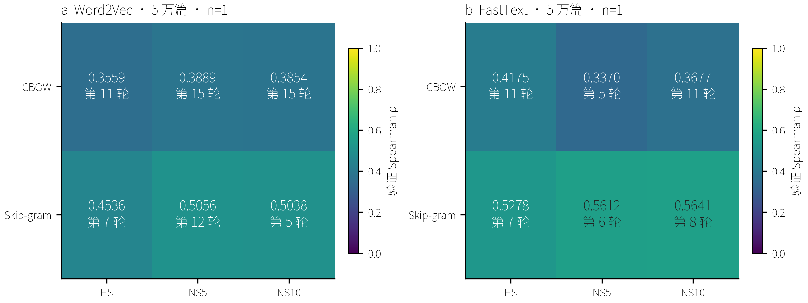

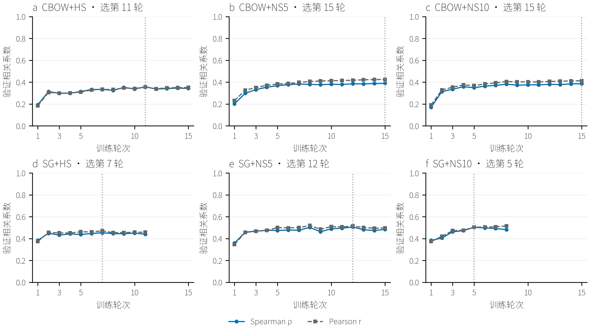

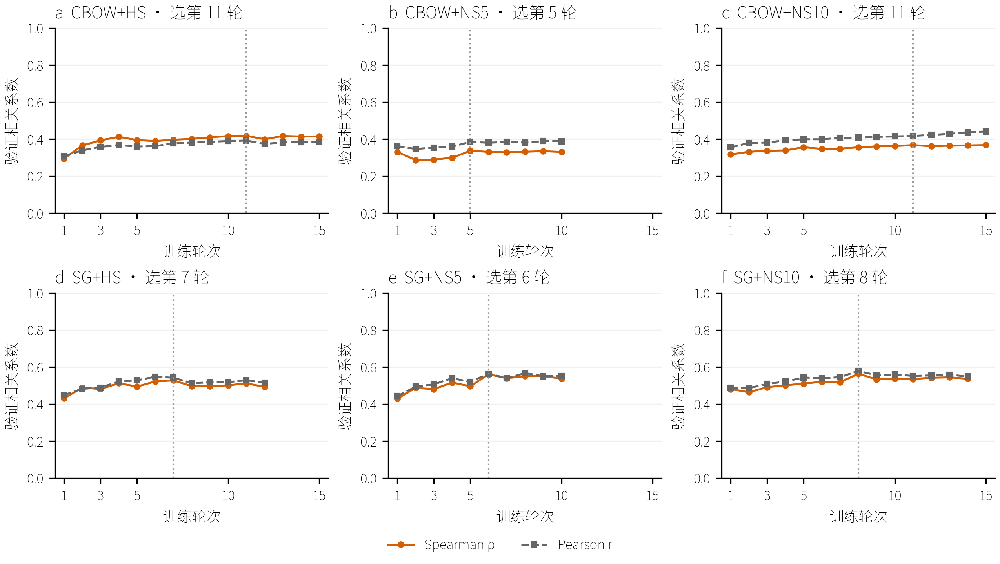

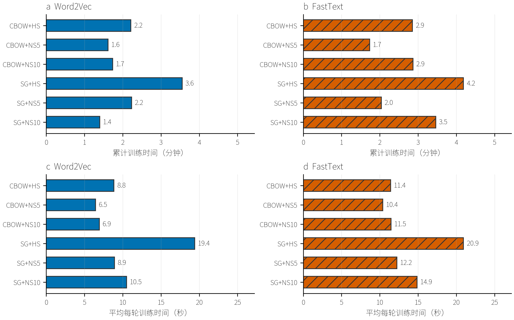

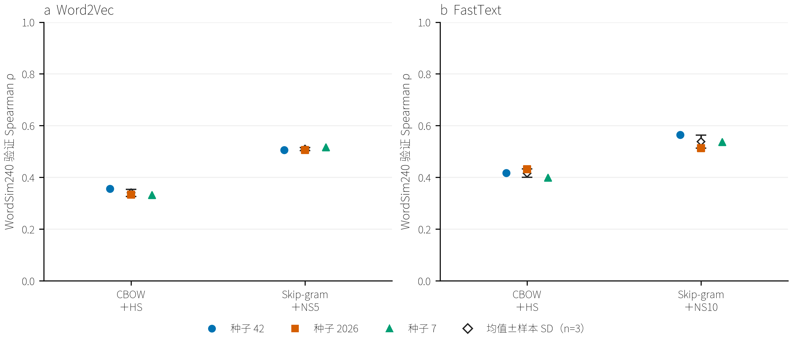

## 五档学习率搜索

固定 5 万篇及验证划分，在 Word2Vec 的 Skip-gram＋NS5、FastText 的 Skip-gram＋NS10 下，完整比较初始学习率 **0.005、0.01、0.025、0.05、0.1**；每档均运行 **42、2026、7** 三种子。学习率阶段共 **30 组**，复用原有 14 组、补充 16 组；加上此前训练方式阶段，共 44 次不同配置训练（两阶段共享 6 组）。每个模型分别按五档三种子验证均值选参，不再先以单种子筛掉学习率。

固定 100 维、窗口 5、最低词频 5、下采样 0.001、20 个训练线程、4 个数值库线程；FastText 子词 1–3、200,000 桶。min_alpha=0.0001，按最多 15 轮线性下降，早停不重排日程。至少 3 轮；最近一轮或两轮验证 Spearman 增幅 >0.001 时继续，结合连续 3 轮无有效提升判断停止，最多 15 轮。每次运行独立选最佳轮数，保存逐轮指标、检查点和重载验证；不记录 loss。

### Word2Vec：Skip-gram＋NS5

| 初始 alpha | 种子42 | 种子2026 | 种子7 | 验证均值±样本SD | n | 选中 |
| --- | --- | --- | --- | --- | --- | --- |
| 0.005 | 0.3909 | 0.3865 | 0.3825 | 0.3867±0.0042 | 3 |  |
| 0.01 | 0.4619 | 0.4618 | 0.4688 | 0.4642±0.0041 | 3 |  |
| 0.025 | 0.5056 | 0.5059 | 0.5169 | 0.5095±0.0065 | 3 | 是 |
| 0.05 | 0.5157 | 0.5287 | 0.4758 | 0.5067±0.0276 | 3 |  |
| 0.1 | 0.4889 | 0.4471 | 0.5046 | 0.4802±0.0297 | 3 |  |

五档三种子均值选中 **alpha=0.025**：0.5095±0.0065，n=3；次高均值 alpha=0.05 为 0.5067，均值差 0.0028。此差异为描述性比较，未作显著性检验。

前两档的均值差小于至少一档的种子标准差，当前排名用于候选筛选，不能据此声称显著优越。

最低学习率 alpha=0.005 有 3/3 次达到15轮预算上限。这里比较的是固定日程及选轮预算下的表现，不能将低分解释为增加训练轮数后仍一定更差；三种子也只反映训练波动，无法排除验证题抽样误差。

辅助指标与主指标的趋势并不完全一致：wordsim297 在 alpha=0.01 的验证 Spearman 均值最高（0.5155）；wordsim296 在 alpha=0.01 的验证 Spearman 均值最高（0.5116）。类比探针趋势另见图。最终候选对应预设 WordSim240 目标，不能泛称对所有语义任务最优。

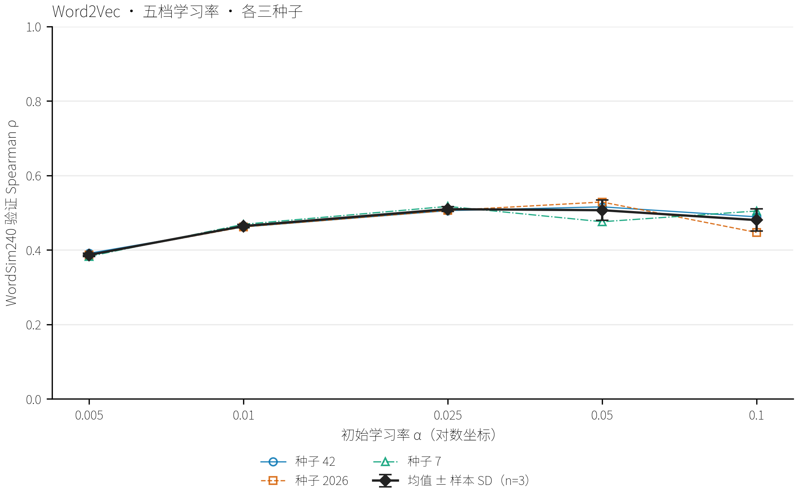

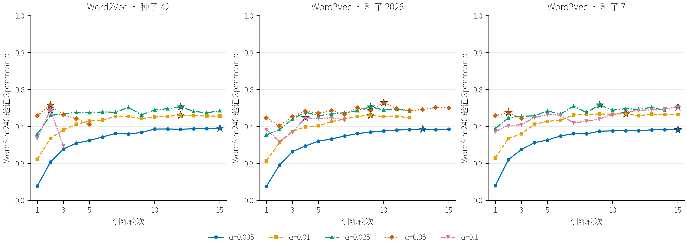

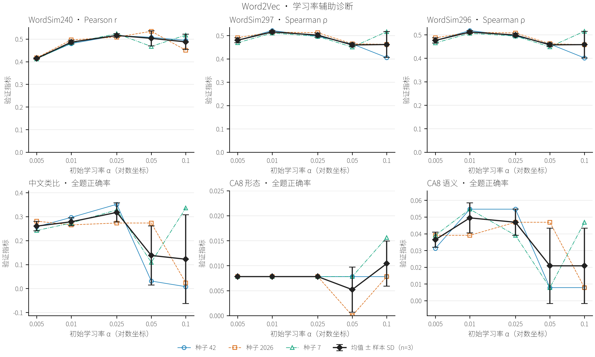

### Gensim FastText：Skip-gram＋NS10

| 初始 alpha | 种子42 | 种子2026 | 种子7 | 验证均值±样本SD | n | 选中 |
| --- | --- | --- | --- | --- | --- | --- |
| 0.005 | 0.4141 | 0.4149 | 0.4180 | 0.4157±0.0020 | 3 |  |
| 0.01 | 0.4836 | 0.5116 | 0.4917 | 0.4956±0.0144 | 3 |  |
| 0.025 | 0.5641 | 0.5131 | 0.5369 | 0.5380±0.0256 | 3 |  |
| 0.05 | 0.6300 | 0.5814 | 0.5732 | 0.5949±0.0307 | 3 | 是 |
| 0.1 | 0.5263 | 0.4677 | 0.5682 | 0.5207±0.0505 | 3 |  |

五档三种子均值选中 **alpha=0.05**：0.5949±0.0307，n=3；次高均值 alpha=0.025 为 0.5380，均值差 0.0569。此差异为描述性比较，未作显著性检验。

相对参考 alpha=0.025，同种子验证分差（42、2026、7）为 +0.0659、+0.0684、+0.0364；只描述这三次实测，不作为独立测试结论。

最低学习率 alpha=0.005 有 3/3 次达到15轮预算上限。这里比较的是固定日程及选轮预算下的表现，不能将低分解释为增加训练轮数后仍一定更差；三种子也只反映训练波动，无法排除验证题抽样误差。

辅助指标与主指标的趋势并不完全一致：wordsim297 在 alpha=0.01 的验证 Spearman 均值最高（0.5155）；wordsim296 在 alpha=0.01 的验证 Spearman 均值最高（0.5140）。类比探针趋势另见图。最终候选对应预设 WordSim240 目标，不能泛称对所有语义任务最优。

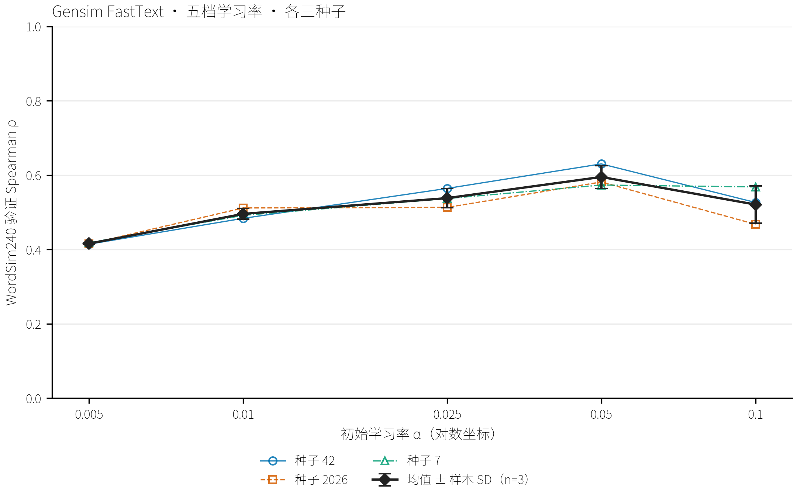

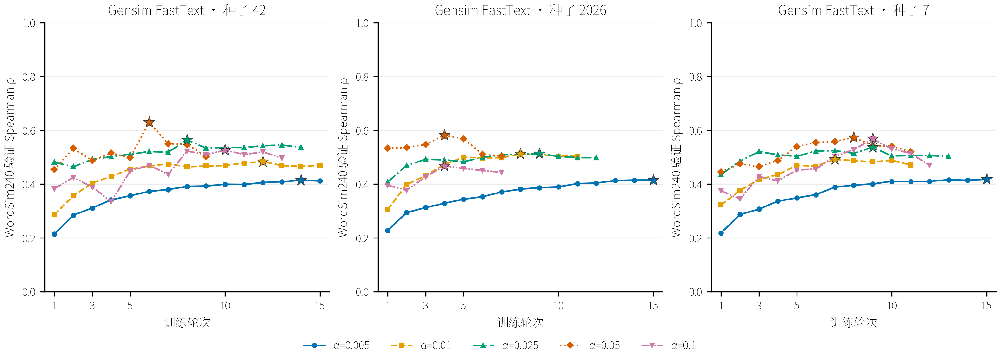

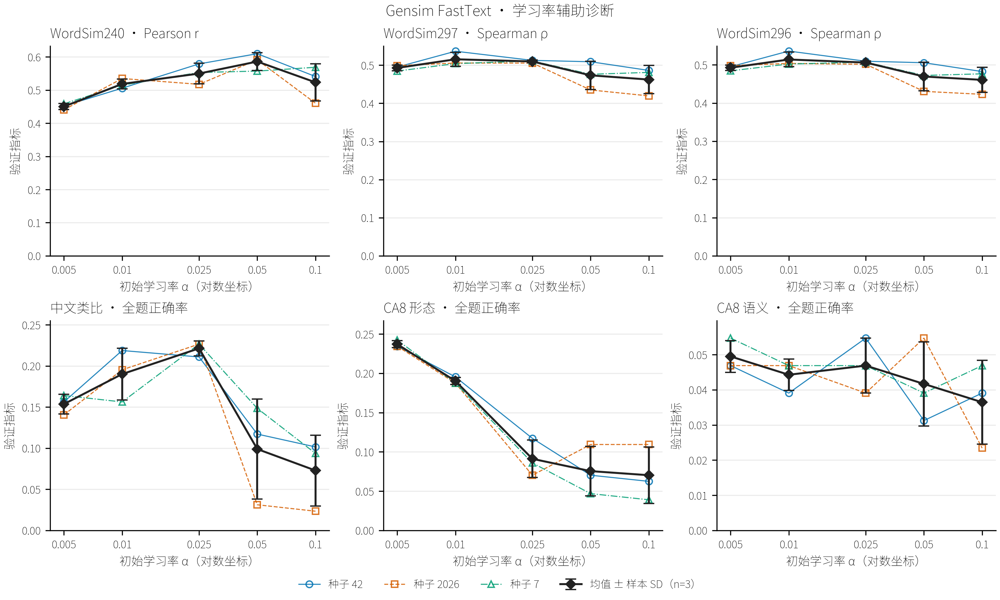

## 辅助指标与运行证据

[全部学习率诊断 CSV](../artifacts/thucnews_small_search/experiments/361d2139d70c8d840fc61da0/rate_validation_metrics.csv)保留 Pearson/Spearman、类比全部题/覆盖题正确率、OOV 和可生成词对诊断的三种子均值、样本 SD；原始 p 值保留逐轮，不作跨种子平均。辅助指标不替换主选参指标。

时间不含建词表、验证和保存；RSS 为各运行进程观测峰值。复用的 FastText/0.025/种子7曾从完整第2轮检查点恢复，RSS 不覆盖此前中断进程，详情见三档历史记录。

### Word2Vec 运行明细

| alpha | 种子 | 最佳/训练轮数 | 训练秒 | 峰值RSS MiB | 最佳模型 MiB | 复用 |
| --- | --- | --- | --- | --- | --- | --- |
| 0.005 | 42 | 15/15 | 138.1 | 287.6 | 75.2 | 否 |
| 0.005 | 2026 | 13/15 | 138.5 | 289.8 | 75.2 | 否 |
| 0.005 | 7 | 15/15 | 149.6 | 287.4 | 75.2 | 否 |
| 0.01 | 42 | 12/15 | 138.5 | 287.3 | 75.2 | 是 |
| 0.01 | 2026 | 9/12 | 124.2 | 287.4 | 75.2 | 否 |
| 0.01 | 7 | 11/15 | 149.7 | 288.2 | 75.2 | 否 |
| 0.025 | 42 | 12/15 | 133.8 | 287.8 | 75.2 | 是 |
| 0.025 | 2026 | 9/12 | 120.7 | 286.7 | 75.2 | 是 |
| 0.025 | 7 | 9/14 | 136.6 | 288.5 | 75.2 | 是 |
| 0.05 | 42 | 2/5 | 47.2 | 286.0 | 75.2 | 是 |
| 0.05 | 2026 | 10/15 | 141.2 | 286.5 | 75.2 | 是 |
| 0.05 | 7 | 2/3 | 27.6 | 284.6 | 75.2 | 是 |
| 0.1 | 42 | 2/3 | 31.4 | 284.2 | 75.2 | 否 |
| 0.1 | 2026 | 4/7 | 69.5 | 291.3 | 75.2 | 否 |
| 0.1 | 7 | 15/15 | 153.4 | 286.4 | 75.2 | 否 |

### Gensim FastText 运行明细

| alpha | 种子 | 最佳/训练轮数 | 训练秒 | 峰值RSS MiB | 最佳模型 MiB | 复用 |
| --- | --- | --- | --- | --- | --- | --- |
| 0.005 | 42 | 14/15 | 219.5 | 516.2 | 151.5 | 否 |
| 0.005 | 2026 | 15/15 | 228.0 | 516.6 | 151.5 | 否 |
| 0.005 | 7 | 15/15 | 218.1 | 517.1 | 151.5 | 否 |
| 0.01 | 42 | 12/15 | 224.8 | 516.6 | 151.5 | 是 |
| 0.01 | 2026 | 8/11 | 162.0 | 516.0 | 151.5 | 否 |
| 0.01 | 7 | 7/11 | 166.8 | 517.4 | 151.5 | 否 |
| 0.025 | 42 | 8/14 | 207.9 | 516.1 | 151.5 | 是 |
| 0.025 | 2026 | 9/12 | 182.9 | 516.3 | 151.5 | 是 |
| 0.025 | 7 | 9/13 | 190.3 | 517.1 | 151.5 | 是 |
| 0.05 | 42 | 6/9 | 133.2 | 516.3 | 151.5 | 是 |
| 0.05 | 2026 | 4/7 | 98.0 | 518.0 | 151.5 | 是 |
| 0.05 | 7 | 8/11 | 159.7 | 516.6 | 151.5 | 是 |
| 0.1 | 42 | 10/13 | 192.7 | 516.3 | 151.5 | 否 |
| 0.1 | 2026 | 4/7 | 102.3 | 516.0 | 151.5 | 否 |
| 0.1 | 7 | 9/12 | 178.0 | 516.5 | 151.5 | 否 |

word2vec/alpha=0.005/seed=42：[日志](../artifacts/thucnews_small_search/runs/ea0f70999d34c9eba58c82c4/run.log) · [逐轮指标](../artifacts/thucnews_small_search/runs/ea0f70999d34c9eba58c82c4/validation_metrics.csv) · [轮次与学习率](../artifacts/thucnews_small_search/runs/ea0f70999d34c9eba58c82c4/epochs.csv) · [最佳模型](../artifacts/thucnews_small_search/runs/ea0f70999d34c9eba58c82c4/checkpoints/epoch_15.gensim) · [保存加载核验](../artifacts/thucnews_small_search/runs/ea0f70999d34c9eba58c82c4/save_load_check.json)。

word2vec/alpha=0.005/seed=2026：[日志](../artifacts/thucnews_small_search/runs/e570b8305bb4c83bad9e9c7b/run.log) · [逐轮指标](../artifacts/thucnews_small_search/runs/e570b8305bb4c83bad9e9c7b/validation_metrics.csv) · [轮次与学习率](../artifacts/thucnews_small_search/runs/e570b8305bb4c83bad9e9c7b/epochs.csv) · [最佳模型](../artifacts/thucnews_small_search/runs/e570b8305bb4c83bad9e9c7b/checkpoints/epoch_13.gensim) · [保存加载核验](../artifacts/thucnews_small_search/runs/e570b8305bb4c83bad9e9c7b/save_load_check.json)。

word2vec/alpha=0.005/seed=7：[日志](../artifacts/thucnews_small_search/runs/cb4ff298b3e7c3ee67e9b8f8/run.log) · [逐轮指标](../artifacts/thucnews_small_search/runs/cb4ff298b3e7c3ee67e9b8f8/validation_metrics.csv) · [轮次与学习率](../artifacts/thucnews_small_search/runs/cb4ff298b3e7c3ee67e9b8f8/epochs.csv) · [最佳模型](../artifacts/thucnews_small_search/runs/cb4ff298b3e7c3ee67e9b8f8/checkpoints/epoch_15.gensim) · [保存加载核验](../artifacts/thucnews_small_search/runs/cb4ff298b3e7c3ee67e9b8f8/save_load_check.json)。

word2vec/alpha=0.01/seed=42：[日志](../artifacts/thucnews_small_search/runs/15338707b12248d218a8629c/run.log) · [逐轮指标](../artifacts/thucnews_small_search/runs/15338707b12248d218a8629c/validation_metrics.csv) · [轮次与学习率](../artifacts/thucnews_small_search/runs/15338707b12248d218a8629c/epochs.csv) · [最佳模型](../artifacts/thucnews_small_search/runs/15338707b12248d218a8629c/checkpoints/epoch_12.gensim) · [保存加载核验](../artifacts/thucnews_small_search/runs/15338707b12248d218a8629c/save_load_check.json)。

word2vec/alpha=0.01/seed=2026：[日志](../artifacts/thucnews_small_search/runs/8cc360d960ae0ac81947d1d6/run.log) · [逐轮指标](../artifacts/thucnews_small_search/runs/8cc360d960ae0ac81947d1d6/validation_metrics.csv) · [轮次与学习率](../artifacts/thucnews_small_search/runs/8cc360d960ae0ac81947d1d6/epochs.csv) · [最佳模型](../artifacts/thucnews_small_search/runs/8cc360d960ae0ac81947d1d6/checkpoints/epoch_09.gensim) · [保存加载核验](../artifacts/thucnews_small_search/runs/8cc360d960ae0ac81947d1d6/save_load_check.json)。

word2vec/alpha=0.01/seed=7：[日志](../artifacts/thucnews_small_search/runs/cb4710f596fd620fcc4f4d57/run.log) · [逐轮指标](../artifacts/thucnews_small_search/runs/cb4710f596fd620fcc4f4d57/validation_metrics.csv) · [轮次与学习率](../artifacts/thucnews_small_search/runs/cb4710f596fd620fcc4f4d57/epochs.csv) · [最佳模型](../artifacts/thucnews_small_search/runs/cb4710f596fd620fcc4f4d57/checkpoints/epoch_11.gensim) · [保存加载核验](../artifacts/thucnews_small_search/runs/cb4710f596fd620fcc4f4d57/save_load_check.json)。

word2vec/alpha=0.025/seed=42：[日志](../artifacts/thucnews_small_search/runs/f9c16001ad2b4c736400df2b/run.log) · [逐轮指标](../artifacts/thucnews_small_search/runs/f9c16001ad2b4c736400df2b/validation_metrics.csv) · [轮次与学习率](../artifacts/thucnews_small_search/runs/f9c16001ad2b4c736400df2b/epochs.csv) · [最佳模型](../artifacts/thucnews_small_search/runs/f9c16001ad2b4c736400df2b/checkpoints/epoch_12.gensim) · [保存加载核验](../artifacts/thucnews_small_search/runs/f9c16001ad2b4c736400df2b/save_load_check.json)。

word2vec/alpha=0.025/seed=2026：[日志](../artifacts/thucnews_small_search/runs/5bf7d2dd4b07c3684261176c/run.log) · [逐轮指标](../artifacts/thucnews_small_search/runs/5bf7d2dd4b07c3684261176c/validation_metrics.csv) · [轮次与学习率](../artifacts/thucnews_small_search/runs/5bf7d2dd4b07c3684261176c/epochs.csv) · [最佳模型](../artifacts/thucnews_small_search/runs/5bf7d2dd4b07c3684261176c/checkpoints/epoch_09.gensim) · [保存加载核验](../artifacts/thucnews_small_search/runs/5bf7d2dd4b07c3684261176c/save_load_check.json)。

word2vec/alpha=0.025/seed=7：[日志](../artifacts/thucnews_small_search/runs/eaf0a4fdc7d75e660eb19bf5/run.log) · [逐轮指标](../artifacts/thucnews_small_search/runs/eaf0a4fdc7d75e660eb19bf5/validation_metrics.csv) · [轮次与学习率](../artifacts/thucnews_small_search/runs/eaf0a4fdc7d75e660eb19bf5/epochs.csv) · [最佳模型](../artifacts/thucnews_small_search/runs/eaf0a4fdc7d75e660eb19bf5/checkpoints/epoch_09.gensim) · [保存加载核验](../artifacts/thucnews_small_search/runs/eaf0a4fdc7d75e660eb19bf5/save_load_check.json)。

word2vec/alpha=0.05/seed=42：[日志](../artifacts/thucnews_small_search/runs/d47bb05fb6638bee6e8e8533/run.log) · [逐轮指标](../artifacts/thucnews_small_search/runs/d47bb05fb6638bee6e8e8533/validation_metrics.csv) · [轮次与学习率](../artifacts/thucnews_small_search/runs/d47bb05fb6638bee6e8e8533/epochs.csv) · [最佳模型](../artifacts/thucnews_small_search/runs/d47bb05fb6638bee6e8e8533/checkpoints/epoch_02.gensim) · [保存加载核验](../artifacts/thucnews_small_search/runs/d47bb05fb6638bee6e8e8533/save_load_check.json)。

word2vec/alpha=0.05/seed=2026：[日志](../artifacts/thucnews_small_search/runs/a055d2f5c2464b3ec721c0c1/run.log) · [逐轮指标](../artifacts/thucnews_small_search/runs/a055d2f5c2464b3ec721c0c1/validation_metrics.csv) · [轮次与学习率](../artifacts/thucnews_small_search/runs/a055d2f5c2464b3ec721c0c1/epochs.csv) · [最佳模型](../artifacts/thucnews_small_search/runs/a055d2f5c2464b3ec721c0c1/checkpoints/epoch_10.gensim) · [保存加载核验](../artifacts/thucnews_small_search/runs/a055d2f5c2464b3ec721c0c1/save_load_check.json)。

word2vec/alpha=0.05/seed=7：[日志](../artifacts/thucnews_small_search/runs/c6462dae4fd8c17f83da6ffb/run.log) · [逐轮指标](../artifacts/thucnews_small_search/runs/c6462dae4fd8c17f83da6ffb/validation_metrics.csv) · [轮次与学习率](../artifacts/thucnews_small_search/runs/c6462dae4fd8c17f83da6ffb/epochs.csv) · [最佳模型](../artifacts/thucnews_small_search/runs/c6462dae4fd8c17f83da6ffb/checkpoints/epoch_02.gensim) · [保存加载核验](../artifacts/thucnews_small_search/runs/c6462dae4fd8c17f83da6ffb/save_load_check.json)。

word2vec/alpha=0.1/seed=42：[日志](../artifacts/thucnews_small_search/runs/60530696ccb1f504bd8106a9/run.log) · [逐轮指标](../artifacts/thucnews_small_search/runs/60530696ccb1f504bd8106a9/validation_metrics.csv) · [轮次与学习率](../artifacts/thucnews_small_search/runs/60530696ccb1f504bd8106a9/epochs.csv) · [最佳模型](../artifacts/thucnews_small_search/runs/60530696ccb1f504bd8106a9/checkpoints/epoch_02.gensim) · [保存加载核验](../artifacts/thucnews_small_search/runs/60530696ccb1f504bd8106a9/save_load_check.json)。

word2vec/alpha=0.1/seed=2026：[日志](../artifacts/thucnews_small_search/runs/12a86b321521c6246b9d37b1/run.log) · [逐轮指标](../artifacts/thucnews_small_search/runs/12a86b321521c6246b9d37b1/validation_metrics.csv) · [轮次与学习率](../artifacts/thucnews_small_search/runs/12a86b321521c6246b9d37b1/epochs.csv) · [最佳模型](../artifacts/thucnews_small_search/runs/12a86b321521c6246b9d37b1/checkpoints/epoch_04.gensim) · [保存加载核验](../artifacts/thucnews_small_search/runs/12a86b321521c6246b9d37b1/save_load_check.json)。

word2vec/alpha=0.1/seed=7：[日志](../artifacts/thucnews_small_search/runs/2628c48ed738e781c77e8101/run.log) · [逐轮指标](../artifacts/thucnews_small_search/runs/2628c48ed738e781c77e8101/validation_metrics.csv) · [轮次与学习率](../artifacts/thucnews_small_search/runs/2628c48ed738e781c77e8101/epochs.csv) · [最佳模型](../artifacts/thucnews_small_search/runs/2628c48ed738e781c77e8101/checkpoints/epoch_15.gensim) · [保存加载核验](../artifacts/thucnews_small_search/runs/2628c48ed738e781c77e8101/save_load_check.json)。

fasttext/alpha=0.005/seed=42：[日志](../artifacts/thucnews_small_search/runs/c623e5d57d5de2adb40c9c4c/run.log) · [逐轮指标](../artifacts/thucnews_small_search/runs/c623e5d57d5de2adb40c9c4c/validation_metrics.csv) · [轮次与学习率](../artifacts/thucnews_small_search/runs/c623e5d57d5de2adb40c9c4c/epochs.csv) · [最佳模型](../artifacts/thucnews_small_search/runs/c623e5d57d5de2adb40c9c4c/checkpoints/epoch_14.gensim) · [保存加载核验](../artifacts/thucnews_small_search/runs/c623e5d57d5de2adb40c9c4c/save_load_check.json)。

fasttext/alpha=0.005/seed=2026：[日志](../artifacts/thucnews_small_search/runs/7100c9504ae4c2937e81bd6c/run.log) · [逐轮指标](../artifacts/thucnews_small_search/runs/7100c9504ae4c2937e81bd6c/validation_metrics.csv) · [轮次与学习率](../artifacts/thucnews_small_search/runs/7100c9504ae4c2937e81bd6c/epochs.csv) · [最佳模型](../artifacts/thucnews_small_search/runs/7100c9504ae4c2937e81bd6c/checkpoints/epoch_15.gensim) · [保存加载核验](../artifacts/thucnews_small_search/runs/7100c9504ae4c2937e81bd6c/save_load_check.json)。

fasttext/alpha=0.005/seed=7：[日志](../artifacts/thucnews_small_search/runs/c0d49b4bbb8aa31bde9dfaa0/run.log) · [逐轮指标](../artifacts/thucnews_small_search/runs/c0d49b4bbb8aa31bde9dfaa0/validation_metrics.csv) · [轮次与学习率](../artifacts/thucnews_small_search/runs/c0d49b4bbb8aa31bde9dfaa0/epochs.csv) · [最佳模型](../artifacts/thucnews_small_search/runs/c0d49b4bbb8aa31bde9dfaa0/checkpoints/epoch_15.gensim) · [保存加载核验](../artifacts/thucnews_small_search/runs/c0d49b4bbb8aa31bde9dfaa0/save_load_check.json)。

fasttext/alpha=0.01/seed=42：[日志](../artifacts/thucnews_small_search/runs/0242e378a5ea8cfe66001628/run.log) · [逐轮指标](../artifacts/thucnews_small_search/runs/0242e378a5ea8cfe66001628/validation_metrics.csv) · [轮次与学习率](../artifacts/thucnews_small_search/runs/0242e378a5ea8cfe66001628/epochs.csv) · [最佳模型](../artifacts/thucnews_small_search/runs/0242e378a5ea8cfe66001628/checkpoints/epoch_12.gensim) · [保存加载核验](../artifacts/thucnews_small_search/runs/0242e378a5ea8cfe66001628/save_load_check.json)。

fasttext/alpha=0.01/seed=2026：[日志](../artifacts/thucnews_small_search/runs/f4b79efdc06cd5443bc8c054/run.log) · [逐轮指标](../artifacts/thucnews_small_search/runs/f4b79efdc06cd5443bc8c054/validation_metrics.csv) · [轮次与学习率](../artifacts/thucnews_small_search/runs/f4b79efdc06cd5443bc8c054/epochs.csv) · [最佳模型](../artifacts/thucnews_small_search/runs/f4b79efdc06cd5443bc8c054/checkpoints/epoch_08.gensim) · [保存加载核验](../artifacts/thucnews_small_search/runs/f4b79efdc06cd5443bc8c054/save_load_check.json)。

fasttext/alpha=0.01/seed=7：[日志](../artifacts/thucnews_small_search/runs/befbc184589fe8dac15d51b0/run.log) · [逐轮指标](../artifacts/thucnews_small_search/runs/befbc184589fe8dac15d51b0/validation_metrics.csv) · [轮次与学习率](../artifacts/thucnews_small_search/runs/befbc184589fe8dac15d51b0/epochs.csv) · [最佳模型](../artifacts/thucnews_small_search/runs/befbc184589fe8dac15d51b0/checkpoints/epoch_07.gensim) · [保存加载核验](../artifacts/thucnews_small_search/runs/befbc184589fe8dac15d51b0/save_load_check.json)。

fasttext/alpha=0.025/seed=42：[日志](../artifacts/thucnews_small_search/runs/36dc0d3874b33d53966c9cef/run.log) · [逐轮指标](../artifacts/thucnews_small_search/runs/36dc0d3874b33d53966c9cef/validation_metrics.csv) · [轮次与学习率](../artifacts/thucnews_small_search/runs/36dc0d3874b33d53966c9cef/epochs.csv) · [最佳模型](../artifacts/thucnews_small_search/runs/36dc0d3874b33d53966c9cef/checkpoints/epoch_08.gensim) · [保存加载核验](../artifacts/thucnews_small_search/runs/36dc0d3874b33d53966c9cef/save_load_check.json)。

fasttext/alpha=0.025/seed=2026：[日志](../artifacts/thucnews_small_search/runs/e3f18889c768e4d9e5acd79b/run.log) · [逐轮指标](../artifacts/thucnews_small_search/runs/e3f18889c768e4d9e5acd79b/validation_metrics.csv) · [轮次与学习率](../artifacts/thucnews_small_search/runs/e3f18889c768e4d9e5acd79b/epochs.csv) · [最佳模型](../artifacts/thucnews_small_search/runs/e3f18889c768e4d9e5acd79b/checkpoints/epoch_09.gensim) · [保存加载核验](../artifacts/thucnews_small_search/runs/e3f18889c768e4d9e5acd79b/save_load_check.json)。

fasttext/alpha=0.025/seed=7：[日志](../artifacts/thucnews_small_search/runs/23f563f873769f019665ad7b/run.log) · [逐轮指标](../artifacts/thucnews_small_search/runs/23f563f873769f019665ad7b/validation_metrics.csv) · [轮次与学习率](../artifacts/thucnews_small_search/runs/23f563f873769f019665ad7b/epochs.csv) · [最佳模型](../artifacts/thucnews_small_search/runs/23f563f873769f019665ad7b/checkpoints/epoch_09.gensim) · [保存加载核验](../artifacts/thucnews_small_search/runs/23f563f873769f019665ad7b/save_load_check.json)。

fasttext/alpha=0.05/seed=42：[日志](../artifacts/thucnews_small_search/runs/14eb2989f18f14c860bbbaaa/run.log) · [逐轮指标](../artifacts/thucnews_small_search/runs/14eb2989f18f14c860bbbaaa/validation_metrics.csv) · [轮次与学习率](../artifacts/thucnews_small_search/runs/14eb2989f18f14c860bbbaaa/epochs.csv) · [最佳模型](../artifacts/thucnews_small_search/runs/14eb2989f18f14c860bbbaaa/checkpoints/epoch_06.gensim) · [保存加载核验](../artifacts/thucnews_small_search/runs/14eb2989f18f14c860bbbaaa/save_load_check.json)。

fasttext/alpha=0.05/seed=2026：[日志](../artifacts/thucnews_small_search/runs/1bfa3f37989f7a8141c714c9/run.log) · [逐轮指标](../artifacts/thucnews_small_search/runs/1bfa3f37989f7a8141c714c9/validation_metrics.csv) · [轮次与学习率](../artifacts/thucnews_small_search/runs/1bfa3f37989f7a8141c714c9/epochs.csv) · [最佳模型](../artifacts/thucnews_small_search/runs/1bfa3f37989f7a8141c714c9/checkpoints/epoch_04.gensim) · [保存加载核验](../artifacts/thucnews_small_search/runs/1bfa3f37989f7a8141c714c9/save_load_check.json)。

fasttext/alpha=0.05/seed=7：[日志](../artifacts/thucnews_small_search/runs/f8d70444c7a28cdeee90cf54/run.log) · [逐轮指标](../artifacts/thucnews_small_search/runs/f8d70444c7a28cdeee90cf54/validation_metrics.csv) · [轮次与学习率](../artifacts/thucnews_small_search/runs/f8d70444c7a28cdeee90cf54/epochs.csv) · [最佳模型](../artifacts/thucnews_small_search/runs/f8d70444c7a28cdeee90cf54/checkpoints/epoch_08.gensim) · [保存加载核验](../artifacts/thucnews_small_search/runs/f8d70444c7a28cdeee90cf54/save_load_check.json)。

fasttext/alpha=0.1/seed=42：[日志](../artifacts/thucnews_small_search/runs/ed6b3771cd4b101503dd5f6e/run.log) · [逐轮指标](../artifacts/thucnews_small_search/runs/ed6b3771cd4b101503dd5f6e/validation_metrics.csv) · [轮次与学习率](../artifacts/thucnews_small_search/runs/ed6b3771cd4b101503dd5f6e/epochs.csv) · [最佳模型](../artifacts/thucnews_small_search/runs/ed6b3771cd4b101503dd5f6e/checkpoints/epoch_10.gensim) · [保存加载核验](../artifacts/thucnews_small_search/runs/ed6b3771cd4b101503dd5f6e/save_load_check.json)。

fasttext/alpha=0.1/seed=2026：[日志](../artifacts/thucnews_small_search/runs/4e6b6ed0c274b9dae7534eee/run.log) · [逐轮指标](../artifacts/thucnews_small_search/runs/4e6b6ed0c274b9dae7534eee/validation_metrics.csv) · [轮次与学习率](../artifacts/thucnews_small_search/runs/4e6b6ed0c274b9dae7534eee/epochs.csv) · [最佳模型](../artifacts/thucnews_small_search/runs/4e6b6ed0c274b9dae7534eee/checkpoints/epoch_04.gensim) · [保存加载核验](../artifacts/thucnews_small_search/runs/4e6b6ed0c274b9dae7534eee/save_load_check.json)。

fasttext/alpha=0.1/seed=7：[日志](../artifacts/thucnews_small_search/runs/ba0cdc47f8e7c5682f1bb419/run.log) · [逐轮指标](../artifacts/thucnews_small_search/runs/ba0cdc47f8e7c5682f1bb419/validation_metrics.csv) · [轮次与学习率](../artifacts/thucnews_small_search/runs/ba0cdc47f8e7c5682f1bb419/epochs.csv) · [最佳模型](../artifacts/thucnews_small_search/runs/ba0cdc47f8e7c5682f1bb419/checkpoints/epoch_09.gensim) · [保存加载核验](../artifacts/thucnews_small_search/runs/ba0cdc47f8e7c5682f1bb419/save_load_check.json)。

[完整运行索引](../artifacts/thucnews_small_search/experiments/361d2139d70c8d840fc61da0/index.json) · [进度](../artifacts/thucnews_small_search/progress.json) · [原阶段索引](../artifacts/thucnews_small_search/experiments/e5cc57786fa3cd4195698419/index.json)。原训练协议与旧索引保持不变。

[全部30组原始结果 CSV](../artifacts/thucnews_small_search/experiments/361d2139d70c8d840fc61da0/results.csv)保留完整精度及配置、种子、模型与检查点定位。

[核验通过](../artifacts/thucnews_small_search/experiments/361d2139d70c8d840fc61da0/verification.json)：30 组完整网格、每档三种子；封存文件、逐轮选轮、检查点哈希、保存加载一致；全部使用验证分区，词表、词频及覆盖一致。

## 复现入口

```powershell
conda run -n Gensim python -m gensim_lab.thucnews_alpha_grid
conda run -n Gensim python -m gensim_lab.thucnews_small_search --stage stop
conda run -n Gensim python -m gensim_lab.thucnews_alpha_grid --stage audit
conda run -n Gensim python -m gensim_lab.thucnews_alpha_grid --stage report
```

主选参指标为 WordSim240 验证集严格词表内 Spearman，覆盖 92/95 题；所有配置的词表、词频和覆盖题一致。三种子固定为 42、2026、7，SD 是样本标准差（ddof=1），反映训练波动，不能保证消除误差或替代独立测试。评价划分种子固定为 42，多线程不保证逐位确定性。本轮为小规模探索性选参，未计算测试指标，未启动全量训练或新闻类别预测。WordSim297/296 验证题不同，分别报告；类比只使用每套固定 128 题验证探针。学习率仅在各自选定训练方式下比较，尚未穷举训练方式交互。
