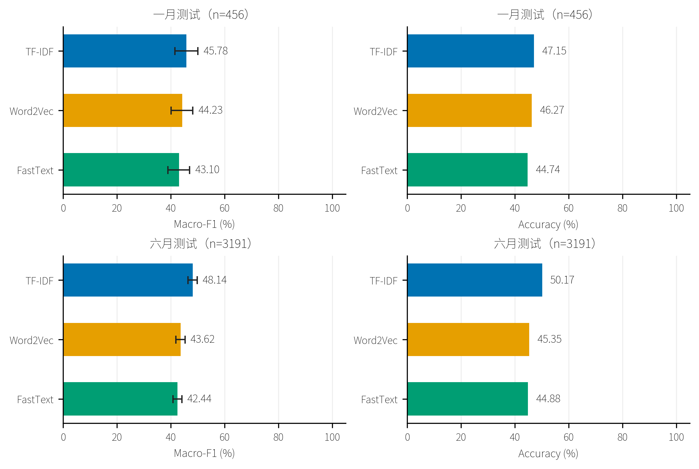
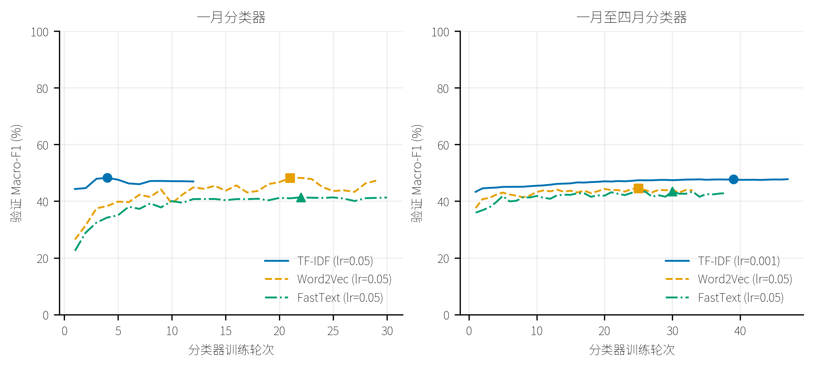
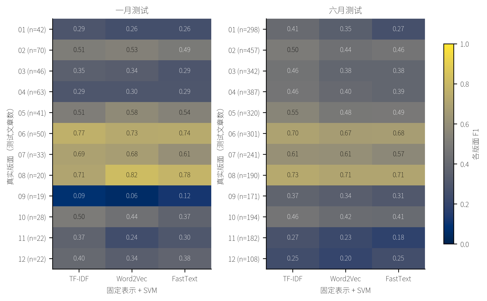
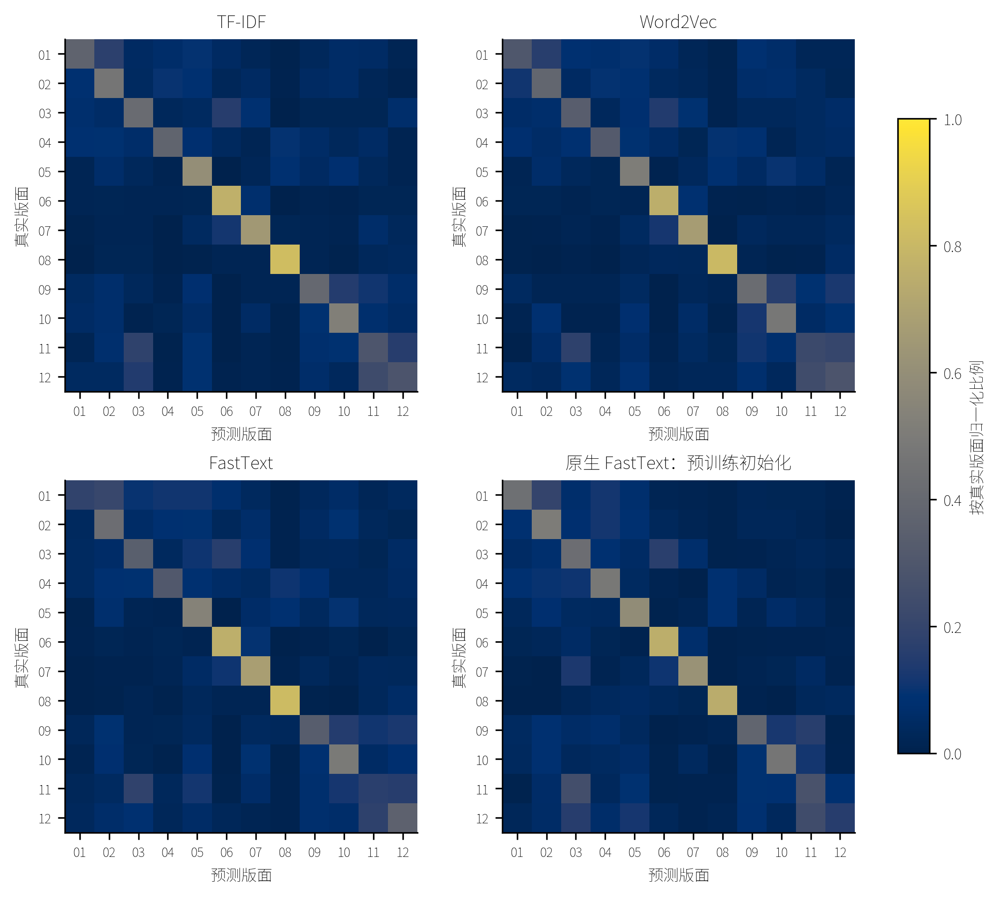
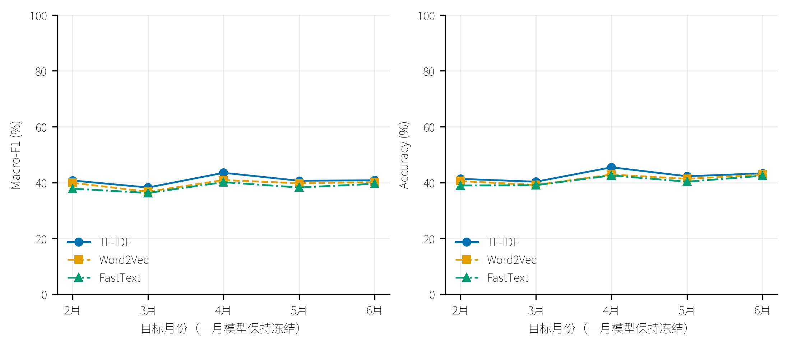

# 历史版面代理分类记录

该实验预测版号，已退出当前提交报告，不能用于判断主题分类效果。

# 人民日报固定表示与 FastText 分类实验

更新：2026-10-10T19:09:55+08:00。

### 1.2 文本分类实验

#### 1.2.1 数据集与评价划分（9801–9806）

分类实验使用人民日报 1998 年一月至六月语料（9801–9806），共 18,647 篇原始文章，清洗后保留 18,108 篇。标签为 01–12 的版面编号，任务称为版面分类。THUCNews 仅用于此前的表示学习，本节没有使用其新闻类别训练分类器。

文章按日期、版面和文章序号聚合，标题与正文共同进入特征。沿用原有分词，去除编号、词性后缀、实体标注括号和标点，进行 NFKC 规范化并清除控制字符；不同内容的重复段落编号按原顺序保留。少于 30 个有效词的文章排除；同文本同标签只保留最早一篇，标签冲突的相同文本全部排除。字符三元组 SimHash 汉明距离不超过 3 的文章归入同组。日期、编号和版面 ID 不进入文本表示。

| 月份 | 原始文章 | 保留文章 |
| --- | --- | --- |
| 199801 | 3148 | 3050 |
| 199802 | 2626 | 2559 |
| 199803 | 2905 | 2822 |
| 199804 | 3465 | 3371 |
| 199805 | 3223 | 3115 |
| 199806 | 3280 | 3191 |

一月实验复用既有种子 42 的分层、近重复组划分，先划分 12 类，再筛选较小的版面范围。时间扩展用一月至四月训练、五月验证、六月测试，并排除跨分区近重复组。两种设置的分类器均只读取相应训练标签，验证集选参，测试集用于最后评价。

| 设置 | 训练 | 验证 | 测试 |
| --- | --- | --- | --- |
| 一月 2 | 543 | 117 | 112 |
| 一月 4 | 1077 | 229 | 221 |
| 一月 8 | 1725 | 368 | 365 |
| 一月 12 | 2138 | 456 | 456 |
| 一至四月→六月 | 11802 | 3115 | 3191 |

#### 1.2.2 表示方式、分类器与参数选择

主要实验将现有三套表示保持冻结，分别训练相同的 LinearSVC。TF-IDF 使用 THUCNews 的 50,000 词词典和原 IDF；Word2Vec 使用 Skip-gram＋NS5、300 维的最佳检查点；Gensim FastText 使用 Skip-gram＋NS10、100 维的最佳检查点。词向量按词次取均值后做 L2 归一化，Word2Vec 跳过未登录词，FastText 纳入能够生成的子词向量；TF-IDF 原始权重也做 L2 归一化。本节比较的是三套现成表示，维数、容量和预训练目标并未统一，因此不将差异归因于架构本身。

SVM 和多项逻辑回归采用类别平衡权重，分别在 C=0.1、1、10 中选择验证 Macro-F1 最高的配置；并列时保留较小 C。自行实现的线性 Softmax 使用同一固定输入表示，只训练输出权重和偏置，采用 CUDA、AdamW、批次 256、权重衰减 0.0001。种子 42 比较学习率 0.001、0.01、0.05，固定最佳学习率后补充 2026、7；每次独立按逐轮验证结果选检查点。至少训练 10 轮，最多 60 轮，连续 8 轮未提高超过 0.001 时停止。训练过程不记录 loss，完整验证曲线另存 CSV。

原生监督 FastText 作为辅助对照，比较随机初始化与现有 Gensim FastText 向量初始化。只导出对应人民日报训练词表中的向量，包括由子词生成的训练词向量；没有导入 Gensim 的字符哈希桶。两者均为 100 维、词 bigram、200,000 桶、平坦 softmax、学习率 0.1、最低词频 1，关闭原生字符子词，使用 20 个 CPU 线程。种子 42 在 5、15、25 轮中按验证 Macro-F1 选择，冻结轮数后补充另外两个种子。标签训练同时更新输入词向量与分类输出，因而与固定表示接 SVM 的比较口径不同。

#### 1.2.3 三个表示模型的分类效果

在固定表示接相同 SVM 的主要比较中，一月 12 类测试的最高 Macro-F1 来自 TF-IDF（45.78%）；一月至四月训练后的六月测试以 TF-IDF 最高（48.14%）。下表同时给出准确率与 Macro-F1，后者等权计算各版面效果，避免高频版面主导结论。

| 测试 | 固定表示＋SVM | 验证选定 C | Accuracy (%) | Macro-F1 (%) | Macro-F1 95% 区间 (%) |
| --- | --- | --- | --- | --- | --- |
| 一月 | TF-IDF | 0.1 | 47.15 | 45.78 | 41.58–50.07 |
| 一月 | Word2Vec | 1.0 | 46.27 | 44.23 | 40.17–48.21 |
| 一月 | Gensim FastText | 1.0 | 44.74 | 43.10 | 38.93–47.05 |
| 六月 | TF-IDF | 0.1 | 50.17 | 48.14 | 46.44–49.82 |
| 六月 | Word2Vec | 10.0 | 45.35 | 43.62 | 41.92–45.30 |
| 六月 | Gensim FastText | 1.0 | 44.88 | 42.44 | 40.84–44.12 |

图1.2-1 三种固定表示的主要分类结果。Macro-F1 误差线为同一测试文章按版面分层、配对 bootstrap 2,000 次的百分位 95% 区间；一月 n=456，六月 n=3,191。Accuracy 未附误差线。每个表示只有一套预训练模型，该区间不代表训练种子的波动。

| 测试 | 配对差值 | Macro-F1 差值（百分点） | 95% 差值区间（百分点） |
| --- | --- | --- | --- |
| 一月 | Word2Vec − TF-IDF | -1.55 | -5.14–2.08 |
| 一月 | Gensim FastText − TF-IDF | -2.69 | -6.75–1.33 |
| 一月 | Gensim FastText − Word2Vec | -1.13 | -3.97–1.67 |
| 六月 | Word2Vec − TF-IDF | -4.52 | -6.07–-2.93 |
| 六月 | Gensim FastText − TF-IDF | -5.70 | -7.24–-4.09 |
| 六月 | Gensim FastText − Word2Vec | -1.18 | -2.56–0.25 |

差值区间使用同一批重采样文章计算，可直接观察两种预测的差异；不通过两个模型区间是否重叠来判断。这些区间没有做多重比较校正，仅用于探索性差异描述。本项目的一月测试集已有历史观察，当前结果也不能视为新的独立确认性证据。

一月的三个两两差值区间均跨零，不能据点估计确认稳定优劣。六月 TF-IDF 相对 Word2Vec、FastText 的优势分别为 4.52 和 5.70 个百分点，对应差值区间为 2.93–6.07 和 4.09–7.24 个百分点；Word2Vec 与 FastText 的差值区间仍跨零。六月测试因此为 TF-IDF 的优势提供了更明确的支持，但尚不足以区分两套词向量表示的稳定排序。

##### 1.2.3.1 类别规模与分类器敏感性

| 版面数 | 测试篇数 | 多数类 Macro-F1 (%) | TF-IDF | Word2Vec | FastText |
| --- | --- | --- | --- | --- | --- |
| 2 | 112 | 38.46 | 65.37 | 65.51 | 66.03 |
| 4 | 221 | 12.03 | 54.74 | 48.25 | 50.35 |
| 8 | 365 | 4.02 | 55.51 | 54.55 | 55.71 |
| 12 | 456 | 2.22 | 45.78 | 44.23 | 43.10 |

| 测试 | 相同分类器 | TF-IDF Macro-F1 (%) | Word2Vec | FastText |
| --- | --- | --- | --- | --- |
| 一月 | SVM | 45.78 | 44.23 | 43.10 |
| 一月 | 逻辑回归 | 46.61 | 43.92 | 41.89 |
| 一月 | 线性 Softmax | 45.42±0.78 | 42.33±0.33 | 40.23±0.31 |
| 六月 | SVM | 48.14 | 43.62 | 42.44 |
| 六月 | 逻辑回归 | 48.00 | 45.81 | 43.01 |
| 六月 | 线性 Softmax | 48.17±0.47 | 44.64±0.09 | 42.40±0.72 |

线性 Softmax 为三种子均值±样本标准差（n=3），其余为固定种子 42 的一次分类器拟合；三种子复验没有重新训练输入表示。SVM 与逻辑回归分别选择 C，Softmax 则独立选择学习率和轮数，因而同一表示在各列具有各自的验证选参结果。

一月的 SVM、逻辑回归、Softmax 优胜表示分别为 TF-IDF、TF-IDF、TF-IDF；六月对应为 TF-IDF、TF-IDF、TF-IDF。这些结果用来判断主要排名对分类器的依赖，不能把不同分类器的最高测试分重新当作选参依据。

图1.2-2 自行实现的冻结表示＋线性 Softmax 验证曲线。显示种子 42、验证选定学习率的实际轮次，点标记保存的最佳检查点；不进行插值或平滑，不画单次运行误差带。其余两个种子的完整曲线保存在运行目录。

##### 1.2.3.2 各版面表现与错误分布

图1.2-3 各版面测试 F1。三种固定表示均接 SVM，两个面板使用相同的 0–1 色阶；括号标出各版面的测试篇数。逐类 Precision、Recall、F1 和原始混淆计数另存 CSV。

| 表示＋SVM | 六月最常见误判方向 | 篇数 |
| --- | --- | --- |
| TF-IDF | 03→06 | 54 |
| TF-IDF | 01→02 | 52 |
| TF-IDF | 02→04 | 45 |
| Word2Vec | 02→01 | 51 |
| Word2Vec | 03→06 | 50 |
| Word2Vec | 01→02 | 48 |
| Gensim FastText | 01→02 | 63 |
| Gensim FastText | 03→06 | 55 |
| Gensim FastText | 04→08 | 42 |

图1.2-4 六月测试的按行归一化混淆矩阵。前三幅为固定表示＋SVM；第四幅为原生 FastText 预训练初始化、种子 42 的辅助对照。颜色表示每个真实版面的预测比例，所有面板共用色阶。

##### 1.2.3.3 覆盖率与计算成本

| 表示 | 六月词表覆盖 (%) | 可用表示覆盖 (%) | 零向量文章 | 选定 SVM 拟合 (s) | 推理表示文件 (MiB) | 分类头 (KiB) |
| --- | --- | --- | --- | --- | --- | --- |
| TF-IDF | 86.81 | 86.81 | 0 | 0.546 | 5.29 | 4688.38 |
| Word2Vec | 96.44 | 96.44 | 0 | 5.183 | 310.41 | 29.00 |
| Gensim FastText | 96.44 | 100.00 | 0 | 0.682 | 185.78 | 10.25 |

词表覆盖按词次计算，可用表示覆盖还计入 FastText 可生成的未登录词。较高覆盖率并不保证正确的类别预测。拟合时间只包含选定 SVM，不包含预训练、特征提取和其余 C 候选；原始数值另保存完整运行耗时与进程 RSS 峰值。词向量推理只需 vectors.kv，故本表的表示文件大小与 1.1 中完整训练模型的大小不同。

##### 1.2.3.4 时间迁移与原生 FastText 对照

图1.2-5 冻结一月 12 类 SVM，在二月至六月逐月评价。所有目标月份均不用于改参数；与任意一月文章同近重复组的文章排除。曲线连接真实时间点，训练语料和表示保持固定。

以下为原先 5、15、25 轮预算中的验证选参结果。随机初始化在一月的验证 Macro-F1 仅 0.0495，说明这组预算下模型仍不能充分利用训练标签；该现象与项目此前的原生 FastText 拟合诊断一致。

| 测试 | 标签联合训练路线 | 验证选定轮数 | Accuracy (%) | Macro-F1 (%) |
| --- | --- | --- | --- | --- |
| 一月 | 原生 FastText：随机初始化 | 5 | 17.76±1.95 | 4.54±0.80 |
| 一月 | 原生 FastText：预训练初始化 | 25 | 44.88±0.46 | 40.86±0.22 |
| 六月 | 原生 FastText：随机初始化 | 25 | 47.15±0.07 | 42.75±0.12 |
| 六月 | 原生 FastText：预训练初始化 | 25 | 51.07±0.10 | 48.66±0.12 |

上表为种子 42、2026、7 的均值±样本标准差（n=3），原生 FastText 的多线程更新不保证逐位确定性。预训练初始化会改变导入的词向量，向量差值探针和导入前零学习率核验均已保存；原始 Gensim 模型的 SHA-256 保持不变。预训练与随机初始化是相同原生结构下的对照，其结果与固定表示＋SVM 的差异同时包含输入微调、词 bigram 和优化目标的改变。

##### 1.2.3.5 扩大原生 FastText 训练预算的探索性检查

为检查低验证分数是否与训练预算有关，额外比较 100、200 轮，保持原生模型其余参数不变。种子 42 仅使用原验证集选轮，固定轮数后补充 2026、7；三个固定表示接 SVM 的模型与主要结果保持封存。补充启动时初始测试结果已经观察，因此本节属于探索性检查，不能宣称新的独立确认性证据。

| 测试 | 原生路线 | 补充验证选定轮数 | 训练 Macro-F1 (%) | 验证 Macro-F1 (%) | 测试 Macro-F1 (%) | Accuracy (%) |
| --- | --- | --- | --- | --- | --- | --- |
| 一月 | 原生 FastText：随机初始化 | 200 | 99.38±0.09 | 49.64±0.36 | 45.97±0.95 | 47.37±0.96 |
| 一月 | 原生 FastText：预训练初始化 | 200 | 100.00±0.00 | 51.35±0.00 | 48.59±0.07 | 50.07±0.13 |
| 六月 | 原生 FastText：随机初始化 | 100 | 99.78±0.05 | 45.83±0.08 | 48.13±0.09 | 49.86±0.14 |
| 六月 | 原生 FastText：预训练初始化 | 100 | 99.97±0.00 | 47.34±0.06 | 47.26±0.06 | 49.12±0.04 |

以上为三种子均值±样本标准差（n=3）。训练分数只检查拟合程度；训练与验证差距提示过拟合风险。增加训练预算的结果用于解释初始配置的限制，不能用最初少轮数的低分认定原生 FastText 不适合本任务。

一月扩大预算后，随机初始化和预训练初始化的测试 Macro-F1 分别达到 45.97% 和 48.59%；其训练 Macro-F1 已接近 100%，验证与测试仍约为 50%，说明增加轮数同时带来了较大的泛化差距。六月的结果没有全面提高：预训练初始化从初始 25 轮的 48.66% 降至补充 100 轮的 47.26%。该路线种子 42 的验证 Macro-F1 也由 0.4815 降为 0.4730，综合两组已测预算时仍应保留原来的 25 轮配置。

[补充原始结果](../../artifacts/pfr_frozen_classification/experiments/dad300cdbab4301662940e97/native_budget/323997afff37b2e6ec60a638/results.csv) · [补充核验](../../artifacts/pfr_frozen_classification/experiments/dad300cdbab4301662940e97/native_budget/323997afff37b2e6ec60a638/verification.json)

#### 1.2.4 小结

在现有三套固定表示接相同 SVM 的比较中，TF-IDF 的一月点估计最高，但差值区间均跨零；六月时间扩展测试的 TF-IDF 优势得到配对区间支持。TF-IDF 在逻辑回归及三种子 Softmax 下也取得了较高的 Macro-F1，是当前配置较合适的版面分类基线。若选择不同分类器，应结合前述分类器对照，而不单凭词相似度或未登录词覆盖决定表示。各版面 F1 和时间迁移结果进一步限定了整体分数的适用范围：版面内容随日期变化，版面 ID 与稳定的人工主题标签不能等同。

TF-IDF 的优势可能与保留区分版面的稀疏词项有关，均值词向量则将这些信号压缩进较小的固定空间。本轮没有分离词项权重、维数和池化因素，因此这一解释仍需消融验证。原生 FastText 的预训练初始化可以通过标签训练改善一月的分类效果；六月初始配置虽取得了略高的点估计，但不能把这项不同训练路线的结果等同于固定 FastText 表示优于 TF-IDF。

现有 Word2Vec 和 FastText 的维数不同，表示预训练均只有种子 42，且选参范围有限；Softmax 和原生模型的三种子波动只反映分类训练阶段。因此，当前结论适用于这些固定模型、人民日报版面标签和既定划分。三套表示均未通过分类损失继续拟合人民日报文本，只有原生监督 FastText 的辅助路线进行了标签联合训练。主实验选参在打开其测试结果前完成，扩大原生预算的检查按前述探索性边界解释；保存加载后的逐篇标签及分数一致。

[完整实验结果与运行记录](人民日报版面分类_历史_20261010.md) · [固定方案](../../docs/人民日报固定表示分类实验方案.md) · [结果 CSV](../../artifacts/pfr_frozen_classification/experiments/dad300cdbab4301662940e97/results.csv) · [运行核验](../../artifacts/pfr_frozen_classification/experiments/dad300cdbab4301662940e97/verification.json)
