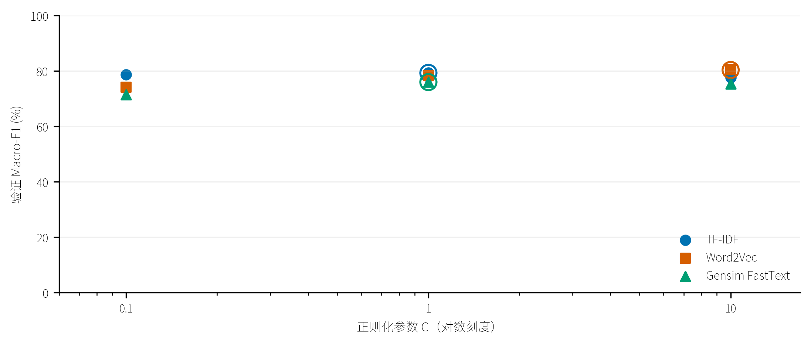
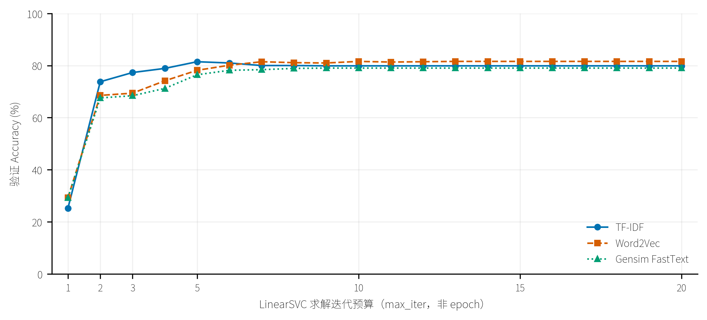
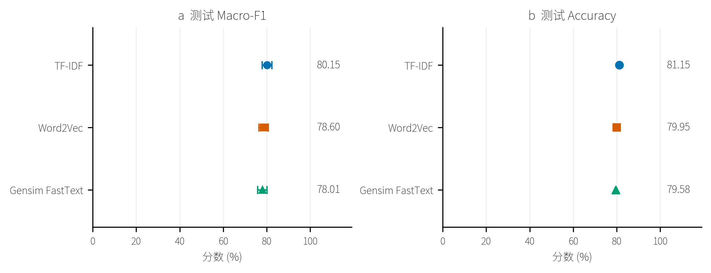
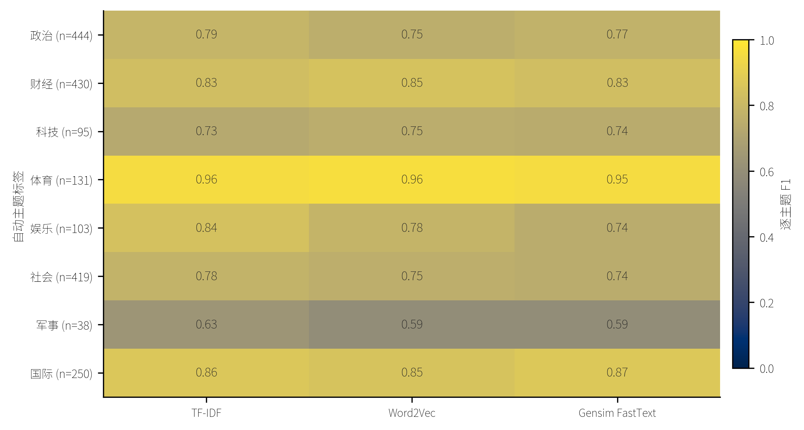
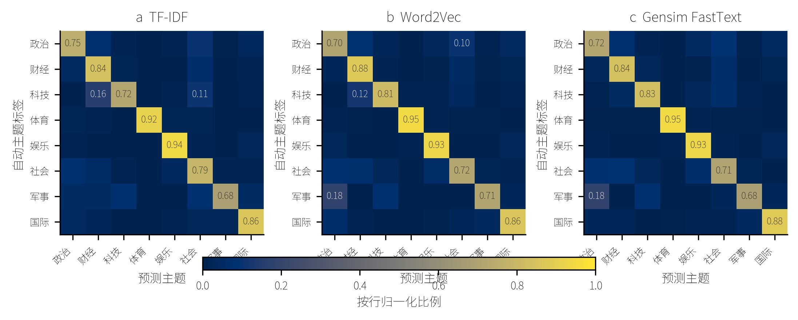

# 人民日报三种表示与LinearSVC对比

#### 1.2.6 三种冻结表示与同一 LinearSVC 的比较

##### 1.2.6.1 比较条件与验证选参

复用此前THUCNews学到的TF-IDF、Word2Vec和Gensim FastText，冻结词典、IDF、词向量及字符子词参数；本轮只训练LinearSVC分类器，未新增主题标注或重新训练表示模型。使用与原生FastText部分完全相同的八类主题、5,333篇一至二月训练文章、820篇三月验证文章和1,910篇三月测试文章。文本、重复组和划分均不变，版号不进入特征。

TF-IDF沿用50,000词词典及训练IDF，输出稀疏文章向量；Word2Vec和FastText按文章中词的出现次数加权求均值。Word2Vec跳过未登录词，FastText允许由字符子词生成词向量。三种文章向量均做L2归一化。现有Word2Vec为300维、Skip-gram＋NS5、alpha=0.025；FastText为100维、Skip-gram＋NS10、alpha=0.05，子词1—3、200,000桶。这里比较现有表示的实际使用效果，维数和预训练参数未匹配，不能单独归因于算法结构。

分类器统一采用LinearSVC，L2惩罚、squared-hinge损失、one-vs-rest多类策略和balanced类别权重。使用原始问题求解（dual=False），容差为10⁻⁴，最大20,000次迭代；九组拟合均收敛。各方法只在训练文章上拟合，在验证集从C={0.1,1,10}选择Macro-F1最高者，平局选较小C。参数全部冻结后评估测试集，不用验证或测试文章更新表示，不合并验证集重新拟合分类器。

LinearSVC使用CPU的liblinear求解器，数值库限制4线程，特征转换使用8个线程。每组求解一个凸优化分类器，不增加无意义的分类器种子重复；本轮也未重复预训练表示，因此没有词向量训练种子的误差估计。

| 表示 | C=0.1验证Macro-F1 (%) | C=1验证Macro-F1 (%) | C=10验证Macro-F1 (%) | 选定C |
| --- | --- | --- | --- | --- |
| TF-IDF | 78.68 | 79.27 | 77.52 | 1.0 |
| Word2Vec | 74.06 | 78.30 | 80.31 | 10.0 |
| Gensim FastText | 71.42 | 75.96 | 75.31 | 1.0 |

图1.2-6　同一LinearSVC的验证选参。n=820；每个点对应一次独立拟合，空圈为选中C。只显示三个实际候选，不插值。

Word2Vec选中C=10，位于本轮候选上界；该结果只说明它在三个已测C中验证Macro-F1最高，不声称C=10是全局最佳参数。后续迭代诊断固定此处选定的C，不重新按曲线峰值选参。

图1.2-7　三种表示接LinearSVC的验证准确率与求解迭代预算。n=820；每种表示实际拟合max_iter=1—20共20个预算，使用同一训练集和各自已选C。三条线置于同图；连接线仅引导阅读独立预算结果，不是按epoch采集的训练曲线。

LinearSVC使用liblinear求解，没有逐epoch回调，也不将一次求解迭代等同于遍历一次语料。因此该图横轴为求解预算；每个预算均从头拟合，保存模型、完整验证决策分数、实际n_iter和收敛状态。预算不足的ConvergenceWarning作为预期诊断记录，不当作正式已收敛结果。TF-IDF和FastText在预算12时首次不再报告未收敛，实际各迭代11次；Word2Vec在预算18时首次收敛，实际迭代17次。预算20的三个模型均与正式选定分类器的验证预测和决策分数完全一致。较小预算的验证准确率可能高于收敛值；优化目标收敛并不保证验证准确率单调提高。本次诊断没有重新读取测试结果或据此改变正式模型。

##### 1.2.6.2 整体效果与配对差值

| 表示 | C | Accuracy (%) | Macro-F1 (%) | Macro-F1 95%区间 (%) | Micro-F1 (%) | Weighted-F1 (%) |
| --- | --- | --- | --- | --- | --- | --- |
| TF-IDF | 1.0 | 81.15 | 80.15 | [77.81, 82.29] | 81.15 | 81.17 |
| Word2Vec | 10.0 | 79.95 | 78.60 | [76.46, 80.74] | 79.95 | 79.92 |
| Gensim FastText | 1.0 | 79.58 | 78.01 | [75.79, 80.12] | 79.58 | 79.63 |

TF-IDF的测试Macro-F1点估计最高，为80.15%；排名依次为TF-IDF、Word2Vec、Gensim FastText。Word2Vec在验证集最高，但测试排序改变，说明单个验证留出集上的小幅差异不能保证在另一批文章中保持。单标签任务中Micro-F1等于Accuracy，二者均保存用于核验。

图1.2-8　三种冻结表示接同一LinearSVC的三月留出测试。n=1,910；Macro-F1误差线为按自动主题分层、文章配对重采样2,000次的百分位95%区间；Accuracy仅显示点估计。每种表示使用一个分类器，误差线不是训练种子标准差。

| 配对差值（前者－后者） | Macro-F1差值（百分点） | 95%区间（百分点） |
| --- | --- | --- |
| Word2Vec－TF-IDF | -1.56 | [-3.64, 0.78] |
| Gensim FastText－TF-IDF | -2.14 | [-4.43, 0.03] |
| Gensim FastText－Word2Vec | -0.59 | [-2.30, 1.04] |

三组配对差值区间都包含零。当前数据支持TF-IDF点估计较高，但不足以确认它稳定优于另外两种表示；不能把包含零解释为三种方法等效。重采样对三种方法使用同一批文章，保持各主题测试数量，本轮所有近重复组均只有一篇，文章可作为重采样单位。区间以既有弱标签和已训练模型为条件，不涵盖自动标注误差或词向量预训练波动，也未做多重比较校正，作为探索性比较报告。

##### 1.2.6.3 逐类表现与覆盖率

图1.2-9　三种表示的逐主题F1。n为该主题测试文章数；统一0—1色阶，格内数字为单个已选模型的F1。

| 主题 | 表示 | 测试篇数 | Precision (%) | Recall (%) | F1 (%) |
| --- | --- | --- | --- | --- | --- |
| 政治 | TF-IDF | 444 | 82.43 | 75.00 | 78.54 |
| 政治 | Word2Vec | 444 | 80.99 | 70.05 | 75.12 |
| 政治 | Gensim FastText | 444 | 83.25 | 71.62 | 77.00 |
| 财经 | TF-IDF | 430 | 80.98 | 84.19 | 82.55 |
| 财经 | Word2Vec | 430 | 81.96 | 87.67 | 84.72 |
| 财经 | Gensim FastText | 430 | 81.31 | 83.95 | 82.61 |
| 科技 | TF-IDF | 95 | 73.91 | 71.58 | 72.73 |
| 科技 | Word2Vec | 95 | 69.37 | 81.05 | 74.76 |
| 科技 | Gensim FastText | 95 | 66.95 | 83.16 | 74.18 |
| 体育 | TF-IDF | 131 | 100.00 | 91.60 | 95.62 |
| 体育 | Word2Vec | 131 | 97.64 | 94.66 | 96.12 |
| 体育 | Gensim FastText | 131 | 96.12 | 94.66 | 95.38 |
| 娱乐 | TF-IDF | 103 | 76.38 | 94.17 | 84.35 |
| 娱乐 | Word2Vec | 103 | 67.61 | 93.20 | 78.37 |
| 娱乐 | Gensim FastText | 103 | 61.94 | 93.20 | 74.42 |
| 社会 | TF-IDF | 419 | 76.87 | 78.52 | 77.69 |
| 社会 | Word2Vec | 419 | 79.42 | 71.84 | 75.44 |
| 社会 | Gensim FastText | 419 | 78.72 | 70.64 | 74.47 |
| 军事 | TF-IDF | 38 | 59.09 | 68.42 | 63.41 |
| 军事 | Word2Vec | 38 | 50.94 | 71.05 | 59.34 |
| 军事 | Gensim FastText | 38 | 52.00 | 68.42 | 59.09 |
| 国际 | TF-IDF | 250 | 86.69 | 86.00 | 86.35 |
| 国际 | Word2Vec | 250 | 84.25 | 85.60 | 84.92 |
| 国际 | Gensim FastText | 250 | 85.94 | 88.00 | 86.96 |

图1.2-10　三种表示的测试混淆矩阵。行是真实保存的自动主题标签，列是预测主题，按行归一化，三图共享0—1色阶；标出占比至少10%的格，原始计数完整保存。

| 表示 | 测试词token数 | 词典内覆盖率 (%) | 可用向量覆盖率 (%) | 零向量文章 |
| --- | --- | --- | --- | --- |
| TF-IDF | 724171 | 86.33 | 86.33 | 0 |
| Word2Vec | 724171 | 95.74 | 95.74 | 0 |
| Gensim FastText | 724171 | 95.74 | 100.00 | 0 |

覆盖率按词token计数。TF-IDF词典内覆盖指保留词典中的token；Word2Vec可用向量覆盖与词典内覆盖一致；FastText可用覆盖还包含子词生成的未登录词向量。高覆盖只说明模型能够构造特征，不保证特征对主题识别有用，因此不能用FastText的覆盖率直接推断分类优势。词均值压缩也会丢失词袋中的部分区分信息，这是TF-IDF表现较好的一个可能原因，本轮没有进行因果验证。

##### 1.2.6.4 计算成本、差异案例与结论

| 表示 | 特征维数 | 8063篇特征转换 (s) | 选定分类器拟合 (s) | 加载及1910篇预测 (s) | 拟合进程峰值RSS (MiB) | 分类器文件 (MiB) |
| --- | --- | --- | --- | --- | --- | --- |
| TF-IDF | 50000 | 2.67 | 0.414 | 0.0057 | 679.80 | 3.0526 |
| Word2Vec | 300 | 11.26 | 0.593 | 0.0039 | 684.97 | 0.0191 |
| Gensim FastText | 100 | 15.57 | 0.144 | 0.0017 | 650.99 | 0.0069 |

特征转换包含表示文件加载和8063篇文章转换；分类器拟合计fit调用，预测列仅计分类器加载和已缓存测试特征上的推断。RSS为共享编排进程采样峰值，受已加载库、表示和缓存影响；分类器文件大小不包含外部词典或词向量，不能当作完整部署体积。这些秒级单次测量用于描述本机成本，不用于推断稳定的速度倍数。FastText分类器较小，但子词向量生成使本轮特征转换耗时最高；TF-IDF虽然有50,000维，其稀疏计算仍使分类拟合保持在秒以内。

| 文章标题 | 自动标签 | TF-IDF | Word2Vec | Gensim FastText |
| --- | --- | --- | --- | --- |
| 印国大党主席凯斯里辞职 | 国际 | 国际 | 政治 | 国际 |
| 肖黎主编的我的史学观一书由广东人民出版社出版所谓史学观简而言之就是历史学家对历史学本身的总体认识如历史学的功能性质研究历史的方法等本书约请海内外30多位史学家从个人的角度对上述问题进行了反思由于他们在各自所从事的专业领域都取得过很大成就故均能道出许多独到的见解此书的出版对广大的史学工作者尤其是青年学子的治学会有颇多启迪与帮助丛文 | 社会 | 社会 | 社会 | 娱乐 |
| 消费者欢迎三·一五 | 社会 | 社会 | 政治 | 社会 |
| 最高人民法院院长任建新在九届人大一次会议上的报告摘要 | 政治 | 政治 | 社会 | 政治 |

上表从预测不一致文章中，先按与自动标签一致的方法数量降序、再按匿名ID升序取四篇，只用于展示具体分歧，不代表错误分布。自动标签也可能有误，未经人工核验不能将某个模型的不同判断直接定为语义错误。

本轮结论是：在同一LinearSVC、固定语料划分与既有预训练表示下，TF-IDF取得最高整体点估计，Word2Vec次之，Gensim FastText略低，配对不确定性尚不能确认稳定排序。三套表示的排名与1.2.3的原生FastText初始化实验属于不同问题：这里表示完全冻结，原生监督训练则会更新输入词向量，并学习词bigram和分类输出权重。前一部分的初始化收益不能直接转化为本部分冻结表示的优势。

三月验证文章参与选参，且此测试集已有原生实验历史观察，结果按探索性的三月留出测试解释。主题来自单次大模型标注，因此分数衡量与这套弱标签的一致性，不等同于人工真值上的主题识别准确率。

完整资源见[验证网格](../artifacts/pfr_topic_svm/experiments/8b19ba4ff6f59b678887f3cb/validation_grid.csv)、[测试指标](../artifacts/pfr_topic_svm/experiments/8b19ba4ff6f59b678887f3cb/results.csv)、[逐类指标](../artifacts/pfr_topic_svm/experiments/8b19ba4ff6f59b678887f3cb/per_class_test.csv)、[分区覆盖率](../artifacts/pfr_topic_svm/experiments/8b19ba4ff6f59b678887f3cb/coverage_summary.csv)、[配对区间](../artifacts/pfr_topic_svm/experiments/8b19ba4ff6f59b678887f3cb/bootstrap.json)、[求解迭代曲线数值](../artifacts/pfr_topic_svm/experiments/8b19ba4ff6f59b678887f3cb/iteration_diagnostic/86a1c2cf7d3858c27d4bf1bf/accuracy_curve.csv)、[全部分歧案例](../artifacts/pfr_topic_svm/experiments/8b19ba4ff6f59b678887f3cb/disagreement_examples.csv)和[核验](../artifacts/pfr_topic_svm/experiments/8b19ba4ff6f59b678887f3cb/verification.json)。复现方法见[主题分类指南](../docs/人民日报主题分类复现指南.md)。
