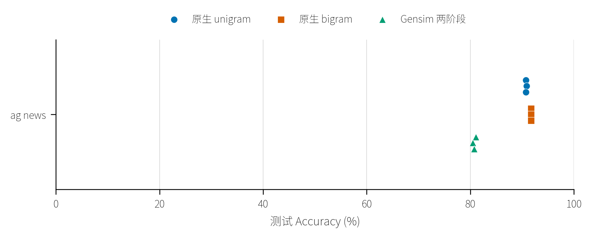
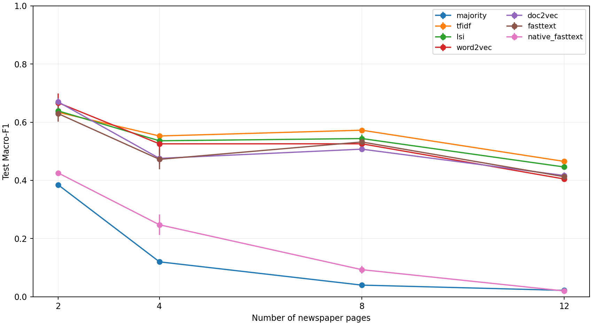
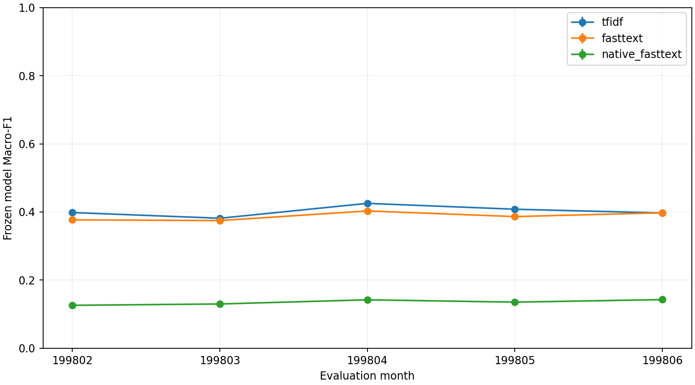
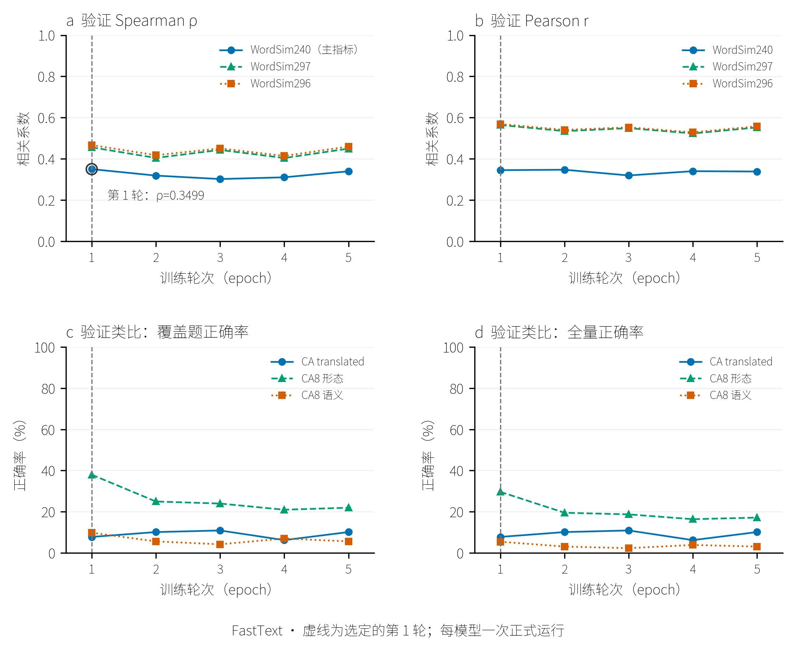
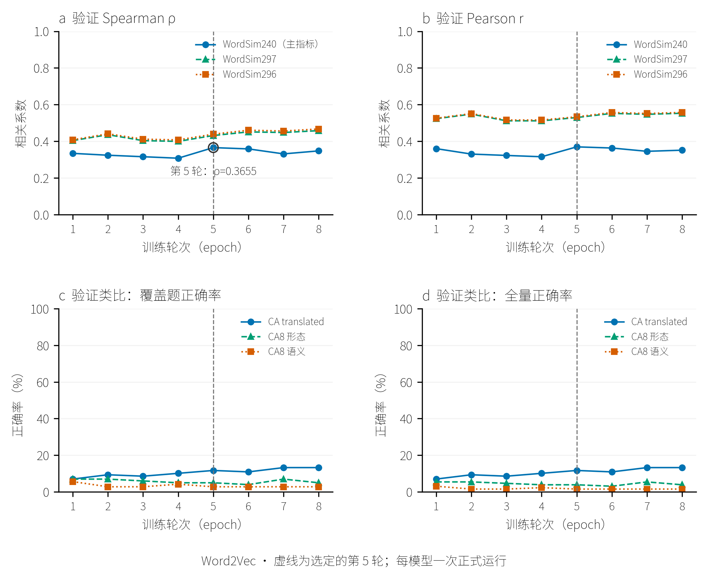
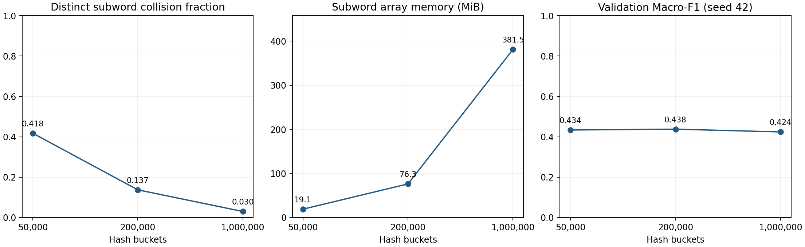
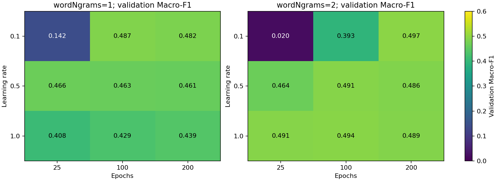

# FastText 论文与实现分析及 Gensim 文本向量化表示学习实验报告

> 展示规则更新（2026-10-09）：项目已取消按变化幅度／极差筛选图形的约束。本文旧版阈值、合表数量与图形数量描述保留为历史展示记录，不再约束新图；训练与评价原始数值不变。


<a id="abstract"></a>

## 摘要

本文比较 Gensim 的五种文本表示方法，对 Word2Vec 和 FastText 开展词语义评价，第一章以 Bag of Tricks for Efficient Text Classification 为核心，分析其分类模型、实验与适用范围，并结合相关词表示研究解释实现差异。实验采用人民日报 1998 年一月至六月语料，清洗后保留 18,108 篇文章。一月的 3,050 篇文章按近重复组划分，训练集、验证集和测试集分别为 2,138、456 和 456 篇。分类标签为版面编号 01–12。版面分类实验将五种 Gensim 表示接入统一的 LinearSVC，以多数类和原生监督 FastText 为参照。表示模型和分类器只拟合训练集，参数选择使用验证集；人民日报历史随机模型采用三个种子、单线程训练；当前默认训练 20 线程，历史记录保留原始口径。

在一月 12 类主配置下，TF-IDF 的测试 Macro-F1 为 0.4652，Gensim FastText 为 0.4127 ± 0.0122。WordSim-240 上，Word2Vec 和 Gensim FastText 的 Spearman rho 分别为 0.3207 ± 0.0090 和 0.4610 ± 0.0101。FastText 的词相似度表现较好，这一优势未转化为版面分类优势。补充优化后，原生 FastText 的测试 Macro-F1 达到 0.4656 ± 0.0020；其相对 TF-IDF 的日期成对抽样差值区间包含零，现有结果尚不足以确认稳定优势。当前两个词向量模型分别采用独立验证曲线和原生检查点选择轮数；HS score 仅作兼容性诊断。

本文完成的是中文语料上的方法对照、参数实验和实现核查。第二部分已接入原论文完整数据，原生监督模型与 Gensim 两阶段近似路线分开报告，当前进度以运行记录为准。分类标签取自版面位置，全文据此讨论版面分类，不将结果解释为人工标注的主题分类。各项实验明细保存在 CSV，正文保留主要结果及其分析。

关键词：FastText；Gensim；子词表示；文本向量化；版面分类；参数比较

<a id="paper-reading"></a>

## 一、FastText论文解读

本章解读 *Bag of Tricks for Efficient Text Classification*，依据 [paper 目录中的论文](../paper/Bag%20of%20Tricks%20for%20Efficient%20Text%20Classification.pdf)（arXiv v3，2016）。论文用简单模型实现高效文本分类，主要优化了文本表示、局部词序特征和类别计算。

<a id="paper-background"></a>

### 1.1 研究目标

作者希望在保持分类效果的同时，降低训练和预测成本，尤其适用于大语料、类别多的任务。思路是以词袋加线性分类器为基础，通过几项优化获得接近复杂模型的效果。

<a id="classification-paper"></a>

### 1.2 平均表示与参数共享

模型先将词和词 n-gram 映射为向量，再取平均得到文本表示，最后用线性输出层预测类别：

$$
\mathbf h=\frac{1}{n}\sum_{i=1}^{n}\mathbf v_i.
$$

其中 $n$ 是输入特征数，$\mathbf v_i$ 是第 $i$ 个特征的向量。平均操作计算简单，适合快速处理长文本。

输入特征先映射到低维空间，再映射到类别，相当于把一个大权重矩阵拆成两个矩阵。不同类别共享特征表示；隐藏维度足够低时，还能减少参数量。这就是论文所说的低秩分类器。

<a id="paper-objective"></a>

### 1.3 联合训练与多核优化

特征向量和分类参数一起训练，标签误差直接影响文本表示，使向量更适合分类。训练采用随机梯度下降，学习率随进度线性降低，并通过多 CPU 线程异步更新提高速度。

<a id="paper-hierarchical-softmax"></a>

### 1.4 层次 softmax：减少类别计算

普通 softmax 要计算全部类别。论文用 Huffman 二叉树组织标签，训练时只更新真实标签所在的路径，把输出计算从类别数 $K$ 的量级降到约 $\log_2 K$ 的量级。频繁标签路径更短；预测时还可剪去概率较低的分支。类别越多，这项优化越有价值。

<a id="paper-ngram-features"></a>

### 1.5 词 n-gram 与哈希：补充词序、控制存储

词向量平均会丢失词序。例如“狗 咬 人”和“人 咬 狗”包含相同的词，却表达不同意思。加入相邻词的 bigram 后，“狗 咬”和“人 咬”成为不同特征，模型就能利用局部顺序。

为避免逐一维护大量词组合，论文把词 n-gram 哈希到固定数量的桶中，控制特征表规模。代价是不同组合可能落入同一桶、共享参数。这里的 n-gram 指相邻词组合。

<a id="paper-experiment-results"></a>

### 1.6 实验设置与结果

原论文结果如下，数值来自 PDF 第 3 页表 1 和第 4 页表 5。

| 任务 | 设置 | 结果 |
| --- | --- | --- |
| 八个文本分类数据集 | 10 维，5 轮；验证集选择学习率 | 加入 bigram 后，Accuracy 提高 0.3–4.4 个百分点 |
| YFCC100M 文本标签预测 | 约 31 万标签，50 维 bigram，5 轮 | P@1 为 36.7%；训练 7 分 47 秒，测试 50 秒 |

P@1 表示最高分预测命中真实标签的比例。上述训练使用 CPU 20 线程，标签预测测试使用单线程。结果支持“简单模型配合有效特征，可以兼顾效果与速度”；不同模型的硬件设置不同，耗时不能直接当作同等硬件下的加速比。

<a id="paper-critical-review"></a>

### 1.7 贡献与局限

论文将平均表示、参数共享、词 n-gram、哈希和层次 softmax 组合起来，使简单分类器具备较强效果和大规模处理能力。它适合作为高效文本分类基线，但平均表示与局部词组合难以充分捕捉长距离依赖和复杂语义，原文结果也没有全面超过深度模型。

<a id="paper-reproduction"></a>

## 二、FastText复现

<a id="reproduction-protocol"></a>

### 2.1 数据与实现

本部分使用原论文的八套分类数据和完整 YFCC100M 文本标签数据，保留作者提供的训练、验证及测试划分。原生 FastText 使用监督训练；Gensim FastText 先学习无监督词向量，再用平均文章向量接分类器，属于原数据上的近似复现。Gensim 的字符子词与原生的词 bigram 是不同特征，结果分开解释。

分类实验采用 10 维、5 轮，原生学习率沿用作者公布的选参结果；Gensim 使用 CBOW 与固定 C=1 的 LinearSVC。标签实验采用 50/200 维、5 轮，原生使用层次 softmax；Gensim 接外部 Huffman 分类头，可用时由 CUDA 训练，预测采用精确树搜索。正式训练使用种子 42、2026、7；本章经用户批准使用 20 个 CPU 训练线程，全项目已取消单线程约束，历史结果保留实际线程数。多线程更新不保证逐位确定性，三种子均值与样本标准差衡量训练波动，不构成显著性检验。预测单线程；本机、实现版本和计时范围与论文不同，耗时不直接视为论文速度的复现。

来源：[原论文](../paper/Bag%20of%20Tricks%20for%20Efficient%20Text%20Classification.pdf)、[作者分类脚本](https://github.com/facebookresearch/fastText/blob/v0.9.2/classification-results.sh)、[官方 YFCC 数据入口](https://fasttext.cc/docs/en/dataset.html)、[运行配置](../configs/paper_reproduction.yaml)。

协议差异：本轮原生模型依照论文使用层次 softmax；归档 v0.9.2 分类脚本采用默认 softmax、4 线程及随机打乱行序。本轮固定原始行序、使用 20 线程，学习率沿用该脚本公布的值。这些差异与版本差异均可能影响结果；全量数据和任务指标对齐，不等于历史数值逐项一致。

能力与计时边界：Gensim 4.4.0 的 FastText 实现对应子词词向量论文，没有 `train_supervised`，且不支持 `word_ngrams != 1`。本机已核查编译内核，实际训练使用 `corpus_file` 和 20 个线程。当前两条路线的耗时比较反映不同训练方案的成本，不能用于认定哪个框架更快；同算法速度基准应对照原生 `train_unsupervised`。依据：[Gensim 4.4.0 源码](https://github.com/piskvorky/gensim/blob/4.4.0/gensim/models/fasttext.py)、[原生训练 API](https://fasttext.cc/docs/en/python-module.html)。

<a id="reproduction-classification"></a>

### 2.2 文本分类实验

| 数据集 | 训练数 | 测试数 | 论文 unigram (%) | 论文 bigram (%) | 本轮 unigram (%) | 本轮 bigram (%) | Gensim (%) |
| --- | --- | --- | --- | --- | --- | --- | --- |
| ag_news | 120000 | 7600 | 91.5 | 92.5 | 90.75 ± 0.08 | 91.69 ± 0.01 | 80.78 ± 0.29 |
| sogou_news | 450000 | 60000 | 93.9 | 96.8 | 93.01 ± 0.04 | 96.59 ± 0.02 | 77.45（n=2，未完成） |
| dbpedia | 560000 | 70000 | 98.1 | 98.6 | 待运行 | 待运行 | 待运行 |
| yelp_review_polarity | 560000 | 38000 | 93.8 | 95.7 | 待运行 | 待运行 | 待运行 |
| yelp_review_full | 650000 | 50000 | 60.4 | 63.9 | 待运行 | 待运行 | 待运行 |
| yahoo_answers | 1400000 | 60000 | 72.0 | 72.3 | 待运行 | 待运行 | 待运行 |
| amazon_review_full | 3000000 | 650000 | 55.8 | 60.2 | 待运行 | 待运行 | 待运行 |
| amazon_review_polarity | 3600000 | 400000 | 91.2 | 94.6 | 待运行 | 待运行 | 待运行 |

分类 Accuracy 等于单标签 P@1；完整 Macro-F1、逐类 Precision/Recall/F1 和混淆矩阵另存。三种子近乎恒定的值保留在表中，避免用三个点放大小差异。原文数值是对照基准，未混入本轮均值。



分类 Accuracy：ag_news。每组显示三个种子的实际结果，未进行显著性检验。

<a id="reproduction-tags"></a>

### 2.3 YFCC100M 标签预测实验

原训练集 91,188,648 条，原验证集和测试集各 930,497 条。按作者词表与标签最低频次 100 过滤评估，得到有效验证 542,967 条、有效测试 543,424 条，后者与论文完全一致；训练仍读取全部原始行。标签数 312,116。当前分发数据得到 297,139 个词（含句末标记），比论文的 297,141 少 2 个；此差异保留记录，未人为补词。最高分标签属于任一真实标签即记为命中，以 P@1 为主指标；R@1 和逐标签指标另存明细。

| 维度 | 路线 | 论文 P@1 (%) | 本轮 P@1 (%) |
| --- | --- | --- | --- |
| 50 | 原生 unigram | 31.2 | 待运行 |
| 50 | 原生 bigram | 36.7 | 待运行 |
| 50 | Gensim 向量 + 外部 HS | 无对应模型 | 待运行 |
| 200 | 原生 unigram | 41.1 | 待运行 |
| 200 | 原生 bigram | 46.1 | 待运行 |
| 200 | Gensim 向量 + 外部 HS | 无对应模型 | 待运行 |

Gensim 分类头是冻结平均向量上的外部 Huffman SGD 模型，采用批量训练；原生模型联合更新输入和标签向量。二者训练目标和实现不同，不能把差值全部归因于 Gensim 框架。外部分类头用 CUDA，精确树搜索用 CPU，未用束搜索近似替代。

<a id="reproduction-evidence"></a>

### 2.4 运行证据与状态

当前完成 17/90 个正式运行。用户于 2026-10-09 要求停止全量实验，未完成项保留，不再自动继续；[停止记录](../artifacts/paper_reproduction/stopped.json)保存已完成及中断运行。冒烟实验不计入正式结果，整体复现尚未完成。

逐运行结果见[汇总 CSV](data/paper_reproduction_results.csv)，当前任务见[进度记录](../artifacts/paper_reproduction/progress.json)。模型、完整分区预测、逐类指标、训练日志和重载检查分别保存在各运行目录。预测 CSV 的 log_score 是标签对数概率，不是句子语言模型对数概率；本章的 FastText 模型不支持后者。训练时间包含词典、向量学习、文档池化及分类器拟合，测试时间包含指标与预测写盘；峰值内存为进程 RSS，CUDA 显存另存分类头记录。

旧单线程运行保留在原目录，但配置与源码指纹不同，不计入当前结果。检查点在轮次边界保存，模型重载后复查全部验证和测试预测。源码、配置、数据指纹变化会生成新运行目录。

复现入口：`conda run -n Gensim python -m gensim_lab.paper_reproduction --stage all --task all`。

<a id="code-reading"></a>

## 三、FastText核心代码阅读笔记

<a id="source-entry"></a>

### 3.1 Python 调用与 C++ 训练入口

源码阅读以归档的 fastText v0.9.2 C++ 核心为主，并对照 Python 调用入口和 Gensim 实现。[Python train_supervised](../references/sources/fastText-0.9.2/python/fasttext_module/fasttext/FastText.py) 将参数传给 [pybind](../references/sources/fastText-0.9.2/python/fasttext_module/fasttext/pybind/fasttext_pybind.cc)，绑定释放 GIL 后进入 C++ 训练。程序读入词典、构造特征并创建模型，再由 trainThread 调用 supervised、skipgram 或 cbow，最终通过 Model::update 计算输出损失并更新参数。阅读对象是上游源码，尚未与第三方 Windows wheel 做逐字节对应核验。

<a id="subword-code"></a>

### 3.2 字符子词与兼容哈希

[Dictionary::computeSubwords](../references/sources/fastText-0.9.2/src/dictionary.cc) 从带有词首、词尾标记的字符串提取字符片段。遍历时，程序跳过 UTF-8 后续字节，每增加一个字符都读入其完整字节序列。因此，中文片段长度按字符边界计算。只含边界标记的一元片段被排除，训练词的整词参数行则与映射到桶中的字符片段一起保留，体现子词词表示研究中的参数共享。

Dictionary::hash 将每个字节转为 int8，再与 uint32 异或、乘以 16777619，并按 32 位溢出处理。有符号字节规则用于兼容历史模型，复算时需遵循同一规则；Python hash() 和无符号字节版本会给出不同结果。中文、ASCII 和新词的子词及哈希探针均与独立复算一致，完整结果保存在 CSV。

<a id="feature-code"></a>

### 3.3 词组合特征与隐藏表示

Dictionary::addWordNgrams 递推计算相邻词的哈希值，再映射到桶，对应分类论文中的词组合特征。字符子词和词 bigram 由不同参数控制，关闭前者时，后者仍可启用。未知词也可能参与词组合哈希，因而监督输入的特征覆盖还需检查词组合，不能只统计单词向量的 OOV。当 wordNgrams≤1 且 maxn=0 时，Python 参数入口将实际 bucket 设为 0，这也是 unigram 模型体积明显小于 bigram 模型的原因。

[Model::computeHidden](../references/sources/fastText-0.9.2/src/model.cc) 先累加各输入特征的矩阵行，再除以特征数，得到平均隐藏表示。对应代码如下。输入为空时，Model::update 会提前返回。

```cpp
hidden.zero();
for (auto it = input.cbegin(); it != input.cend(); ++it) {
  hidden.addRow(*wi_, *it);
}
hidden.mul(1.0 / input.size());
```

Model::update 随后调用损失函数的 forward，更新输出参数并计算隐藏层梯度，再用该梯度更新输入矩阵。启用 normalizeGradient_ 时，梯度还会按输入特征数缩放。监督分类的标签损失由此参与表示参数的学习。

<a id="objective-code"></a>

### 3.4 监督与无监督训练目标

[FastText::createLoss/supervised](../references/sources/fastText-0.9.2/src/fasttext.cc) 按配置选择负采样、层次 softmax 或普通 softmax 等目标。supervised 遇到无标签或无特征的文章时直接返回；除 OVA 分支外，程序从文章标签中选择目标，并调用 Model::update。本项目每篇文章只有一个版面标签，采用 softmax。无监督 skipgram 和 cbow 的预测目标则是上下文词。

监督模式下，Dictionary::discard 返回 false，高频词下采样只在相应的无监督路径中生效。NS 和 HS 的输出事件与计算路径也有区别。Gensim 的 HS 对照明确设置 hs=1、negative=0，单独训练 HS 目标。分类结果和内在评价分别见第四、六部分。

<a id="training-code"></a>

### 3.5 学习率、线程、矩阵与模型保存

FastText::trainThread 用 `tokenCount/(epoch×ntokens)` 计算训练进度，并按 `lr×(1−progress)` 衰减学习率。局部 token 计数超过 lrUpdateRate 后，才上报共享进度。训练线程按模型类型调用 supervised、cbow 或 skipgram；多个线程共享输入和输出矩阵，参数更新顺序随调度变化。正式结果均设 thread=1，多线程实验用于比较速度。

[DenseMatrix](../references/sources/fastText-0.9.2/src/densematrix.cc) 按连续行存储参数。输入矩阵通常为 `(词数+桶数)×维度`，普通 softmax 的输出矩阵为 `类别数×维度`。saveModel/loadModel 同时保存和恢复字典、参数及矩阵，完整分类还需保留输出头。小语料检查中，原生模型训练 P@1=1，保存、加载后的预测一致，说明分类流程可正常运行；正式数据上的泛化表现另由测试集评价。

<a id="engineering"></a>

### 3.6 实现检查与可重复性验证

运行检查覆盖子词与哈希、OOV 聚合、最低词频、高频下采样、语料重复遍历、实际训练任务与学习率、数组类型和模型保存、加载。小语料关闭下采样时，有效训练词数为 6,000；设 sample=0.001 后为 501。下采样改变了训练事件数，分类文章本身仍保留功能词。Gensim 已登录词聚合的最大复算误差为 1.86e-09，OOV 聚合最大误差为 0，验证了向量组合计算；这些探针不评价 OOV 的语义质量。

数据核查独立重算了清洗结果、词典文档频率、IDF、预测标签和评价指标。对 163,940,778 对文章进行 SimHash 全对检查，得到的 3 对近重复与生产索引一致，验证了指定距离阈值下的检索结果；阈值之外的语义重复仍可能存在。323 个完整预测分区重载后的最大分数差为 0。一月 12 类、seed 42 的七种方法独立重训后，完整验证预测 CSV 也保持字节一致。可重复性检查的条件为当前机器、固定依赖和单线程，跨平台逐位一致尚未验证。

缓存检查核对模型、输入、分区、预测文件及 SHA-256；异常缓存保留后重新构建，写入由操作系统文件锁保护。公开预测入口检查了空文本、标点、分词空白、全 OOV 输入和旧协议拒绝。Doc2Vec 原先依赖文章编号设置推断种子，修正前的 20 篇探针中有 1 篇预测标签随编号改变。现以 token 序列的 SHA-256 重置种子，全 OOV 文章输出零向量，并已重训受影响的主矩阵、冒烟和日期隔离实验。实现见[content_seed.py](../gensim_lab/content_seed.py)。

核验记录包括[探针](../artifacts/evidence/probes.json)、[独立重训](../artifacts/reproducibility/checks.json)、[深度核查](../artifacts/deep_audit.json)和[预测入口检查](../artifacts/cli_prediction_checks.json)。2026-10-07 的审查快照记录了 43 项测试和 51 项技术验收，2026-10-08 的代码基线验证记录了 49 项测试。两组记录对应不同日期，反映各自的工程检查状态；独立 THUCNews 词向量实验已完成，原论文全量复现按用户要求停止。

<a id="vectorization"></a>

## 四、基于Gensim文本向量化表示学习的各种实验

<a id="data-quality"></a>

### 4.1 实验语料、预处理与评价方法

现有表示学习和分类实验均使用人民日报 1998 年 01–06 月文本，沿用原文分词。预处理去除编号、词性和实体括号，进行 NFKC 规范化，并清理控制字符与标点；标题和正文均保留，未额外删除停用词。文章编号用于溯源和提取版面标签。4.1–4.8 节报告人民日报实验，新增 THUCNews 独立词向量实验另列于 4.9 节。

清洗后，文章数由 18,647 篇降至 18,108 篇，排除比例为 2.89%。压缩包与原文内容一致，各月保留情况如下。

| 月份 | 原始文章 | 保留文章 | 保留比例 |
| --- | --- | --- | --- |
| 199801 | 3148 | 3050 | 96.89% |
| 199802 | 2626 | 2559 | 97.45% |
| 199803 | 2905 | 2822 | 97.14% |
| 199804 | 3465 | 3371 | 97.29% |
| 199805 | 3223 | 3115 | 96.65% |
| 199806 | 3280 | 3191 | 97.29% |

一月训练、验证和测试集分别有 2,138、456 和 456 篇文章。各版面训练样本数为 85–316 篇，分布不均，因此采用 Macro-F1 作为主指标，SVM 使用 balanced 类别权重。逐版面分布和六个月的清洗损失保存在数据资源中。原文有三处段落编号重复，但对应内容不同，均按物理行顺序保留；编号缺口及控制字符清理后缺失的内容均未猜测补写。

清洗排除少于 30 个有效词的文章。异标签的精确重复文章全部排除，同标签精确重复只保留最早文章。被排除的 539 篇中，短文占 492 篇，异标签重复占 45 篇，同标签重复占 2 篇。近重复检测使用字符三元组的 64 位 SimHash，以汉明距离≤3 建组。一月采用 seed 42 的 20 折 StratifiedGroupKFold，将折合并为 14/3/3 的训练、验证和测试分区，确保各分区之间没有相同近重复组。先完成 12 类划分，再筛选出 2/4/8/12 类实验数据。

五种表示均接入 `LinearSVC(class_weight='balanced', dual='auto', max_iter=20000)`，在验证集从 C=0.1/1/10 中选参。Macro-F1 为各类 F1 的算术平均，计算中分母为零时置零，同时保存 Accuracy、逐类及加权 PRF 和混淆计数。随机模型使用 42/2026/7 三个种子，报告均值 ± 样本标准差（SD），用于描述训练波动；日期抽样的分位区间另见补充分析。TF-IDF 和多数类为确定性单次基线，LSI 按随机模型处理。

<a id="representations"></a>

### 4.2 表示训练与文章向量构造

| 方法 | 本项目训练或拟合 | 文章向量 |
| --- | --- | --- |
| TF-IDF | 训练词典、文档频率与 log2(N/df) IDF | 稀疏词袋与 L2 归一化 |
| LSI | 训练 TF-IDF 矩阵的随机截断低秩投影 | 至多 100 维与 L2 归一化 |
| Word2Vec | 主配置 Skip-gram 负采样，保持句子/段落边界 | token 频次均值，跳过 OOV，再 L2 归一化 |
| Doc2Vec | DBOW，dm=0、默认 dbow_words=0 | 所有分区内容种子推断 30 轮；全 OOV 置零 |
| Gensim FastText | Skip-gram，整词与字符子词共享上下文目标 | 组合词向量均值或训练 IDF 加权，再 L2 归一化 |

词向量方法将文章表示为 `z(d)=Σ w(t,d)v(t)/Σ w(t,d)`，主配置按 token 频次加权；IDF 对照在此基础上乘以训练集 IDF，词典外但能生成向量的词使用训练集最大 IDF。无有效词向量的文章输出零向量。词上下文保持文章边界，每段最多 1,000 词，SentenceCorpus 可在每轮重新遍历。Doc2Vec 主配置未联合训练词向量，因此只评价其文章表示，不使用其词向量进行词语义评价。模型入口见 [models.py](../gensim_lab/models.py)，Doc2Vec 推断还使用第三部分所述的内容种子适配器。

<a id="word-similarity"></a>

### 4.3 中文词相似度、类比与覆盖率

中文人工评分基准只用于评价，不参与表示训练、词表扩充或分类选参。WordSim-240 包含 240 个词对。CWE 转存的 297 词对保留原样评价，并按上游说明另列去除 OPEC/石油后的 296 词对版本。CA-translated 包含 953 题，CA8 形态和语义题分别为 10,177 和 7,636 题，评价分母均以归档文件为准。这些中文基准与原 FastText 论文的评测集不同。以下比较主配置下两种方法各三个种子的结果。

| 评测 | 方法 | Spearman rho | 平均覆盖率 | 每种子IV词对数 |
| --- | --- | --- | --- | --- |
| wordsim240 | Word2Vec | 0.3207 ± 0.0090 | 72.5% | 174 |
| wordsim240 | Gensim FastText | 0.4610 ± 0.0101 | 72.5% | 174 |
| wordsim296 | Word2Vec | 0.3870 ± 0.0034 | 66.2% | 196 |
| wordsim296 | Gensim FastText | 0.5105 ± 0.0133 | 66.2% | 196 |

Gensim FastText 在两个主要词相似度基准上的相关系数均高于 Word2Vec，严格词表覆盖率则相同。该结果说明 FastText 在已覆盖词对上更接近人工相似度评分，版面分类表现需另行评价。Pearson、Spearman 和双侧 p 值由 Gensim evaluate_word_pairs 计算，采用严格词表、大小写敏感及 restrict_vocab=len(wv) 设置，OOV 词对不参与相关计算。p 值未作多重比较校正，也未用于选参。共同词表和 FastText 可生成 OOV 向量的评价结果单独保存，与严格已登录词（IV）指标区分。


主配置下两种方法的词相似度结果。点表示三个种子，短线表示均值，图中未绘制推断区间。

<a id="analogy-results"></a>

#### 4.3.1 类比准确率与词表覆盖

| 基准 | 方法 | 覆盖率 | 覆盖内准确率均值 | 全部题准确率均值 |
| --- | --- | --- | --- | --- |
| CA_translated | Word2Vec | 69.99% | 1.15% | 0.80% |
| CA_translated | Gensim FastText | 69.99% | 3.35% | 2.34% |
| CA8_morphological | Word2Vec | 7.11% | 2.67% | 0.19% |
| CA8_morphological | Gensim FastText | 7.11% | 86.51% | 6.15% |
| CA8_semantic | Word2Vec | 22.38% | 3.88% | 0.87% |
| CA8_semantic | Gensim FastText | 22.38% | 6.12% | 1.37% |

类比评价用 evaluate_word_analogies 执行 3CosAdd，四个词均在训练词表时才计为已覆盖，dummy4unknown=True 将未覆盖题计为错误。FastText 在 CA8 形态题上的覆盖内准确率为 86.51%，但仅覆盖 7.11% 的题目，全部题准确率为 6.15%。前者描述已覆盖子集，后者反映整套基准表现。两者差距表明覆盖仍是主要限制，语义类比的准确率也较低。


类比评价分别报告覆盖内准确率和全部题准确率，两者使用不同分母。


不同训练类别范围下的词相似度与覆盖率。类别范围改变时，训练文章和词表也随之变化，图中结果反映这些条件的共同影响。

词评价共保存 99 条模型记录、594 条外部指标和 1,089 行逐关系结果。其中有重训记录，也有共享权重的历史控制，记录数包含重复条件。评价资源来自固定的 CWE/Chinese-Word-Vectors 归档，两仓库分别声明 MIT/Apache-2.0 许可证，原始人工评分的归属仍按原来源处理。详见[来源与校验清单](../references/word_benchmarks/manifest.json)。

<a id="main-results"></a>

### 4.4 基于文章向量的分类小实验

| 方法 | 2 类 | 4 类 | 8 类 | 12 类 |
| --- | --- | --- | --- | --- |
| 多数类 | 0.3846 | 0.1203 | 0.0402 | 0.0222 |
| TF-IDF | 0.6339 | 0.5526 | 0.5725 | 0.4652 |
| LSI | 0.6387 ± 0.0100 | 0.5361 ± 0.0139 | 0.5438 ± 0.0136 | 0.4461 ± 0.0096 |
| Word2Vec | 0.6667 ± 0.0315 | 0.5256 ± 0.0297 | 0.5257 ± 0.0168 | 0.4048 ± 0.0063 |
| Doc2Vec | 0.6696 ± 0.0135 | 0.4757 ± 0.0199 | 0.5073 ± 0.0059 | 0.4169 ± 0.0100 |
| Gensim FastText | 0.6293 ± 0.0271 | 0.4723 ± 0.0344 | 0.5320 ± 0.0036 | 0.4127 ± 0.0122 |
| 原生 FastText | 0.4255 ± 0.0000 | 0.2476 ± 0.0353 | 0.0933 ± 0.0128 | 0.0202 ± 0.0000 |

表中为测试 Macro-F1。2 类实验中，Word2Vec 和 Doc2Vec 的均值较高；主配置的 4、8、12 类实验中，TF-IDF 得分较高。一月 12 类任务中，TF-IDF 的 Accuracy 为 0.4803、Macro-F1 为 0.4652。FastText 子词向量的可生成覆盖达到 1，分类 F1 仍低于 TF-IDF，完整的向量覆盖在这一配置下未对应更高的分类得分。各类别范围对应的文章和类别分布也不同，分数变化同时受这些因素影响。原生监督 FastText 的初始预算下得分很低，后续优化结果见第六部分；两组结果共同用于判断拟合程度。



四种类别范围的测试 Macro-F1。随机模型报告三个种子的均值与样本标准差。

<a id="temporal-results"></a>

### 4.5 补充实验：冻结模型的跨月泛化

| 月份 | 文章数 | TF-IDF | Gensim FastText | 原生 FastText |
| --- | --- | --- | --- | --- |
| 199802 | 2559 | 0.3983 | 0.3769 ± 0.0039 | 0.1261 ± 0.0018 |
| 199803 | 2822 | 0.3816 | 0.3748 ± 0.0039 | 0.1301 ± 0.0016 |
| 199804 | 3371 | 0.4253 | 0.4031 ± 0.0014 | 0.1422 ± 0.0006 |
| 199805 | 3115 | 0.4081 | 0.3865 ± 0.0053 | 0.1354 ± 0.0011 |
| 199806 | 3191 | 0.3971 | 0.3976 ± 0.0025 | 0.1428 ± 0.0014 |

二月至六月使用冻结的一月模型进行评价，词典、IDF、表示和分类器均不重新拟合。后续文章若与一月任意分区属于同一近重复组，则予以排除。原生模型采用最初由验证集选定的配置。TF-IDF 在多数月份得分较高，各方法的分数也随月份波动。不同月份的事件、版面内容和类别分布均有变化，因此这里只描述跨月泛化表现。



冻结一月模型后，在后续月份文章上得到的分类结果。

<a id="scale-results"></a>

### 4.6 补充实验：扩大训练与共同测试集比较

扩大训练实验使用一月至四月的 11,802 篇文章训练，五月的 3,115 篇文章验证，六月的 3,191 篇文章测试。各后续分区排除与前序分区同组的文章。表示参数沿用一月配置，Gensim 方法只在五月重新选择 SVM 的 C。下表将扩展模型与冻结模型放在同一批六月文章上成对比较，差值为扩展结果减去冻结结果。

| 方法 | 冻结F1 | 扩展F1 | 成对差值 | 扩展拟合秒 | 扩展模型MiB |
| --- | --- | --- | --- | --- | --- |
| TF-IDF | 0.3971 | 0.4846 | 0.0874 | 12.5 | 7.3 |
| Gensim FastText | 0.3976 ± 0.0025 | 0.4511 ± 0.0043 | 0.0535 ± 0.0068 | 406.5 ± 36.8 | 142.2 ± 0.0 |
| 原生 FastText | 0.1428 ± 0.0014 | 0.4665 ± 0.0007 | 0.3237 ± 0.0011 | 17.2 ± 0.8 | 19.6 ± 0.0 |

三种方法的测试 F1 均提高，其中原生 FastText 提升最大，扩展后的 TF-IDF 仍得分较高。扩大训练同时增加了文章数、词表、训练事件和时间范围，现有设计无法分离规模增加与内容变化各自的贡献。相同 epoch 下，各方法实际处理的训练事件数也不同。

<a id="robustness"></a>

### 4.7 补充实验：日期隔离与结果不确定性

日期隔离、标签置乱和不确定性分析均在一月及六月测试结果已被观察后补充开展，属于探索性实验。日期隔离按 1–21 日训练、22–26 日验证、27–31 日测试，分别有 2,091、652 和 307 篇文章。七种方法均完成主参数实验，TF-IDF 的测试 F1 为 0.3342，Gensim FastText 为 0.3240 ± 0.0015。迁移改进参数后，原生 FastText 为 0.2666 ± 0.0050。改进参数来自包含后期日期的一月随机验证集，因此该项结果用于考察日期划分的敏感性，尚不具备完全前瞻评估的条件。

| 方法 seed 42 | 真实训练标签测试F1 | 置乱训练标签测试F1 | 差值 |
| --- | --- | --- | --- |
| TF-IDF | 0.4652 | 0.0915 | 0.3737 |
| Gensim FastText | 0.4053 | 0.0865 | 0.3188 |
| 原生 FastText | 0.4633 | 0.0889 | 0.3744 |

标签置乱只作用于训练标签，使用 seed=12345，文本、样本数及验证和测试集的真实标签保持不变。SVM 仍按相同 C 网格在验证集选参，部分分类器参数因而可能变化。三种方法的分数均明显下降，符合负对照的预期。这是一次置乱检查，尚未形成正式置乱显著性检验，也不足以排除所有形式的数据泄漏。

| 月份 | 相对 TF-IDF 的方法 | F1点差值 | 日期成对分位区间 | 七日期块分位区间 |
| --- | --- | --- | --- | --- |
| 一月 | Gensim FastText | -0.0543 | -0.0815 / -0.0289 | -0.0901 / -0.0180 |
| 一月 | 补充原生 FastText | 0.0004 | -0.0340 / 0.0355 | -0.0307 / 0.0370 |
| 六月 | Gensim FastText | -0.0334 | -0.0481 / -0.0205 | -0.0537 / -0.0181 |
| 六月 | 原选定原生 FastText | -0.0181 | -0.0377 / 0.0013 | -0.0347 / -0.0028 |
| 六月 | 补充原生 FastText | -0.0105 | -0.0281 / 0.0090 | -0.0267 / 0.0042 |

两种抽样方法各重复 2,000 次，分别以整日和连续 7 个已观察日期组成的循环块为单位；同一次抽样对各方法使用相同权重。模型种子保持固定，区间取 2.5%/97.5% 描述性分位数，未作多重比较校正。补充原生模型的差值区间包含零，现有证据尚无法确认其稳定优于 TF-IDF，等效性也需另行检验。最初选定的原生模型在六月的区间是否跨零，随抽样定义而变化，说明日期相关性会影响结果解释。

<a id="errors"></a>

### 4.8 拟合程度与错误案例

以下比较最初由验证集选定的配置，均取 seed 42。训练集指标用于检查拟合程度，不参与再次选参。

| 方法 | 训练F1（拟合样本） | 验证F1 | 测试F1 |
| --- | --- | --- | --- |
| TF-IDF | 0.9063 | 0.4751 | 0.4652 |
| Gensim FastText | 0.5149 | 0.4760 | 0.4053 |
| 原生 FastText | 0.1755 | 0.1418 | 0.1629 |

TF-IDF 的训练 F1 明显高于测试 F1。早期原生模型在训练集上的得分也较低，显示拟合不足。改进配置在日期隔离训练集上的 F1 约为 0.997，测试 F1 却只有约 0.267；增加优化预算改善了训练拟合，日期划分下的泛化差距仍然存在。

| 文章标题 | 真实版面 | 预测版面 |
| --- | --- | --- |
| 忠诚的共产主义战士久经考验的无产阶级革命家刘澜涛同志逝世 | 02 | 04 |
| 改变空域拥挤状况保证航班安全正点首都国际机场实行空中雷达管制 | 01 | 02 |
| 王学贤被任命为驻南非大使 | 04 | 01 |

错误样例提醒，文章主题与版面位置之间并无一一对应关系：语义相近的文章可能跨版，同一版面也可能包含不同主题。这些样例有助于理解标签含义，具体误分类原因还需进一步分析。完整预测、PRF、混淆计数及其他错误案例保存在 CSV。

<a id="thucnews-word-learning"></a>

### 4.9 THUCNews 三种表示学习

#### 数据与预处理

原始 836,075 篇文章，清洗、短文过滤与完全去重后保留 826,609 篇。标题和正文合并；统一全半角，处理 HTML/实体、网址、控制字符与空白；jieba 关闭 HMM 分词，不删除停用词。少于 30 词的文章排除，每句最多 256 词。固定文章顺序，独立保留 5,000 篇文章做覆盖率诊断。新闻类别不用于本轮词向量训练和轮数选择。本轮没有训练类别预测器。

| 分区 | 文章 | 句子/分块 | 词数 |
| --- | --- | --- | --- |
| train | 821609 | 18576718 | 378641761 |
| holdout | 5000 | 114052 | 2337756 |

| 排除原因 | 文章 |
| --- | --- |
| short_document | 8232 |
| duplicate_clean_text | 1234 |

[数据清单](../data/thucnews/prepared/9cb3ecd006ae1a9a1f7f/manifest.json)。语料已排除完全重复，未按近重复新闻分组。

#### 模型与线程

TF-IDF 沿用同一训练集拟合的统计模型：文档频次至少 3、最高占比 0.9、至多 50,000 词，log2(N/DF)，L2 归一化。其结果与训练设置未改变，可直接复用。Word2Vec 与 FastText 分别从头训练原生 Gensim 模型：CBOW、100 维、窗口 5、最低词频 5、HS=1/negative=0、下采样 0.001。FastText 使用字符子词 1–3、200,000 桶。两个模型各使用 20 个 CPU 训练线程，数值库 4 线程；固定种子 42、输入顺序和 Python hash seed=0。多线程更新不保证逐位确定性；每个模型仅一次正式训练（n=1），不报告重复实验误差或显著性。

使用 LineSentence 和 Gensim 有界任务队列；每个任务最多 9,000 原始词，保留句子边界。学习率 0.025→0.0001 按最多 15 轮线性调度；提前停止时尚未走完该调度。因此，本次与历史固定 5 轮训练的差异还包含学习率日程，不能只归因于增加轮数。

[配置](../configs/thucnews_validation.yaml) · [训练入口](../gensim_lab/thucnews_validation.py)。

#### 独立验证与测试

评价题目先去重，再固定划分验证与测试。相同无序词对及关系交换/同时反向的等价类比题跨基准共享分区，避免同题泄漏。同一基准的重复题保留第一题，冲突评分单独记录；不同版本的人工评分不合并。WordSim240 237 个唯一词对固定分为 95 验证、142 测试；其他基准按同一题组规则划分。逐轮记录三个词对集全部验证词对的 Pearson、Spearman、覆盖率与 p 值，以及每套类比验证池固定抽取最多 128 题的正确率。测试阶段使用全部测试题。

Word2Vec、FastText 分别按 WordSim240 验证集严格词表内 Spearman 选择最佳检查点。至少 5 轮、最多 15 轮；连续 3 轮未比有效提升参照增加超过 0.001 时停止。任何更高分都更新最佳检查点，但不超过 0.001 的小幅提升不重置耐心计数。Pearson 与类比只作辅助诊断，不参与选择。两个模型独立完成选择并重载核对后，才计算各自最终测试结果。验证曲线只能支持当前语料、配置和评价任务的轮数选择，不能证明全局最优或所有下游任务均已收敛。

| 基准 | 原题数 | 等价重复删除 | 验证池 | 逐轮评价 | 测试 |
| --- | --- | --- | --- | --- | --- |
| wordsim240 | 240 | 3 | 95 | 95 | 142 |
| wordsim297 | 297 | 2 | 109 | 109 | 186 |
| wordsim296 | 296 | 2 | 108 | 108 | 186 |
| CA_translated | 953 | 413 | 221 | 128 | 319 |
| CA8_morphological | 10177 | 33 | 4076 | 128 | 6068 |
| CA8_semantic | 7636 | 1 | 3092 | 128 | 4543 |

[分区清单](../artifacts/thucnews_validation/benchmarks/c1943509f229e0645ba2/manifest.json) · [题组分配](../artifacts/thucnews_validation/benchmarks/c1943509f229e0645ba2/assignments.csv)。分区题组交集为 0。WordSim297/296 的本次测试题完全相同，图中合并标注；两份指标分别保存。该协议不同于历史完整基准直接测试，历史分数不能直接作为本次提升幅度。原完整基准已被历史实验观察过，本次保留集不能声称是未观察过的新基准盲测；当前选轮程序不读取测试分数。

#### 逐轮验证与模型检查点

### fasttext

实际训练 5 轮，因验证主指标连续三轮无有效提升结束；选择第 1 轮，验证 Spearman=0.3499。每轮均保存完整原生检查点、配置和逐题评价，最终 model.gensim 为所选检查点，训练最后一轮与部署模型可能不同。



| 轮次 | 验证主指标 ρ | 最佳轮次 | 耐心计数 | 训练秒 | 评价秒 | 保存秒 |
| --- | --- | --- | --- | --- | --- | --- |
| 1 | 0.3499 | 1 | 0 | 173.9 | 2.0 | 1.2 |
| 2 | 0.3186 | 1 | 1 | 175.4 | 2.0 | 1.3 |
| 3 | 0.3019 | 1 | 2 | 175.6 | 2.0 | 1.3 |
| 4 | 0.3103 | 1 | 3 | 175.5 | 2.2 | 1.3 |
| 5 | 0.3395 | 1 | 4 | 217.6 | 2.2 | 1.6 |

### word2vec

实际训练 8 轮，因验证主指标连续三轮无有效提升结束；选择第 5 轮，验证 Spearman=0.3655。每轮均保存完整原生检查点、配置和逐题评价，最终 model.gensim 为所选检查点，训练最后一轮与部署模型可能不同。



| 轮次 | 验证主指标 ρ | 最佳轮次 | 耐心计数 | 训练秒 | 评价秒 | 保存秒 |
| --- | --- | --- | --- | --- | --- | --- |
| 1 | 0.3341 | 1 | 0 | 204.6 | 2.3 | 1.7 |
| 2 | 0.3239 | 1 | 1 | 184.0 | 2.4 | 2.2 |
| 3 | 0.3158 | 1 | 2 | 163.3 | 2.1 | 1.2 |
| 4 | 0.3077 | 1 | 3 | 155.4 | 2.1 | 1.3 |
| 5 | 0.3655 | 5 | 0 | 202.9 | 2.3 | 1.6 |
| 6 | 0.3584 | 5 | 1 | 181.3 | 2.3 | 1.3 |
| 7 | 0.3312 | 5 | 2 | 158.3 | 2.2 | 1.2 |
| 8 | 0.3476 | 5 | 3 | 157.5 | 2.1 | 1.2 |

#### 最终测试与覆盖率

词相似度仅对严格词表内词对计算正式相关系数。FastText 子词生成的 OOV 结果另存探索指标。类比同时报告覆盖题正确率与 OOV 按错误计入的全部测试题正确率；TF-IDF 不适用这些词向量评价。

| 方法 | 词对集 | 覆盖/测试 | Spearman ρ | Pearson r | 含生成 OOV 的 ρ（探索） |
| --- | --- | --- | --- | --- | --- |
| fasttext | wordsim240 | 141/142 | 0.4521 | 0.4526 | 0.4480 |
| fasttext | wordsim297 | 182/186 | 0.4785 | 0.4761 | 0.4853 |
| fasttext | wordsim296 | 182/186 | 0.4785 | 0.4761 | 0.4853 |
| word2vec | wordsim240 | 141/142 | 0.4875 | 0.4852 | — |
| word2vec | wordsim297 | 182/186 | 0.5147 | 0.5145 | — |
| word2vec | wordsim296 | 182/186 | 0.5147 | 0.5145 | — |

| 方法 | 类比集 | 覆盖/测试 | 正确题 | 覆盖题正确率 | 全部测试正确率 |
| --- | --- | --- | --- | --- | --- |
| fasttext | CA_translated | 319/319 | 11 | 0.0345 | 0.0345 |
| fasttext | CA8_morphological | 4568/6068 | 1836 | 0.4019 | 0.3026 |
| fasttext | CA8_semantic | 2831/4543 | 188 | 0.0664 | 0.0414 |
| word2vec | CA_translated | 319/319 | 27 | 0.0846 | 0.0846 |
| word2vec | CA8_morphological | 4568/6068 | 273 | 0.0598 | 0.0450 |
| word2vec | CA8_semantic | 2831/4543 | 86 | 0.0304 | 0.0189 |

| 方法 | 词表/特征数 | 训练/拟合秒 | 主进程峰值 RSS MiB | 原生模型 MiB | 留出可用词覆盖率 |
| --- | --- | --- | --- | --- | --- |
| fasttext | 263356 | 918.0 | 1126.3 | 320.9 | 1.0000 |
| tfidf | 50000 | 56.7 | 416.4 | 5.3 | 0.9177 |
| word2vec | 263356 | 1407.4 | 823.1 | 240.7 | 0.9981 |

神经模型训练时间仅累计所有实际训练轮的训练调用，不包含词表构建、验证评价、检查点保存或最终测试；上述开销分别保存。TF-IDF 拟合包含 DF/CF 统计和 IDF 计算，计时范围不同。原生模型体积不含所有检查点总占用；TF-IDF 包含词典。峰值内存为模型主进程 RSS。

#### 句子上下文评分与核验

fasttext 的最佳模型保存 114,052 条留出句子上下文评分，[逐句 CSV](../artifacts/thucnews_validation/posthoc/b560d36061b15b8ab5904931/heldout_sentence_scores.csv)。

[定性 API 探针](../artifacts/thucnews_validation/posthoc/b560d36061b15b8ab5904931/qualitative_probes.json)保存近邻、词／词组相似度、乘法类比与异类词结果；不作为训练停止指标。

word2vec 的最佳模型保存 114,052 条留出句子上下文评分，[逐句 CSV](../artifacts/thucnews_validation/posthoc/ea6051ebda1db1bf95921d3d/heldout_sentence_scores.csv)。

[定性 API 探针](../artifacts/thucnews_validation/posthoc/ea6051ebda1db1bf95921d3d/qualitative_probes.json)保存近邻、词／词组相似度、乘法类比与异类词结果；不作为训练停止指标。

HS 上下文 score 是固定窗口中词预测事件的分数，忽略 OOV；FastText 继承 Word2Vec 的评分路径，这里仅作兼容性诊断。它不是整句生成概率，不计算困惑度，也不用于早停。训练过程只使用外部验证指标。

独立核验通过：题组无交叉、每轮主指标复算、原生检查点重载、最佳轮次与耐心规则、训练词数、训练词表频次、逐题测试分母和保存向量均一致。[核验记录](../artifacts/thucnews_validation/verification.json)。

#### 资源与复现

项目测试 73 项通过。[测试日志](../artifacts/thucnews_validation/tests.log)。

fasttext：[配置](../artifacts/thucnews_validation/runs/b560d36061b15b8ab5904931/spec.json) · [日志](../artifacts/thucnews_validation/runs/b560d36061b15b8ab5904931/run.log) · [逐轮记录](../artifacts/thucnews_validation/runs/b560d36061b15b8ab5904931/epochs.csv) · [逐轮指标](../artifacts/thucnews_validation/runs/b560d36061b15b8ab5904931/validation_metrics.csv) · [最佳模型](../artifacts/thucnews_validation/runs/b560d36061b15b8ab5904931/model.gensim) · [KV](../artifacts/thucnews_validation/runs/b560d36061b15b8ab5904931/vectors.kv) · [测试指标](../artifacts/thucnews_validation/runs/b560d36061b15b8ab5904931/metrics.json) · [重载核对](../artifacts/thucnews_validation/runs/b560d36061b15b8ab5904931/save_load_check.json)

word2vec：[配置](../artifacts/thucnews_validation/runs/ea6051ebda1db1bf95921d3d/spec.json) · [日志](../artifacts/thucnews_validation/runs/ea6051ebda1db1bf95921d3d/run.log) · [逐轮记录](../artifacts/thucnews_validation/runs/ea6051ebda1db1bf95921d3d/epochs.csv) · [逐轮指标](../artifacts/thucnews_validation/runs/ea6051ebda1db1bf95921d3d/validation_metrics.csv) · [最佳模型](../artifacts/thucnews_validation/runs/ea6051ebda1db1bf95921d3d/model.gensim) · [KV](../artifacts/thucnews_validation/runs/ea6051ebda1db1bf95921d3d/vectors.kv) · [测试指标](../artifacts/thucnews_validation/runs/ea6051ebda1db1bf95921d3d/metrics.json) · [重载核对](../artifacts/thucnews_validation/runs/ea6051ebda1db1bf95921d3d/save_load_check.json)

```powershell
conda run -n Gensim python -m gensim_lab.thucnews_validation --smoke
conda run -n Gensim python -m gensim_lab.thucnews_validation
conda run -n Gensim python -m gensim_lab.thucnews_audit
conda run -n Gensim python -m gensim_lab.thucnews --stage report
```

中断后按配置/数据/代码指纹从最后完整检查点恢复；已封存结果复用缓存。历史固定 5 轮和分类实验资源保留，当前报告采用上述新分区。原论文全量复现仍保持停止。[THUNLP](https://github.com/thunlp/THUCTC) · [CWE 词对](https://github.com/Leonard-Xu/CWE) · [Chinese Word Vectors 类比](https://github.com/Embedding/Chinese-Word-Vectors)。

<a id="implementation-comparison"></a>

## 五、对比Gensim的实现方法

<a id="gensim-methods"></a>

### 5.1 五种 Gensim 表示的实现差异

| 方法 | 核心实现 | 输入与词表 | 适用及限制 |
| --- | --- | --- | --- |
| TF-IDF | Dictionary/TfidfModel | 文档频率过滤、稀疏词袋 | 保留栏目关键词；不直接学习词语义 |
| LSI | LsiModel 随机低秩投影 | 训练 TF-IDF 矩阵 | 压缩共现结构；投影秩受词表与样本数限制 |
| Word2Vec | Word2Vec + word2vec_inner Cython | token 频次词表、句子上下文 | 上下文词表示；跳过 OOV，文章聚合丢失顺序 |
| Doc2Vec | Doc2Vec + doc2vec_inner DBOW | TaggedDocument，推断需已登录词 | 文章表示；需固定内容种子与统一推断协议 |
| Gensim FastText | FastText + fasttext_inner Cython | 整词表、字符子词哈希桶 | 共享片段及 OOV 组合；桶体积大，可生成不等于语义正确 |

TF-IDF 的 no_below 按文档频次过滤，Word2Vec 和 FastText 的 min_count 则按 token 频次过滤，两类词表由此存在差异。各方法还使用不同的训练目标和文章表示方式，因此分数比较反映整套流程的表现，单一机制的贡献尚未单独隔离。独立核查已确认，词典、IDF 和表示模型仅使用对应训练集拟合。

<a id="fasttext-comparison"></a>

### 5.2 Gensim FastText 与原生监督 FastText

| 比较 | Gensim FastText + LinearSVC | 原生 FastText 监督分类 |
| --- | --- | --- |
| 表示学习目标 | 词到上下文；无监督，只用当前训练文章 | 文章到版面标签；监督 |
| 子词 | 主配置字符 1–3；词内 UTF-8 字符片段 | 主配置关闭字符子词，保留词 bigram |
| 文章表示 | 训练完词向量再均值/IDF 加权、L2 归一化 | 内部输入特征平均；不采用本项目的外部 L2 流程 |
| 分类器 | 独立训练的类别权重 LinearSVC，验证选择 C | 标签输出矩阵与输入矩阵联合训练，softmax |
| 输出分数 | SVM 决策边距 | softmax 近似概率；源码存在数值平滑，不视为校准概率 |
| OOV | 通过哈希子词生成向量，可能包含未训练桶 | 单词字符向量关闭时无 OOV 单词向量；含未知词的词 bigram 仍可能产生哈希特征 |

Gensim 训练时分别更新 vectors_vocab 和 vectors_ngrams，查询前由 adjust_vectors 组合整词与子词。已登录词的向量取整词行与子词行的平均，OOV 只平均片段桶，重复桶可重复参与计算。判断一个词是否在训练词表中，应查询 key_to_index；启用子词时，`word in wv` 对 OOV 也可能返回真。关闭子词后，OOV 查询抛出 KeyError，文章聚合器会跳过该词。未训练桶仍保留初始化值，因此非零 OOV 向量的语义质量仍需评价。

Gensim 默认的负采样频次指数为 0.75，子词词表示论文为 0.5。训练按队列调度任务，经 _do_train_job 调用 train_batch_any，在 nogil 区域完成更新。batch_words 控制任务大小，任务内部仍按训练事件更新参数，与平均梯度 mini-batch 有别。原生监督 FastText 直接通过标签更新输入和输出矩阵，当前未额外使用类别重加权；Gensim 表示则交给 balanced SVM。训练目标和分类器均不同，所以这里比较的是两套完整流程，同样轮数对应的训练预算也不同。

Gensim 可原生保存表示模型和词典，恢复完整分类还需 Bundle 中的 IDF 与 SVM。原生监督模型保存在 native.bin 中。Gensim 的子词向量 API 没有等价的监督输出头，本项目也未用该 API 载入监督分类 bin 并复现分类预测。

<a id="numeric-diagnostics"></a>

### 5.3 HS 上下文 score 与逐轮验证

HS score 是上下文预测事件的累计分数，忽略 OOV，不是整句生成概率，也不用于早停。当前 THUCNews 两个模型分别根据独立验证曲线选择原生检查点，详见第四章 4.9 节。

<a id="resource-comparison"></a>

### 5.4 资源成本与计算后端

| 方法 | 拟合秒 | 峰值RSS MiB | 模型 MiB |
| --- | --- | --- | --- |
| TF-IDF | 1.5 | 313.8 | 2.5 |
| LSI | 2.7 ± 0.2 | 385.6 | 12.4 ± 0.0 |
| Word2Vec | 27.4 ± 5.9 | 325.0 | 15.1 ± 0.0 |
| Doc2Vec | 15.6 ± 2.0 | 326.8 | 15.9 ± 0.0 |
| Gensim FastText | 33.9 ± 6.1 | 511.7 | 100.1 ± 0.0 |
| 原生 FastText | 6.3 ± 0.6 | 557.7 | 83.3 ± 0.0 |

表中为一月 12 类主配置的资源消耗。拟合时间包括表示训练和 SVM 的 C 搜索；峰值 RSS 每 50 ms 采样，报告各种子中的最大值。模型大小按可运行的 Bundle 或 native.bin 计算，相同内容的原生 Gensim 导出不重复计入。TF-IDF 在该设置下成本较低，分类得分也较好；FastText 的子词桶增加了存储，主配置的分类结果未见相应优势。本机计时用于描述运行成本，未估计性能置信区间。

本机识别到 RTX 5070，但固定版本的 Gensim、原生 FastText 和 LinearSVC 计算均使用 CPU，尚未执行 CUDA 训练或 GPU 基准。这一判断来自数组、BLAS、C++ 计算路径和接口检查。向量聚合等外围计算虽可另行改写为 GPU 实现，其加速收益仍需实测。详见 [CUDA 核查](../artifacts/cuda_audit.json)。

<a id="parameters"></a>

## 六、各类参数，超参数尝试比较

<a id="main-parameters"></a>

### 6.1 主配置与控制条件

| 参数组 | 已执行主配置 |
| --- | --- |
| 训练与随机性 | split_seed=42；模型 seeds=42/2026/7；classes=2/4/8/12；历史单线程 |
| Dictionary | no_below=3 文档；no_above=0.9；keep_n=50,000 |
| 通用词表示 | vector_size=100；window=5；min_count=3 token；epochs=15；sample=0.001 |
| 优化目标 | sg=1；negative=5；hs=0；alpha=0.025；min_alpha=0.0001；batch_words=10,000 |
| FastText | 字符 min_n=1/max_n=3；bucket=200,000；文章 pooling=mean |
| Doc2Vec | dm=0/dbow_words=0；infer epochs=30/alpha=0.025/min_alpha=0.0001；tokens_sha256_v1 |
| 原生监督 | dim=100；epoch=25；lr=0.1；minCount=3；wordNgrams=2；字符关闭；softmax；bucket=200,000 |
| 分类器 | LinearSVC C=0.1/1/10；balanced；dual=auto；max_iter=20,000 |

Gensim FastText 单因素实验固定一月 12 类数据和 seed 42，每次只改变一个参数，并在验证集上评价。本节历史选参使用单线程候选，多线程另作速度对照；现行正式训练默认多线程。各组复用的基线缓存来自同一次训练，统计时按共享记录处理。最终配置取自实际运行过的完整候选，未将不同参数组的单项最优值拼接成新配置。

<a id="fasttext-factors"></a>

### 6.2 FastText 单因素参数比较

| 因素 | 实际测试取值 | 验证 Macro-F1 范围 | 本组最高分取值 |
| --- | --- | --- | --- |
| 维度 | 50 / 100 / 200 | 0.4379–0.4509 | 200 |
| 上下文窗口 | 3 / 5 / 10 | 0.4379–0.4469 | 3 |
| 最低词频 | 1 / 3 / 5 | 0.4309–0.4391 | 5 |
| 轮数 | 5 / 15 / 30 | 0.4127–0.4601 | 30 |
| CBOW/SG | 0 / 1 | 0.4123–0.4379 | 1 |
| 字符子词范围 | [0, 0] / [1, 3] / [2, 4] / [3, 6] | 0.4369–0.4451 | [3, 6] |
| 哈希桶数 | 50000 / 200000 / 1000000 | 0.4243–0.4379 | 200000 |
| 训练目标 | ns5 / ns10 / hs | 0.4379–0.4760 | ns10 |
| 初始学习率 | 0.01 / 0.025 / 0.05 | 0.4266–0.4527 | 0.05 |
| 高频下采样 | 0.0 / 0.001 | 0.4379–0.4399 | 0.0 |
| 文章聚合 | mean / tfidf | 0.4308–0.4379 | mean |
| 原生词组合 | 1 / 2 | 0.0202–0.1418 | 1 |
| CPU线程（速度） | 1 / 4 / 8 | 0.4379–0.4493 | 4 |
| 任务大小 | 1000 / 10000 | 0.4379–0.4385 | 1000 |

历史单线程候选中，negative=10 的验证 F1 最高，为 0.4760。维度、轮数、架构和学习率的改变均带来较明显的局部分数变化，参数与效果之间仍需结合具体取值判断。窗口、最低词频、子词长度、下采样、文章聚合和任务大小各组的极差均不超过 0.0091，现有单次结果尚不足以确认设置等效。最低词频从 1 增到 5 时，token OOV 比例由 0.0477 增至 0.1089，说明过滤参数还会改变词覆盖率，需与分类指标一并考察。

<a id="intrinsic-factors"></a>

### 6.3 Word2Vec/FastText 参数与内在评价

Word2Vec 另外完成了维度、窗口、最低词频、轮数、SG/CBOW、训练目标、alpha、sample 和 batch_words 九个单因素实验，适用参数沿用上表取值设计。已有 FastText 模型也接受了同一套中文词评价。各取值仅训练一次。这批评价是在原分类测试结果已被观察后补充开展的，用于分析参数影响，未据此重新选择主分类模型。


Word2Vec 各参数取值下的 WordSim-240 rho。每个取值 n=1，数值轴上的实测点以线连接。


Word2Vec 验证 F1 相对共享基线 0.4429 的百分点变化。分类参数的取值仅以点表示。


Gensim FastText 各参数取值下的 WordSim-240 rho，与分类指标分别评价。


Gensim FastText 验证 F1 相对基线 0.4379 的变化。线程数实验仅用于速度对照，未参与正式选参。


图表不按变化幅度设门槛；保留原始完整精度数值，选择图型和展示不作为显著性或等效性证据。

<a id="resource-factors"></a>

### 6.4 桶容量与线程的资源权衡

| 桶数 | 碰撞率 | 模型MiB | 验证F1 |
| --- | --- | --- | --- |
| 50000 | 0.4177 | 42.8 | 0.4339 |
| 200000 | 0.1374 | 100.1 | 0.4379 |
| 1000000 | 0.0301 | 405.2 | 0.4243 |



桶数增大时，碰撞率降低、子词数组内存增加，验证 F1 未单调提高。图中记录数组内存，上表记录完整模型文件大小。

碰撞率衡量不同子词共享桶的比例。子词数组本身约占 `4×bucket×dim` 字节：200,000×100 时约为 76.3 MiB，1,000,000×100 时约为 381.5 MiB。峰值 RSS 还包括其他矩阵、词典、分类器和语料，因此数组内存、进程内存和模型文件大小需分别记录。碰撞率描述参数共享程度，与查询出错概率无直接对应关系。

| CPU线程 | 拟合秒 | 相对单线程加速 |
| --- | --- | --- |
| 1 | 27.16 | 1.00× |
| 4 | 11.97 | 2.27× |
| 8 | 8.70 | 3.12× |

本机单次测量中，4/8 线程分别获得约 2.27/3.12 倍加速。线程增加也改变了异步更新顺序和分类结果，因此这些运行只用于速度比较。其性能稳定性和跨平台字节一致性尚未验证。

<a id="optimization"></a>

### 6.5 原生 FastText 优化与文章聚合比较

最初由验证集选定的配置又以三个种子重复训练，结果如下。Gensim FastText 在 negative=10 时获得的单种子验证收益，未稳定延续到测试集；原生 unigram、25 轮模型仍显示拟合不足。这些早期结果与后续补充优化一并保留。

| 方法 | 验证F1 | 测试F1 |
| --- | --- | --- |
| Gensim FastText | 0.4520 ± 0.0217 | 0.4109 ± 0.0064 |
| 原生 FastText | 0.1434 ± 0.0017 | 0.1590 ± 0.0038 |

原生补充网格取 lr=0.1/0.5/1、epoch=25/100/200、wordNgrams=1/2，共 18 个组合。在 seed 42 的验证结果中选定 lr=0.1、epoch=200、wordNgrams=2 后，再以三个种子复验。由于原测试结果已被观察，这一轮属于补充探索。提高轮数或学习率改善了拟合，训练与验证的差距同时显示过拟合风险。



原生 FastText 的学习率、轮数与词组合网格。参数比较和选择均使用验证分数。

| 场景/方法 | 种子数 | 验证Macro-F1 | 测试Macro-F1 | 测试Accuracy | 拟合秒 | 模型MiB |
| --- | --- | --- | --- | --- | --- | --- |
| 一月 TF-IDF | 1 | 0.4751 | 0.4652 | 0.4803 | 1.5 | 2.5 |
| 一月原选定原生 FastText | 3 | 0.1434 ± 0.0017 | 0.1590 ± 0.0038 | 0.2953 ± 0.0046 | 2.3 ± 0.2 | 7.1 ± 0.0 |
| 一月补充原生 FastText | 3 | 0.4925 ± 0.0036 | 0.4656 ± 0.0020 | 0.4759 ± 0.0022 | 50.7 ± 3.3 | 83.3 ± 0.0 |
| 扩展 TF-IDF / 六月 | 1 | 0.4896 | 0.4846 | 0.5064 | 12.5 | 7.3 |
| 扩展原选定原生 FastText / 六月 | 3 | 0.4524 ± 0.0012 | 0.4665 ± 0.0007 | 0.4925 ± 0.0004 | 17.2 ± 0.8 | 19.6 ± 0.0 |
| 扩展补充原生 FastText / 六月 | 3 | 0.4519 ± 0.0011 | 0.4741 ± 0.0015 | 0.4926 ± 0.0008 | 296.3 ± 11.9 | 95.9 ± 0.0 |

补充原生模型的一月测试 F1 达到 0.4656 ± 0.0020，扩大训练后的六月 F1 为 0.4741 ± 0.0015，拟合时间和模型大小也随之增加。扩展实验沿用一月选定的表示参数，未在五月扩大网格。第四部分的日期抽样分析给出了这些比较的不确定性范围。

| 类别 | 原生主配置测试F1 | 补充固定参数测试F1 |
| --- | --- | --- |
| 2 类 | 0.4255 ± 0.0000 | 0.6969 ± 0.0000 |
| 4 类 | 0.2476 ± 0.0353 | 0.5482 ± 0.0037 |
| 8 类 | 0.0933 ± 0.0128 | 0.5604 ± 0.0011 |

将 12 类验证选定的固定参数迁移到 2/4/8 类后，分类得分也有所提高。每个实验只使用对应类别的训练文章，未根据测试分数重新选参。不过，参数选定与迁移检查共享已观察的实验背景，结果仍按补充分析解释。

| 配置 | 三种子验证F1 | 三种子测试F1 |
| --- | --- | --- |
| negative=10 / mean | 0.4520 ± 0.0217 | 0.4109 ± 0.0064 |
| negative=10 / tfidf | 0.4424 ± 0.0046 | 0.4112 ± 0.0087 |

negative=10 下，均值聚合和训练 IDF 加权的三种子测试均值相近，现有结果未显示加权聚合的明确收益。实验仅覆盖部分参数交互，且验证集被多次用于比较，结论还受三个种子的有限重复次数约束。

<a id="data-resources"></a>

### 6.6 数据资源与实验复查

[CSV 总索引](data/csv_index.csv)列出全部 21 份导出资源的行数、字段和校验值，覆盖 201 个分类训练与评估运行、323 个指标分区、99 条词模型记录，以及外部词评价和句子评分。冻结评估复用已有模型，部分精度控制共享权重，统计实验数量时需区分运行记录与独立模型。

| 用途 | 主要 CSV |
| --- | --- |
| 分类与逐类明细 | [分类指标](data/classification_metrics.csv)、[PRF](data/per_class_metrics.csv)、[混淆计数](data/confusion_counts.csv)、[逐篇预测索引](data/prediction_file_index.csv) |
| 词评价与参数明细 | [外部指标](data/word_metrics.csv)、[逐关系类比](data/analogy_relations.csv)、[逐题索引](data/evaluation_file_index.csv)、[Word2Vec 因素](data/word2vec_factors.csv)、[FastText 因素](data/fasttext_factors.csv) |
| 训练与数值诊断 | [句子评分索引](data/sentence_score_file_index.csv) |
| 配置与其余完整记录 | [分类配置](data/run_configurations.csv)、[词模型配置](data/word_model_configurations.csv)、[补充运行](data/supplemental_runs.csv)、[旧报告全部表格](data/historical_report_tables.csv) |

机器指标保留原始浮点精度，historical_report_tables.csv 保留旧表的展示精度，空值按缺失值处理。标签 01–12 导入表格软件时需设为文本。file_index 中的路径相对于项目根目录，大型逐题、逐句和逐篇 CSV 沿用原位置。artifacts 和训练语料默认不纳入 Git，只有代码仓库时还需按运行入口准备这些资源。

代码基线为 `f16410ec42742d1c64036e93ccb7792f3b7ed07e`，源文档校验值见 [source_fingerprints.csv](data/source_fingerprints.csv)。项目使用 Gensim conda 环境，Python 3.12.15；依赖固定为 Gensim 4.4.0、fasttext-wheel 0.9.2、NumPy 1.26.4、SciPy 1.16.3 和 scikit-learn 1.7.2，详见[锁定依赖](../requirements.lock.txt)。运行顺序为 prepare、smoke、full 单种子、ablations、full 三种子、temporal/finalize、补充与词评价、evidence、深度核查和报告生成。[run_all.py](../tools/run_all.py)可按此顺序编排并复用完整缓存，同一运行索引应由一个编排进程写入。以上步骤用于重现本项目实验；原论文复现尚未完成。

重新生成数据汇总原稿和 CSV，并检查生成结果，可执行：

```powershell
conda run -n Gensim python tools/build_consolidated_report.py
conda run -n Gensim python tools/build_consolidated_report.py --check
```

报告生成器直接读取已保存结果，不触发训练，也不修改选参或实验索引。检查包括章节结构、第二部分与复现记录一致、源文档覆盖、CSV 完整性、关键数值和资源链接，记录见[检查记录](../artifacts/consolidated_report_editorial_check.json)。

本项目中，FastText 的词相似度相关系数高于 Word2Vec，但主配置下的版面分类仍以 TF-IDF 得分较高。增加原生 FastText 的优化预算改善了拟合，日期抽样和日期隔离结果则表明，其相对优势与泛化能力仍受数据划分影响。上述判断适用于当前语料、版面标签、候选配置和固定版本，新闻主题分类的更一般结论仍需独立数据验证。
