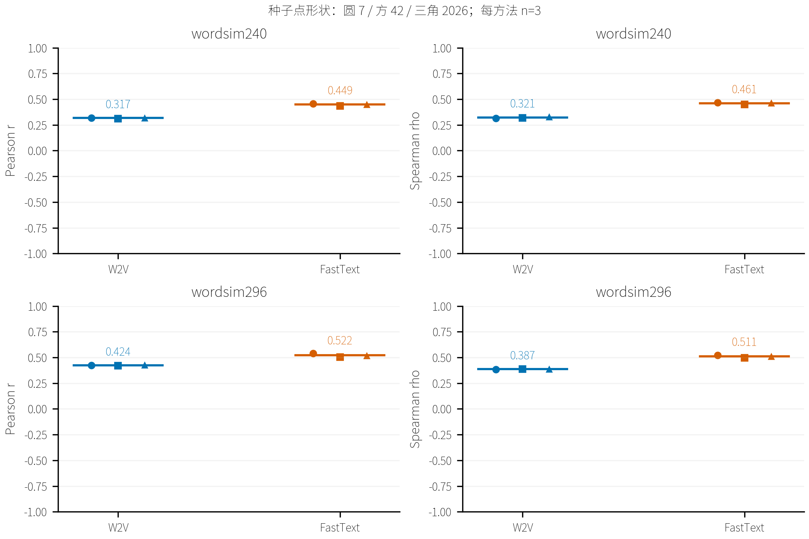
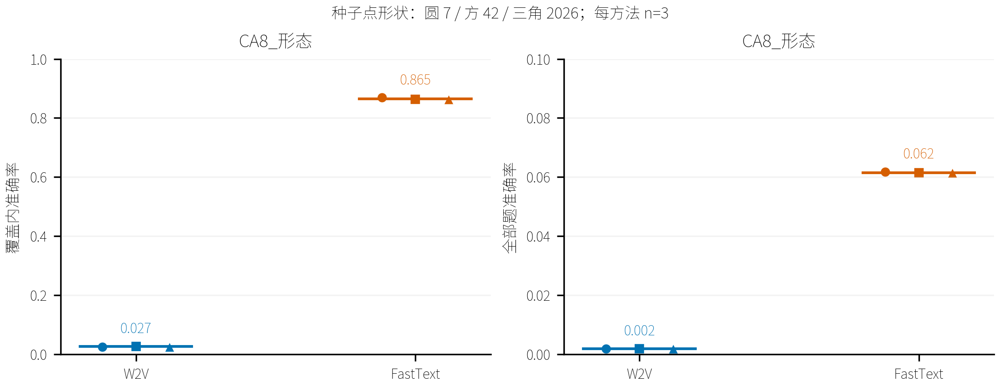
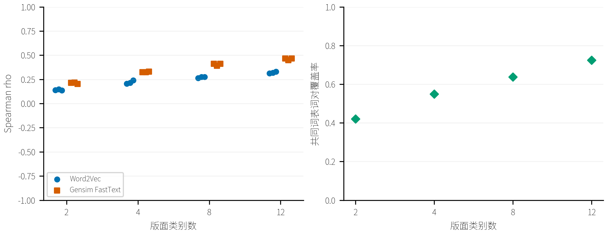
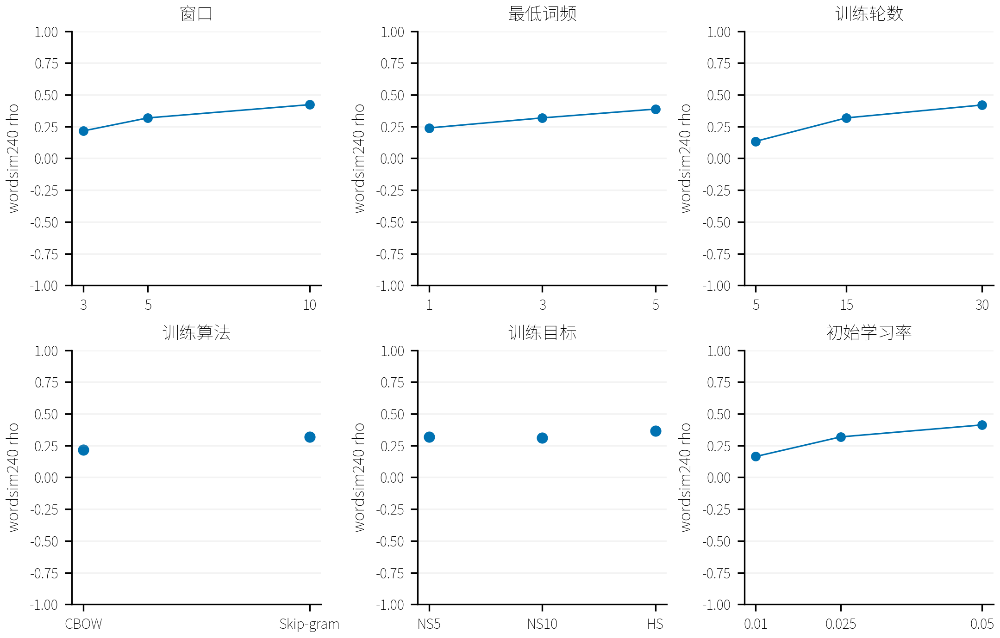
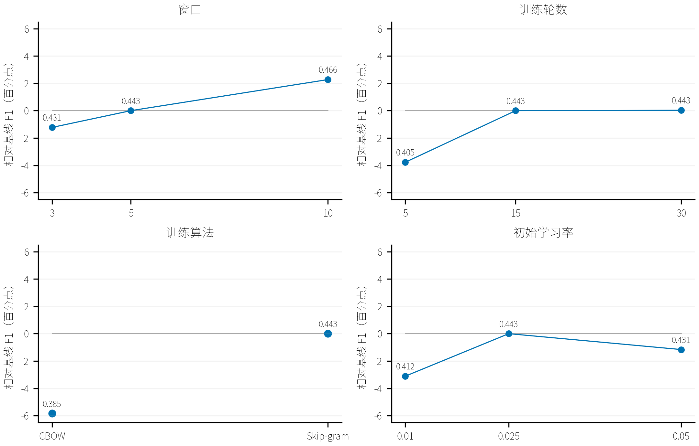
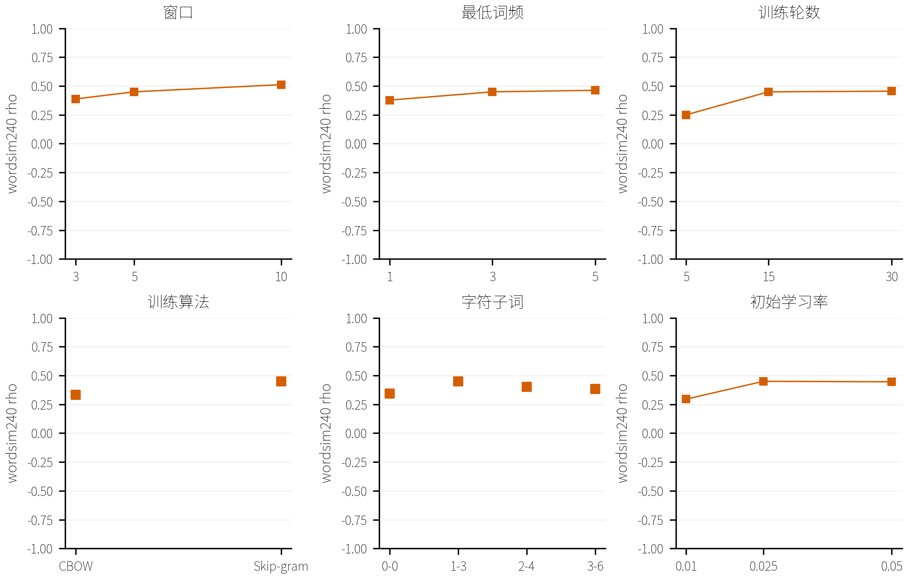
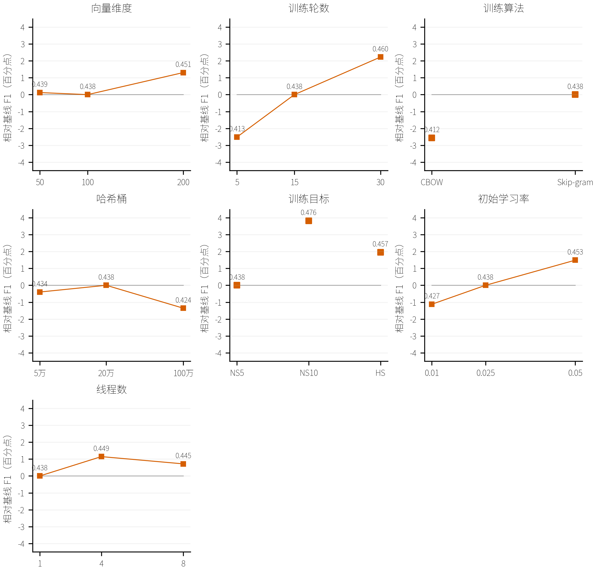
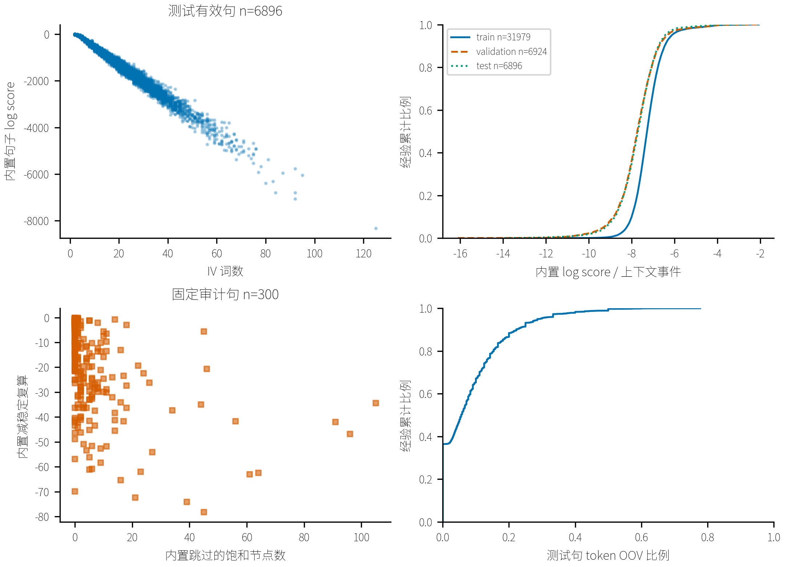
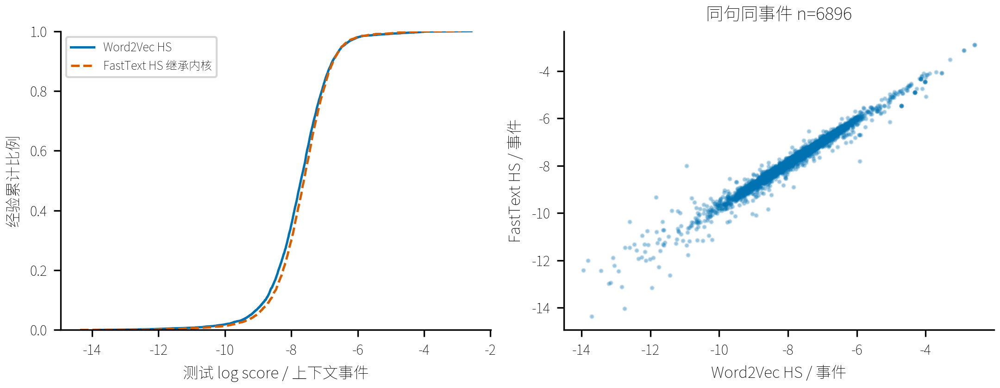

# 词向量全面评价与句子上下文评分

本文保留历史分类语料的外部词表示评价。THUCNews 已改用独立验证与测试分区，分别选择 Word2Vec 和 FastText 轮数，见[当前词向量实验](THUCNews词向量实验.md)。

## 口径与适用范围

词相似度使用 Pearson、Spearman 和双侧 p 值；类比同时给出覆盖题与全量正确率。OOV 生成结果独立标注。句子上下文评分只作兼容性诊断，不作为语言模型困惑度。

## 全部外部指标

| 模型 | 方法/类/种子 | 评测 | 覆盖/全部 | Pearson r | Spearman ρ | OOV% |
| --- | --- | --- | --- | --- | --- | --- |
| 2142e871fea6685414ec | word2vec/2/42 | wordsim240 | 101/240 | 0.0943 | 0.1480 | 57.9167 |
| 2142e871fea6685414ec | word2vec/2/42 | wordsim297 | 91/297 | 0.0541 | 0.0348 | 69.3603 |
| 2142e871fea6685414ec | word2vec/2/42 | wordsim296 | 91/296 | 0.0541 | 0.0348 | 69.2568 |
| e003b93e0a773da2615d | fasttext/2/42 | wordsim240 | 101/240 | 0.1579 | 0.2186 | 57.9167 |
| e003b93e0a773da2615d | fasttext/2/42 | wordsim297 | 91/297 | 0.1435 | 0.1321 | 69.3603 |
| e003b93e0a773da2615d | fasttext/2/42 | wordsim296 | 91/296 | 0.1435 | 0.1321 | 69.2568 |
| 7a5ddaf21431be9b1204 | word2vec/4/42 | wordsim240 | 132/240 | 0.1628 | 0.2150 | 45.0000 |
| 7a5ddaf21431be9b1204 | word2vec/4/42 | wordsim297 | 128/297 | 0.3385 | 0.2780 | 56.9024 |
| 7a5ddaf21431be9b1204 | word2vec/4/42 | wordsim296 | 128/296 | 0.3385 | 0.2780 | 56.7568 |
| e1a56e5aae57ae8fba98 | fasttext/4/42 | wordsim240 | 132/240 | 0.2779 | 0.3250 | 45.0000 |
| e1a56e5aae57ae8fba98 | fasttext/4/42 | wordsim297 | 128/297 | 0.4345 | 0.3639 | 56.9024 |
| e1a56e5aae57ae8fba98 | fasttext/4/42 | wordsim296 | 128/296 | 0.4345 | 0.3639 | 56.7568 |
| 61097697ecd845dd74ee | word2vec/8/42 | wordsim240 | 153/240 | 0.2761 | 0.2753 | 36.2500 |
| 61097697ecd845dd74ee | word2vec/8/42 | wordsim297 | 176/297 | 0.3410 | 0.3027 | 40.7407 |
| 61097697ecd845dd74ee | word2vec/8/42 | wordsim296 | 176/296 | 0.3410 | 0.3027 | 40.5405 |
| caf041d8cb61b8c12935 | fasttext/8/42 | wordsim240 | 153/240 | 0.3809 | 0.3899 | 36.2500 |
| caf041d8cb61b8c12935 | fasttext/8/42 | wordsim297 | 176/297 | 0.4508 | 0.4283 | 40.7407 |
| caf041d8cb61b8c12935 | fasttext/8/42 | wordsim296 | 176/296 | 0.4508 | 0.4283 | 40.5405 |
| 21a62cc1c065734b4a1c | word2vec/12/42 | wordsim240 | 174/240 | 0.3112 | 0.3180 | 27.5000 |
| 21a62cc1c065734b4a1c | word2vec/12/42 | wordsim297 | 196/297 | 0.4195 | 0.3853 | 34.0067 |
| 21a62cc1c065734b4a1c | word2vec/12/42 | wordsim296 | 196/296 | 0.4195 | 0.3853 | 33.7838 |
| fba706f76965ee24f1a3 | fasttext/12/42 | wordsim240 | 174/240 | 0.4352 | 0.4494 | 27.5000 |
| fba706f76965ee24f1a3 | fasttext/12/42 | wordsim297 | 196/297 | 0.5038 | 0.4962 | 34.0067 |
| fba706f76965ee24f1a3 | fasttext/12/42 | wordsim296 | 196/296 | 0.5038 | 0.4962 | 33.7838 |
| 71f4868f1f107fcc7771 | fasttext/12/42 | wordsim240 | 174/240 | 0.4574 | 0.4618 | 27.5000 |
| 71f4868f1f107fcc7771 | fasttext/12/42 | wordsim297 | 196/297 | 0.5131 | 0.5014 | 34.0067 |
| 71f4868f1f107fcc7771 | fasttext/12/42 | wordsim296 | 196/296 | 0.5131 | 0.5014 | 33.7838 |
| f6122a90d3a53606a05a | fasttext/12/42 | wordsim240 | 174/240 | 0.4174 | 0.4344 | 27.5000 |
| f6122a90d3a53606a05a | fasttext/12/42 | wordsim297 | 196/297 | 0.4939 | 0.4835 | 34.0067 |
| f6122a90d3a53606a05a | fasttext/12/42 | wordsim296 | 196/296 | 0.4939 | 0.4835 | 33.7838 |
| be413f18928b1c5f28dd | fasttext/12/42 | wordsim240 | 174/240 | 0.3855 | 0.3878 | 27.5000 |
| be413f18928b1c5f28dd | fasttext/12/42 | wordsim297 | 196/297 | 0.4610 | 0.4377 | 34.0067 |
| be413f18928b1c5f28dd | fasttext/12/42 | wordsim296 | 196/296 | 0.4610 | 0.4377 | 33.7838 |
| 6128861234147b23eefb | fasttext/12/42 | wordsim240 | 174/240 | 0.4846 | 0.5118 | 27.5000 |
| 6128861234147b23eefb | fasttext/12/42 | wordsim297 | 196/297 | 0.5409 | 0.5183 | 34.0067 |
| 6128861234147b23eefb | fasttext/12/42 | wordsim296 | 196/296 | 0.5409 | 0.5183 | 33.7838 |
| 7831163c1cfc3aa9e59b | fasttext/12/42 | wordsim240 | 211/240 | 0.3870 | 0.3776 | 12.0833 |
| 7831163c1cfc3aa9e59b | fasttext/12/42 | wordsim297 | 244/297 | 0.4649 | 0.4350 | 17.8451 |
| 7831163c1cfc3aa9e59b | fasttext/12/42 | wordsim296 | 244/296 | 0.4649 | 0.4350 | 17.5676 |
| 935507188889a1d5a783 | fasttext/12/42 | wordsim240 | 158/240 | 0.4355 | 0.4627 | 34.1667 |
| 935507188889a1d5a783 | fasttext/12/42 | wordsim297 | 169/297 | 0.5184 | 0.4971 | 43.0976 |
| 935507188889a1d5a783 | fasttext/12/42 | wordsim296 | 169/296 | 0.5184 | 0.4971 | 42.9054 |
| 6fe8f2d2a192b3de3a15 | fasttext/12/42 | wordsim240 | 174/240 | 0.2549 | 0.2503 | 27.5000 |
| 6fe8f2d2a192b3de3a15 | fasttext/12/42 | wordsim297 | 196/297 | 0.3116 | 0.3024 | 34.0067 |
| 6fe8f2d2a192b3de3a15 | fasttext/12/42 | wordsim296 | 196/296 | 0.3116 | 0.3024 | 33.7838 |
| c9d8888fdd62ed3504eb | fasttext/12/42 | wordsim240 | 174/240 | 0.4432 | 0.4552 | 27.5000 |
| c9d8888fdd62ed3504eb | fasttext/12/42 | wordsim297 | 196/297 | 0.5529 | 0.5349 | 34.0067 |
| c9d8888fdd62ed3504eb | fasttext/12/42 | wordsim296 | 196/296 | 0.5529 | 0.5349 | 33.7838 |
| ec6be56a15428406aa8f | fasttext/12/42 | wordsim240 | 174/240 | 0.3458 | 0.3324 | 27.5000 |
| ec6be56a15428406aa8f | fasttext/12/42 | wordsim297 | 196/297 | 0.3837 | 0.3592 | 34.0067 |
| ec6be56a15428406aa8f | fasttext/12/42 | wordsim296 | 196/296 | 0.3837 | 0.3592 | 33.7838 |
| e450554c2a51b28c2d1f | fasttext/12/42 | wordsim240 | 174/240 | 0.3300 | 0.3422 | 27.5000 |
| e450554c2a51b28c2d1f | fasttext/12/42 | wordsim297 | 196/297 | 0.4166 | 0.3918 | 34.0067 |
| e450554c2a51b28c2d1f | fasttext/12/42 | wordsim296 | 196/296 | 0.4166 | 0.3918 | 33.7838 |
| 2409244877bae9e200cb | fasttext/12/42 | wordsim240 | 174/240 | 0.3999 | 0.4034 | 27.5000 |
| 2409244877bae9e200cb | fasttext/12/42 | wordsim297 | 196/297 | 0.4764 | 0.4530 | 34.0067 |
| 2409244877bae9e200cb | fasttext/12/42 | wordsim296 | 196/296 | 0.4764 | 0.4530 | 33.7838 |
| 019d16b12ab40b6c4ffd | fasttext/12/42 | wordsim240 | 174/240 | 0.3830 | 0.3835 | 27.5000 |
| 019d16b12ab40b6c4ffd | fasttext/12/42 | wordsim297 | 196/297 | 0.4509 | 0.4236 | 34.0067 |
| 019d16b12ab40b6c4ffd | fasttext/12/42 | wordsim296 | 196/296 | 0.4509 | 0.4236 | 33.7838 |
| 3aadcbc3bfe2a0e7df80 | fasttext/12/42 | wordsim240 | 174/240 | 0.4292 | 0.4410 | 27.5000 |
| 3aadcbc3bfe2a0e7df80 | fasttext/12/42 | wordsim297 | 196/297 | 0.5111 | 0.4990 | 34.0067 |
| 3aadcbc3bfe2a0e7df80 | fasttext/12/42 | wordsim296 | 196/296 | 0.5111 | 0.4990 | 33.7838 |
| 674b67d01a1230b30161 | fasttext/12/42 | wordsim240 | 174/240 | 0.4397 | 0.4529 | 27.5000 |
| 674b67d01a1230b30161 | fasttext/12/42 | wordsim297 | 196/297 | 0.4999 | 0.4885 | 34.0067 |
| 674b67d01a1230b30161 | fasttext/12/42 | wordsim296 | 196/296 | 0.4999 | 0.4885 | 33.7838 |
| a916caeaf8d45e22c250 | fasttext/12/42 | wordsim240 | 174/240 | 0.4380 | 0.4527 | 27.5000 |
| a916caeaf8d45e22c250 | fasttext/12/42 | wordsim297 | 196/297 | 0.5176 | 0.5146 | 34.0067 |
| a916caeaf8d45e22c250 | fasttext/12/42 | wordsim296 | 196/296 | 0.5176 | 0.5146 | 33.7838 |
| bbac8032647b1ffe5f2c | fasttext/12/42 | wordsim240 | 174/240 | 0.4578 | 0.4582 | 27.5000 |
| bbac8032647b1ffe5f2c | fasttext/12/42 | wordsim297 | 196/297 | 0.4921 | 0.4486 | 34.0067 |
| bbac8032647b1ffe5f2c | fasttext/12/42 | wordsim296 | 196/296 | 0.4921 | 0.4486 | 33.7838 |
| 7dea7c1939300b90620d | fasttext/12/42 | wordsim240 | 174/240 | 0.2984 | 0.2955 | 27.5000 |
| 7dea7c1939300b90620d | fasttext/12/42 | wordsim297 | 196/297 | 0.3566 | 0.3468 | 34.0067 |
| 7dea7c1939300b90620d | fasttext/12/42 | wordsim296 | 196/296 | 0.3566 | 0.3468 | 33.7838 |
| 6f3ddc142972460ba9e9 | fasttext/12/42 | wordsim240 | 174/240 | 0.4362 | 0.4455 | 27.5000 |
| 6f3ddc142972460ba9e9 | fasttext/12/42 | wordsim297 | 196/297 | 0.5454 | 0.5249 | 34.0067 |
| 6f3ddc142972460ba9e9 | fasttext/12/42 | wordsim296 | 196/296 | 0.5454 | 0.5249 | 33.7838 |
| ed327656553c634eef13 | fasttext/12/42 | wordsim240 | 174/240 | 0.4192 | 0.4216 | 27.5000 |
| ed327656553c634eef13 | fasttext/12/42 | wordsim297 | 196/297 | 0.5273 | 0.5154 | 34.0067 |
| ed327656553c634eef13 | fasttext/12/42 | wordsim296 | 196/296 | 0.5273 | 0.5154 | 33.7838 |
| 3a64bf34f4eda0ce3808 | fasttext/12/42 | wordsim240 | 174/240 | 0.4352 | 0.4494 | 27.5000 |
| 3a64bf34f4eda0ce3808 | fasttext/12/42 | wordsim297 | 196/297 | 0.5038 | 0.4962 | 34.0067 |
| 3a64bf34f4eda0ce3808 | fasttext/12/42 | wordsim296 | 196/296 | 0.5038 | 0.4962 | 33.7838 |
| 99b3967b6bbe921218b9 | fasttext/12/42 | wordsim240 | 174/240 | 0.4347 | 0.4519 | 27.5000 |
| 99b3967b6bbe921218b9 | fasttext/12/42 | wordsim297 | 196/297 | 0.5109 | 0.5006 | 34.0067 |
| 99b3967b6bbe921218b9 | fasttext/12/42 | wordsim296 | 196/296 | 0.5109 | 0.5006 | 33.7838 |
| 496ac9aa014953f0d682 | fasttext/12/42 | wordsim240 | 174/240 | 0.4376 | 0.4444 | 27.5000 |
| 496ac9aa014953f0d682 | fasttext/12/42 | wordsim297 | 196/297 | 0.5023 | 0.4870 | 34.0067 |
| 496ac9aa014953f0d682 | fasttext/12/42 | wordsim296 | 196/296 | 0.5023 | 0.4870 | 33.7838 |
| b83c7317c6b95a28052a | fasttext/12/42 | wordsim240 | 174/240 | 0.4238 | 0.4379 | 27.5000 |
| b83c7317c6b95a28052a | fasttext/12/42 | wordsim297 | 196/297 | 0.5213 | 0.5118 | 34.0067 |
| b83c7317c6b95a28052a | fasttext/12/42 | wordsim296 | 196/296 | 0.5213 | 0.5118 | 33.7838 |
| 9694a25b4c29c7f5d7fb | word2vec/2/2026 | wordsim240 | 101/240 | 0.0764 | 0.1357 | 57.9167 |
| 9694a25b4c29c7f5d7fb | word2vec/2/2026 | wordsim297 | 91/297 | 0.0441 | 0.0287 | 69.3603 |
| 9694a25b4c29c7f5d7fb | word2vec/2/2026 | wordsim296 | 91/296 | 0.0441 | 0.0287 | 69.2568 |
| f1d96a8ea58430d9b9e9 | word2vec/2/7 | wordsim240 | 101/240 | 0.0801 | 0.1390 | 57.9167 |
| f1d96a8ea58430d9b9e9 | word2vec/2/7 | wordsim297 | 91/297 | 0.0326 | 0.0009 | 69.3603 |
| f1d96a8ea58430d9b9e9 | word2vec/2/7 | wordsim296 | 91/296 | 0.0326 | 0.0009 | 69.2568 |
| ea7fa237850ce1a91ca0 | fasttext/2/2026 | wordsim240 | 101/240 | 0.1620 | 0.2025 | 57.9167 |
| ea7fa237850ce1a91ca0 | fasttext/2/2026 | wordsim297 | 91/297 | 0.1756 | 0.1692 | 69.3603 |
| ea7fa237850ce1a91ca0 | fasttext/2/2026 | wordsim296 | 91/296 | 0.1756 | 0.1692 | 69.2568 |
| fac7bfc44a24d9b7f229 | fasttext/2/7 | wordsim240 | 101/240 | 0.1594 | 0.2151 | 57.9167 |
| fac7bfc44a24d9b7f229 | fasttext/2/7 | wordsim297 | 91/297 | 0.1824 | 0.1848 | 69.3603 |
| fac7bfc44a24d9b7f229 | fasttext/2/7 | wordsim296 | 91/296 | 0.1824 | 0.1848 | 69.2568 |
| 20d5f2f26e7df81fc1ae | word2vec/4/2026 | wordsim240 | 132/240 | 0.1796 | 0.2392 | 45.0000 |
| 20d5f2f26e7df81fc1ae | word2vec/4/2026 | wordsim297 | 128/297 | 0.3305 | 0.2780 | 56.9024 |
| 20d5f2f26e7df81fc1ae | word2vec/4/2026 | wordsim296 | 128/296 | 0.3305 | 0.2780 | 56.7568 |
| e80e52d4a273be1cbd7f | word2vec/4/7 | wordsim240 | 132/240 | 0.1478 | 0.2044 | 45.0000 |
| e80e52d4a273be1cbd7f | word2vec/4/7 | wordsim297 | 128/297 | 0.3326 | 0.2736 | 56.9024 |
| e80e52d4a273be1cbd7f | word2vec/4/7 | wordsim296 | 128/296 | 0.3326 | 0.2736 | 56.7568 |
| 4c51234c295a4026acfa | fasttext/4/2026 | wordsim240 | 132/240 | 0.2951 | 0.3313 | 45.0000 |
| 4c51234c295a4026acfa | fasttext/4/2026 | wordsim297 | 128/297 | 0.4177 | 0.3484 | 56.9024 |
| 4c51234c295a4026acfa | fasttext/4/2026 | wordsim296 | 128/296 | 0.4177 | 0.3484 | 56.7568 |
| 7dc326eeeb17ce3df3a2 | fasttext/4/7 | wordsim240 | 132/240 | 0.2835 | 0.3244 | 45.0000 |
| 7dc326eeeb17ce3df3a2 | fasttext/4/7 | wordsim297 | 128/297 | 0.4278 | 0.3609 | 56.9024 |
| 7dc326eeeb17ce3df3a2 | fasttext/4/7 | wordsim296 | 128/296 | 0.4278 | 0.3609 | 56.7568 |
| 14d0fefc3f1ab913fc6c | word2vec/8/2026 | wordsim240 | 153/240 | 0.2771 | 0.2738 | 36.2500 |
| 14d0fefc3f1ab913fc6c | word2vec/8/2026 | wordsim297 | 176/297 | 0.3479 | 0.3147 | 40.7407 |
| 14d0fefc3f1ab913fc6c | word2vec/8/2026 | wordsim296 | 176/296 | 0.3479 | 0.3147 | 40.5405 |
| c28b521ac5ca1b2f5614 | word2vec/8/7 | wordsim240 | 153/240 | 0.2748 | 0.2634 | 36.2500 |
| c28b521ac5ca1b2f5614 | word2vec/8/7 | wordsim297 | 176/297 | 0.3743 | 0.3408 | 40.7407 |
| c28b521ac5ca1b2f5614 | word2vec/8/7 | wordsim296 | 176/296 | 0.3743 | 0.3408 | 40.5405 |
| 98e6b0aed9253bce4d57 | fasttext/8/2026 | wordsim240 | 153/240 | 0.3893 | 0.4107 | 36.2500 |
| 98e6b0aed9253bce4d57 | fasttext/8/2026 | wordsim297 | 176/297 | 0.4723 | 0.4556 | 40.7407 |
| 98e6b0aed9253bce4d57 | fasttext/8/2026 | wordsim296 | 176/296 | 0.4723 | 0.4556 | 40.5405 |
| c7a354d653f01a1226a2 | fasttext/8/7 | wordsim240 | 153/240 | 0.3912 | 0.4120 | 36.2500 |
| c7a354d653f01a1226a2 | fasttext/8/7 | wordsim297 | 176/297 | 0.4603 | 0.4384 | 40.7407 |
| c7a354d653f01a1226a2 | fasttext/8/7 | wordsim296 | 176/296 | 0.4603 | 0.4384 | 40.5405 |
| eb2f493f0b29f8aaf59a | word2vec/12/2026 | wordsim240 | 174/240 | 0.3227 | 0.3307 | 27.5000 |
| eb2f493f0b29f8aaf59a | word2vec/12/2026 | wordsim297 | 196/297 | 0.4294 | 0.3909 | 34.0067 |
| eb2f493f0b29f8aaf59a | word2vec/12/2026 | wordsim296 | 196/296 | 0.4294 | 0.3909 | 33.7838 |
| 4c6d811d06522b9532fb | word2vec/12/7 | wordsim240 | 174/240 | 0.3163 | 0.3134 | 27.5000 |
| 4c6d811d06522b9532fb | word2vec/12/7 | wordsim297 | 196/297 | 0.4219 | 0.3848 | 34.0067 |
| 4c6d811d06522b9532fb | word2vec/12/7 | wordsim296 | 196/296 | 0.4219 | 0.3848 | 33.7838 |
| a07b642be9bed6585dd0 | fasttext/12/2026 | wordsim240 | 174/240 | 0.4531 | 0.4674 | 27.5000 |
| a07b642be9bed6585dd0 | fasttext/12/2026 | wordsim297 | 196/297 | 0.5229 | 0.5128 | 34.0067 |
| a07b642be9bed6585dd0 | fasttext/12/2026 | wordsim296 | 196/296 | 0.5229 | 0.5128 | 33.7838 |
| bfde32d81f70d1b62177 | fasttext/12/7 | wordsim240 | 174/240 | 0.4580 | 0.4662 | 27.5000 |
| bfde32d81f70d1b62177 | fasttext/12/7 | wordsim297 | 196/297 | 0.5385 | 0.5225 | 34.0067 |
| bfde32d81f70d1b62177 | fasttext/12/7 | wordsim296 | 196/296 | 0.5385 | 0.5225 | 33.7838 |
| 407e5907ca9839707f04 | fasttext/12/2026 | wordsim240 | 174/240 | 0.4475 | 0.4671 | 27.5000 |
| 407e5907ca9839707f04 | fasttext/12/2026 | wordsim297 | 196/297 | 0.5532 | 0.5425 | 34.0067 |
| 407e5907ca9839707f04 | fasttext/12/2026 | wordsim296 | 196/296 | 0.5532 | 0.5425 | 33.7838 |
| d7916379478f10a9a4d3 | fasttext/12/7 | wordsim240 | 174/240 | 0.4437 | 0.4543 | 27.5000 |
| d7916379478f10a9a4d3 | fasttext/12/7 | wordsim297 | 196/297 | 0.5363 | 0.5244 | 34.0067 |
| d7916379478f10a9a4d3 | fasttext/12/7 | wordsim296 | 196/296 | 0.5363 | 0.5244 | 33.7838 |
| 4a7484ae6159fc10dcab | fasttext/12/42 | wordsim240 | 216/240 | 0.4914 | 0.5157 | 10.0000 |
| 4a7484ae6159fc10dcab | fasttext/12/42 | wordsim297 | 258/297 | 0.5946 | 0.5774 | 13.1313 |
| 4a7484ae6159fc10dcab | fasttext/12/42 | wordsim296 | 258/296 | 0.5946 | 0.5774 | 12.8378 |
| 85760540322acfcb499a | fasttext/12/2026 | wordsim240 | 216/240 | 0.5162 | 0.5242 | 10.0000 |
| 85760540322acfcb499a | fasttext/12/2026 | wordsim297 | 258/297 | 0.5937 | 0.5758 | 13.1313 |
| 85760540322acfcb499a | fasttext/12/2026 | wordsim296 | 258/296 | 0.5937 | 0.5758 | 12.8378 |
| f8638e41bf733765f38c | fasttext/12/7 | wordsim240 | 216/240 | 0.5035 | 0.5211 | 10.0000 |
| f8638e41bf733765f38c | fasttext/12/7 | wordsim297 | 258/297 | 0.6017 | 0.5850 | 13.1313 |
| f8638e41bf733765f38c | fasttext/12/7 | wordsim296 | 258/296 | 0.6017 | 0.5850 | 12.8378 |
| 9bad157381176d29e441 | fasttext/12/42 | wordsim240 | 174/240 | 0.4380 | 0.4527 | 27.5000 |
| 9bad157381176d29e441 | fasttext/12/42 | wordsim297 | 196/297 | 0.5176 | 0.5146 | 34.0067 |
| 9bad157381176d29e441 | fasttext/12/42 | wordsim296 | 196/296 | 0.5176 | 0.5146 | 33.7838 |
| ac17c489414c061ccb10 | fasttext/12/2026 | wordsim240 | 174/240 | 0.4475 | 0.4671 | 27.5000 |
| ac17c489414c061ccb10 | fasttext/12/2026 | wordsim297 | 196/297 | 0.5532 | 0.5425 | 34.0067 |
| ac17c489414c061ccb10 | fasttext/12/2026 | wordsim296 | 196/296 | 0.5532 | 0.5425 | 33.7838 |
| 015c451549f10ba3bd6e | fasttext/12/7 | wordsim240 | 174/240 | 0.4437 | 0.4543 | 27.5000 |
| 015c451549f10ba3bd6e | fasttext/12/7 | wordsim297 | 196/297 | 0.5363 | 0.5244 | 34.0067 |
| 015c451549f10ba3bd6e | fasttext/12/7 | wordsim296 | 196/296 | 0.5363 | 0.5244 | 33.7838 |
| 640d5db3e1d11924697a | word2vec/12/42 | wordsim240 | 170/240 | 0.3639 | 0.3471 | 29.1667 |
| 640d5db3e1d11924697a | word2vec/12/42 | wordsim297 | 190/297 | 0.4441 | 0.4132 | 36.0269 |
| 640d5db3e1d11924697a | word2vec/12/42 | wordsim296 | 190/296 | 0.4441 | 0.4132 | 35.8108 |
| f5257b7ade4d6a532795 | word2vec/12/2026 | wordsim240 | 170/240 | 0.3473 | 0.3413 | 29.1667 |
| f5257b7ade4d6a532795 | word2vec/12/2026 | wordsim297 | 190/297 | 0.4421 | 0.4098 | 36.0269 |
| f5257b7ade4d6a532795 | word2vec/12/2026 | wordsim296 | 190/296 | 0.4421 | 0.4098 | 35.8108 |
| b9b674d95e0899e3df0c | word2vec/12/7 | wordsim240 | 170/240 | 0.3529 | 0.3420 | 29.1667 |
| b9b674d95e0899e3df0c | word2vec/12/7 | wordsim297 | 190/297 | 0.4423 | 0.4047 | 36.0269 |
| b9b674d95e0899e3df0c | word2vec/12/7 | wordsim296 | 190/296 | 0.4423 | 0.4047 | 35.8108 |
| 6f802e04936699be2ac9 | fasttext/12/42 | wordsim240 | 170/240 | 0.4117 | 0.4062 | 29.1667 |
| 6f802e04936699be2ac9 | fasttext/12/42 | wordsim297 | 190/297 | 0.5372 | 0.5233 | 36.0269 |
| 6f802e04936699be2ac9 | fasttext/12/42 | wordsim296 | 190/296 | 0.5372 | 0.5233 | 35.8108 |
| 6781d5cbc4282c1a0186 | fasttext/12/2026 | wordsim240 | 170/240 | 0.4175 | 0.4178 | 29.1667 |
| 6781d5cbc4282c1a0186 | fasttext/12/2026 | wordsim297 | 190/297 | 0.5401 | 0.5198 | 36.0269 |
| 6781d5cbc4282c1a0186 | fasttext/12/2026 | wordsim296 | 190/296 | 0.5401 | 0.5198 | 35.8108 |
| dc41ac1e34e6e7dde32d | fasttext/12/7 | wordsim240 | 170/240 | 0.4121 | 0.4136 | 29.1667 |
| dc41ac1e34e6e7dde32d | fasttext/12/7 | wordsim297 | 190/297 | 0.5370 | 0.5146 | 36.0269 |
| dc41ac1e34e6e7dde32d | fasttext/12/7 | wordsim296 | 190/296 | 0.5370 | 0.5146 | 35.8108 |
| 778f321eea8271513544 | fasttext/12/42 | wordsim240 | 174/240 | 0.4380 | 0.4527 | 27.5000 |
| 778f321eea8271513544 | fasttext/12/42 | wordsim297 | 196/297 | 0.5176 | 0.5146 | 34.0067 |
| 778f321eea8271513544 | fasttext/12/42 | wordsim296 | 196/296 | 0.5176 | 0.5146 | 33.7838 |
| 746d0aa42db36bcec321 | word2vec/2/42 | wordsim240 | 101/240 | 0.0943 | 0.1480 | 57.9167 |
| 746d0aa42db36bcec321 | word2vec/2/42 | wordsim297 | 91/297 | 0.0541 | 0.0348 | 69.3603 |
| 746d0aa42db36bcec321 | word2vec/2/42 | wordsim296 | 91/296 | 0.0541 | 0.0348 | 69.2568 |
| 343911186194dde79240 | word2vec/4/42 | wordsim240 | 132/240 | 0.1628 | 0.2150 | 45.0000 |
| 343911186194dde79240 | word2vec/4/42 | wordsim297 | 128/297 | 0.3385 | 0.2780 | 56.9024 |
| 343911186194dde79240 | word2vec/4/42 | wordsim296 | 128/296 | 0.3385 | 0.2780 | 56.7568 |
| 5478325ac6665e8fd938 | word2vec/8/42 | wordsim240 | 153/240 | 0.2761 | 0.2753 | 36.2500 |
| 5478325ac6665e8fd938 | word2vec/8/42 | wordsim297 | 176/297 | 0.3410 | 0.3027 | 40.7407 |
| 5478325ac6665e8fd938 | word2vec/8/42 | wordsim296 | 176/296 | 0.3410 | 0.3027 | 40.5405 |
| ee0d164c27697d45dc67 | word2vec/12/42 | wordsim240 | 174/240 | 0.3112 | 0.3180 | 27.5000 |
| ee0d164c27697d45dc67 | word2vec/12/42 | wordsim297 | 196/297 | 0.4195 | 0.3853 | 34.0067 |
| ee0d164c27697d45dc67 | word2vec/12/42 | wordsim296 | 196/296 | 0.4195 | 0.3853 | 33.7838 |
| f54607a7719d351bcaaa | word2vec/2/2026 | wordsim240 | 101/240 | 0.0764 | 0.1357 | 57.9167 |
| f54607a7719d351bcaaa | word2vec/2/2026 | wordsim297 | 91/297 | 0.0441 | 0.0287 | 69.3603 |
| f54607a7719d351bcaaa | word2vec/2/2026 | wordsim296 | 91/296 | 0.0441 | 0.0287 | 69.2568 |
| b238ac0cfbd3d3d6b530 | word2vec/2/7 | wordsim240 | 101/240 | 0.0801 | 0.1390 | 57.9167 |
| b238ac0cfbd3d3d6b530 | word2vec/2/7 | wordsim297 | 91/297 | 0.0326 | 0.0009 | 69.3603 |
| b238ac0cfbd3d3d6b530 | word2vec/2/7 | wordsim296 | 91/296 | 0.0326 | 0.0009 | 69.2568 |
| 144c992c3ee367576301 | word2vec/4/2026 | wordsim240 | 132/240 | 0.1796 | 0.2392 | 45.0000 |
| 144c992c3ee367576301 | word2vec/4/2026 | wordsim297 | 128/297 | 0.3305 | 0.2780 | 56.9024 |
| 144c992c3ee367576301 | word2vec/4/2026 | wordsim296 | 128/296 | 0.3305 | 0.2780 | 56.7568 |
| 14c8b4c8edda8f972f84 | word2vec/4/7 | wordsim240 | 132/240 | 0.1478 | 0.2044 | 45.0000 |
| 14c8b4c8edda8f972f84 | word2vec/4/7 | wordsim297 | 128/297 | 0.3326 | 0.2736 | 56.9024 |
| 14c8b4c8edda8f972f84 | word2vec/4/7 | wordsim296 | 128/296 | 0.3326 | 0.2736 | 56.7568 |
| 02a87ee6c5297033a76c | word2vec/8/2026 | wordsim240 | 153/240 | 0.2771 | 0.2738 | 36.2500 |
| 02a87ee6c5297033a76c | word2vec/8/2026 | wordsim297 | 176/297 | 0.3479 | 0.3147 | 40.7407 |
| 02a87ee6c5297033a76c | word2vec/8/2026 | wordsim296 | 176/296 | 0.3479 | 0.3147 | 40.5405 |
| e35f5d202dc6cf4736e9 | word2vec/8/7 | wordsim240 | 153/240 | 0.2748 | 0.2634 | 36.2500 |
| e35f5d202dc6cf4736e9 | word2vec/8/7 | wordsim297 | 176/297 | 0.3743 | 0.3408 | 40.7407 |
| e35f5d202dc6cf4736e9 | word2vec/8/7 | wordsim296 | 176/296 | 0.3743 | 0.3408 | 40.5405 |
| e1f1e4a4a0e740f13640 | word2vec/12/2026 | wordsim240 | 174/240 | 0.3227 | 0.3307 | 27.5000 |
| e1f1e4a4a0e740f13640 | word2vec/12/2026 | wordsim297 | 196/297 | 0.4294 | 0.3909 | 34.0067 |
| e1f1e4a4a0e740f13640 | word2vec/12/2026 | wordsim296 | 196/296 | 0.4294 | 0.3909 | 33.7838 |
| ff123b22ff69ce64337d | word2vec/12/7 | wordsim240 | 174/240 | 0.3163 | 0.3134 | 27.5000 |
| ff123b22ff69ce64337d | word2vec/12/7 | wordsim297 | 196/297 | 0.4219 | 0.3848 | 34.0067 |
| ff123b22ff69ce64337d | word2vec/12/7 | wordsim296 | 196/296 | 0.4219 | 0.3848 | 33.7838 |
| bbda23e6bf1f9a68957f | word2vec/12/42 | wordsim240 | 170/240 | 0.3639 | 0.3471 | 29.1667 |
| bbda23e6bf1f9a68957f | word2vec/12/42 | wordsim297 | 190/297 | 0.4441 | 0.4132 | 36.0269 |
| bbda23e6bf1f9a68957f | word2vec/12/42 | wordsim296 | 190/296 | 0.4441 | 0.4132 | 35.8108 |
| 1e5e30b32e6e5a252257 | word2vec/12/2026 | wordsim240 | 170/240 | 0.3473 | 0.3413 | 29.1667 |
| 1e5e30b32e6e5a252257 | word2vec/12/2026 | wordsim297 | 190/297 | 0.4421 | 0.4098 | 36.0269 |
| 1e5e30b32e6e5a252257 | word2vec/12/2026 | wordsim296 | 190/296 | 0.4421 | 0.4098 | 35.8108 |
| b6f43f2c86f4452ea2c3 | word2vec/12/7 | wordsim240 | 170/240 | 0.3529 | 0.3420 | 29.1667 |
| b6f43f2c86f4452ea2c3 | word2vec/12/7 | wordsim297 | 190/297 | 0.4423 | 0.4047 | 36.0269 |
| b6f43f2c86f4452ea2c3 | word2vec/12/7 | wordsim296 | 190/296 | 0.4423 | 0.4047 | 35.8108 |
| 1b6b01c2c6b3e20db2fa | word2vec/12/42 | wordsim240 | 174/240 | 0.3450 | 0.3459 | 27.5000 |
| 1b6b01c2c6b3e20db2fa | word2vec/12/42 | wordsim297 | 196/297 | 0.4148 | 0.3857 | 34.0067 |
| 1b6b01c2c6b3e20db2fa | word2vec/12/42 | wordsim296 | 196/296 | 0.4148 | 0.3857 | 33.7838 |
| 917804eac1c735d190f0 | word2vec/12/42 | wordsim240 | 174/240 | 0.3112 | 0.3180 | 27.5000 |
| 917804eac1c735d190f0 | word2vec/12/42 | wordsim297 | 196/297 | 0.4195 | 0.3853 | 34.0067 |
| 917804eac1c735d190f0 | word2vec/12/42 | wordsim296 | 196/296 | 0.4195 | 0.3853 | 33.7838 |
| bfd9b258359036f42181 | word2vec/12/42 | wordsim240 | 174/240 | 0.3042 | 0.3131 | 27.5000 |
| bfd9b258359036f42181 | word2vec/12/42 | wordsim297 | 196/297 | 0.4248 | 0.3879 | 34.0067 |
| bfd9b258359036f42181 | word2vec/12/42 | wordsim296 | 196/296 | 0.4248 | 0.3879 | 33.7838 |
| fad3b2681be77d80e035 | word2vec/12/42 | wordsim240 | 174/240 | 0.2011 | 0.2154 | 27.5000 |
| fad3b2681be77d80e035 | word2vec/12/42 | wordsim297 | 196/297 | 0.3602 | 0.3243 | 34.0067 |
| fad3b2681be77d80e035 | word2vec/12/42 | wordsim296 | 196/296 | 0.3602 | 0.3243 | 33.7838 |
| eb5b5115a6a85e31b81a | word2vec/12/42 | wordsim240 | 174/240 | 0.4068 | 0.4220 | 27.5000 |
| eb5b5115a6a85e31b81a | word2vec/12/42 | wordsim297 | 196/297 | 0.4798 | 0.4495 | 34.0067 |
| eb5b5115a6a85e31b81a | word2vec/12/42 | wordsim296 | 196/296 | 0.4798 | 0.4495 | 33.7838 |
| fdc33ca3b99a6eda0f8a | word2vec/12/42 | wordsim240 | 211/240 | 0.2467 | 0.2390 | 12.0833 |
| fdc33ca3b99a6eda0f8a | word2vec/12/42 | wordsim297 | 244/297 | 0.3538 | 0.3136 | 17.8451 |
| fdc33ca3b99a6eda0f8a | word2vec/12/42 | wordsim296 | 244/296 | 0.3538 | 0.3136 | 17.5676 |
| b51b4d145bc4fce80499 | word2vec/12/42 | wordsim240 | 158/240 | 0.3573 | 0.3874 | 34.1667 |
| b51b4d145bc4fce80499 | word2vec/12/42 | wordsim297 | 169/297 | 0.4359 | 0.4013 | 43.0976 |
| b51b4d145bc4fce80499 | word2vec/12/42 | wordsim296 | 169/296 | 0.4359 | 0.4013 | 42.9054 |
| 4aeb7f3f018f42d40cf6 | word2vec/12/42 | wordsim240 | 174/240 | 0.1304 | 0.1337 | 27.5000 |
| 4aeb7f3f018f42d40cf6 | word2vec/12/42 | wordsim297 | 196/297 | 0.2167 | 0.2269 | 34.0067 |
| 4aeb7f3f018f42d40cf6 | word2vec/12/42 | wordsim296 | 196/296 | 0.2167 | 0.2269 | 33.7838 |
| c328193503e4b26dad6b | word2vec/12/42 | wordsim240 | 174/240 | 0.4042 | 0.4194 | 27.5000 |
| c328193503e4b26dad6b | word2vec/12/42 | wordsim297 | 196/297 | 0.4778 | 0.4504 | 34.0067 |
| c328193503e4b26dad6b | word2vec/12/42 | wordsim296 | 196/296 | 0.4778 | 0.4504 | 33.7838 |
| d58fa749e2aebfa2d9b6 | word2vec/12/42 | wordsim240 | 174/240 | 0.2538 | 0.2152 | 27.5000 |
| d58fa749e2aebfa2d9b6 | word2vec/12/42 | wordsim297 | 196/297 | 0.3419 | 0.3202 | 34.0067 |
| d58fa749e2aebfa2d9b6 | word2vec/12/42 | wordsim296 | 196/296 | 0.3419 | 0.3202 | 33.7838 |
| 4833455490aa17121faa | word2vec/12/42 | wordsim240 | 174/240 | 0.2929 | 0.3104 | 27.5000 |
| 4833455490aa17121faa | word2vec/12/42 | wordsim297 | 196/297 | 0.4280 | 0.3893 | 34.0067 |
| 4833455490aa17121faa | word2vec/12/42 | wordsim296 | 196/296 | 0.4280 | 0.3893 | 33.7838 |
| ca0382d676ceef0a1adb | word2vec/12/42 | wordsim240 | 174/240 | 0.3837 | 0.3641 | 27.5000 |
| ca0382d676ceef0a1adb | word2vec/12/42 | wordsim297 | 196/297 | 0.4335 | 0.3656 | 34.0067 |
| ca0382d676ceef0a1adb | word2vec/12/42 | wordsim296 | 196/296 | 0.4335 | 0.3656 | 33.7838 |
| e3273a2461b2199c6be4 | word2vec/12/42 | wordsim240 | 174/240 | 0.1533 | 0.1637 | 27.5000 |
| e3273a2461b2199c6be4 | word2vec/12/42 | wordsim297 | 196/297 | 0.2439 | 0.2421 | 34.0067 |
| e3273a2461b2199c6be4 | word2vec/12/42 | wordsim296 | 196/296 | 0.2439 | 0.2421 | 33.7838 |
| 1bf1fbdf71febe0f2d82 | word2vec/12/42 | wordsim240 | 174/240 | 0.4154 | 0.4121 | 27.5000 |
| 1bf1fbdf71febe0f2d82 | word2vec/12/42 | wordsim297 | 196/297 | 0.4815 | 0.4498 | 34.0067 |
| 1bf1fbdf71febe0f2d82 | word2vec/12/42 | wordsim296 | 196/296 | 0.4815 | 0.4498 | 33.7838 |
| 2281bfe42d664d1e24f6 | word2vec/12/42 | wordsim240 | 174/240 | 0.3245 | 0.3195 | 27.5000 |
| 2281bfe42d664d1e24f6 | word2vec/12/42 | wordsim297 | 196/297 | 0.4313 | 0.4014 | 34.0067 |
| 2281bfe42d664d1e24f6 | word2vec/12/42 | wordsim296 | 196/296 | 0.4313 | 0.4014 | 33.7838 |
| 376e298770b3d4c9f6d6 | word2vec/12/42 | wordsim240 | 174/240 | 0.3204 | 0.3476 | 27.5000 |
| 376e298770b3d4c9f6d6 | word2vec/12/42 | wordsim297 | 196/297 | 0.4259 | 0.3960 | 34.0067 |
| 376e298770b3d4c9f6d6 | word2vec/12/42 | wordsim296 | 196/296 | 0.4259 | 0.3960 | 33.7838 |
| 176c1531e90998f4f214 | word2vec/12/2026 | wordsim240 | 174/240 | 0.4248 | 0.4094 | 27.5000 |
| 176c1531e90998f4f214 | word2vec/12/2026 | wordsim297 | 196/297 | 0.4306 | 0.3711 | 34.0067 |
| 176c1531e90998f4f214 | word2vec/12/2026 | wordsim296 | 196/296 | 0.4306 | 0.3711 | 33.7838 |
| 2715c1e24be491b1d103 | word2vec/12/7 | wordsim240 | 174/240 | 0.4028 | 0.3852 | 27.5000 |
| 2715c1e24be491b1d103 | word2vec/12/7 | wordsim297 | 196/297 | 0.4130 | 0.3584 | 34.0067 |
| 2715c1e24be491b1d103 | word2vec/12/7 | wordsim296 | 196/296 | 0.4130 | 0.3584 | 33.7838 |
| 6d5a40ea6ddc077f4b80 | word2vec/12/42 | wordsim240 | 174/240 | 0.2582 | 0.1962 | 27.5000 |
| 6d5a40ea6ddc077f4b80 | word2vec/12/42 | wordsim297 | 196/297 | 0.3555 | 0.2688 | 34.0067 |
| 6d5a40ea6ddc077f4b80 | word2vec/12/42 | wordsim296 | 196/296 | 0.3555 | 0.2688 | 33.7838 |
| d4504b7a7e297c6ae5e4 | word2vec/12/42 | wordsim240 | 174/240 | 0.3112 | 0.3180 | 27.5000 |
| d4504b7a7e297c6ae5e4 | word2vec/12/42 | wordsim297 | 196/297 | 0.4195 | 0.3853 | 34.0067 |
| d4504b7a7e297c6ae5e4 | word2vec/12/42 | wordsim296 | 196/296 | 0.4195 | 0.3853 | 33.7838 |
| 63e43e74b6e57b2600d3 | word2vec/12/2026 | wordsim240 | 174/240 | 0.3227 | 0.3307 | 27.5000 |
| 63e43e74b6e57b2600d3 | word2vec/12/2026 | wordsim297 | 196/297 | 0.4294 | 0.3909 | 34.0067 |
| 63e43e74b6e57b2600d3 | word2vec/12/2026 | wordsim296 | 196/296 | 0.4294 | 0.3909 | 33.7838 |
| 7bd460f9d3428a1f444e | word2vec/12/7 | wordsim240 | 174/240 | 0.3163 | 0.3134 | 27.5000 |
| 7bd460f9d3428a1f444e | word2vec/12/7 | wordsim297 | 196/297 | 0.4219 | 0.3848 | 34.0067 |
| 7bd460f9d3428a1f444e | word2vec/12/7 | wordsim296 | 196/296 | 0.4219 | 0.3848 | 33.7838 |

| 模型 | 评测 | 覆盖/全部 | 正确题 | 覆盖题正确率 | 全量正确率 |
| --- | --- | --- | --- | --- | --- |
| 2142e871fea6685414ec | CA_translated | 152/953 | 1 | 0.0066 | 0.0010 |
| 2142e871fea6685414ec | CA8_morphological | 149/10177 | 4 | 0.0268 | 0.0004 |
| 2142e871fea6685414ec | CA8_semantic | 485/7636 | 11 | 0.0227 | 0.0014 |
| e003b93e0a773da2615d | CA_translated | 152/953 | 5 | 0.0329 | 0.0052 |
| e003b93e0a773da2615d | CA8_morphological | 149/10177 | 126 | 0.8456 | 0.0124 |
| e003b93e0a773da2615d | CA8_semantic | 485/7636 | 42 | 0.0866 | 0.0055 |
| 7a5ddaf21431be9b1204 | CA_translated | 361/953 | 7 | 0.0194 | 0.0073 |
| 7a5ddaf21431be9b1204 | CA8_morphological | 311/10177 | 12 | 0.0386 | 0.0012 |
| 7a5ddaf21431be9b1204 | CA8_semantic | 900/7636 | 26 | 0.0289 | 0.0034 |
| e1a56e5aae57ae8fba98 | CA_translated | 361/953 | 6 | 0.0166 | 0.0063 |
| e1a56e5aae57ae8fba98 | CA8_morphological | 311/10177 | 265 | 0.8521 | 0.0260 |
| e1a56e5aae57ae8fba98 | CA8_semantic | 900/7636 | 94 | 0.1044 | 0.0123 |
| 61097697ecd845dd74ee | CA_translated | 625/953 | 5 | 0.0080 | 0.0052 |
| 61097697ecd845dd74ee | CA8_morphological | 524/10177 | 17 | 0.0324 | 0.0017 |
| 61097697ecd845dd74ee | CA8_semantic | 1486/7636 | 56 | 0.0377 | 0.0073 |
| caf041d8cb61b8c12935 | CA_translated | 625/953 | 10 | 0.0160 | 0.0105 |
| caf041d8cb61b8c12935 | CA8_morphological | 524/10177 | 460 | 0.8779 | 0.0452 |
| caf041d8cb61b8c12935 | CA8_semantic | 1486/7636 | 98 | 0.0659 | 0.0128 |
| 21a62cc1c065734b4a1c | CA_translated | 667/953 | 8 | 0.0120 | 0.0084 |
| 21a62cc1c065734b4a1c | CA8_morphological | 724/10177 | 20 | 0.0276 | 0.0020 |
| 21a62cc1c065734b4a1c | CA8_semantic | 1709/7636 | 65 | 0.0380 | 0.0085 |
| fba706f76965ee24f1a3 | CA_translated | 667/953 | 25 | 0.0375 | 0.0262 |
| fba706f76965ee24f1a3 | CA8_morphological | 724/10177 | 625 | 0.8633 | 0.0614 |
| fba706f76965ee24f1a3 | CA8_semantic | 1709/7636 | 114 | 0.0667 | 0.0149 |
| 71f4868f1f107fcc7771 | CA_translated | 667/953 | 29 | 0.0435 | 0.0304 |
| 71f4868f1f107fcc7771 | CA8_morphological | 724/10177 | 474 | 0.6547 | 0.0466 |
| 71f4868f1f107fcc7771 | CA8_semantic | 1709/7636 | 84 | 0.0492 | 0.0110 |
| f6122a90d3a53606a05a | CA_translated | 667/953 | 25 | 0.0375 | 0.0262 |
| f6122a90d3a53606a05a | CA8_morphological | 724/10177 | 670 | 0.9254 | 0.0658 |
| f6122a90d3a53606a05a | CA8_semantic | 1709/7636 | 116 | 0.0679 | 0.0152 |
| be413f18928b1c5f28dd | CA_translated | 667/953 | 17 | 0.0255 | 0.0178 |
| be413f18928b1c5f28dd | CA8_morphological | 724/10177 | 657 | 0.9075 | 0.0646 |
| be413f18928b1c5f28dd | CA8_semantic | 1709/7636 | 94 | 0.0550 | 0.0123 |
| 6128861234147b23eefb | CA_translated | 667/953 | 34 | 0.0510 | 0.0357 |
| 6128861234147b23eefb | CA8_morphological | 724/10177 | 547 | 0.7555 | 0.0537 |
| 6128861234147b23eefb | CA8_semantic | 1709/7636 | 126 | 0.0737 | 0.0165 |
| 7831163c1cfc3aa9e59b | CA_translated | 769/953 | 10 | 0.0130 | 0.0105 |
| 7831163c1cfc3aa9e59b | CA8_morphological | 1937/10177 | 1651 | 0.8523 | 0.1622 |
| 7831163c1cfc3aa9e59b | CA8_semantic | 2688/7636 | 83 | 0.0309 | 0.0109 |
| 935507188889a1d5a783 | CA_translated | 462/953 | 10 | 0.0216 | 0.0105 |
| 935507188889a1d5a783 | CA8_morphological | 459/10177 | 379 | 0.8257 | 0.0372 |
| 935507188889a1d5a783 | CA8_semantic | 1285/7636 | 118 | 0.0918 | 0.0155 |
| 6fe8f2d2a192b3de3a15 | CA_translated | 667/953 | 14 | 0.0210 | 0.0147 |
| 6fe8f2d2a192b3de3a15 | CA8_morphological | 724/10177 | 569 | 0.7859 | 0.0559 |
| 6fe8f2d2a192b3de3a15 | CA8_semantic | 1709/7636 | 53 | 0.0310 | 0.0069 |
| c9d8888fdd62ed3504eb | CA_translated | 667/953 | 23 | 0.0345 | 0.0241 |
| c9d8888fdd62ed3504eb | CA8_morphological | 724/10177 | 492 | 0.6796 | 0.0483 |
| c9d8888fdd62ed3504eb | CA8_semantic | 1709/7636 | 104 | 0.0609 | 0.0136 |
| ec6be56a15428406aa8f | CA_translated | 667/953 | 8 | 0.0120 | 0.0084 |
| ec6be56a15428406aa8f | CA8_morphological | 724/10177 | 611 | 0.8439 | 0.0600 |
| ec6be56a15428406aa8f | CA8_semantic | 1709/7636 | 55 | 0.0322 | 0.0072 |
| e450554c2a51b28c2d1f | CA_translated | 667/953 | 8 | 0.0120 | 0.0084 |
| e450554c2a51b28c2d1f | CA8_morphological | 724/10177 | 19 | 0.0262 | 0.0019 |
| e450554c2a51b28c2d1f | CA8_semantic | 1709/7636 | 71 | 0.0415 | 0.0093 |
| 2409244877bae9e200cb | CA_translated | 667/953 | 21 | 0.0315 | 0.0220 |
| 2409244877bae9e200cb | CA8_morphological | 724/10177 | 451 | 0.6229 | 0.0443 |
| 2409244877bae9e200cb | CA8_semantic | 1709/7636 | 97 | 0.0568 | 0.0127 |
| 019d16b12ab40b6c4ffd | CA_translated | 667/953 | 9 | 0.0135 | 0.0094 |
| 019d16b12ab40b6c4ffd | CA8_morphological | 724/10177 | 73 | 0.1008 | 0.0072 |
| 019d16b12ab40b6c4ffd | CA8_semantic | 1709/7636 | 72 | 0.0421 | 0.0094 |
| 3aadcbc3bfe2a0e7df80 | CA_translated | 667/953 | 20 | 0.0300 | 0.0210 |
| 3aadcbc3bfe2a0e7df80 | CA8_morphological | 724/10177 | 623 | 0.8605 | 0.0612 |
| 3aadcbc3bfe2a0e7df80 | CA8_semantic | 1709/7636 | 105 | 0.0614 | 0.0138 |
| 674b67d01a1230b30161 | CA_translated | 667/953 | 23 | 0.0345 | 0.0241 |
| 674b67d01a1230b30161 | CA8_morphological | 724/10177 | 623 | 0.8605 | 0.0612 |
| 674b67d01a1230b30161 | CA8_semantic | 1709/7636 | 108 | 0.0632 | 0.0141 |
| a916caeaf8d45e22c250 | CA_translated | 667/953 | 21 | 0.0315 | 0.0220 |
| a916caeaf8d45e22c250 | CA8_morphological | 724/10177 | 608 | 0.8398 | 0.0597 |
| a916caeaf8d45e22c250 | CA8_semantic | 1709/7636 | 108 | 0.0632 | 0.0141 |
| bbac8032647b1ffe5f2c | CA_translated | 667/953 | 23 | 0.0345 | 0.0241 |
| bbac8032647b1ffe5f2c | CA8_morphological | 724/10177 | 310 | 0.4282 | 0.0305 |
| bbac8032647b1ffe5f2c | CA8_semantic | 1709/7636 | 98 | 0.0573 | 0.0128 |
| 7dea7c1939300b90620d | CA_translated | 667/953 | 16 | 0.0240 | 0.0168 |
| 7dea7c1939300b90620d | CA8_morphological | 724/10177 | 615 | 0.8494 | 0.0604 |
| 7dea7c1939300b90620d | CA8_semantic | 1709/7636 | 63 | 0.0369 | 0.0083 |
| 6f3ddc142972460ba9e9 | CA_translated | 667/953 | 22 | 0.0330 | 0.0231 |
| 6f3ddc142972460ba9e9 | CA8_morphological | 724/10177 | 441 | 0.6091 | 0.0433 |
| 6f3ddc142972460ba9e9 | CA8_semantic | 1709/7636 | 110 | 0.0644 | 0.0144 |
| ed327656553c634eef13 | CA_translated | 667/953 | 20 | 0.0300 | 0.0210 |
| ed327656553c634eef13 | CA8_morphological | 724/10177 | 619 | 0.8550 | 0.0608 |
| ed327656553c634eef13 | CA8_semantic | 1709/7636 | 99 | 0.0579 | 0.0130 |
| 3a64bf34f4eda0ce3808 | CA_translated | 667/953 | 25 | 0.0375 | 0.0262 |
| 3a64bf34f4eda0ce3808 | CA8_morphological | 724/10177 | 625 | 0.8633 | 0.0614 |
| 3a64bf34f4eda0ce3808 | CA8_semantic | 1709/7636 | 114 | 0.0667 | 0.0149 |
| 99b3967b6bbe921218b9 | CA_translated | 667/953 | 18 | 0.0270 | 0.0189 |
| 99b3967b6bbe921218b9 | CA8_morphological | 724/10177 | 619 | 0.8550 | 0.0608 |
| 99b3967b6bbe921218b9 | CA8_semantic | 1709/7636 | 85 | 0.0497 | 0.0111 |
| 496ac9aa014953f0d682 | CA_translated | 667/953 | 21 | 0.0315 | 0.0220 |
| 496ac9aa014953f0d682 | CA8_morphological | 724/10177 | 622 | 0.8591 | 0.0611 |
| 496ac9aa014953f0d682 | CA8_semantic | 1709/7636 | 100 | 0.0585 | 0.0131 |
| b83c7317c6b95a28052a | CA_translated | 667/953 | 21 | 0.0315 | 0.0220 |
| b83c7317c6b95a28052a | CA8_morphological | 724/10177 | 627 | 0.8660 | 0.0616 |
| b83c7317c6b95a28052a | CA8_semantic | 1709/7636 | 99 | 0.0579 | 0.0130 |
| 9694a25b4c29c7f5d7fb | CA_translated | 152/953 | 0 | 0.0000 | 0.0000 |
| 9694a25b4c29c7f5d7fb | CA8_morphological | 149/10177 | 3 | 0.0201 | 0.0003 |
| 9694a25b4c29c7f5d7fb | CA8_semantic | 485/7636 | 8 | 0.0165 | 0.0010 |
| f1d96a8ea58430d9b9e9 | CA_translated | 152/953 | 0 | 0.0000 | 0.0000 |
| f1d96a8ea58430d9b9e9 | CA8_morphological | 149/10177 | 1 | 0.0067 | 0.0001 |
| f1d96a8ea58430d9b9e9 | CA8_semantic | 485/7636 | 7 | 0.0144 | 0.0009 |
| ea7fa237850ce1a91ca0 | CA_translated | 152/953 | 4 | 0.0263 | 0.0042 |
| ea7fa237850ce1a91ca0 | CA8_morphological | 149/10177 | 128 | 0.8591 | 0.0126 |
| ea7fa237850ce1a91ca0 | CA8_semantic | 485/7636 | 40 | 0.0825 | 0.0052 |
| fac7bfc44a24d9b7f229 | CA_translated | 152/953 | 4 | 0.0263 | 0.0042 |
| fac7bfc44a24d9b7f229 | CA8_morphological | 149/10177 | 123 | 0.8255 | 0.0121 |
| fac7bfc44a24d9b7f229 | CA8_semantic | 485/7636 | 40 | 0.0825 | 0.0052 |
| 20d5f2f26e7df81fc1ae | CA_translated | 361/953 | 3 | 0.0083 | 0.0031 |
| 20d5f2f26e7df81fc1ae | CA8_morphological | 311/10177 | 10 | 0.0322 | 0.0010 |
| 20d5f2f26e7df81fc1ae | CA8_semantic | 900/7636 | 34 | 0.0378 | 0.0045 |
| e80e52d4a273be1cbd7f | CA_translated | 361/953 | 3 | 0.0083 | 0.0031 |
| e80e52d4a273be1cbd7f | CA8_morphological | 311/10177 | 10 | 0.0322 | 0.0010 |
| e80e52d4a273be1cbd7f | CA8_semantic | 900/7636 | 24 | 0.0267 | 0.0031 |
| 4c51234c295a4026acfa | CA_translated | 361/953 | 5 | 0.0139 | 0.0052 |
| 4c51234c295a4026acfa | CA8_morphological | 311/10177 | 271 | 0.8714 | 0.0266 |
| 4c51234c295a4026acfa | CA8_semantic | 900/7636 | 82 | 0.0911 | 0.0107 |
| 7dc326eeeb17ce3df3a2 | CA_translated | 361/953 | 7 | 0.0194 | 0.0073 |
| 7dc326eeeb17ce3df3a2 | CA8_morphological | 311/10177 | 265 | 0.8521 | 0.0260 |
| 7dc326eeeb17ce3df3a2 | CA8_semantic | 900/7636 | 97 | 0.1078 | 0.0127 |
| 14d0fefc3f1ab913fc6c | CA_translated | 625/953 | 5 | 0.0080 | 0.0052 |
| 14d0fefc3f1ab913fc6c | CA8_morphological | 524/10177 | 19 | 0.0363 | 0.0019 |
| 14d0fefc3f1ab913fc6c | CA8_semantic | 1486/7636 | 46 | 0.0310 | 0.0060 |
| c28b521ac5ca1b2f5614 | CA_translated | 625/953 | 5 | 0.0080 | 0.0052 |
| c28b521ac5ca1b2f5614 | CA8_morphological | 524/10177 | 17 | 0.0324 | 0.0017 |
| c28b521ac5ca1b2f5614 | CA8_semantic | 1486/7636 | 50 | 0.0336 | 0.0065 |
| 98e6b0aed9253bce4d57 | CA_translated | 625/953 | 12 | 0.0192 | 0.0126 |
| 98e6b0aed9253bce4d57 | CA8_morphological | 524/10177 | 465 | 0.8874 | 0.0457 |
| 98e6b0aed9253bce4d57 | CA8_semantic | 1486/7636 | 96 | 0.0646 | 0.0126 |
| c7a354d653f01a1226a2 | CA_translated | 625/953 | 11 | 0.0176 | 0.0115 |
| c7a354d653f01a1226a2 | CA8_morphological | 524/10177 | 458 | 0.8740 | 0.0450 |
| c7a354d653f01a1226a2 | CA8_semantic | 1486/7636 | 101 | 0.0680 | 0.0132 |
| eb2f493f0b29f8aaf59a | CA_translated | 667/953 | 7 | 0.0105 | 0.0073 |
| eb2f493f0b29f8aaf59a | CA8_morphological | 724/10177 | 19 | 0.0262 | 0.0019 |
| eb2f493f0b29f8aaf59a | CA8_semantic | 1709/7636 | 70 | 0.0410 | 0.0092 |
| 4c6d811d06522b9532fb | CA_translated | 667/953 | 8 | 0.0120 | 0.0084 |
| 4c6d811d06522b9532fb | CA8_morphological | 724/10177 | 19 | 0.0262 | 0.0019 |
| 4c6d811d06522b9532fb | CA8_semantic | 1709/7636 | 64 | 0.0374 | 0.0084 |
| a07b642be9bed6585dd0 | CA_translated | 667/953 | 18 | 0.0270 | 0.0189 |
| a07b642be9bed6585dd0 | CA8_morphological | 724/10177 | 625 | 0.8633 | 0.0614 |
| a07b642be9bed6585dd0 | CA8_semantic | 1709/7636 | 87 | 0.0509 | 0.0114 |
| bfde32d81f70d1b62177 | CA_translated | 667/953 | 24 | 0.0360 | 0.0252 |
| bfde32d81f70d1b62177 | CA8_morphological | 724/10177 | 629 | 0.8688 | 0.0618 |
| bfde32d81f70d1b62177 | CA8_semantic | 1709/7636 | 113 | 0.0661 | 0.0148 |
| 407e5907ca9839707f04 | CA_translated | 667/953 | 16 | 0.0240 | 0.0168 |
| 407e5907ca9839707f04 | CA8_morphological | 724/10177 | 613 | 0.8467 | 0.0602 |
| 407e5907ca9839707f04 | CA8_semantic | 1709/7636 | 103 | 0.0603 | 0.0135 |
| d7916379478f10a9a4d3 | CA_translated | 667/953 | 25 | 0.0375 | 0.0262 |
| d7916379478f10a9a4d3 | CA8_morphological | 724/10177 | 612 | 0.8453 | 0.0601 |
| d7916379478f10a9a4d3 | CA8_semantic | 1709/7636 | 112 | 0.0655 | 0.0147 |
| 4a7484ae6159fc10dcab | CA_translated | 863/953 | 227 | 0.2630 | 0.2382 |
| 4a7484ae6159fc10dcab | CA8_morphological | 2352/10177 | 1326 | 0.5638 | 0.1303 |
| 4a7484ae6159fc10dcab | CA8_semantic | 3183/7636 | 407 | 0.1279 | 0.0533 |
| 85760540322acfcb499a | CA_translated | 863/953 | 214 | 0.2480 | 0.2246 |
| 85760540322acfcb499a | CA8_morphological | 2352/10177 | 1321 | 0.5616 | 0.1298 |
| 85760540322acfcb499a | CA8_semantic | 3183/7636 | 408 | 0.1282 | 0.0534 |
| f8638e41bf733765f38c | CA_translated | 863/953 | 215 | 0.2491 | 0.2256 |
| f8638e41bf733765f38c | CA8_morphological | 2352/10177 | 1305 | 0.5548 | 0.1282 |
| f8638e41bf733765f38c | CA8_semantic | 3183/7636 | 368 | 0.1156 | 0.0482 |
| 9bad157381176d29e441 | CA_translated | 667/953 | 21 | 0.0315 | 0.0220 |
| 9bad157381176d29e441 | CA8_morphological | 724/10177 | 608 | 0.8398 | 0.0597 |
| 9bad157381176d29e441 | CA8_semantic | 1709/7636 | 108 | 0.0632 | 0.0141 |
| ac17c489414c061ccb10 | CA_translated | 667/953 | 16 | 0.0240 | 0.0168 |
| ac17c489414c061ccb10 | CA8_morphological | 724/10177 | 613 | 0.8467 | 0.0602 |
| ac17c489414c061ccb10 | CA8_semantic | 1709/7636 | 103 | 0.0603 | 0.0135 |
| 015c451549f10ba3bd6e | CA_translated | 667/953 | 25 | 0.0375 | 0.0262 |
| 015c451549f10ba3bd6e | CA8_morphological | 724/10177 | 612 | 0.8453 | 0.0601 |
| 015c451549f10ba3bd6e | CA8_semantic | 1709/7636 | 112 | 0.0655 | 0.0147 |
| 640d5db3e1d11924697a | CA_translated | 607/953 | 24 | 0.0395 | 0.0252 |
| 640d5db3e1d11924697a | CA8_morphological | 727/10177 | 15 | 0.0206 | 0.0015 |
| 640d5db3e1d11924697a | CA8_semantic | 1614/7636 | 54 | 0.0335 | 0.0071 |
| f5257b7ade4d6a532795 | CA_translated | 607/953 | 23 | 0.0379 | 0.0241 |
| f5257b7ade4d6a532795 | CA8_morphological | 727/10177 | 15 | 0.0206 | 0.0015 |
| f5257b7ade4d6a532795 | CA8_semantic | 1614/7636 | 70 | 0.0434 | 0.0092 |
| b9b674d95e0899e3df0c | CA_translated | 607/953 | 20 | 0.0329 | 0.0210 |
| b9b674d95e0899e3df0c | CA8_morphological | 727/10177 | 16 | 0.0220 | 0.0016 |
| b9b674d95e0899e3df0c | CA8_semantic | 1614/7636 | 58 | 0.0359 | 0.0076 |
| 6f802e04936699be2ac9 | CA_translated | 607/953 | 27 | 0.0445 | 0.0283 |
| 6f802e04936699be2ac9 | CA8_morphological | 727/10177 | 629 | 0.8652 | 0.0618 |
| 6f802e04936699be2ac9 | CA8_semantic | 1614/7636 | 108 | 0.0669 | 0.0141 |
| 6781d5cbc4282c1a0186 | CA_translated | 607/953 | 26 | 0.0428 | 0.0273 |
| 6781d5cbc4282c1a0186 | CA8_morphological | 727/10177 | 617 | 0.8487 | 0.0606 |
| 6781d5cbc4282c1a0186 | CA8_semantic | 1614/7636 | 108 | 0.0669 | 0.0141 |
| dc41ac1e34e6e7dde32d | CA_translated | 607/953 | 25 | 0.0412 | 0.0262 |
| dc41ac1e34e6e7dde32d | CA8_morphological | 727/10177 | 615 | 0.8459 | 0.0604 |
| dc41ac1e34e6e7dde32d | CA8_semantic | 1614/7636 | 111 | 0.0688 | 0.0145 |
| 778f321eea8271513544 | CA_translated | 667/953 | 21 | 0.0315 | 0.0220 |
| 778f321eea8271513544 | CA8_morphological | 724/10177 | 608 | 0.8398 | 0.0597 |
| 778f321eea8271513544 | CA8_semantic | 1709/7636 | 108 | 0.0632 | 0.0141 |
| 746d0aa42db36bcec321 | CA_translated | 152/953 | 1 | 0.0066 | 0.0010 |
| 746d0aa42db36bcec321 | CA8_morphological | 149/10177 | 4 | 0.0268 | 0.0004 |
| 746d0aa42db36bcec321 | CA8_semantic | 485/7636 | 11 | 0.0227 | 0.0014 |
| 343911186194dde79240 | CA_translated | 361/953 | 7 | 0.0194 | 0.0073 |
| 343911186194dde79240 | CA8_morphological | 311/10177 | 12 | 0.0386 | 0.0012 |
| 343911186194dde79240 | CA8_semantic | 900/7636 | 26 | 0.0289 | 0.0034 |
| 5478325ac6665e8fd938 | CA_translated | 625/953 | 5 | 0.0080 | 0.0052 |
| 5478325ac6665e8fd938 | CA8_morphological | 524/10177 | 17 | 0.0324 | 0.0017 |
| 5478325ac6665e8fd938 | CA8_semantic | 1486/7636 | 56 | 0.0377 | 0.0073 |
| ee0d164c27697d45dc67 | CA_translated | 667/953 | 8 | 0.0120 | 0.0084 |
| ee0d164c27697d45dc67 | CA8_morphological | 724/10177 | 20 | 0.0276 | 0.0020 |
| ee0d164c27697d45dc67 | CA8_semantic | 1709/7636 | 65 | 0.0380 | 0.0085 |
| f54607a7719d351bcaaa | CA_translated | 152/953 | 0 | 0.0000 | 0.0000 |
| f54607a7719d351bcaaa | CA8_morphological | 149/10177 | 3 | 0.0201 | 0.0003 |
| f54607a7719d351bcaaa | CA8_semantic | 485/7636 | 8 | 0.0165 | 0.0010 |
| b238ac0cfbd3d3d6b530 | CA_translated | 152/953 | 0 | 0.0000 | 0.0000 |
| b238ac0cfbd3d3d6b530 | CA8_morphological | 149/10177 | 1 | 0.0067 | 0.0001 |
| b238ac0cfbd3d3d6b530 | CA8_semantic | 485/7636 | 7 | 0.0144 | 0.0009 |
| 144c992c3ee367576301 | CA_translated | 361/953 | 3 | 0.0083 | 0.0031 |
| 144c992c3ee367576301 | CA8_morphological | 311/10177 | 10 | 0.0322 | 0.0010 |
| 144c992c3ee367576301 | CA8_semantic | 900/7636 | 34 | 0.0378 | 0.0045 |
| 14c8b4c8edda8f972f84 | CA_translated | 361/953 | 3 | 0.0083 | 0.0031 |
| 14c8b4c8edda8f972f84 | CA8_morphological | 311/10177 | 10 | 0.0322 | 0.0010 |
| 14c8b4c8edda8f972f84 | CA8_semantic | 900/7636 | 24 | 0.0267 | 0.0031 |
| 02a87ee6c5297033a76c | CA_translated | 625/953 | 5 | 0.0080 | 0.0052 |
| 02a87ee6c5297033a76c | CA8_morphological | 524/10177 | 19 | 0.0363 | 0.0019 |
| 02a87ee6c5297033a76c | CA8_semantic | 1486/7636 | 46 | 0.0310 | 0.0060 |
| e35f5d202dc6cf4736e9 | CA_translated | 625/953 | 5 | 0.0080 | 0.0052 |
| e35f5d202dc6cf4736e9 | CA8_morphological | 524/10177 | 17 | 0.0324 | 0.0017 |
| e35f5d202dc6cf4736e9 | CA8_semantic | 1486/7636 | 50 | 0.0336 | 0.0065 |
| e1f1e4a4a0e740f13640 | CA_translated | 667/953 | 7 | 0.0105 | 0.0073 |
| e1f1e4a4a0e740f13640 | CA8_morphological | 724/10177 | 19 | 0.0262 | 0.0019 |
| e1f1e4a4a0e740f13640 | CA8_semantic | 1709/7636 | 70 | 0.0410 | 0.0092 |
| ff123b22ff69ce64337d | CA_translated | 667/953 | 8 | 0.0120 | 0.0084 |
| ff123b22ff69ce64337d | CA8_morphological | 724/10177 | 19 | 0.0262 | 0.0019 |
| ff123b22ff69ce64337d | CA8_semantic | 1709/7636 | 64 | 0.0374 | 0.0084 |
| bbda23e6bf1f9a68957f | CA_translated | 607/953 | 24 | 0.0395 | 0.0252 |
| bbda23e6bf1f9a68957f | CA8_morphological | 727/10177 | 15 | 0.0206 | 0.0015 |
| bbda23e6bf1f9a68957f | CA8_semantic | 1614/7636 | 54 | 0.0335 | 0.0071 |
| 1e5e30b32e6e5a252257 | CA_translated | 607/953 | 23 | 0.0379 | 0.0241 |
| 1e5e30b32e6e5a252257 | CA8_morphological | 727/10177 | 15 | 0.0206 | 0.0015 |
| 1e5e30b32e6e5a252257 | CA8_semantic | 1614/7636 | 70 | 0.0434 | 0.0092 |
| b6f43f2c86f4452ea2c3 | CA_translated | 607/953 | 20 | 0.0329 | 0.0210 |
| b6f43f2c86f4452ea2c3 | CA8_morphological | 727/10177 | 16 | 0.0220 | 0.0016 |
| b6f43f2c86f4452ea2c3 | CA8_semantic | 1614/7636 | 58 | 0.0359 | 0.0076 |
| 1b6b01c2c6b3e20db2fa | CA_translated | 667/953 | 12 | 0.0180 | 0.0126 |
| 1b6b01c2c6b3e20db2fa | CA8_morphological | 724/10177 | 15 | 0.0207 | 0.0015 |
| 1b6b01c2c6b3e20db2fa | CA8_semantic | 1709/7636 | 66 | 0.0386 | 0.0086 |
| 917804eac1c735d190f0 | CA_translated | 667/953 | 8 | 0.0120 | 0.0084 |
| 917804eac1c735d190f0 | CA8_morphological | 724/10177 | 20 | 0.0276 | 0.0020 |
| 917804eac1c735d190f0 | CA8_semantic | 1709/7636 | 65 | 0.0380 | 0.0085 |
| bfd9b258359036f42181 | CA_translated | 667/953 | 11 | 0.0165 | 0.0115 |
| bfd9b258359036f42181 | CA8_morphological | 724/10177 | 20 | 0.0276 | 0.0020 |
| bfd9b258359036f42181 | CA8_semantic | 1709/7636 | 81 | 0.0474 | 0.0106 |
| fad3b2681be77d80e035 | CA_translated | 667/953 | 13 | 0.0195 | 0.0136 |
| fad3b2681be77d80e035 | CA8_morphological | 724/10177 | 20 | 0.0276 | 0.0020 |
| fad3b2681be77d80e035 | CA8_semantic | 1709/7636 | 66 | 0.0386 | 0.0086 |
| eb5b5115a6a85e31b81a | CA_translated | 667/953 | 29 | 0.0435 | 0.0304 |
| eb5b5115a6a85e31b81a | CA8_morphological | 724/10177 | 16 | 0.0221 | 0.0016 |
| eb5b5115a6a85e31b81a | CA8_semantic | 1709/7636 | 93 | 0.0544 | 0.0122 |
| fdc33ca3b99a6eda0f8a | CA_translated | 769/953 | 6 | 0.0078 | 0.0063 |
| fdc33ca3b99a6eda0f8a | CA8_morphological | 1937/10177 | 20 | 0.0103 | 0.0020 |
| fdc33ca3b99a6eda0f8a | CA8_semantic | 2688/7636 | 74 | 0.0275 | 0.0097 |
| b51b4d145bc4fce80499 | CA_translated | 462/953 | 7 | 0.0152 | 0.0073 |
| b51b4d145bc4fce80499 | CA8_morphological | 459/10177 | 25 | 0.0545 | 0.0025 |
| b51b4d145bc4fce80499 | CA8_semantic | 1285/7636 | 64 | 0.0498 | 0.0084 |
| 4aeb7f3f018f42d40cf6 | CA_translated | 667/953 | 17 | 0.0255 | 0.0178 |
| 4aeb7f3f018f42d40cf6 | CA8_morphological | 724/10177 | 19 | 0.0262 | 0.0019 |
| 4aeb7f3f018f42d40cf6 | CA8_semantic | 1709/7636 | 44 | 0.0257 | 0.0058 |
| c328193503e4b26dad6b | CA_translated | 667/953 | 16 | 0.0240 | 0.0168 |
| c328193503e4b26dad6b | CA8_morphological | 724/10177 | 14 | 0.0193 | 0.0014 |
| c328193503e4b26dad6b | CA8_semantic | 1709/7636 | 62 | 0.0363 | 0.0081 |
| d58fa749e2aebfa2d9b6 | CA_translated | 667/953 | 10 | 0.0150 | 0.0105 |
| d58fa749e2aebfa2d9b6 | CA8_morphological | 724/10177 | 20 | 0.0276 | 0.0020 |
| d58fa749e2aebfa2d9b6 | CA8_semantic | 1709/7636 | 59 | 0.0345 | 0.0077 |
| 4833455490aa17121faa | CA_translated | 667/953 | 15 | 0.0225 | 0.0157 |
| 4833455490aa17121faa | CA8_morphological | 724/10177 | 23 | 0.0318 | 0.0023 |
| 4833455490aa17121faa | CA8_semantic | 1709/7636 | 86 | 0.0503 | 0.0113 |
| ca0382d676ceef0a1adb | CA_translated | 667/953 | 21 | 0.0315 | 0.0220 |
| ca0382d676ceef0a1adb | CA8_morphological | 724/10177 | 16 | 0.0221 | 0.0016 |
| ca0382d676ceef0a1adb | CA8_semantic | 1709/7636 | 83 | 0.0486 | 0.0109 |
| e3273a2461b2199c6be4 | CA_translated | 667/953 | 18 | 0.0270 | 0.0189 |
| e3273a2461b2199c6be4 | CA8_morphological | 724/10177 | 27 | 0.0373 | 0.0027 |
| e3273a2461b2199c6be4 | CA8_semantic | 1709/7636 | 66 | 0.0386 | 0.0086 |
| 1bf1fbdf71febe0f2d82 | CA_translated | 667/953 | 22 | 0.0330 | 0.0231 |
| 1bf1fbdf71febe0f2d82 | CA8_morphological | 724/10177 | 11 | 0.0152 | 0.0011 |
| 1bf1fbdf71febe0f2d82 | CA8_semantic | 1709/7636 | 77 | 0.0451 | 0.0101 |
| 2281bfe42d664d1e24f6 | CA_translated | 667/953 | 9 | 0.0135 | 0.0094 |
| 2281bfe42d664d1e24f6 | CA8_morphological | 724/10177 | 22 | 0.0304 | 0.0022 |
| 2281bfe42d664d1e24f6 | CA8_semantic | 1709/7636 | 67 | 0.0392 | 0.0088 |
| 376e298770b3d4c9f6d6 | CA_translated | 667/953 | 8 | 0.0120 | 0.0084 |
| 376e298770b3d4c9f6d6 | CA8_morphological | 724/10177 | 22 | 0.0304 | 0.0022 |
| 376e298770b3d4c9f6d6 | CA8_semantic | 1709/7636 | 70 | 0.0410 | 0.0092 |
| 176c1531e90998f4f214 | CA_translated | 667/953 | 24 | 0.0360 | 0.0252 |
| 176c1531e90998f4f214 | CA8_morphological | 724/10177 | 12 | 0.0166 | 0.0012 |
| 176c1531e90998f4f214 | CA8_semantic | 1709/7636 | 86 | 0.0503 | 0.0113 |
| 2715c1e24be491b1d103 | CA_translated | 667/953 | 20 | 0.0300 | 0.0210 |
| 2715c1e24be491b1d103 | CA8_morphological | 724/10177 | 14 | 0.0193 | 0.0014 |
| 2715c1e24be491b1d103 | CA8_semantic | 1709/7636 | 88 | 0.0515 | 0.0115 |
| 6d5a40ea6ddc077f4b80 | CA_translated | 667/953 | 8 | 0.0120 | 0.0084 |
| 6d5a40ea6ddc077f4b80 | CA8_morphological | 724/10177 | 16 | 0.0221 | 0.0016 |
| 6d5a40ea6ddc077f4b80 | CA8_semantic | 1709/7636 | 22 | 0.0129 | 0.0029 |
| d4504b7a7e297c6ae5e4 | CA_translated | 667/953 | 8 | 0.0120 | 0.0084 |
| d4504b7a7e297c6ae5e4 | CA8_morphological | 724/10177 | 20 | 0.0276 | 0.0020 |
| d4504b7a7e297c6ae5e4 | CA8_semantic | 1709/7636 | 65 | 0.0380 | 0.0085 |
| 63e43e74b6e57b2600d3 | CA_translated | 667/953 | 7 | 0.0105 | 0.0073 |
| 63e43e74b6e57b2600d3 | CA8_morphological | 724/10177 | 19 | 0.0262 | 0.0019 |
| 63e43e74b6e57b2600d3 | CA8_semantic | 1709/7636 | 70 | 0.0410 | 0.0092 |
| 7bd460f9d3428a1f444e | CA_translated | 667/953 | 8 | 0.0120 | 0.0084 |
| 7bd460f9d3428a1f444e | CA8_morphological | 724/10177 | 19 | 0.0262 | 0.0019 |
| 7bd460f9d3428a1f444e | CA8_semantic | 1709/7636 | 64 | 0.0374 | 0.0084 |

## 历史评价图

以下为已有实测资源，历史参数对照不计作当前 THUCNews 的逐轮验证。

## 保存与复现

全部 p 值及逐题数值见[指标 CSV](../artifacts/word_evaluation/metrics.csv)。历史数值与模型保留，当前训练入口为 `python -m gensim_lab.thucnews_validation`。
