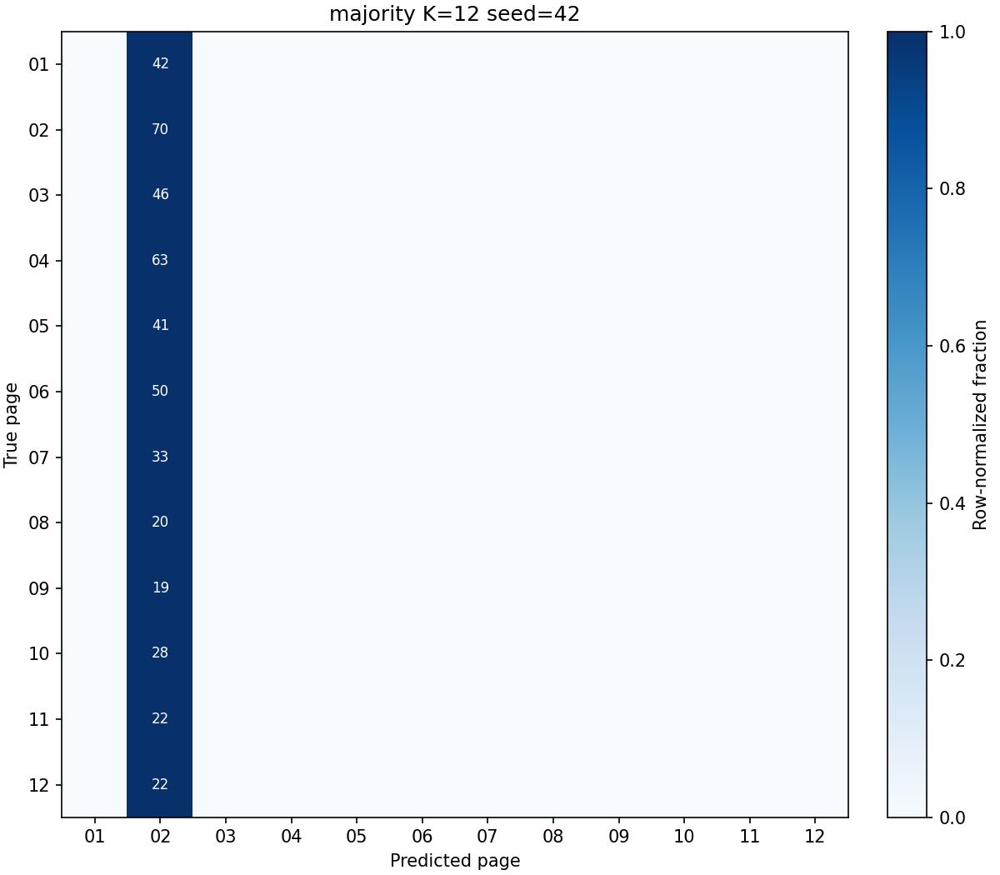
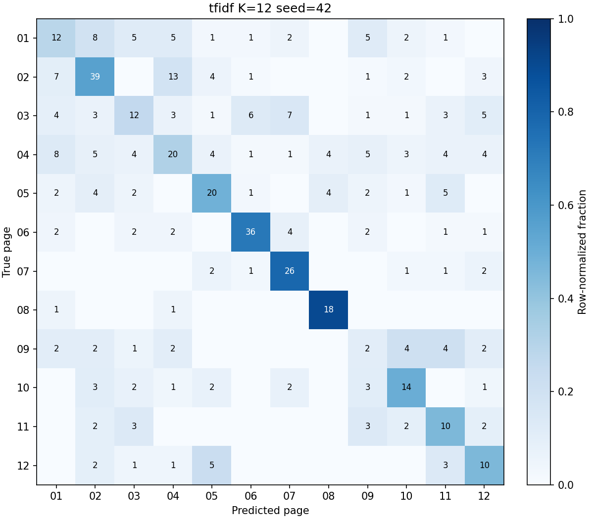
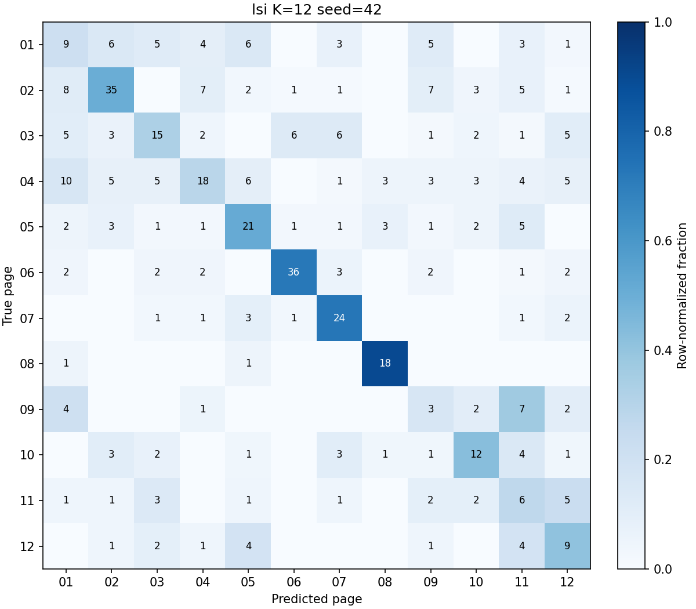
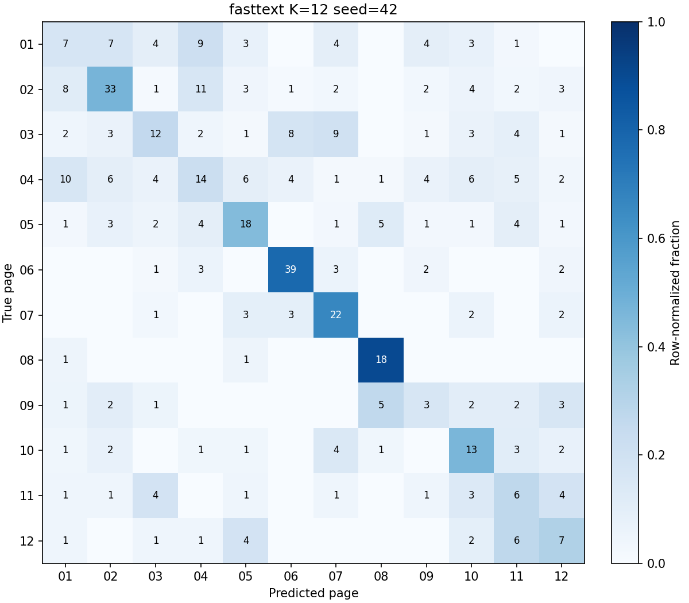
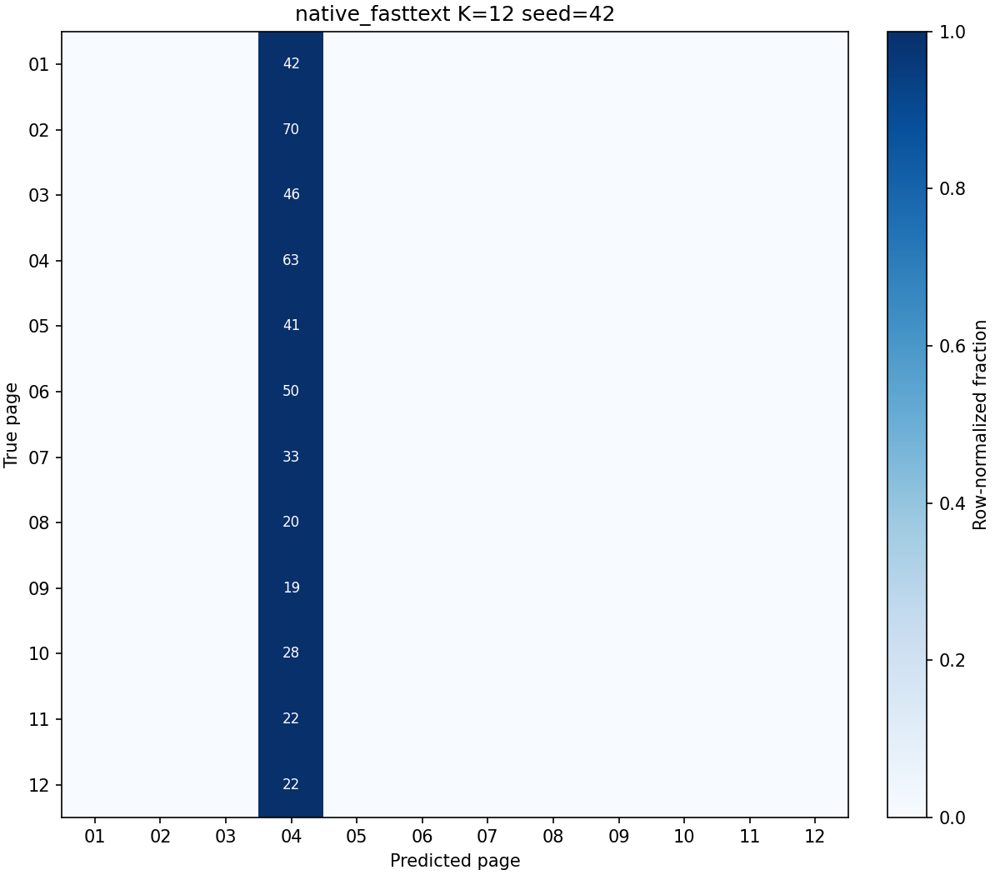
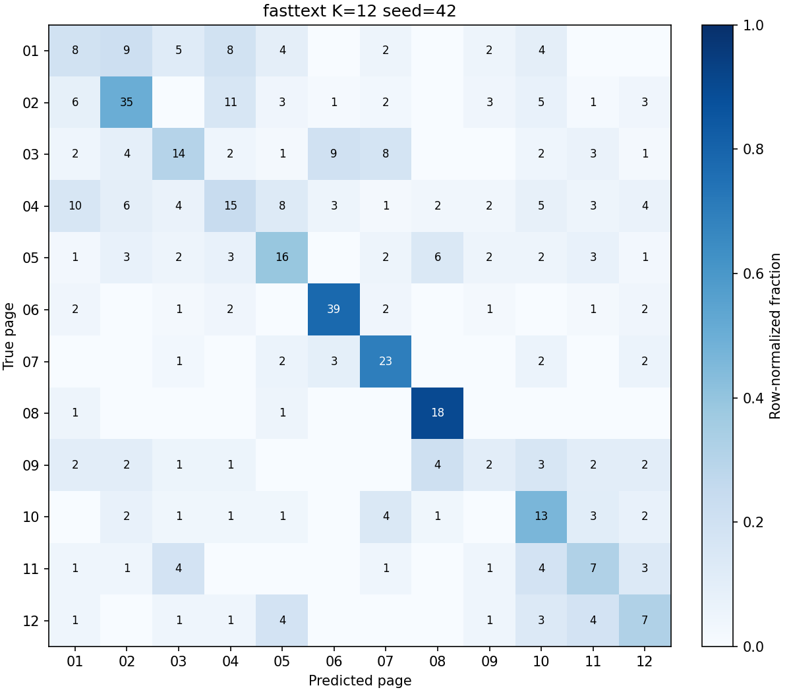
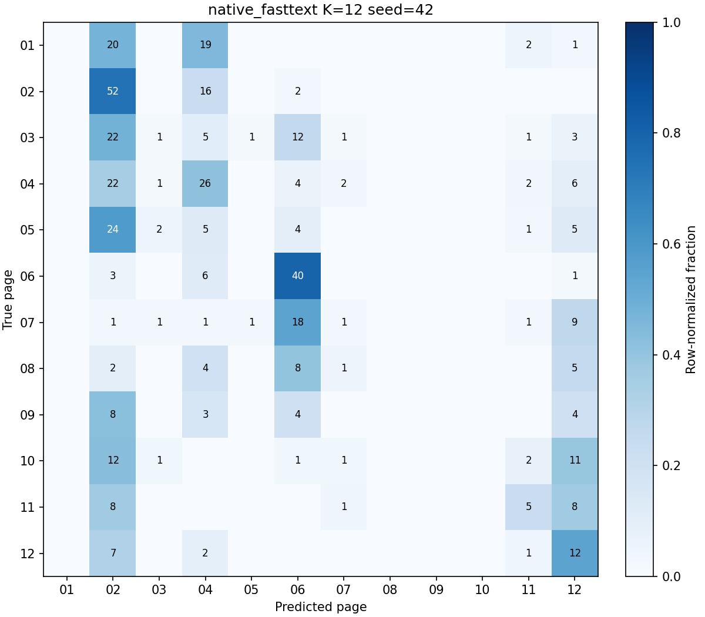
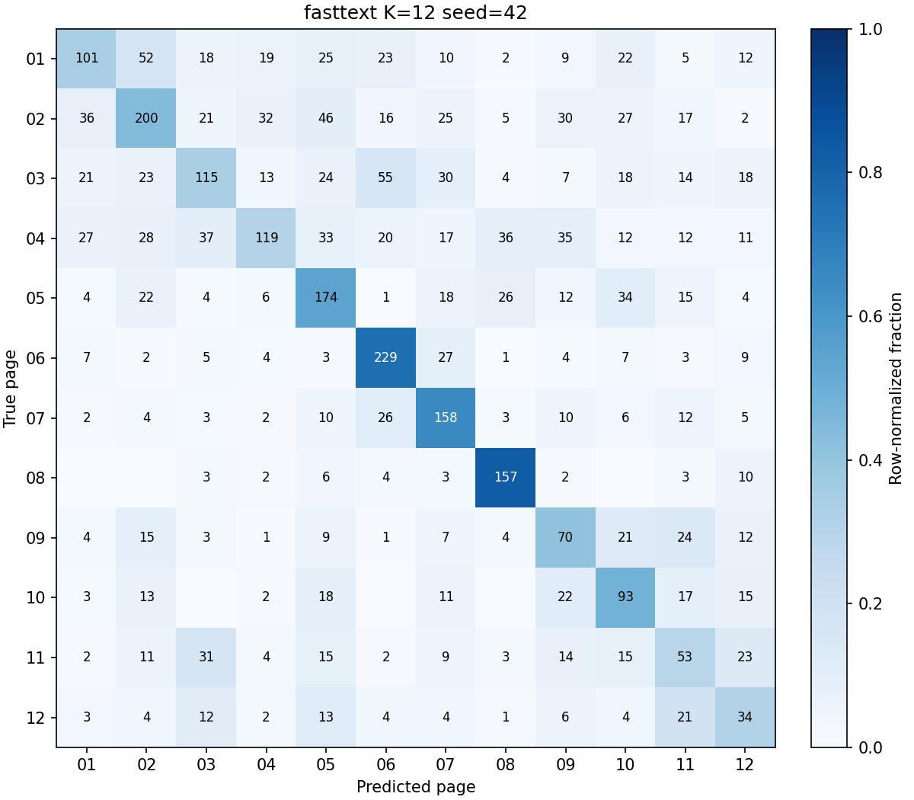
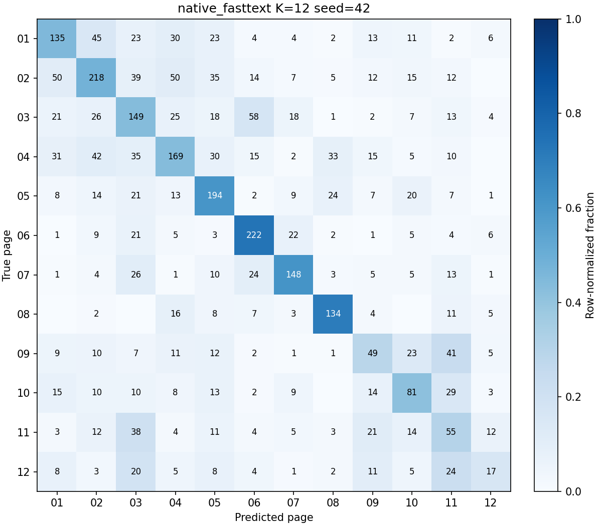
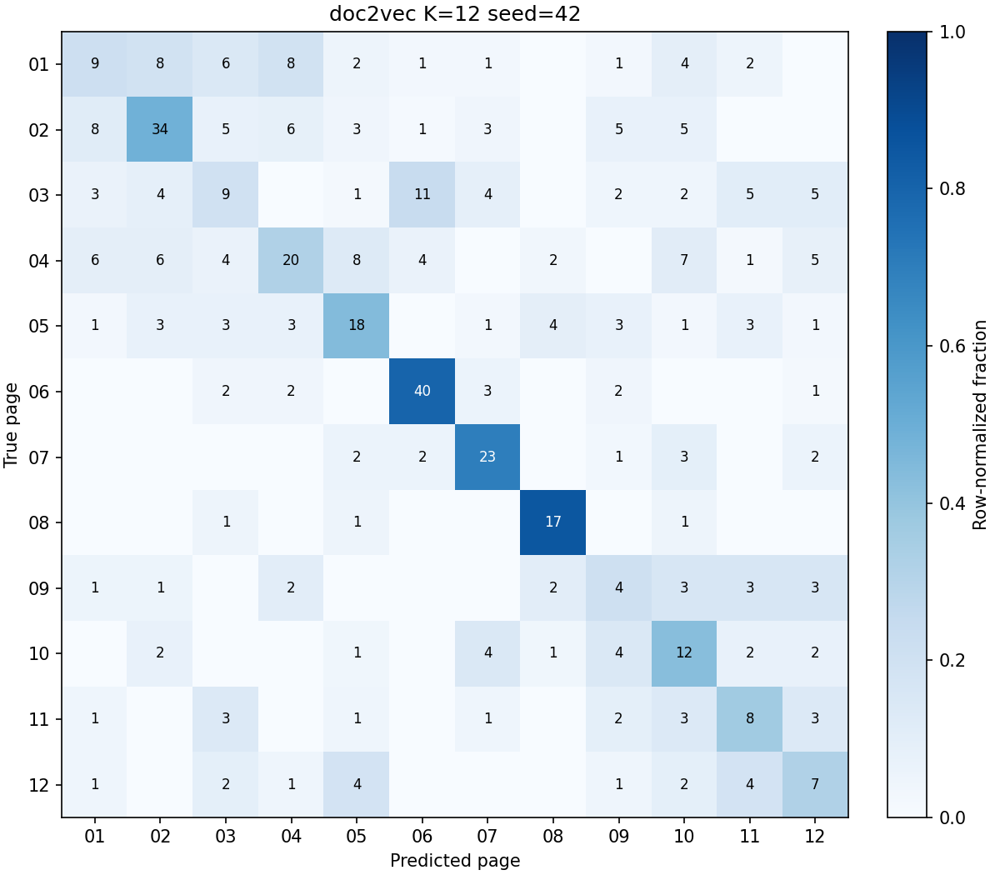

# 逐类指标与混淆矩阵

以下展示 seed 42 的主矩阵、选定配置和扩展实验。其他种子的完整逐类 PRF 与混淆矩阵在各运行 metrics_test.json 中；[实验汇总](实验汇总.csv)可定位运行。混淆矩阵行是真实版面、列是预测版面，图中色阶按行归一化，数字是文章数。

## 多数类 / 2 类 / main

[fd5188e929d7d007469f](../artifacts/runs/fd5188e929d7d007469f/spec.json)；[全部测试指标](../artifacts/runs/fd5188e929d7d007469f/metrics_test.json)。

| 版面 | Precision | Recall | F1 | Support |
| --- | --- | --- | --- | --- |
| 01 | 0.0000 | 0.0000 | 0.0000 | 42 |
| 02 | 0.6250 | 1.0000 | 0.7692 | 70 |

## TF-IDF / 2 类 / main

[88f043e05ceb4de2b111](../artifacts/runs/88f043e05ceb4de2b111/spec.json)；[全部测试指标](../artifacts/runs/88f043e05ceb4de2b111/metrics_test.json)。

| 版面 | Precision | Recall | F1 | Support |
| --- | --- | --- | --- | --- |
| 01 | 0.5714 | 0.4762 | 0.5195 | 42 |
| 02 | 0.7143 | 0.7857 | 0.7483 | 70 |

## LSI / 2 类 / main

[c04c3eeb6b7d82efd9df](../artifacts/runs/c04c3eeb6b7d82efd9df/spec.json)；[全部测试指标](../artifacts/runs/c04c3eeb6b7d82efd9df/metrics_test.json)。

| 版面 | Precision | Recall | F1 | Support |
| --- | --- | --- | --- | --- |
| 01 | 0.5273 | 0.6905 | 0.5979 | 42 |
| 02 | 0.7719 | 0.6286 | 0.6929 | 70 |

## Word2Vec / 2 类 / main

[2142e871fea6685414ec](../artifacts/runs/2142e871fea6685414ec/spec.json)；[全部测试指标](../artifacts/runs/2142e871fea6685414ec/metrics_test.json)。

| 版面 | Precision | Recall | F1 | Support |
| --- | --- | --- | --- | --- |
| 01 | 0.6087 | 0.6667 | 0.6364 | 42 |
| 02 | 0.7879 | 0.7429 | 0.7647 | 70 |

## Gensim FastText / 2 类 / main

[e003b93e0a773da2615d](../artifacts/runs/e003b93e0a773da2615d/spec.json)；[全部测试指标](../artifacts/runs/e003b93e0a773da2615d/metrics_test.json)。

| 版面 | Precision | Recall | F1 | Support |
| --- | --- | --- | --- | --- |
| 01 | 0.5128 | 0.4762 | 0.4938 | 42 |
| 02 | 0.6986 | 0.7286 | 0.7133 | 70 |

## 原生 FastText / 2 类 / main

[481c4bcd7518371cd3f3](../artifacts/runs/481c4bcd7518371cd3f3/spec.json)；[全部测试指标](../artifacts/runs/481c4bcd7518371cd3f3/metrics_test.json)。

| 版面 | Precision | Recall | F1 | Support |
| --- | --- | --- | --- | --- |
| 01 | 0.5000 | 0.0476 | 0.0870 | 42 |
| 02 | 0.6296 | 0.9714 | 0.7640 | 70 |

## 多数类 / 4 类 / main

[45f7df32b22d16c9cefc](../artifacts/runs/45f7df32b22d16c9cefc/spec.json)；[全部测试指标](../artifacts/runs/45f7df32b22d16c9cefc/metrics_test.json)。

| 版面 | Precision | Recall | F1 | Support |
| --- | --- | --- | --- | --- |
| 01 | 0.0000 | 0.0000 | 0.0000 | 42 |
| 02 | 0.3167 | 1.0000 | 0.4811 | 70 |
| 03 | 0.0000 | 0.0000 | 0.0000 | 46 |
| 04 | 0.0000 | 0.0000 | 0.0000 | 63 |

## TF-IDF / 4 类 / main

[f4b18ee85b7a8adebb0a](../artifacts/runs/f4b18ee85b7a8adebb0a/spec.json)；[全部测试指标](../artifacts/runs/f4b18ee85b7a8adebb0a/metrics_test.json)。

| 版面 | Precision | Recall | F1 | Support |
| --- | --- | --- | --- | --- |
| 01 | 0.4688 | 0.3571 | 0.4054 | 42 |
| 02 | 0.5897 | 0.6571 | 0.6216 | 70 |
| 03 | 0.6579 | 0.5435 | 0.5952 | 46 |
| 04 | 0.5479 | 0.6349 | 0.5882 | 63 |

## LSI / 4 类 / main

[b4d846954dbfccfd969f](../artifacts/runs/b4d846954dbfccfd969f/spec.json)；[全部测试指标](../artifacts/runs/b4d846954dbfccfd969f/metrics_test.json)。

| 版面 | Precision | Recall | F1 | Support |
| --- | --- | --- | --- | --- |
| 01 | 0.3750 | 0.3571 | 0.3659 | 42 |
| 02 | 0.6406 | 0.5857 | 0.6119 | 70 |
| 03 | 0.5745 | 0.5870 | 0.5806 | 46 |
| 04 | 0.5286 | 0.5873 | 0.5564 | 63 |

## Word2Vec / 4 类 / main

[7a5ddaf21431be9b1204](../artifacts/runs/7a5ddaf21431be9b1204/spec.json)；[全部测试指标](../artifacts/runs/7a5ddaf21431be9b1204/metrics_test.json)。

| 版面 | Precision | Recall | F1 | Support |
| --- | --- | --- | --- | --- |
| 01 | 0.3667 | 0.2619 | 0.3056 | 42 |
| 02 | 0.5844 | 0.6429 | 0.6122 | 70 |
| 03 | 0.5306 | 0.5652 | 0.5474 | 46 |
| 04 | 0.5077 | 0.5238 | 0.5156 | 63 |

## Gensim FastText / 4 类 / main

[e1a56e5aae57ae8fba98](../artifacts/runs/e1a56e5aae57ae8fba98/spec.json)；[全部测试指标](../artifacts/runs/e1a56e5aae57ae8fba98/metrics_test.json)。

| 版面 | Precision | Recall | F1 | Support |
| --- | --- | --- | --- | --- |
| 01 | 0.3103 | 0.2143 | 0.2535 | 42 |
| 02 | 0.5600 | 0.6000 | 0.5793 | 70 |
| 03 | 0.5000 | 0.6304 | 0.5577 | 46 |
| 04 | 0.4746 | 0.4444 | 0.4590 | 63 |

## 原生 FastText / 4 类 / main

[5aa8aef56a04e4860d3c](../artifacts/runs/5aa8aef56a04e4860d3c/spec.json)；[全部测试指标](../artifacts/runs/5aa8aef56a04e4860d3c/metrics_test.json)。

| 版面 | Precision | Recall | F1 | Support |
| --- | --- | --- | --- | --- |
| 01 | 1.0000 | 0.0238 | 0.0465 | 42 |
| 02 | 0.3367 | 0.9571 | 0.4981 | 70 |
| 03 | 0.0000 | 0.0000 | 0.0000 | 46 |
| 04 | 0.5714 | 0.1905 | 0.2857 | 63 |

## 多数类 / 8 类 / main

[567b3a8ad50ff6e50dbf](../artifacts/runs/567b3a8ad50ff6e50dbf/spec.json)；[全部测试指标](../artifacts/runs/567b3a8ad50ff6e50dbf/metrics_test.json)。

| 版面 | Precision | Recall | F1 | Support |
| --- | --- | --- | --- | --- |
| 01 | 0.0000 | 0.0000 | 0.0000 | 42 |
| 02 | 0.1918 | 1.0000 | 0.3218 | 70 |
| 03 | 0.0000 | 0.0000 | 0.0000 | 46 |
| 04 | 0.0000 | 0.0000 | 0.0000 | 63 |
| 05 | 0.0000 | 0.0000 | 0.0000 | 41 |
| 06 | 0.0000 | 0.0000 | 0.0000 | 50 |
| 07 | 0.0000 | 0.0000 | 0.0000 | 33 |
| 08 | 0.0000 | 0.0000 | 0.0000 | 20 |

## TF-IDF / 8 类 / main

[7ddf44770d1cd6ff9282](../artifacts/runs/7ddf44770d1cd6ff9282/spec.json)；[全部测试指标](../artifacts/runs/7ddf44770d1cd6ff9282/metrics_test.json)。

| 版面 | Precision | Recall | F1 | Support |
| --- | --- | --- | --- | --- |
| 01 | 0.3333 | 0.3095 | 0.3210 | 42 |
| 02 | 0.5867 | 0.6286 | 0.6069 | 70 |
| 03 | 0.4054 | 0.3261 | 0.3614 | 46 |
| 04 | 0.4930 | 0.5556 | 0.5224 | 63 |
| 05 | 0.6176 | 0.5122 | 0.5600 | 41 |
| 06 | 0.7778 | 0.7000 | 0.7368 | 50 |
| 07 | 0.6842 | 0.7879 | 0.7324 | 33 |
| 08 | 0.6538 | 0.8500 | 0.7391 | 20 |

## LSI / 8 类 / main

[0e21d676ed9dc1564acd](../artifacts/runs/0e21d676ed9dc1564acd/spec.json)；[全部测试指标](../artifacts/runs/0e21d676ed9dc1564acd/metrics_test.json)。

| 版面 | Precision | Recall | F1 | Support |
| --- | --- | --- | --- | --- |
| 01 | 0.2821 | 0.2619 | 0.2716 | 42 |
| 02 | 0.6338 | 0.6429 | 0.6383 | 70 |
| 03 | 0.4595 | 0.3696 | 0.4096 | 46 |
| 04 | 0.4898 | 0.3810 | 0.4286 | 63 |
| 05 | 0.5400 | 0.6585 | 0.5934 | 41 |
| 06 | 0.7826 | 0.7200 | 0.7500 | 50 |
| 07 | 0.5682 | 0.7576 | 0.6494 | 33 |
| 08 | 0.6207 | 0.9000 | 0.7347 | 20 |

## Word2Vec / 8 类 / main

[61097697ecd845dd74ee](../artifacts/runs/61097697ecd845dd74ee/spec.json)；[全部测试指标](../artifacts/runs/61097697ecd845dd74ee/metrics_test.json)。

| 版面 | Precision | Recall | F1 | Support |
| --- | --- | --- | --- | --- |
| 01 | 0.2683 | 0.2619 | 0.2651 | 42 |
| 02 | 0.5882 | 0.5714 | 0.5797 | 70 |
| 03 | 0.3846 | 0.3261 | 0.3529 | 46 |
| 04 | 0.3830 | 0.2857 | 0.3273 | 63 |
| 05 | 0.5250 | 0.5122 | 0.5185 | 41 |
| 06 | 0.7292 | 0.7000 | 0.7143 | 50 |
| 07 | 0.5000 | 0.8182 | 0.6207 | 33 |
| 08 | 0.6071 | 0.8500 | 0.7083 | 20 |

## Gensim FastText / 8 类 / main

[caf041d8cb61b8c12935](../artifacts/runs/caf041d8cb61b8c12935/spec.json)；[全部测试指标](../artifacts/runs/caf041d8cb61b8c12935/metrics_test.json)。

| 版面 | Precision | Recall | F1 | Support |
| --- | --- | --- | --- | --- |
| 01 | 0.2812 | 0.2143 | 0.2432 | 42 |
| 02 | 0.6379 | 0.5286 | 0.5781 | 70 |
| 03 | 0.4250 | 0.3696 | 0.3953 | 46 |
| 04 | 0.4310 | 0.3968 | 0.4132 | 63 |
| 05 | 0.4694 | 0.5610 | 0.5111 | 41 |
| 06 | 0.7000 | 0.7000 | 0.7000 | 50 |
| 07 | 0.5098 | 0.7879 | 0.6190 | 33 |
| 08 | 0.6667 | 0.9000 | 0.7660 | 20 |

## 原生 FastText / 8 类 / main

[580b2b8e3ce62975aa6f](../artifacts/runs/580b2b8e3ce62975aa6f/spec.json)；[全部测试指标](../artifacts/runs/580b2b8e3ce62975aa6f/metrics_test.json)。

| 版面 | Precision | Recall | F1 | Support |
| --- | --- | --- | --- | --- |
| 01 | 0.0000 | 0.0000 | 0.0000 | 42 |
| 02 | 0.5079 | 0.4571 | 0.4812 | 70 |
| 03 | 0.0000 | 0.0000 | 0.0000 | 46 |
| 04 | 0.1987 | 0.9524 | 0.3288 | 63 |
| 05 | 0.0000 | 0.0000 | 0.0000 | 41 |
| 06 | 0.0000 | 0.0000 | 0.0000 | 50 |
| 07 | 0.0000 | 0.0000 | 0.0000 | 33 |
| 08 | 0.0000 | 0.0000 | 0.0000 | 20 |

## 多数类 / 12 类 / main

[30f5eb4bd6347499987d](../artifacts/runs/30f5eb4bd6347499987d/spec.json)；[全部测试指标](../artifacts/runs/30f5eb4bd6347499987d/metrics_test.json)。

| 版面 | Precision | Recall | F1 | Support |
| --- | --- | --- | --- | --- |
| 01 | 0.0000 | 0.0000 | 0.0000 | 42 |
| 02 | 0.1535 | 1.0000 | 0.2662 | 70 |
| 03 | 0.0000 | 0.0000 | 0.0000 | 46 |
| 04 | 0.0000 | 0.0000 | 0.0000 | 63 |
| 05 | 0.0000 | 0.0000 | 0.0000 | 41 |
| 06 | 0.0000 | 0.0000 | 0.0000 | 50 |
| 07 | 0.0000 | 0.0000 | 0.0000 | 33 |
| 08 | 0.0000 | 0.0000 | 0.0000 | 20 |
| 09 | 0.0000 | 0.0000 | 0.0000 | 19 |
| 10 | 0.0000 | 0.0000 | 0.0000 | 28 |
| 11 | 0.0000 | 0.0000 | 0.0000 | 22 |
| 12 | 0.0000 | 0.0000 | 0.0000 | 22 |

## TF-IDF / 12 类 / main

[dd5ff942dae3958a19b0](../artifacts/runs/dd5ff942dae3958a19b0/spec.json)；[全部测试指标](../artifacts/runs/dd5ff942dae3958a19b0/metrics_test.json)。

| 版面 | Precision | Recall | F1 | Support |
| --- | --- | --- | --- | --- |
| 01 | 0.3158 | 0.2857 | 0.3000 | 42 |
| 02 | 0.5735 | 0.5571 | 0.5652 | 70 |
| 03 | 0.3750 | 0.2609 | 0.3077 | 46 |
| 04 | 0.4167 | 0.3175 | 0.3604 | 63 |
| 05 | 0.5128 | 0.4878 | 0.5000 | 41 |
| 06 | 0.7660 | 0.7200 | 0.7423 | 50 |
| 07 | 0.6190 | 0.7879 | 0.6933 | 33 |
| 08 | 0.6923 | 0.9000 | 0.7826 | 20 |
| 09 | 0.0833 | 0.1053 | 0.0930 | 19 |
| 10 | 0.4667 | 0.5000 | 0.4828 | 28 |
| 11 | 0.3125 | 0.4545 | 0.3704 | 22 |
| 12 | 0.3333 | 0.4545 | 0.3846 | 22 |

## LSI / 12 类 / main

[e721475d1839ad751b3a](../artifacts/runs/e721475d1839ad751b3a/spec.json)；[全部测试指标](../artifacts/runs/e721475d1839ad751b3a/metrics_test.json)。

| 版面 | Precision | Recall | F1 | Support |
| --- | --- | --- | --- | --- |
| 01 | 0.2143 | 0.2143 | 0.2143 | 42 |
| 02 | 0.6140 | 0.5000 | 0.5512 | 70 |
| 03 | 0.4167 | 0.3261 | 0.3659 | 46 |
| 04 | 0.4865 | 0.2857 | 0.3600 | 63 |
| 05 | 0.4667 | 0.5122 | 0.4884 | 41 |
| 06 | 0.8000 | 0.7200 | 0.7579 | 50 |
| 07 | 0.5581 | 0.7273 | 0.6316 | 33 |
| 08 | 0.7200 | 0.9000 | 0.8000 | 20 |
| 09 | 0.1154 | 0.1579 | 0.1333 | 19 |
| 10 | 0.4615 | 0.4286 | 0.4444 | 28 |
| 11 | 0.1463 | 0.2727 | 0.1905 | 22 |
| 12 | 0.2727 | 0.4091 | 0.3273 | 22 |

## Word2Vec / 12 类 / main

[21a62cc1c065734b4a1c](../artifacts/runs/21a62cc1c065734b4a1c/spec.json)；[全部测试指标](../artifacts/runs/21a62cc1c065734b4a1c/metrics_test.json)。

| 版面 | Precision | Recall | F1 | Support |
| --- | --- | --- | --- | --- |
| 01 | 0.3030 | 0.2381 | 0.2667 | 42 |
| 02 | 0.5893 | 0.4714 | 0.5238 | 70 |
| 03 | 0.3333 | 0.2826 | 0.3059 | 46 |
| 04 | 0.3953 | 0.2698 | 0.3208 | 63 |
| 05 | 0.5278 | 0.4634 | 0.4935 | 41 |
| 06 | 0.7000 | 0.7000 | 0.7000 | 50 |
| 07 | 0.5000 | 0.7273 | 0.5926 | 33 |
| 08 | 0.5333 | 0.8000 | 0.6400 | 20 |
| 09 | 0.0952 | 0.1053 | 0.1000 | 19 |
| 10 | 0.2895 | 0.3929 | 0.3333 | 28 |
| 11 | 0.2000 | 0.3182 | 0.2456 | 22 |
| 12 | 0.3333 | 0.4091 | 0.3673 | 22 |

## Gensim FastText / 12 类 / main

[fba706f76965ee24f1a3](../artifacts/runs/fba706f76965ee24f1a3/spec.json)；[全部测试指标](../artifacts/runs/fba706f76965ee24f1a3/metrics_test.json)。

| 版面 | Precision | Recall | F1 | Support |
| --- | --- | --- | --- | --- |
| 01 | 0.2121 | 0.1667 | 0.1867 | 42 |
| 02 | 0.5789 | 0.4714 | 0.5197 | 70 |
| 03 | 0.3871 | 0.2609 | 0.3117 | 46 |
| 04 | 0.3111 | 0.2222 | 0.2593 | 63 |
| 05 | 0.4390 | 0.4390 | 0.4390 | 41 |
| 06 | 0.7091 | 0.7800 | 0.7429 | 50 |
| 07 | 0.4681 | 0.6667 | 0.5500 | 33 |
| 08 | 0.6000 | 0.9000 | 0.7200 | 20 |
| 09 | 0.1667 | 0.1579 | 0.1622 | 19 |
| 10 | 0.3333 | 0.4643 | 0.3881 | 28 |
| 11 | 0.1818 | 0.2727 | 0.2182 | 22 |
| 12 | 0.2593 | 0.3182 | 0.2857 | 22 |

## 原生 FastText / 12 类 / main

[feaaadb72d3d1c5fcaf1](../artifacts/runs/feaaadb72d3d1c5fcaf1/spec.json)；[全部测试指标](../artifacts/runs/feaaadb72d3d1c5fcaf1/metrics_test.json)。

| 版面 | Precision | Recall | F1 | Support |
| --- | --- | --- | --- | --- |
| 01 | 0.0000 | 0.0000 | 0.0000 | 42 |
| 02 | 0.0000 | 0.0000 | 0.0000 | 70 |
| 03 | 0.0000 | 0.0000 | 0.0000 | 46 |
| 04 | 0.1382 | 1.0000 | 0.2428 | 63 |
| 05 | 0.0000 | 0.0000 | 0.0000 | 41 |
| 06 | 0.0000 | 0.0000 | 0.0000 | 50 |
| 07 | 0.0000 | 0.0000 | 0.0000 | 33 |
| 08 | 0.0000 | 0.0000 | 0.0000 | 20 |
| 09 | 0.0000 | 0.0000 | 0.0000 | 19 |
| 10 | 0.0000 | 0.0000 | 0.0000 | 28 |
| 11 | 0.0000 | 0.0000 | 0.0000 | 22 |
| 12 | 0.0000 | 0.0000 | 0.0000 | 22 |

## Gensim FastText / 12 类 / selected

[a916caeaf8d45e22c250](../artifacts/runs/a916caeaf8d45e22c250/spec.json)；[全部测试指标](../artifacts/runs/a916caeaf8d45e22c250/metrics_test.json)。

| 版面 | Precision | Recall | F1 | Support |
| --- | --- | --- | --- | --- |
| 01 | 0.2353 | 0.1905 | 0.2105 | 42 |
| 02 | 0.5645 | 0.5000 | 0.5303 | 70 |
| 03 | 0.4118 | 0.3043 | 0.3500 | 46 |
| 04 | 0.3409 | 0.2381 | 0.2804 | 63 |
| 05 | 0.4000 | 0.3902 | 0.3951 | 41 |
| 06 | 0.7091 | 0.7800 | 0.7429 | 50 |
| 07 | 0.5111 | 0.6970 | 0.5897 | 33 |
| 08 | 0.5806 | 0.9000 | 0.7059 | 20 |
| 09 | 0.1429 | 0.1053 | 0.1212 | 19 |
| 10 | 0.3023 | 0.4643 | 0.3662 | 28 |
| 11 | 0.2593 | 0.3182 | 0.2857 | 22 |
| 12 | 0.2593 | 0.3182 | 0.2857 | 22 |

## 原生 FastText / 12 类 / selected

[51e05bcfa3e63d1d43e4](../artifacts/runs/51e05bcfa3e63d1d43e4/spec.json)；[全部测试指标](../artifacts/runs/51e05bcfa3e63d1d43e4/metrics_test.json)。

| 版面 | Precision | Recall | F1 | Support |
| --- | --- | --- | --- | --- |
| 01 | 0.0000 | 0.0000 | 0.0000 | 42 |
| 02 | 0.2873 | 0.7429 | 0.4143 | 70 |
| 03 | 0.1667 | 0.0217 | 0.0385 | 46 |
| 04 | 0.2989 | 0.4127 | 0.3467 | 63 |
| 05 | 0.0000 | 0.0000 | 0.0000 | 41 |
| 06 | 0.4301 | 0.8000 | 0.5594 | 50 |
| 07 | 0.1429 | 0.0303 | 0.0500 | 33 |
| 08 | 0.0000 | 0.0000 | 0.0000 | 20 |
| 09 | 0.0000 | 0.0000 | 0.0000 | 19 |
| 10 | 0.0000 | 0.0000 | 0.0000 | 28 |
| 11 | 0.3333 | 0.2273 | 0.2703 | 22 |
| 12 | 0.1846 | 0.5455 | 0.2759 | 22 |

## TF-IDF / 12 类 / expanded

[3781d9efc5ade9173b41](../artifacts/runs/3781d9efc5ade9173b41/spec.json)；[全部测试指标](../artifacts/runs/3781d9efc5ade9173b41/metrics_test.json)。

| 版面 | Precision | Recall | F1 | Support |
| --- | --- | --- | --- | --- |
| 01 | 0.4979 | 0.3893 | 0.4369 | 298 |
| 02 | 0.5476 | 0.4530 | 0.4958 | 457 |
| 03 | 0.5139 | 0.4327 | 0.4698 | 342 |
| 04 | 0.6256 | 0.3669 | 0.4625 | 387 |
| 05 | 0.5141 | 0.6281 | 0.5654 | 320 |
| 06 | 0.6443 | 0.7641 | 0.6991 | 301 |
| 07 | 0.5791 | 0.6680 | 0.6204 | 241 |
| 08 | 0.6468 | 0.8579 | 0.7376 | 190 |
| 09 | 0.3655 | 0.4211 | 0.3913 | 171 |
| 10 | 0.4059 | 0.5000 | 0.4480 | 194 |
| 11 | 0.2475 | 0.2692 | 0.2579 | 182 |
| 12 | 0.1961 | 0.2778 | 0.2299 | 108 |

## Gensim FastText / 12 类 / expanded

[4a7484ae6159fc10dcab](../artifacts/runs/4a7484ae6159fc10dcab/spec.json)；[全部测试指标](../artifacts/runs/4a7484ae6159fc10dcab/metrics_test.json)。

| 版面 | Precision | Recall | F1 | Support |
| --- | --- | --- | --- | --- |
| 01 | 0.4810 | 0.3389 | 0.3976 | 298 |
| 02 | 0.5348 | 0.4376 | 0.4813 | 457 |
| 03 | 0.4563 | 0.3363 | 0.3872 | 342 |
| 04 | 0.5777 | 0.3075 | 0.4013 | 387 |
| 05 | 0.4628 | 0.5437 | 0.5000 | 320 |
| 06 | 0.6010 | 0.7608 | 0.6716 | 301 |
| 07 | 0.4953 | 0.6556 | 0.5643 | 241 |
| 08 | 0.6488 | 0.8263 | 0.7269 | 190 |
| 09 | 0.3167 | 0.4094 | 0.3571 | 171 |
| 10 | 0.3591 | 0.4794 | 0.4106 | 194 |
| 11 | 0.2704 | 0.2912 | 0.2804 | 182 |
| 12 | 0.2194 | 0.3148 | 0.2586 | 108 |

## 原生 FastText / 12 类 / expanded

[91607d6374ff595cc7a3](../artifacts/runs/91607d6374ff595cc7a3/spec.json)；[全部测试指标](../artifacts/runs/91607d6374ff595cc7a3/metrics_test.json)。

| 版面 | Precision | Recall | F1 | Support |
| --- | --- | --- | --- | --- |
| 01 | 0.4787 | 0.4530 | 0.4655 | 298 |
| 02 | 0.5519 | 0.4770 | 0.5117 | 457 |
| 03 | 0.3830 | 0.4357 | 0.4077 | 342 |
| 04 | 0.5015 | 0.4367 | 0.4669 | 387 |
| 05 | 0.5315 | 0.6062 | 0.5664 | 320 |
| 06 | 0.6201 | 0.7375 | 0.6737 | 301 |
| 07 | 0.6463 | 0.6141 | 0.6298 | 241 |
| 08 | 0.6381 | 0.7053 | 0.6700 | 190 |
| 09 | 0.3182 | 0.2865 | 0.3015 | 171 |
| 10 | 0.4241 | 0.4175 | 0.4208 | 194 |
| 11 | 0.2489 | 0.3022 | 0.2730 | 182 |
| 12 | 0.2833 | 0.1574 | 0.2024 | 108 |

## Doc2Vec / 2 类 / main

[163aebda3743de858878](../artifacts/runs/163aebda3743de858878/spec.json)；[全部测试指标](../artifacts/runs/163aebda3743de858878/metrics_test.json)。

| 版面 | Precision | Recall | F1 | Support |
| --- | --- | --- | --- | --- |
| 01 | 0.5556 | 0.7143 | 0.6250 | 42 |
| 02 | 0.7931 | 0.6571 | 0.7188 | 70 |

## Doc2Vec / 4 类 / main

[dbad75d7be0e5c91f1fa](../artifacts/runs/dbad75d7be0e5c91f1fa/spec.json)；[全部测试指标](../artifacts/runs/dbad75d7be0e5c91f1fa/metrics_test.json)。

| 版面 | Precision | Recall | F1 | Support |
| --- | --- | --- | --- | --- |
| 01 | 0.3611 | 0.3095 | 0.3333 | 42 |
| 02 | 0.6197 | 0.6286 | 0.6241 | 70 |
| 03 | 0.4151 | 0.4783 | 0.4444 | 46 |
| 04 | 0.5082 | 0.4921 | 0.5000 | 63 |

## Doc2Vec / 8 类 / main

[a28e2127abe426af27c4](../artifacts/runs/a28e2127abe426af27c4/spec.json)；[全部测试指标](../artifacts/runs/a28e2127abe426af27c4/metrics_test.json)。

| 版面 | Precision | Recall | F1 | Support |
| --- | --- | --- | --- | --- |
| 01 | 0.2703 | 0.2381 | 0.2532 | 42 |
| 02 | 0.5541 | 0.5857 | 0.5694 | 70 |
| 03 | 0.2973 | 0.2391 | 0.2651 | 46 |
| 04 | 0.4167 | 0.3175 | 0.3604 | 63 |
| 05 | 0.4894 | 0.5610 | 0.5227 | 41 |
| 06 | 0.6792 | 0.7200 | 0.6990 | 50 |
| 07 | 0.5476 | 0.6970 | 0.6133 | 33 |
| 08 | 0.6296 | 0.8500 | 0.7234 | 20 |

## Doc2Vec / 12 类 / main

[12cc279c9977f3a877e5](../artifacts/runs/12cc279c9977f3a877e5/spec.json)；[全部测试指标](../artifacts/runs/12cc279c9977f3a877e5/metrics_test.json)。

| 版面 | Precision | Recall | F1 | Support |
| --- | --- | --- | --- | --- |
| 01 | 0.3000 | 0.2143 | 0.2500 | 42 |
| 02 | 0.5862 | 0.4857 | 0.5312 | 70 |
| 03 | 0.2571 | 0.1957 | 0.2222 | 46 |
| 04 | 0.4762 | 0.3175 | 0.3810 | 63 |
| 05 | 0.4390 | 0.4390 | 0.4390 | 41 |
| 06 | 0.6780 | 0.8000 | 0.7339 | 50 |
| 07 | 0.5750 | 0.6970 | 0.6301 | 33 |
| 08 | 0.6538 | 0.8500 | 0.7391 | 20 |
| 09 | 0.1600 | 0.2105 | 0.1818 | 19 |
| 10 | 0.2791 | 0.4286 | 0.3380 | 28 |
| 11 | 0.2857 | 0.3636 | 0.3200 | 22 |
| 12 | 0.2414 | 0.3182 | 0.2745 | 22 |

